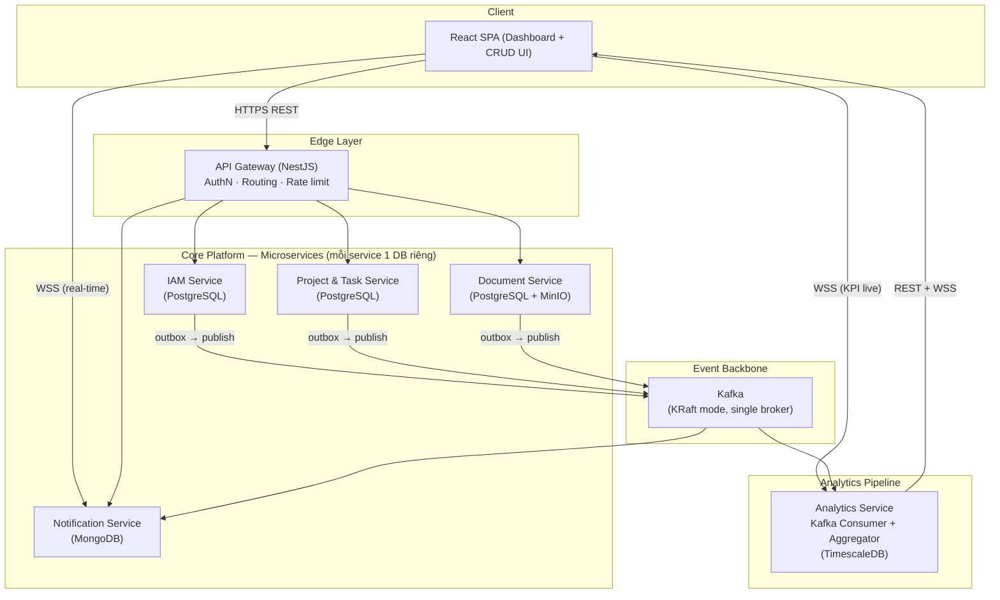
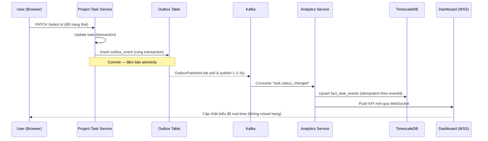

# Technical Specification — Enterprise Collaboration & Analytics Platform for SMEs

> Trạng thái: **ĐÃ TRIỂN KHAI** — mô tả kiến trúc/hệ thống đã lập trình cho §1–§25, đã xác minh sống
> cho §1–§21 và §23–§25; §22 (Inventory Service) đã xác minh tĩnh (`typecheck`/`lint`/`test` sạch
> toàn workspace) nhưng CHƯA xác minh sống qua Gateway thật — xem §22.8. §23 (Chat bot nội bộ RAG +
> tool-calling, 24/10/2026) đã triển khai, khác kế hoạch ban đầu ở vài điểm ghi rõ tại §23.2; §25
> (giảm tải RAM Docker, 24/10/2026). §26 (CDC Debezium, profile tuỳ chọn `cdc`, 25/10/2026) đã
> triển khai và xác minh sống dưới tải. Dữ liệu kiểm thử tái sử dụng: `Mock_data.md`. Phần cố ý chưa
> triển khai (forecasting ML, Layer 4/6 của §19) được đánh dấu rõ tại chỗ và theo dõi thêm ở
> `Upgrade.md`. Chi tiết lịch sử đầy đủ: xem `RevisionHistory.md`.

**Tài liệu liên quan:** [General_idea.md](General_idea.md) · [Wireframe.md](Wireframe.md)
**Ngày khởi tạo:** 18/07/2026
**Múi giờ chuẩn hệ thống:** GMT+7 (Asia/Ho_Chi_Minh) — mọi timestamp lưu ở DB dưới dạng UTC, quy đổi sang GMT+7 khi hiển thị ở tầng frontend/API response.

---

## 1. Kiến trúc tổng thể

Hệ thống gồm hai trụ cột liên kết qua một **event backbone** (Kafka): **Core Platform** (các microservice CRUD nghiệp vụ) và **Analytics Pipeline** (thu thập — xử lý — hiển thị dữ liệu).



**Nguyên tắc kiến trúc áp dụng:**
- **Database-per-service:** mỗi service sở hữu schema/DB riêng, không service nào truy vấn trực tiếp DB của service khác.
- **API Gateway là điểm vào duy nhất** cho client; các service không public trực tiếp ra ngoài internet.
- **Giao tiếp đồng bộ (REST)** dùng cho Gateway → Service (yêu cầu — phản hồi ngay).
- **Giao tiếp bất đồng bộ (Kafka event)** dùng cho lan truyền thay đổi trạng thái sang Analytics/Notification — tách rời (decoupling) giữa nơi sinh dữ liệu và nơi tiêu thụ dữ liệu.
- **Đa người thuê (multi-tenant), mô hình shared-schema:** mọi bảng nghiệp vụ có cột `organization_id`; mọi truy vấn được lọc theo tenant ở tầng middleware/service.

## 2. Công nghệ sử dụng (Tech Stack)

| Thành phần | Công nghệ lựa chọn | Lý do |
|---|---|---|
| Backend framework | **Node.js + NestJS (TypeScript)** | Kiến trúc module hóa sẵn có, hỗ trợ tốt cho microservices, cùng ngôn ngữ với frontend giúp giảm chi phí chuyển ngữ cảnh cho 1 sinh viên |
| Frontend | **React 18 + TypeScript + Vite** | Hệ sinh thái lớn, nhiều thư viện chart, tốc độ dev nhanh |
| UI styling | TailwindCSS + shadcn/ui | Xây UI nhanh, nhất quán, ít viết CSS thủ công |
| State/data fetching | TanStack Query (React Query) + Zustand | Quản lý cache API và state cục bộ tách biệt rõ ràng |
| Chart/Visualization | Recharts (hoặc ECharts cho biểu đồ phức tạp hơn) | Component React thuần, tài liệu phong phú |
| OLTP Database (IAM, Project-Task, Document) | **PostgreSQL 16** | Quan hệ mạnh, transaction ACID, phù hợp dữ liệu nghiệp vụ cốt lõi |
| Document store (Notification) | **MongoDB** | Schema linh hoạt, ghi nhanh, phù hợp dữ liệu thông báo bán cấu trúc — minh họa polyglot persistence |
| Analytics Database | **TimescaleDB** (extension của PostgreSQL) | Tối ưu cho dữ liệu time-series/hypertable, hỗ trợ continuous aggregate cho rollup theo ngày/tuần, vẫn dùng SQL quen thuộc |
| Object Storage | **MinIO** (S3-compatible) | Lưu file nhị phân (tài liệu upload), tương thích API S3, tự host được trong Docker |
| Message Broker | **Apache Kafka** (KRaft mode, không cần Zookeeper) | Event backbone có khả năng replay, phù hợp bài toán phân tích/xu hướng theo thời gian |
| Cache / Session / Rate-limit | **Redis** | Lưu refresh-token blacklist, cache truy vấn nóng, Socket.IO adapter |
| Real-time transport | **Socket.IO** (qua NestJS Gateway) | Đẩy notification và KPI real-time tới client |
| API Documentation | **Swagger/OpenAPI** (`@nestjs/swagger`) | Tự sinh tài liệu từ decorator, chi phí thấp |
| Containerization | **Docker + Docker Compose** | Đóng gói và chạy toàn hệ thống bằng một lệnh, đúng yêu cầu đề tài |
| CI | **GitHub Actions** (lint, test, build, docker build) | Miễn phí, tích hợp sẵn với GitHub |
| Testing | **Jest** (unit), **Supertest** (integration cơ bản) | Tích hợp sẵn trong NestJS |
| Quản lý mã nguồn | **Monorepo** (npm workspaces hoặc Turborepo) | 1 sinh viên quản lý nhiều service — monorepo giảm chi phí đồng bộ version, chia sẻ package `common` (DTO, event schema, guard dùng chung) |

## 3. Danh sách service chi tiết

### 3.1 API Gateway
- **Trách nhiệm:** điểm vào duy nhất; xác thực JWT (verify chữ ký, không gọi lại IAM cho mỗi request); định tuyến REST tới service tương ứng; forward WebSocket handshake tới Notification/Analytics Service; áp rate limiting cơ bản (theo người dùng khi đã xác thực, theo IP khi chưa — đổi 24/10/2026, xem §8); tổng hợp Swagger từ các service con.
- **Không có DB riêng** (stateless), chỉ dùng Redis để cache blacklist token.

### 3.2 IAM Service
- **Trách nhiệm:** đăng ký tổ chức (organization) mới, đăng ký/đăng nhập user, quản lý Department, quản lý Role/Permission (RBAC), phát hành/refresh JWT.
- **Entity chính:** `Organization`, `User`, `Department`, `Role`, `Permission`, `RolePermission`, `RefreshToken`, `OutboxEvent`.
- **Event phát ra:** `iam.organization.registered`, `iam.user.registered`, `iam.user.deactivated`.

### 3.3 Project & Task Service
- **Trách nhiệm:** CRUD Project, CRUD Task, board Kanban (`TODO` → `DOING` → `DONE`), gán người thực hiện, comment trên task, lưu lịch sử đổi trạng thái (phục vụ modal chi tiết Task ở Wireframe §4.2).
- **Entity chính:** `Project`, `Task`, `TaskComment`, `TaskAssignee`, `TaskStatusHistory`, `OutboxEvent`.
- **Event phát ra:** `task.created`, `task.status_changed`, `task.assigned`, `task.deleted`, `project.created`, `project.completed`, `project.deleted`.
- **Lưu ý (điều chỉnh 21/07/2026):** bổ sung sự kiện `task.deleted`/`project.deleted` để Analytics không đếm nhầm entity đã bị xóa cứng; `TaskStatusHistory` ghi lại mỗi lần đổi trạng thái (cùng transaction với `Task.status` và Outbox), phục vụ trực tiếp yêu cầu "lịch sử thay đổi trạng thái" trong Wireframe §4.2.
- **Frontend — sắp xếp tuỳ chỉnh danh sách Dự án (bổ sung 25/08/2026, đóng góp của Nguyễn Lê Tiến, nhánh `frontend`):** `ProjectsListPage.tsx` cho phép kéo-thả đổi thứ tự thẻ dự án (thứ tự lưu trong `localStorage`, khoá `ec_projects_custom_order`), lọc theo độ ưu tiên (`priorityFilter`), và luôn gom nhóm dự án `COMPLETED` xuống cuối danh sách bất kể thứ tự tuỳ chỉnh. Hoàn toàn ở tầng client, không thêm field/endpoint backend nào.
- **Điều chỉnh 26/08/2026 (rà soát lần 4):** `priority`/`leadUserId` — trước đó chỉ lưu `localStorage['ec_projects_metadata']` từng trình duyệt (vô hình với thành viên khác) — nay là cột thật trên entity `Project` (`priority: ProjectPriority` enum LOW/MEDIUM/HIGH/URGENT mặc định MEDIUM, `leadUserId` uuid nullable), có trong `CreateProjectDto`/`UpdateProjectDto`, trả về trong response như mọi field khác. Bộ lọc `priorityFilter` ở `ProjectsListPage.tsx` vẫn lọc phía client (giới hạn đã biết: chỉ lọc trong phạm vi 1 trang server-paginated, xem `Doc/RevisionHistory.md` mục "26/08/2026").

### 3.4 Document Service
- **Trách nhiệm:** CRUD Folder/File (metadata trong PostgreSQL, nội dung nhị phân trong MinIO), chia sẻ nội bộ theo user/phòng ban, versioning đơn giản (giữ tối đa N bản gần nhất mỗi file).
- **Entity chính:** `Folder`, `FileMeta`, `FileVersion`, `FileShare`, `OutboxEvent`.
- **Event phát ra:** `document.uploaded`, `document.shared`, `document.deleted`.
- **Lưu trữ (điều chỉnh 21/07/2026):** bucket MinIO cấu hình **private** (không bật anonymous/public download); mọi truy cập tải file bắt buộc đi qua presigned URL có thời hạn ngắn (mặc định 15 phút) do Document Service cấp sau khi đã xác thực `organizationId` của người gọi.
- **Phạm vi `FileShare`/access-control (điều chỉnh 21/07/2026, nâng cấp thành access-control thực sự 28/07/2026):** mặc định (`Folder.visibility = 'organization'`) vẫn giữ nguyên hành vi MVP — mọi thành viên tổ chức xem/tải được mọi tài liệu, **không đổi hành vi của dữ liệu đã có** (opt-in). Người tạo thư mục (hoặc Org Admin) có thể chuyển 1 thư mục cụ thể sang `visibility = 'restricted'`: khi đó chỉ người tạo, Org Admin, hoặc người/phòng ban được cấp quyền tường minh qua `FolderShare` (bảng mới) mới thấy được thư mục đó và các tệp bên trong. `FileShare` (tệp lẻ, không đổi tên) giờ cũng là 1 đường cấp quyền TRUY CẬP THỰC SỰ (không chỉ gắn nhãn hiển thị) cho MỘT tệp cụ thể — dùng cho trường hợp "có link trực tiếp tới 1 tệp trong thư mục hạn chế mà không cần thấy được cả thư mục". Cả `FolderShare` lẫn `FileShare` đều chấp nhận đích là 1 người dùng (`sharedWithUserId`) HOẶC 1 phòng ban (`sharedWithDepartmentId`, mới) — chi tiết đầy đủ xem §6 và §14. **Cập nhật 24/10/2026:** hạn chế nay kế thừa xuống mọi cấp thư mục con — thư mục con thường nằm trong thư mục `restricted` trước đây bị bỏ sót (mở cho mọi người); quy tắc mới đi ngược lên các thư mục cha, xem §23.3.

### 3.5 Notification Service
- **Trách nhiệm:** tiêu thụ sự kiện từ Kafka (từ IAM, Project-Task, Document), sinh notification tương ứng, lưu MongoDB, đẩy real-time qua WebSocket tới user liên quan, đánh dấu đã đọc/chưa đọc.
- **Entity chính (MongoDB collection):** `notifications` `{ _id, eventId, organizationId, userId, type, payload, isRead, createdAt }` — trường `eventId` có unique index, dùng để chống trùng khi Outbox publish lại cùng một sự kiện (điều chỉnh 21/07/2026, xem §4.1).
- **Không phát Outbox event** (là consumer cuối chuỗi, không kích hoạt nghiệp vụ khác).
- **(Bổ sung 28/07/2026) Module `failed-events`:** collection MongoDB riêng `failed_events`, populate qua 1 Kafka consumer độc lập đọc topic `domain-events.dlq` (xem §4.5) — service này đóng vai trò "nơi lưu trữ tập trung" cho Dead Letter Queue của toàn nền tảng, không chỉ riêng sự kiện của chính nó.

### 3.6 Analytics Service
- **Trách nhiệm:** tiêu thụ toàn bộ sự kiện từ Kafka, tổng hợp theo thời gian thực (increment counter) và theo lô (rollup ngày/tuần qua continuous aggregate của TimescaleDB), expose REST API cho truy vấn KPI lịch sử và WebSocket cho cập nhật KPI trực tiếp.
- **Entity chính:** hypertable `fact_task_events`, `fact_document_events`, `fact_user_activity`; continuous aggregate `daily_task_summary`, `weekly_project_progress`.
- **Không phát Outbox event.**

> **Ghi chú (mở rộng):** HRM-lite Service và CRM-lite Service (nếu triển khai ở Phase 2) sẽ theo đúng khuôn mẫu trên: sở hữu DB riêng, ghi Outbox, phát event vào cùng Kafka cluster để Analytics Service tiêu thụ mà không cần thay đổi kiến trúc.

## 4. Kiến trúc hướng sự kiện (Event-Driven Architecture)

### 4.1 Outbox Pattern
Mỗi service nghiệp vụ (IAM, Project-Task, Document) ghi bản ghi sự kiện vào bảng `outbox_events` **trong cùng transaction** với thay đổi dữ liệu nghiệp vụ, đảm bảo tính nguyên tử nội bộ service (tránh vấn đề dual-write). Một worker nội bộ (`OutboxPublisherJob`, chạy định kỳ mỗi 2–3 giây trong chính service) poll các bản ghi `published = false`, publish lên Kafka, sau đó đánh dấu `published = true`.

- **Ưu điểm:** đơn giản, không cần hạ tầng bổ sung, triển khai được trong thời gian 1 học kỳ.
- **Giới hạn đã biết:** độ trễ vài giây (không phải true CDC); nếu worker crash giữa lúc publish có thể phát trùng sự kiện (chấp nhận được vì **mọi consumer** — cả Analytics Service lẫn Notification Service — xử lý theo kiểu idempotent bằng `eventId`; xem yêu cầu cụ thể ở §3.5/§3.6).
- **Hướng nâng cấp (ngoài phạm vi MVP):** thay bằng Debezium đọc trực tiếp WAL của PostgreSQL (CDC thực thụ), loại bỏ độ trễ polling. *(Cập nhật 25/10/2026: đã có bản CDC cho `project-task-service` dưới dạng profile tuỳ chọn `cdc` — Outbox polling vẫn là chế độ mặc định, xem §26.)*

### 4.2 Chuẩn đặt tên Kafka topic
Dùng ít topic (theo bounded context sinh sự kiện) kèm trường `eventType` để phân loại bên trong message, giảm chi phí vận hành cho 1 broker:

| Topic | Producer | Consumer |
|---|---|---|
| `iam.events` | IAM Service | Analytics Service, Notification Service |
| `project-task.events` | Project & Task Service | Analytics Service, Notification Service |
| `document.events` | Document Service | Analytics Service, Notification Service |
| `domain-events.dlq` | Analytics Service, Notification Service *(bổ sung 28/07/2026)* | Notification Service (consumer riêng, xem §4.5) |

### 4.3 Schema sự kiện chuẩn (JSON)

```json
{
  "eventId": "b3f1c2d4-...-uuid",
  "eventType": "task.status_changed",
  "occurredAt": "2026-07-18T09:30:00.000Z",
  "organizationId": "org-uuid",
  "producer": "project-task-service",
  "payload": {
    "taskId": "task-uuid",
    "projectId": "project-uuid",
    "fromStatus": "DOING",
    "toStatus": "DONE",
    "actorId": "user-uuid"
  }
}
```

`occurredAt` luôn lưu dưới dạng ISO-8601 UTC; tầng hiển thị (Dashboard) quy đổi sang GMT+7.

### 4.5 Dead Letter Queue *(bổ sung 28/07/2026)*

Trước đây (xem §14, mục đã gỡ bỏ) một event xử lý thất bại chỉ có 2 kết cục: lỗi dữ liệu vĩnh viễn (payload sai định dạng) bị log rồi **mất hẳn**, hoặc lỗi hạ tầng tạm thời khiến Kafka **redeliver mãi mãi** cùng một message (có thể wedge cả partition nếu lỗi không tự khỏi). Cả hai đều là chỗ hổng vận hành thực sự cho một hệ thống hướng sự kiện.

- **Giới hạn số lần thử lại:** `KafkaConsumerService` của Analytics Service và Notification Service theo dõi số lần thất bại liên tiếp theo `eventId` (`Map` trong bộ nhớ, giới hạn 5 lần). Vượt quá 5 lần, thay vì tiếp tục rethrow, service tự phát ("republish") message + thông tin lỗi vào topic `domain-events.dlq`. **Giới hạn đã biết:** bộ đếm nằm trong bộ nhớ tiến trình — nếu service khởi động lại giữa chừng, một message đang bị kẹt sẽ được cấp lại đủ 5 lượt thử từ đầu; chấp nhận được ở quy mô đồ án, không dùng Redis/DB để giữ bền bộ đếm này.
- **Lỗi dữ liệu vĩnh viễn** (mã lỗi Postgres `22P02`/`23502`/`23503` ở Analytics Service; lỗi Mongoose permanent ở Notification Service) và **envelope không hợp lệ**/**JSON không parse được** giờ đều được đẩy vào `domain-events.dlq` ngay lập tức (không cần đợi hết lượt retry, vì retry lại chắc chắn thất bại y hệt) thay vì chỉ log-và-mất.
- **Schema DLQ** (`DeadLetterEnvelope`, `packages/common-dto`): `eventId`/`eventType`/`organizationId` (có thể `null` nếu lỗi xảy ra trước khi đọc được các trường này), `sourceService`, `sourceTopic`, `errorType` (`MALFORMED_JSON`/`INVALID_ENVELOPE`/`PERMANENT_DATA_ERROR`/`RETRY_EXHAUSTED`), `errorMessage`, `attempts`, `rawPayload`, `failedAt`.
- **Lưu trữ & hiển thị:** Notification Service có một Kafka consumer **riêng** (group `notification-service-dlq-group`, tách biệt hoàn toàn khỏi consumer đọc 3 topic domain event gốc — tránh 2 luồng xử lý khác nhau tranh nhau cùng 1 group/partition) chỉ đọc topic `domain-events.dlq`, lưu vào MongoDB collection `failed_events`. Endpoint `GET /api/v1/failed-events` (module `failed-events`, quyền `system:manage` — chỉ Org Admin) hiển thị danh sách này tại Quản trị > "Sự kiện lỗi hệ thống" — **chỉ đọc**, không có thao tác "thử lại" (replay) trong phạm vi bổ sung này.
- **(Sửa 28/07/2026, phát hiện qua đợt "ultimate check" toàn hệ thống) Phạm vi hiển thị `organizationId = null`:** endpoint trên lọc theo `organizationId` của người gọi **CỘNG THÊM** mọi bản ghi có `organizationId = null` (lỗi `MALFORMED_JSON` — xảy ra ngay từ khâu đọc JSON, trước khi hệ thống kịp đọc được `organizationId` từ message gốc, nên không thể gán cho tổ chức nào). Trước fix này, các bản ghi `organizationId = null` **vĩnh viễn vô hình** với mọi Org Admin (chỉ xem được qua truy vấn thẳng vào MongoDB) — nhóm lỗi hạ tầng nghiêm trọng nhất lại là nhóm duy nhất không ai xem được qua giao diện, đi ngược mục tiêu ban đầu của tính năng này. Vì hệ thống không có khái niệm "System Admin" toàn nền tảng (mỗi Org Admin chỉ thuộc 1 tổ chức), đánh đổi được chấp nhận: cho mọi Org Admin thấy các bản ghi không xác định được tổ chức (FE gắn nhãn "Không xác định tổ chức", cột "Phạm vi" mới trong bảng) — đây là dữ liệu chẩn đoán hạ tầng dùng chung, không phải dữ liệu nghiệp vụ riêng tổ chức nào, nên không vi phạm cách ly tenant theo nghĩa thực chất.
- **Đã kiểm thử trực tiếp trên hệ thống thật:** phát 1 message JSON hợp lệ nhưng payload sai kiểu UUID lên `project-task.events` → Analytics Service bắt đúng lỗi Postgres `22P02` → tự phát vào `domain-events.dlq` → Notification Service lưu vào `failed_events` → `GET /api/v1/failed-events` trả về đúng bản ghi, đúng phạm vi tổ chức. Kiểm thử lại sau fix `organizationId = null`: xác nhận qua `mongosh` có 5 bản ghi trong `failed_events` nhưng trước fix endpoint chỉ trả về 1 (đúng tổ chức) — 4 bản ghi `MALFORMED_JSON` còn lại (`organizationId = null`, tạo ra trong lúc kiểm thử DLQ bằng `kafka-console-producer`) vô hình hoàn toàn; sau fix endpoint trả đủ cả 5.

### 4.6 KPI theo phòng ban — mô hình "dimension table" *(bổ sung 28/07/2026)*

`Project`/`Task` cố tình KHÔNG lưu `departmentId` (một dự án/công việc có thể có người phụ trách từ nhiều phòng ban khác nhau — gắn cứng 1 `departmentId` lên `Project` sẽ sai về ngữ nghĩa). Thay vào đó, Analytics Service tự xây và duy trì một **bảng chiều (dimension table)** ánh xạ `user_id -> department_id`, cập nhật qua sự kiện — mô hình fact/dimension kinh điển trong data warehousing, áp dụng gọn vào kiến trúc hướng sự kiện sẵn có của đồ án:

- **Sự kiện mới:** `EVENT_TYPES.USER_DEPARTMENT_CHANGED` (`iam.user.department_changed`) — IAM Service phát mỗi khi `departmentId` của 1 user có sẵn thay đổi qua `PATCH /users/:id` (sự kiện `USER_REGISTERED` đã có sẵn `departmentId` cho user MỚI tạo, không cần sự kiện riêng cho trường hợp đó).
- **Đồng bộ lại toàn bộ mỗi lần khởi động (chủ đích, không phải một lần duy nhất):** IAM Service, mỗi lần khởi động, phát lại `USER_DEPARTMENT_CHANGED` cho **TOÀN BỘ** user của **TẤT CẢ** tổ chức với `departmentId` hiện tại. Vì Analytics Service chỉ làm phép "ghi đè giá trị mới nhất" (`ON CONFLICT (user_id) DO UPDATE`), việc phát lại này an toàn tuyệt đối để lặp lại — và tự "chữa lành" bảng `dim_user` nếu có lệch pha (vd retention của Kafka topic đã xóa message cũ, hoặc `dim_user` từng bị reset). **Đây là lựa chọn CHỈ PHÙ HỢP với quy mô đồ án** (vài chục tới vài trăm user) — ở quy mô production thật với hàng triệu user, cách làm đúng là event-driven thuần túy kèm cơ chế đối soát định kỳ theo lô, không phát lại toàn bộ mỗi lần khởi động.
- **`dim_user`** (bảng thường, KHÔNG phải hypertable — không có chiều thời gian): `user_id (PK), organization_id, department_id, updated_at`.
- **`fact_task_events.assignee_id`** (cột mới): trước đây bảng này chỉ lưu `actor_id` (người THỰC HIỆN hành động, vd người tạo/đổi trạng thái), không lưu người ĐƯỢC GIAO việc; cột mới lấy từ payload của sự kiện `task.assigned` (`TaskAssignedPayload.assigneeId`), NULL với các loại sự kiện khác.
- **Lọc theo phòng ban:** `GET /analytics/summary`, `/task-status-breakdown`, `/project-progress` nhận thêm query param tùy chọn `departmentId` — khi có, chỉ tính các task có ÍT NHẤT 1 lần giao việc (`task.assigned`) cho user thuộc phòng ban đó (`JOIN dim_user`). **`GET /analytics/task-trend` KHÔNG hỗ trợ** `departmentId` — cùng lý do đã ghi nhận trước đó (continuous aggregate không còn giữ `task_id` sau khi tổng hợp).
- **Ngữ nghĩa đa phòng ban (có chủ đích, không phải lỗi):** 1 công việc có nhiều người phụ trách thuộc nhiều phòng ban khác nhau sẽ được tính vào KPI của MỖI phòng ban liên quan khi lọc riêng — tổng các phòng ban cộng lại có thể VƯỢT tổng toàn tổ chức, đây là hành vi đúng thiết kế (công sức được ghi nhận cho đúng người thực hiện), không phải sai lệch dữ liệu.
- **Lưu ý vận hành khi triển khai lên hệ thống ĐÃ CHẠY (áp dụng đúng 1 lần cho đồ án này lúc bổ sung tính năng):** cột `fact_task_events.assignee_id` chỉ có giá trị cho các sự kiện `task.assigned` xử lý SAU KHI cột này tồn tại — dữ liệu lịch sử trước đó có `assignee_id = NULL` do ràng buộc `ON CONFLICT (time, event_id) DO NOTHING` khiến message Kafka cũ (dù còn trong topic) không ghi đè được dòng đã tồn tại. Đã khắc phục 1 lần bằng lệnh `UPDATE` thủ công lấy lại `assigneeId` từ `fact_user_activity.payload` (bảng này lưu nguyên payload JSONB của MỌI sự kiện nên vẫn còn dữ liệu gốc) — không cần thiết cho các bản triển khai MỚI hoàn toàn (schema đã có `assignee_id` từ đầu nên không có giai đoạn "trước khi cột tồn tại").

### 4.7 Nhận xét AI *(bổ sung 28/07/2026 — hạng mục đầu tiên của loạt nâng cấp tính năng AI)*

Sau khi hoàn tất 4 hạng mục Frontend/DLQ/access-control tài liệu/KPI theo phòng ban, đây là hạng mục đầu tiên trong loạt nâng cấp tính năng AI (đã thống nhất để sau cùng — xem §14). Do điều kiện tài nguyên hiện tại không phù hợp để tự lưu trữ (self-host) một mô hình cục bộ (cần GPU/RAM đáng kể), tính năng này gọi **Google Gemini API** (có gói miễn phí, không cần thẻ tín dụng) thay vì chạy mô hình tại chỗ.

- **Endpoint mới:** `GET /analytics/ai-insights?range=7d|30d|quarter&departmentId=&departmentName=` (Analytics Service, controller riêng `AiInsightsController` cùng prefix `analytics`, cùng quyền `analytics:view` như các endpoint KPI khác — đây chỉ là một lớp diễn giải bằng ngôn ngữ tự nhiên trên số liệu người dùng ĐÃ có quyền xem, không phải dữ liệu/quyền mới). `departmentName` là tham số RIÊNG chỉ để hiển thị trong đoạn văn AI sinh ra (Analytics Service không sở hữu tên phòng ban — database-per-service — nên frontend truyền kèm từ dữ liệu đã có sẵn cho dropdown lọc; KHÔNG dùng cho logic lọc/truy vấn, vẫn là `departmentId`).
- **Cơ chế:** `AiInsightsService` tái sử dụng NGUYÊN 3 phương thức đã có của `AnalyticsService` (`getSummary`/`getTaskStatusBreakdown`/`getProjectProgress` — mỗi phương thức đã tự có cache Redis riêng), ghép số liệu vào một prompt tiếng Việt có đầy đủ dấu, gọi thẳng REST API của Gemini qua `fetch` có sẵn của Node 20 (không thêm SDK `@google/genai` cho một lệnh gọi POST/JSON đơn giản — đúng định hướng "tối giản", ClaudeRule.md mục 8), rồi trả về đoạn văn bản Gemini sinh ra.
- **Cache riêng, TTL dài hơn cache KPI thường (30 phút thay vì 8 giây):** mục đích không phải giảm tải TimescaleDB (đã có cache cho từng truy vấn KPI) mà là giảm số lần gọi Gemini API thật để tiết kiệm hạn ngạch miễn phí — tính năng này chạy THEO YÊU CẦU (nút bấm), không polling tự động.
- **Chịu lỗi rõ ràng, không làm sập Analytics Service:** thiếu `GEMINI_API_KEY`, Gemini API lỗi/timeout (giới hạn 15 giây)/rate-limit, hoặc phản hồi không có nội dung (vd bị chặn bởi bộ lọc an toàn) đều trả về `503 ServiceUnavailableException` với thông báo tiếng Việt rõ ràng — các tính năng KPI khác trên cùng trang không bị ảnh hưởng.
- **Cấu hình:** `GEMINI_API_KEY` (lấy miễn phí tại `aistudio.google.com/apikey`) + `GEMINI_MODEL` (mặc định `gemini-flash-latest`) trong `infra/.env`/`docker-compose.yml`. Để trống `GEMINI_API_KEY` là trạng thái HỢP LỆ (không lỗi khởi động service) — chỉ riêng endpoint này trả lỗi rõ ràng cho tới khi được cấu hình.
- **Frontend:** trang Báo cáo & Phân tích có thêm thẻ "Nhận xét AI" với nút "Tạo nhận xét AI" (không tự động gọi khi vào trang/đổi bộ lọc — theo đúng lý do tiết kiệm hạn ngạch ở trên); đoạn nhận xét hiển thị kèm dòng chú thích phạm vi/khoảng thời gian ĐÃ DÙNG để tạo ra nó (tránh hiểu nhầm khi người dùng đổi bộ lọc sau khi đã tạo nhận xét).
- **Giới hạn token đầu ra (`maxOutputTokens = 2048`):** phát hiện qua xác minh sống — các model Gemini hiện tại (dòng `gemini-flash-latest`/`gemini-3.x`) tính cả "thinking token" (suy luận nội bộ, không hiển thị, quan sát được ~250-500 token/lần gọi) vào chung ngân sách `maxOutputTokens`. Mức khởi điểm 400 bị thinking chiếm gần hết, cắt cụt đoạn văn trả về giữa chừng (`finishReason=MAX_TOKENS`) mà vẫn trả `200 OK` — lỗi im lặng, không lộ ra qua status code. Đã nâng lên 2048 để đủ chỗ cho cả thinking lẫn đoạn văn 3-5 câu thực tế.
- **Phương án dự phòng tự động — Groq (bổ sung 20/08/2026):** phát hiện qua vận hành thực tế — gói miễn phí Gemini thỉnh thoảng trả về `503 "model is currently experiencing high demand"` khi Google gặp spike nhu cầu toàn cầu (ảnh hưởng MỌI tier, không riêng gói miễn phí, không phải lỗi cấu hình/dữ liệu). `AiInsightsService.generateText()` thử Gemini trước (văn phong tiếng Việt tốt hơn, model độc quyền lớn hơn); nếu lỗi/timeout/chưa cấu hình, tự động chuyển sang **Groq** (`console.groq.com`, model mặc định `openai/gpt-oss-120b`, định dạng REST tương thích OpenAI chat-completions) — phần cứng suy luận chuyên dụng (LPU) khiến gói miễn phí ít bị nghẽn hơn GPU pool dùng chung của Gemini. Chỉ khi CẢ HAI đều lỗi/chưa cấu hình mới trả `503` cho người dùng. Cấu hình `GROQ_API_KEY`/`GROQ_MODEL` — để trống là trạng thái HỢP LỆ (mất lớp dự phòng, tính năng vẫn chạy bằng Gemini một mình, giống hành vi trước khi bổ sung mục này).

### 4.4 Luồng dữ liệu Analytics (end-to-end)



Song song với luồng real-time, các **continuous aggregate của TimescaleDB** (`daily_task_summary`, `weekly_project_progress`) tự động refresh mỗi giờ thông qua `add_continuous_aggregate_policy` — cơ chế rollup nội tại của TimescaleDB, không phải một cron job ở tầng ứng dụng (điều chỉnh 21/07/2026 so với bản đặc tả gốc: lựa chọn này bền hơn qua các lần restart service). Kết quả phục vụ các báo cáo xu hướng dài hạn, tách biệt khỏi luồng cập nhật tức thời.

## 5. Cơ sở dữ liệu — tổng quan entity theo service

| Service | Entity chính | Quan hệ đáng chú ý |
|---|---|---|
| IAM | Organization 1—N Department, Organization 1—N User, User N—N Role (qua UserRole), Role N—N Permission | `User.departmentId` → Department; mọi entity có `organizationId` |
| Project-Task | Project 1—N Task, Task 1—N TaskComment, Task 1—N TaskStatusHistory, Task N—N User (qua TaskAssignee) | `Task.projectId` bắt buộc; `Task.assigneeIds` tham chiếu `userId` của IAM (không FK vật lý xuyên service — chỉ lưu ID). Không có `departmentId` trên `Project`/`Task` (đúng theo thiết kế — 1 dự án/công việc có thể có người phụ trách từ nhiều phòng ban khác nhau); KPI theo phòng ban (từ 28/07/2026) tính qua `dim_user` bên Analytics Service, không gắn `departmentId` trực tiếp lên Project/Task — xem §4.6. |
| Document | Folder 1—N Folder (cây thư mục), Folder 1—N FileMeta, FileMeta 1—N FileVersion, FileMeta N—N User (qua FileShare) | Nội dung nhị phân lưu ở MinIO, DB chỉ lưu `objectKey` trỏ tới MinIO |
| Notification (MongoDB) | Document `notifications` phẳng, không quan hệ | Đánh index trên `(organizationId, userId, isRead)` |
| Analytics (TimescaleDB) | Hypertable theo `time`, `organizationId`, `eventType` | Continuous aggregate rollup theo ngày/tuần |

> Vì các service không chia sẻ DB, tham chiếu xuyên service (ví dụ `Task.assigneeIds` trỏ tới `User` của IAM) **chỉ lưu ID, không có foreign key vật lý** — đúng nguyên tắc microservices; tính toàn vẹn được đảm bảo ở tầng ứng dụng (validate qua API Gateway/IAM khi cần).

## 6. Xác thực & phân quyền (AuthN/AuthZ)

- **Đăng nhập:** IAM Service xác thực username/password (bcrypt hash), phát hành **JWT access token** (thời hạn 15 phút) + **refresh token** (thời hạn 7 ngày, lưu hash trong PostgreSQL, có thể thu hồi qua Redis blacklist). Refresh token trả về qua **httpOnly, SameSite=Lax cookie** do IAM Service set (không trả trong JSON body) — Gateway proxy nguyên vẹn cookie này tới client (điều chỉnh 21/07/2026, khớp với Wireframe.md §1).
- **Xác thực tại Gateway:** API Gateway verify chữ ký JWT (không gọi lại IAM mỗi request — giảm tải), trích `organizationId`, `userId`, `roles` từ payload, forward qua header nội bộ (`x-org-id`, `x-user-id`, `x-roles`, `x-permissions`) cho service phía sau. **(Bổ sung 28/07/2026)** Payload JWT/header nội bộ nay mang thêm `departmentId` (`x-department-id`, rỗng nếu người dùng chưa được gán phòng ban) — phục vụ Document Service tự kiểm tra "người gọi có thuộc phòng ban được chia sẻ thư mục hay không" mà không cần gọi ngang sang IAM Service (dịch vụ này vẫn chưa có cơ chế gọi nội bộ giữa các service — xem §14).
- **Xác thực nội bộ Gateway → Service (bổ sung 21/07/2026):** Gateway đính kèm thêm header `x-internal-secret` (giá trị bí mật chia sẻ qua biến môi trường `INTERNAL_SHARED_SECRET`, không lộ ra client). Mọi service phía sau bắt buộc kiểm tra header này khớp trước khi tin các header context `x-org-id/x-user-id/x-roles/x-permissions` — chống trường hợp một client gọi thẳng vào service (bỏ qua Gateway) và tự khai header để giả mạo danh tính/tổ chức.
- **Thu hồi access token (bổ sung 21/07/2026):** khi tài khoản bị `deactivate`, IAM Service ghi khóa `blacklist:user:{userId}` vào Redis với TTL bằng thời hạn access token (15 phút); Gateway kiểm tra khóa này song song với verify chữ ký JWT, giúp access token của tài khoản vừa khóa mất hiệu lực gần như ngay lập tức thay vì phải chờ hết hạn tự nhiên.
- **Phân quyền (RBAC):** mỗi Role gắn danh sách Permission dạng `resource:action` (ví dụ `task:create`, `document:delete`). Mỗi service tự kiểm tra permission liên quan qua NestJS Guard, không phụ thuộc Gateway kiểm tra thay. Guard phải được gắn trên **mọi** endpoint (kể cả các endpoint chỉ đọc/GET) tương ứng với permission đã định nghĩa trong RBAC matrix, không chỉ các endpoint ghi/mutate. **Ngoại lệ có chủ đích, ghi nhận sau đợt review toàn dự án 22/07/2026:** `GET /departments` (IAM) và `GET /users` dạng danh sách (IAM) để mở cho MỌI thành viên đã xác thực trong tổ chức thay vì chỉ Org Admin — cả hai là nguồn dữ liệu nền tảng cho nhiều màn hình không-phải-quản-trị (Dashboard, picker chọn người phụ trách task, chia sẻ tài liệu, tìm kiếm tổng hợp, trang Hồ sơ cá nhân); gắn permission quản trị (`user:manage`) sẽ chặn phần lớn ứng dụng đối với vai trò Manager/Employee — một regression nghiêm trọng hơn chính lỗ hổng đang sửa. `GET /users/:id` (xem hồ sơ một người dùng cụ thể) vẫn được chặn đúng theo quy tắc: chỉ cho phép tự xem chính mình HOẶC người gọi có `user:manage`. Xem chi tiết tại mục Lịch sử thay đổi tài liệu, mục review 22/07/2026.
- **(Bổ sung 25/07/2026) Gán vai trò (`roleIds`) khi mời/sửa người dùng yêu cầu riêng `user:manage`:** phát hiện qua đợt review vòng 2 — `POST /users/invite`/`PATCH /users/:id` trước đó chỉ yêu cầu `user:invite` (Manager cũng có quyền này) nhưng KHÔNG kiểm tra người gọi có được phép gán `roleIds` cụ thể trong request hay không, cho phép một Manager tự đọc UUID vai trò Org Admin qua `GET /users` (vốn cố ý mở cho mọi người, xem trên) rồi mời một tài khoản mới với vai trò đó — leo thang đặc quyền hoàn chỉnh mà không cần bất kỳ quyền quản trị nào ban đầu. Đây là lỗi mức **Nghiêm trọng (Critical)** duy nhất phát hiện ở IAM Service trong đợt review này. Sửa: `roleIds` non-empty trong 2 endpoint trên nay bị từ chối (`403 Forbidden`, thông báo tiếng Việt) trừ khi người gọi có `user:manage` — không âm thầm bỏ qua `roleIds` vì luồng UI hợp lệ (`InviteMemberModal.tsx`) chưa bao giờ cho vai trò thấp quyền gửi trường này, nên một request có `roleIds` từ Manager gần như chắc chắn là request thủ công/độc hại, cần lộ ra ngay bằng lỗi thay vì âm thầm thành công với vai trò rỗng.
- **Cách ly tenant:** mọi Guard/Middleware bắt buộc lọc theo `organizationId` lấy từ JWT — không cho phép truy vấn chéo tổ chức dù có ID hợp lệ của tổ chức khác. Quy tắc này áp dụng cả cho **tham chiếu chéo entity trong cùng service** (ví dụ tạo `Task` phải xác minh `projectId` thuộc đúng `organizationId`, không chỉ định dạng UUID hợp lệ).

## 7. Quy ước thiết kế API

- **Versioning:** tiền tố `/api/v1/...`.
- **Định dạng lỗi chuẩn:**
```json
{ "statusCode": 400, "error": "VALIDATION_ERROR", "message": "Trường 'title' là bắt buộc", "timestamp": "2026-07-18T09:30:00.000Z" }
```
- **(Bổ sung 20/08/2026, xem §18) Mở rộng CỘNG THÊM cho đa ngôn ngữ:** 3 trường tùy chọn mới — `errorCode?: string` (khớp 1 giá trị trong `ERROR_CODES`, dùng khi `message` là chuỗi đơn), `errorParams?: Record<string, string|number>` (đi kèm `errorCode`), và `details?: { code: string; params?: ... }[]` (dùng khi `message` là mảng, tức lỗi validate DTO — mỗi phần tử khớp 1 phần tử của `message`). Cả 4 trường gốc (`statusCode`/`error`/`message`/`timestamp`) giữ nguyên 100% giá trị và hành vi cũ; 3 trường mới hoàn toàn tùy chọn, `ecap-mobile` không đọc và không bị ảnh hưởng gì. Chi tiết đầy đủ ở §18.
- **Phân trang:** query `?page=1&limit=20`, response kèm `{ data, meta: { page, limit, total } }`.
- **Validation:** `class-validator` + `class-transformer` (DTO) ở tầng controller của từng service. **(Bổ sung 25/07/2026)** `ValidationPipe` của 5 service nghiệp vụ (không áp dụng cho Gateway — Gateway không parse/validate body, chỉ forward nguyên vẹn tới service phía sau) dùng chung `exceptionFactory` mới (`vietnameseValidationExceptionFactory`, `packages/common-guard`) dịch mọi constraint của `class-validator` sang tiếng Việt trước khi trả về client — trước đó dùng thông báo mặc định bằng tiếng Anh (vd `"page must not be greater than 100000"`), vi phạm ClaudeRule.md mục 1, phát hiện qua đợt review vòng 2 (áp dụng cho toàn bộ 400 response validate lỗi ở cả 5 service, không riêng 1 DTO nào).
- **Tài liệu API:** mỗi service expose `/api/docs` (Swagger) riêng, chỉ truy cập được từ bên trong `internal-net`. **(Sửa 06/08/2026)** Gateway KHÔNG có route `/api/docs` hay trang tổng hợp Swagger nào — mọi request tới đường dẫn không khớp `REST_PROXY_ROUTES` bị middleware xác thực JWT của Gateway trả `401` trước khi kịp 404, kể cả khi client chưa đăng nhập; câu "Gateway tổng hợp thành 1 trang docs chung" ghi trước đó mô tả một tính năng chưa từng được triển khai. Muốn xem Swagger của 1 service, dùng `docker compose exec gateway wget -qO- http://<service>:<port>/api/docs-json` từ bên trong `internal-net` (xem ví dụ ở README.md).

## 8. Triển khai & hạ tầng (Docker)

### 8.1 Danh sách container (Docker Compose)

| Container | Image/Base | Port (host) |
|---|---|---|
| `web` | Nginx serve static React build | 80 |
| `gateway` | NestJS (custom) | 3000 |
| `iam-service` | NestJS (custom) | 3001 |
| `project-task-service` | NestJS (custom) | 3002 |
| `document-service` | NestJS (custom) | 3003 |
| `notification-service` | NestJS (custom) | 3004 |
| `analytics-service` | NestJS (custom) | 3005 |
| `postgres-iam`, `postgres-pt`, `postgres-doc` | `postgres:16` | 5433–5435 |
| `timescaledb` | `timescale/timescaledb:latest-pg16` | 5436 |
| `mongodb` | `mongo:7` | 27017 |
| `kafka` | `apache/kafka:latest` (KRaft mode) | 9092 |
| `redis` | `redis:7-alpine` | 6380 (host) → 6379 (container) |
| `minio` | `minio/minio` | 9010 (host) → 9000, 9011 (host) → 9001 (console) |

- **(Sửa 25/07/2026)** Bảng port host của `redis`/`minio` ở trên trước đó ghi nhầm là cổng container mặc định (6379 / 9000, 9001) — phát hiện qua đợt review vòng 2, tự mâu thuẫn với chính changelog ngày 21/07/2026 bên dưới (đã nêu đúng `MINIO_PUBLIC_PORT` mặc định là `9010`). Cổng host thực tế lệch khỏi cổng mặc định của image để tránh xung đột với các dịch vụ khác cùng chạy trên máy phát triển (xem `infra/docker-compose.yml`) — bảng trên nay khớp đúng `docker-compose.yml`.
- **Mạng:** một Docker network nội bộ (`internal-net`) chứa toàn bộ service + DB. Chỉ `web` và `gateway` expose port nghiệp vụ ra host; 5 service nghiệp vụ còn lại (IAM, Project-Task, Document, Notification, Analytics) **không map port ra host** trong cấu hình mặc định — chỉ giao tiếp qua `internal-net`, kết hợp với xác thực `x-internal-secret` ở §6 để chống truy cập trực tiếp bỏ qua Gateway (điều chỉnh 21/07/2026, sửa sai lệch so với bản đặc tả gốc). Các container hạ tầng/CSDL (Postgres ×3, TimescaleDB, MongoDB, Redis, MinIO, Kafka) vẫn map port ra host **chỉ để phục vụ debug cục bộ trên máy phát triển** (rủi ro chấp nhận được vì đồ án chạy trên một máy đơn do sinh viên toàn quyền kiểm soát); khi trình bày/bảo vệ trên môi trường có thể truy cập từ bên ngoài, các port này nên được gỡ bỏ hoặc chặn qua firewall.
- **(Bổ sung 25/07/2026)** `gateway`, `analytics-service` dùng Redis (rate-limit/blacklist token, cache KPI) nhưng trước đó thiếu khai báo `depends_on: { redis: { condition: service_healthy } }` trong `docker-compose.yml` (chỉ `iam-service` được sửa tường minh trong đợt review này, rồi phát hiện thêm 2 service còn lại cũng thiếu — đã bổ sung cho cả 3); tương tự, `document-service` trước đó chỉ chờ `minio` khoẻ mà không chờ job một-lần `minio-init` (tạo bucket) hoàn tất, gây race hiếm gặp lúc `docker compose up` lần đầu — đã thêm `minio-init: { condition: service_completed_successfully }`.
- **Volume:** volume riêng cho mỗi DB + MinIO để dữ liệu tồn tại qua các lần `docker compose down/up`.
- **Cấu hình:** biến môi trường qua file `.env` theo từng service (không hardcode secret trong image), bao gồm `INTERNAL_SHARED_SECRET` dùng chung giữa Gateway và các service (xem §6).

## 9. Bảo mật

- Mật khẩu hash bằng **bcrypt** (cost factor ≥ 10), không bao giờ log plaintext password.
- Áp dụng **Helmet** (security headers) và **CORS** whitelist theo domain frontend.
- **Rate limiting** tại Gateway (theo IP + `organizationId`) chống brute-force đăng nhập. **(Sửa 25/07/2026)** Khoá rate-limit trước đó tin tưởng byte đầu tiên của header `X-Forwarded-For` (client tự khai báo được, có thể giả mạo IP tuỳ ý để tạo vô số khoá rate-limit mới) — nay ưu tiên `X-Real-IP` (Nginx phía trước GHI ĐÈ vô điều kiện bằng `$remote_addr`, không thể giả mạo qua header client, khác với `X-Forwarded-For` chỉ được Nginx `$proxy_add_x_forwarded_for` NỐI THÊM vào giá trị client đã gửi), chỉ rơi về `X-Forwarded-For`/`socket.remoteAddress` khi không có `X-Real-IP` (vd môi trường dev không qua Nginx). **(Đổi 24/10/2026)** Request đã xác thực nay đếm theo NGƯỜI DÙNG (`ratelimit:user:<organizationId>:<userId>`, mặc định 300 request/phút, `RATE_LIMIT_MAX`), không còn theo `organizationId` + IP: một văn phòng thật thường ra Internet qua cùng 1 IP (NAT), nên trước đây cả tổ chức dùng chung 100 request/phút trong khi 1 trang SPA đã gọi 8–15 request — kiểm thử Playwright 3 người dùng duyệt 26 trang nhận 50 lần `429`. Request chưa xác thực (đăng nhập, quên mật khẩu...) vẫn đếm theo IP, giữ 100 request/phút (`RATE_LIMIT_ANONYMOUS_MAX`) để không nới lỏng lớp chặn brute-force. Xác minh sống: 1 người dùng qua được đúng 300 request/phút, request thứ 301 nhận `429`.
- Validate toàn bộ input qua DTO (`class-validator`) — chống injection và dữ liệu không hợp lệ.
- Secret (JWT signing key, DB credential, MinIO key) quản lý qua `.env`, không commit vào Git (`.gitignore` áp dụng từ đầu).
- File upload giới hạn kích thước và loại MIME hợp lệ ở Document Service. **(Bổ sung 22/07/2026)** Ngoài kiểm tra `Content-Type` client tự khai báo, còn đối chiếu magic-byte thực tế của nội dung file (PDF/PNG/JPEG/GIF/nhóm định dạng ZIP gồm docx-xlsx-pptx-zip, và định dạng OLE Compound File cũ .doc/.xls/.ppt ở mức xác nhận "đúng cấu trúc OLE CFB", chưa phân biệt được 3 phân loại con) trước khi lưu lên MinIO — chống giả mạo phần mở rộng/MIME. `text/csv`/`text/plain` không có magic-byte đáng tin cậy nên vẫn chỉ dựa vào `Content-Type`. **(Sửa 25/07/2026)** Chính khoảng trống đó là một rủi ro sniff-XSS thật: file khai `text/plain` nhưng chứa HTML/JS, khi tải với `?disposition=inline` được MinIO (origin riêng, ngoài `helmet()` của app) phục vụ mà không có `X-Content-Type-Options: nosniff` — trình duyệt có thể tự đoán và render như HTML. Sửa bằng cách ép `disposition=attachment` (bỏ qua giá trị client yêu cầu) cho MỌI mime-type không kiểm chứng được bằng magic-byte (`text/plain`, `text/csv`) — các định dạng đã kiểm chứng được (PDF, ảnh, Office/zip) vẫn cho `inline` bình thường. Tên file gốc do client cung cấp cũng được làm sạch (loại bỏ ký tự phân tách đường dẫn, chuỗi `..`, ký tự điều khiển, giới hạn độ dài) trước khi dùng để tạo object key MinIO hoặc đưa vào header `Content-Disposition`.

## 10. Kiểm thử

| Cấp độ | Công cụ | Phạm vi bắt buộc |
|---|---|---|
| Unit test | Jest (6 service backend + 2 package dùng chung) · Vitest (`apps/web`, bổ sung 25/07/2026) | Logic nghiệp vụ cốt lõi mỗi service (state machine của Task, tính toán KPI của Analytics, RBAC guard của IAM); phía frontend: hàm định dạng ngày giờ theo múi giờ, hành vi `Dropdown`/tìm kiếm/`KpiCard`/tự thu gọn sidebar |
| Integration test | Jest + Supertest | Luồng API chính (đăng nhập, tạo task, upload file) chạy trên DB test (Docker) |
| E2E | Playwright (`e2e/`, bổ sung 28/07/2026) | Luồng vàng trên trình duyệt thật, nhắm vào stack Docker đang chạy: xác thực (đăng nhập/sai mật khẩu/đăng xuất), Dự án & Công việc (tạo dự án/công việc, đổi trạng thái qua đúng state machine, cập nhật Kanban), Tài liệu (tải lên, mở xem trực tiếp, chia sẻ), Quản trị > Thành viên (mời/vô hiệu hoá/kích hoạt lại), tìm kiếm tổng hợp. Không chạy trong CI (§11) vì chưa có môi trường staging với stack Docker đầy đủ — chạy thủ công từ máy phát triển, xem `e2e/README.md`. |
| Contract testing | — | **Ngoài phạm vi MVP** — ghi nhận là hướng phát triển |

## 11. CI/CD

Pipeline GitHub Actions (`.github/workflows/ci.yml`) chạy khi push/PR vào nhánh chính:
1. Cài dependency (cache theo `package-lock.json`).
2. Lint (ESLint) + kiểm tra kiểu (TypeScript `tsc --noEmit`).
3. Chạy unit test toàn bộ workspace.
4. Build Docker image cho từng service (không push registry — chỉ xác minh build thành công, do đồ án không có môi trường staging).

**Bổ sung 26/08/2026:** thêm 1 bước lint riêng ngay sau ESLint — `npm run lint:i18n-strings`
(`scripts/check-hardcoded-vietnamese.js`) — tự động quét `apps/web/src/**/*.{ts,tsx}` tìm chuỗi
tiếng Việt có dấu còn sót ngoài `t()`. Lý do: 3 chuỗi hardcode (`DatePicker.tsx`,
`RecentActivityFeed.tsx`, `Topbar.tsx`) chỉ được phát hiện thủ công, SAU KHI đợt rollout i18n đã
được coi là hoàn tất — công cụ này tự động hoá bước kiểm tra đó thay vì tiếp tục dựa vào rà soát
thủ công mỗi lần có tính năng mới.

## 12. Yêu cầu phi chức năng (NFR)

| Hạng mục | Mục tiêu (mức demo đồ án) |
|---|---|
| Hiệu năng | Dashboard tải KPI ban đầu < 2 giây với tập dữ liệu demo (~vài nghìn bản ghi sự kiện) |
| Độ trễ real-time | Cập nhật KPI trên Dashboard trong vòng ≤ 5 giây sau khi sự kiện phát sinh |
| Khả dụng | Chạy ổn định trên 1 instance duy nhất (không yêu cầu HA/multi-region — đúng phạm vi Non-goal) |
| Khả năng mở rộng (thiết kế) | Kiến trúc cho phép scale-out theo service (thêm consumer group Kafka) về mặt lý thuyết, không kiểm chứng tải thực tế trong đồ án |
| Múi giờ | Toàn bộ timestamp lưu UTC, hiển thị GMT+7 |

## 13. Cấu trúc repository (Monorepo)

```
/
├── apps/
│   ├── gateway/
│   ├── iam-service/
│   ├── project-task-service/
│   ├── document-service/
│   ├── notification-service/
│   ├── analytics-service/
│   └── web/                     # React SPA
├── packages/
│   ├── common-dto/              # DTO/event schema dùng chung
│   └── common-guard/            # JWT guard, RBAC decorator dùng chung
├── infra/
│   └── docker-compose.yml
├── e2e/                          # Playwright - kiem thu E2E tren trinh duyet that (bo sung 28/07/2026)
├── Doc/
│   ├── ClaudeRule.md
│   ├── General_idea.md
│   ├── Technical_Spec.md
│   └── Wireframe.md
└── package.json                 # npm workspaces root
```

## 14. Giới hạn đã biết & Hướng phát triển

- **Outbox polling thay vì CDC thực thụ** — chấp nhận độ trễ vài giây trong MVP; nâng cấp Debezium là hướng phát triển rõ ràng. *(Cập nhật 25/10/2026: CDC Debezium đã triển khai cho `project-task-service` như chế độ tuỳ chọn, chỉ dùng cho demo ngắn — polling vẫn là mặc định, 5 service còn lại vẫn chỉ có polling; xem §26.)*
- **Single Kafka broker** — không có replication/fault-tolerance thực sự; đủ cho mục đích minh họa kiến trúc trong đồ án.
- ~~**Không có observability hạ tầng** (Prometheus/Grafana) trong MVP~~ — **đã triển khai 04/08/2026**, xem §15.
- **Chưa có database-per-tenant** — mô hình shared-schema đơn giản hóa triển khai nhưng giới hạn khả năng cách ly dữ liệu ở mức doanh nghiệp lớn (chấp nhận được với quy mô SME).
- **Chưa có forecasting/ML** trong Analytics — hiện chỉ dừng ở tổng hợp mô tả (descriptive analytics), dự báo xu hướng (predictive) là hướng mở rộng.
- ~~**KPI theo phòng ban chưa triển khai**~~ — **đã triển khai 28/07/2026** đúng theo hướng khuyến nghị ban đầu (enrichment qua event, không gắn cứng `departmentId` lên `Project`) — xem §4.6.
- ~~**`FileShare` chỉ mang tính hiển thị, chưa phải access-control thực sự**~~ — **đã nâng cấp thành access-control thực sự 28/07/2026** (xem §3.4/§6): opt-in theo từng thư mục, mặc định KHÔNG đổi hành vi dữ liệu đã có.
- **(Bổ sung 28/07/2026) Việc tải lên tệp MỚI vào 1 thư mục hạn chế không tự kiểm tra quyền truy cập thư mục đó** — `POST /files/upload` chỉ kiểm tra `document:upload` (quyền chung), không kiểm tra `canAccessFolder()` như các thao tác khác (`findOne`, tải xuống, chia sẻ, xoá, tải phiên bản mới đều đã kiểm tra). Hệ quả: về lý thuyết, một thành viên biết trước UUID của 1 thư mục hạn chế (dù không thấy được thư mục đó trong danh sách) vẫn có thể tải file vào đó. Mức độ nghiêm trọng thấp (không đọc được dữ liệu người khác, chỉ "ghi mù" vào 1 thư mục không thấy được) — để trong phạm vi chấp nhận được của đợt bổ sung này, có thể siết chặt thêm ở đợt sau nếu cần.
- **(Bổ sung 28/07/2026) Chia sẻ tệp cho MỘT PHÒNG BAN (`FileShare.sharedWithDepartmentId`) không phát sinh thông báo (notification)** — `DocumentSharedPayload` (`packages/common-dto`) chỉ định nghĩa `sharedWithUserId: string` (bắt buộc, đơn lẻ), chưa hỗ trợ "chia sẻ cho nhiều người trong 1 phòng ban cùng lúc". Quyền truy cập vẫn được cấp đúng (người trong phòng ban đó xem/tải được tệp bình thường) — chỉ riêng việc CHỦ ĐỘNG báo cho họ biết qua thông báo/WebSocket là chưa có; mở rộng `DocumentSharedPayload` + Notification Service để "quạt" 1 event thành nhiều thông báo (1 cho mỗi thành viên phòng ban) là hướng phát triển, ngoài phạm vi đợt bổ sung này.
- **(Bổ sung 21/07/2026) Dọn dẹp object MinIO mồ côi** khi xóa thất bại (lỗi mạng giữa lúc xóa DB row và xóa object) hiện chỉ log cảnh báo, chưa có job đối soát (reconciliation) định kỳ — chấp nhận được ở quy mô demo.
- ~~**Kafka consumer chưa có Dead Letter Queue**~~ — **đã triển khai 28/07/2026, xem §4.5** (topic `domain-events.dlq`, giới hạn 5 lần retry, lưu trữ + hiển thị qua `GET /api/v1/failed-events`).
- **(Bổ sung 22/07/2026) `GET /analytics/task-trend` chưa loại trừ được task đã bị xóa cứng ở mức task** — 3 endpoint KPI khác (`/analytics/summary`, `/analytics/task-status-breakdown`, `/analytics/project-progress`) đã lọc `NOT EXISTS` với event `task.deleted`/`project.deleted` ở tầng câu truy vấn, nhưng `task-trend` đọc từ continuous aggregate (`daily_task_summary`/`weekly_project_progress`) vốn không còn giữ cột `task_id` sau khi đã tổng hợp — muốn loại trừ đúng cần định nghĩa lại continuous aggregate (một migration DB thực sự, ngoài phạm vi sửa lỗi ở tầng ứng dụng của đợt review này).
- **(Bổ sung 22/07/2026) KPI "số task hoàn thành" có thể chênh nhẹ giữa `/analytics/summary` (đếm `DISTINCT task_id`, loại trừ task mở-lại-rồi-hoàn-thành-lại tính trùng) và các endpoint đọc từ continuous aggregate (đếm theo dòng sự kiện, không dedupe theo task)** — chấp nhận được với quy mô demo, ghi nhận lại để không nhầm là 2 nguồn dữ liệu phải luôn khớp tuyệt đối.
- **(Bổ sung 22/07/2026) SPA (`apps/web`, phục vụ qua Nginx) chưa có `Content-Security-Policy`** — đã bổ sung `X-Frame-Options`/`X-Content-Type-Options`/`Referrer-Policy`/`server_tokens off`, nhưng CSP cần tinh chỉnh riêng cho bundle Vite (inline style/script, kết nối WebSocket `/ws/`) và xác minh qua trình duyệt thật trước khi bật — hoãn lại để tránh chỉnh mù (blind edit) làm hỏng ứng dụng.
- **(Bổ sung 22/07/2026) Reactivate tài khoản (`PATCH /users/:id/reactivate`) và Archive dự án (`POST /projects/:id/archive`) không phát Outbox event** — `EVENT_TYPES` (`packages/common-dto`) chưa có `USER_REACTIVATED`/`PROJECT_ARCHIVED` tương ứng; thêm event type mới kéo theo cập nhật Notification/Analytics Service nên để ngoài phạm vi 2 fix này (đều thuộc nhóm ưu tiên Major/Minor của đợt review, không phải Critical).
- **(Bổ sung 25/07/2026) `TasksService.assign()` (Project & Task) và `FilesService.share()` (Document) không xác minh `userId`/`sharedWithUserId` mục tiêu thuộc đúng `organizationId` của người gọi** — cả 2 service không có cơ chế gọi nội bộ sang IAM Service để tra cứu tổ chức của một user id (chưa tồn tại `HttpService`/API client nội bộ nào giữa các service trong toàn bộ codebase, xác minh qua rà soát mã nguồn). Mức độ nghiêm trọng thấp vì KHÔNG cấp quyền truy cập dữ liệu trái phép — mọi đường đọc dữ liệu vẫn tự kiểm tra lại `organizationId` độc lập; hệ quả thực tế chỉ là: (1) gán task cho một id không thuộc tổ chức sẽ không bao giờ hiện ở "task của tôi" cho bất kỳ ai; (2) chia sẻ tài liệu có thể kích hoạt notification tới một user id tuỳ ý ở tổ chức khác. Hướng khắc phục đúng đắn (thêm internal API tra cứu tổ chức của user) cần hạ tầng mới, ngoài phạm vi 1 đợt sửa lỗi.
- **(Bổ sung 25/07/2026) Traffic nâng cấp WebSocket (`/ws/notifications`, `/ws/analytics`) không đi qua rate-limit của Gateway** — do được xử lý ở tầng `http.Server.on('upgrade', ...)` thay vì middleware Express thông thường (xem `apps/gateway/src/proxy/setup-gateway.ts:78`), nơi `createRateLimitMiddleware()` không bao giờ chạy được. Xác thực JWT cho đường này vẫn có (thực hiện ở tầng downstream qua Socket.IO handshake, không phải qua Gateway), chỉ riêng rate-limit là còn thiếu — ghi nhận là giới hạn đã biết, không phải thiếu sót vô tình.

## 15. Observability hạ tầng *(bổ sung 04/08/2026)*

Giám sát HẠ TẦNG/VẬN HÀNH (latency, tỷ lệ lỗi HTTP, tài nguyên, Kafka consumer lag) — **tách biệt hoàn toàn** khỏi Analytics Dashboard nghiệp vụ (React, KPI công việc/dự án/tài liệu). Hai hệ thống không dùng chung dữ liệu, không dùng chung mục đích: Analytics Dashboard trả lời "doanh nghiệp đang hoạt động thế nào", Observability trả lời "hệ thống đang chạy khoẻ không".

- **Package dùng chung mới `packages/common-metrics` (`@app/common-metrics`)** — bọc `prom-client`:
  - `MetricsService`: `Registry` riêng cho từng service + `collectDefaultMetrics()` (CPU/RAM/event-loop process Node) + histogram `http_request_duration_seconds` (nhãn `method`/`route`/`status_code`).
  - `HttpMetricsInterceptor`: interceptor Nest toàn cục, dùng `req.route.path` (pattern, vd `/tasks/:id`) thay vì URL thật để tránh bùng nổ cardinality do UUID.
  - `MetricsController`: `GET /metrics`, đánh dấu `@Public()` (giống `health.controller.ts`) vì Prometheus không có JWT/internal-secret header.
  - `createHttpMetricsMiddleware()`: middleware Express thuần, riêng cho Gateway — các route nghiệp vụ ở Gateway đi qua `http-proxy-middleware` (xem §3.1), KHÔNG qua pipeline Nest nên `HttpMetricsInterceptor` không bắt được; middleware này đo trực tiếp ở tầng Express, rút gọn đường dẫn về tối đa 3 đoạn (vd `/api/v1/projects/<uuid>/tasks` → `/api/v1/projects`) để tránh cùng vấn đề cardinality, và loại trừ `/api/v1/health`/`/api/v1/metrics` (đã được `HttpMetricsInterceptor` ghi nhận riêng) để không đếm trùng.
  - Áp dụng cho toàn bộ 6 service nghiệp vụ + Gateway — mỗi service tự thêm `MetricsController`/`MetricsService`/`HttpMetricsInterceptor` vào `app.module.ts` (không dùng `@Global()` module bọc sẵn, theo đúng quy ước "export raw building block, mỗi service tự lắp" của `@app/common-guard`).
- **Hạ tầng mới trong `docker-compose.yml`:**
  - `prometheus` (`prom/prometheus`) — scrape 15s/lần, cấu hình tại `infra/prometheus/prometheus.yml`, map ra host `9090` để xem trực tiếp (chỉ phục vụ debug cục bộ, cùng quy ước với các container hạ tầng khác — xem README.md).
  - `kafka-exporter` (`danielqsj/kafka-exporter`) — expose lag từng consumer group/topic, tự động hoá phần "kiểm tra lag Kafka" từng phải làm thủ công ở đợt "ultimate check" (28/07/2026). Image build từ scratch (không có shell) nên không khai báo `healthcheck` — Prometheus tự retry scrape.
  - `grafana` (`grafana/grafana`) — tự động cấu hình sẵn datasource Prometheus + 1 dashboard khởi điểm ("ECAP - Tổng quan hạ tầng") qua provisioning (`infra/grafana/provisioning/`), map ra host `3010`, tài khoản `admin`/`GRAFANA_ADMIN_PASSWORD` (mặc định dev `admin`, đổi trước khi dùng thật — cùng quy ước `JWT_ACCESS_SECRET`).
  - Không service nghiệp vụ nào `depends_on` nhóm Observability — mất Prometheus/Grafana không làm gián đoạn Core Platform.
- **Quyết định có chủ đích: không thêm cAdvisor.** Cân nhắc ban đầu (theo dõi CPU/RAM từng container) nhưng cAdvisor cần mount trực tiếp các đường dẫn hệ thống file đặc thù của Linux (`/var/lib/docker`, `/dev/disk`...) — trên Docker Desktop for Windows (môi trường phát triển thực tế của đồ án), các đường dẫn này không ánh xạ đúng qua máy ảo quản lý của Docker Desktop, dẫn tới container chạy không ổn định hoặc báo dữ liệu sai. Giữ phạm vi Prometheus + Grafana + kafka-exporter (không phụ thuộc hệ thống file host) để đảm bảo mọi container đều thật sự "healthy" trên môi trường đang phát triển, đúng tinh thần tối giản (ClaudeRule.md mục 8) — có thể bổ sung cAdvisor sau nếu đồ án triển khai trên Linux thật.
- **Xác minh trực tiếp trên hệ thống thật (04/08/2026):** rebuild toàn bộ 7 service (6 nghiệp vụ + Gateway) + 3 container Observability mới; toàn bộ container ở trạng thái healthy. `GET http://localhost:9090/api/v1/targets` xác nhận cả 8 target (7 service + chính Prometheus) ở trạng thái `up`, không lỗi. Gọi thật 5 request `GET /api/v1/projects` + 1 `POST /api/v1/auth/login` qua Gateway → xác nhận Prometheus ghi nhận đúng số lượng ở cả 2 nơi: `project-task-service` (qua `HttpMetricsInterceptor`, route sạch `/api/v1/projects`) và `gateway` (qua middleware Express, cùng route, không đếm trùng với `/api/v1/health`/`/api/v1/metrics` của chính Gateway). Grafana API xác nhận datasource `Prometheus` và dashboard "ECAP - Tổng quan hạ tầng" được provisioning tự động thành công. Build+test toàn workspace sau khi gắn metrics vào 7 service: `typecheck`/`lint`/`build` sạch, toàn bộ test pass (bao gồm 5 test mới cho `packages/common-metrics`).

## 16. CRM-lite Service *(bổ sung 04/08/2026)*

Khách hàng và cơ hội bán hàng (deal pipeline) — hạng mục mở rộng thứ hai (sau Observability), mirror kiến trúc `apps/project-task-service` (Outbox Pattern, RBAC, database-per-service).

- **Service mới `apps/crm-service`** (cổng nội bộ 3007, Postgres riêng `postgres-crm`) — 2 entity chính:
  - `Customer` — khách hàng (tên, email, sđt, công ty, ghi chú, `ownerUserId`). `GET /customers`/`GET /customers/:id` trả kèm `openDealCount`/`openDealValue` tính gộp qua 1 query `GROUP BY customer_id` (loại trừ deal đã ở `WON`/`LOST`) — mirror `ProjectsService.computeProjectStats()`.
  - `Deal` — cơ hội bán hàng (tiêu đề, giá trị, `stage`, `expectedCloseDate`, `closedAt`, `ownerUserId`), thuộc 1 `Customer` (`onDelete: CASCADE`).
- **`DealStage` enum + `DEAL_STAGE_TRANSITIONS`** (`packages/common-dto`) — khác `TaskStatus` (3 trạng thái, tuyến tính): 6 giai đoạn `NEW/CONTACTED/PROPOSAL/NEGOTIATION/WON/LOST`, 4 giai đoạn đầu di chuyển tự do qua lại lẫn nhau (phản ánh đúng thực tế pipeline bán hàng — khách hàng có thể quay lại giai đoạn trước), `WON`/`LOST` là trạng thái **cuối** (terminal, không thể chuyển tiếp). `PATCH /deals/:id/stage` validate qua `DealsService.updateStage()` — mirror chính xác `TasksService.updateStatus()`: pre-check fail-fast, khoá `pessimistic_write` bên trong transaction, re-validate trước khi áp dụng (chống race condition khi 2 request đổi giai đoạn đồng thời).
- **RBAC:** permission mới `customer:view/create/update/delete`, `deal:view/create/update/delete` (`packages/common-dto`). Manager được cấp đủ CRUD (mirror nhóm quyền Project); Employee chỉ xem được danh mục khách hàng (`customer:view`) nhưng tự tạo/cập nhật được Deal của mình (`deal:create/update/view`, mirror nhóm quyền Task — không có delete).
- **Sự kiện Kafka mới** (topic `crm.events`): `customer.created`, `customer.deleted`, `deal.created`, `deal.stage_changed`, `deal.deleted`. Notification Service subscribe thêm topic này, chỉ sinh thông báo khi `deal.stage_changed` có `toStage = WON` (chúc mừng người thực hiện thao tác) — không tạo `DEAL_WON` như 1 event type riêng để tránh phình to danh sách event cho 1 trường hợp cụ thể của stage-change chung (xem `event-notification-builder.ts`).
- **Gateway:** route `/api/v1/customers`, `/api/v1/deals` (`services.crm` → `crm-service:3007`).
- **Frontend** (`apps/web/src/features/crm`): trang danh sách khách hàng (tìm kiếm, thẻ hiển thị số deal đang hoạt động + tổng giá trị), trang chi tiết khách hàng với bảng Kanban 6 cột (tái dùng `@hello-pangea/dnd`, cùng thư viện với Kanban Task), modal tạo/sửa deal. Nav item mới "Khách hàng" (`BriefcaseIcon` vẽ tay mới).
- **Quan sát hạ tầng:** `crm-service` tự động có `/metrics` (dùng chung `packages/common-metrics` — service được tạo sau khi quy ước này đã có, wiring từ đầu, không cần thêm bước riêng) — chỉ cần bổ sung 1 job scrape mới vào `infra/prometheus/prometheus.yml`.
- **Lỗi thật phát hiện qua xác minh sống (đã sửa):** `Customer.email`/`phone`/`company` khai báo `@Column({ nullable: true }) x?: string | null;` **không có `type` tường minh** — union `string | null` bị TypeScript `reflect-metadata` erase thành `Object`, khiến TypeORM ném `DataTypeNotSupportedError` ngay lúc khởi động service (không kết nối được DB, container "unhealthy" vĩnh viễn). Sửa bằng khai báo `type: 'varchar'` tường minh, mirror đúng cách `Project.description` (`apps/project-task-service`) đã làm với `type: 'text'`. Bài học: **mọi cột nullable kiểu chuỗi trong repo đều phải khai báo `type` tường minh**, không dựa vào suy luận tự động từ TypeScript type.
- **Xác minh trực tiếp trên hệ thống thật (04/08/2026):** build+test toàn workspace sạch (8 test mới cho `crm-service`: 4 cho `isValidDealStageTransition`, 4 cho `DealsService.updateStage`/`create`), `typecheck`/`lint` sạch. Rebuild toàn bộ stack (đã bao gồm fix lỗi entity ở trên) — tất cả container healthy, Prometheus xác nhận 9/9 target `up` (thêm `crm-service`). Luồng thật qua Gateway: tạo 1 khách hàng → tạo 1 deal (50.000.000đ) → chuyển giai đoạn `NEW → NEGOTIATION → WON` thành công, `closedAt` được gán tự động; xác nhận `openDealCount` của khách hàng về `0` sau khi deal đóng (query loại trừ đúng); thử chuyển tiếp từ `WON` → bị từ chối `400` đúng thông báo tiếng Việt; xác nhận Notification Service tạo đúng 1 thông báo "Deal đã chốt thành công" cho người thực hiện thao tác qua toàn bộ pipeline Outbox → Kafka (`crm.events`) → consumer. **Ghi nhận phụ:** tổ chức demo được tạo trước khi permission CRM tồn tại nên vai trò Org Admin của tổ chức đó KHÔNG tự có các quyền `customer:*`/`deal:*` mới (permission mới chỉ tự cấp cho tổ chức **đăng ký sau** khi tồn tại, qua `DEFAULT_ROLE_PERMISSIONS` — xem `PermissionsSeederService`) — đã cấp thủ công qua `PATCH /roles/:id/permissions` cho tổ chức demo; đúng hành vi đã biết trước, không phải lỗi.

## 17. HRM-lite Service *(bổ sung 05/08/2026)*

Chấm công (check-in/out kèm ảnh chụp làm bằng chứng) và nghỉ phép — hạng mục mở rộng cuối cùng trong danh sách đã thống nhất ban đầu. Mirror kiến trúc `apps/project-task-service`/`apps/crm-service` (Outbox Pattern, RBAC, database-per-service).

- **Quyết định thiết kế — "photo-proof check-in", KHÔNG nhận diện khuôn mặt:** thay vì mua thiết bị chấm công chuyên dụng, dùng thẳng camera laptop có sẵn để chụp 1 ảnh làm bằng chứng đính kèm mỗi lần check-in/out. Danh tính người chấm công xác định qua tài khoản đã đăng nhập (JWT, giống mọi endpoint khác), KHÔNG chạy mô hình nhận diện khuôn mặt — tránh rủi ro sai số nhận diện khi demo trực tiếp, tránh phát sinh dữ liệu sinh trắc học cần xử lý riêng, và đúng tinh thần "tối giản, ưu tiên chức năng" (ClaudeRule.md mục 8). Đây là quyết định rẽ nhánh quan trọng nhất của hạng mục này — xem thêm lựa chọn thay thế đã cân nhắc (nhận diện khuôn mặt bằng mô hình client-side) bị loại vì độ phức tạp và rủi ro không tương xứng với quy mô đồ án.
- **Service mới `apps/hrm-service`** (cổng nội bộ 3006, Postgres riêng `postgres-hrm`, bucket MinIO riêng `hrm-attendance`) — 2 entity chính:
  - `Attendance` — 1 bản ghi/người dùng/**ngày làm việc theo lịch GMT+7** (`workDate`, dạng `'YYYY-MM-DD'`, tính qua `toGmt7DateString()` — xem giải thích ranh giới nửa đêm trong `attendance-date.util.ts`), ràng buộc `@Unique(['organizationId','userId','workDate'])` ở tầng DB (phòng thủ 2 lớp cùng kiểm tra ở tầng service). Lưu `checkInAt`/`checkInPhotoObjectKey`, `checkOutAt`/`checkOutPhotoObjectKey` (2 cột sau nullable — chưa check-out).
  - `LeaveRequest` — yêu cầu nghỉ phép (`startDate`/`endDate`/`reason`, `status: PENDING|APPROVED|REJECTED`, `approverId`, `decisionNote`, `decidedAt`). Duyệt/từ chối dùng `LeaveRequestsService.decide()` — mirror pattern khoá `pessimistic_write` + re-check của `ProjectsService.complete()`/`archive()` (chống 2 Manager cùng quyết định 1 yêu cầu đồng thời).
- **Ảnh chấm công lưu trong bucket MinIO RIÊNG** (`hrm-attendance`, không gọi HTTP sang Document Service) — quyết định kiến trúc mirror đúng lý do đã ghi nhận cho CRM-lite (§16 không áp dụng ở đây, nhưng cùng nguyên tắc chung của dự án): giữ ghi nhận chấm công (ảnh + bản ghi + outbox event) là 1 transaction cục bộ duy nhất, và hiện KHÔNG có hạ tầng gọi HTTP nội bộ giữa các service trong repo. Object key `${organizationId}/${userId}/${workDate}/checkin|checkout.<ext>`. MIME allowlist thu gọn chỉ còn `image/jpeg`/`image/png` (ảnh xuất ra từ `<canvas>.toBlob()` trên trình duyệt) kèm kiểm tra magic-byte, sao chép-và-thu-gọn từ `apps/document-service/src/files/allowed-mime-types.ts`.
- **RBAC:** permission mới `attendance:checkin`, `attendance:view`, `leave_request:create`, `leave_request:view`, `leave_request:approve`. Employee tự chấm công/tự xin nghỉ (`attendance:checkin`, `leave_request:create`); Manager có thêm quyền xem toàn tổ chức và duyệt nghỉ phép. **Giới hạn đã biết (chấp nhận được ở quy mô đồ án):** `attendance:view`/`leave_request:view` cho phép xem TOÀN TỔ CHỨC, không giới hạn theo phòng ban của Manager — vì `Attendance`/`LeaveRequest` không lưu `departmentId` (muốn lọc đúng theo phòng ban của Manager cần hạ tầng tra cứu xuyên service tương tự bảng chiều `dim_user` của Analytics Service, ngoài phạm vi đợt này).
- **Endpoint `GET /attendance/:id/photo`, `GET /attendance/me`, `GET /leave-requests/me`:** không gắn `@RequirePermissions` cố định — tự kiểm tra "chính chủ HOẶC có quyền xem toàn tổ chức" bên trong service, mirror endpoint bình luận của `TasksController` (không nằm trong nhóm quyền cố định).
- **Sự kiện Kafka mới** (topic `hrm.events`): `attendance.checked_in`, `attendance.checked_out`, `leave_request.created`, `leave_request.approved`, `leave_request.rejected`. Notification Service subscribe thêm topic này nhưng CHỈ sinh thông báo cho 2 sự kiện có người nhận rõ ràng (`leave_request.approved`/`rejected` — nhắn cho chính người xin nghỉ), mirror đúng lý do bỏ qua `DEAL_CREATED` ở CRM-lite: `leave_request.created` không có "người duyệt" cụ thể ngay lúc tạo (bất kỳ Manager/Org Admin nào cũng duyệt được), Notification Service không có hạ tầng tra cứu "toàn bộ Manager của tổ chức này". Không sinh thông báo cho check-in/out (hành động tự thân).
- **Gateway:** route `/api/v1/attendance`, `/api/v1/leave-requests` (`services.hrm` → `hrm-service:3006`).
- **Frontend** (`apps/web/src/features/hrm`):
  - `CheckInCamera.tsx` — component camera MỚI (lần đầu tiên dùng `navigator.mediaDevices.getUserMedia()`/`<video>`/`<canvas>` trong repo, đã xác nhận qua grep toàn bộ `apps/web/src` trước khi viết: không có tiền lệ). Luồng: xin quyền camera → xem trước qua `<video>` → nút "Chụp ảnh" vẽ khung hình hiện tại vào `<canvas>` ẩn → `canvas.toBlob('image/jpeg', 0.9)` → xem lại ảnh vừa chụp (chọn "Chụp lại" hoặc "Xác nhận") → gửi kèm `FormData` trong request check-in/out. Dừng toàn bộ track của `MediaStream` ngay khi đóng modal (tránh đèn báo camera bật treo sau khi người dùng đã đóng). Bắt lỗi rõ ràng khi bị từ chối quyền/không có camera, kèm nút "Thử lại".
  - Trang "Chấm công": hiển thị trạng thái hôm nay (chưa check-in / đã vào lúc X / đã ra lúc X) + nút Check-in/Check-out mở `CheckInCamera`, bảng lịch sử chấm công cá nhân.
  - Trang "Nghỉ phép": form tạo yêu cầu + danh sách yêu cầu của bản thân kèm trạng thái; mục "Chờ duyệt" cho Manager/Org Admin chỉ hiển thị khi gọi API thành công (403 từ `PERMISSIONS.LEAVE_REQUEST_VIEW` được coi là "không áp dụng với mình" và ẩn đi thay vì hiện banner lỗi — component không có cách kiểm tra quyền phía client trước khi gọi, vì FE hiện chưa có hạ tầng gate theo permission-key ngoài phạm vi trang quản trị, xem giới hạn đã ghi nhận tại `Doc/Script.md`).
  - Nav item mới "Chấm công" (`ClockIcon`, đã có sẵn) và "Nghỉ phép" (`CalendarIcon`, đã có sẵn) — không cần vẽ icon mới cho 2 mục này, chỉ thêm 1 icon mới `CameraIcon` cho nút chụp ảnh.
- **Bổ sung 13/08/2026 — cờ "on-site"/"off-site" (soft flag, KHÔNG chặn check-in/out):** đối chiếu toạ độ GPS lúc check-in/out với toạ độ văn phòng (cấu hình qua env `OFFICE_LATITUDE`/`OFFICE_LONGITUDE`/`OFFICE_GEOFENCE_RADIUS_METERS`, mặc định bán kính 200m — để trống toạ độ = tắt hoàn toàn tính năng này). Quyết định thiết kế cốt lõi: đây là một tín hiệu THÊM đính kèm ảnh để Manager tự đối chiếu, KHÔNG phải cơ chế chặn check-in/out — lý do: GPS trong nhà có thể lệch vài chục mét (rủi ro chặn nhầm nhân viên thật đang ở văn phòng), và vị trí trên Android có thể giả mạo qua ứng dụng giả lập khi bật Tuỳ chọn nhà phát triển (chặn cứng dựa trên tín hiệu không đáng tin cậy vừa gây phiền hà thật vừa không ngăn được người có chủ đích giả mạo). `latitude`/`longitude` gửi kèm multipart cùng ảnh, HOÀN TOÀN TUỲ CHỌN — thiếu quyền vị trí/từ chối cấp quyền không chặn check-in, chỉ khiến cờ lưu `null` (khác `false`) nghĩa là "không có dữ liệu để đánh giá". Cột mới trên `Attendance`: `checkInLatitude/Longitude/IsOnSite`, `checkOutLatitude/Longitude/IsOnSite` (đều nullable). Hàm thuần `haversineDistanceMeters()` (`geo-distance.util.ts`, có unit test riêng) tính khoảng cách, tách khỏi tầng DB/HTTP để test độc lập, mirror `task-status.util.ts`. Áp dụng cho CẢ web (`CheckInCamera.tsx` gọi `navigator.geolocation` song song với xin quyền camera) LẪN `ecap-mobile` (gói `geolocator`, quyền `ACCESS_FINE_LOCATION`) — cố ý làm cả 2 client cùng lúc, nếu chỉ mobile có cờ này thì ai cũng có thể né bằng cách luôn chấm công qua web. Frontend: `AttendancePage.tsx` thêm badge nhỏ "Tại văn phòng"/"Ngoài văn phòng" ở mục "Hôm nay" và bảng lịch sử cá nhân, cộng thêm 1 bảng MỚI "Chấm công toàn tổ chức" (Manager/Org Admin, `PERMISSIONS.ATTENDANCE_VIEW`, endpoint `GET /attendance` — trước đó tồn tại ở backend nhưng CHƯA từng được gọi ở frontend, phát hiện khi làm tính năng này) hiển thị tên nhân viên (join qua `useUserNameMap()` có sẵn) kèm badge cùng loại, cho phép Manager thực sự thực hiện được việc "đối chiếu" mà thiết kế cờ mềm này giả định.
- **Lỗi thật phát hiện SỚM nhờ bài học từ CRM-lite (§16):** áp dụng ngay quy ước "mọi cột nullable kiểu chuỗi phải khai báo `type` tường minh" khi viết `Attendance`/`LeaveRequest` — không lặp lại lỗi `DataTypeNotSupportedError` đã gặp ở `Customer` entity, cả 2 entity mới khởi động healthy ngay từ lần build đầu tiên.
- **Xác minh trực tiếp trên hệ thống thật (05/08/2026):** build+test toàn workspace sạch (8 test mới cho `hrm-service`: 3 cho `toGmt7DateString`, 5 cho `allowed-photo-mime-types`), `typecheck`/`lint` sạch. Rebuild toàn bộ stack — tất cả container healthy ngay từ lần build đầu (không có lỗi khởi động), Prometheus xác nhận 10/10 target `up` (thêm `hrm-service`). Luồng thật qua Gateway (ảnh JPEG thật, không phải file giả): check-in thành công → ảnh lưu đúng object key trong MinIO (xác nhận qua `mc ls` trực tiếp) → thử check-in lần 2 cùng ngày bị từ chối `400` đúng thông báo; lấy presigned URL xem ảnh → tải thành công (`200`, đúng `Content-Type: image/jpeg`); check-out thành công, thử check-out lần 2 bị từ chối; tạo 1 yêu cầu nghỉ phép → xuất hiện đúng trong danh sách "chờ duyệt" → duyệt thành công (`approverId`/`decidedAt` được gán) → thử quyết định lại bị từ chối `400`; xác nhận Notification Service tạo đúng 1 thông báo "Yêu cầu nghỉ phép đã được duyệt" qua toàn bộ pipeline Outbox → Kafka (`hrm.events`) → consumer. Thử tải lên 1 file giả mạo Content-Type `image/jpeg` (nội dung thật là văn bản thuần) → bị từ chối `400` đúng bởi kiểm tra magic-byte, xác nhận guardrail bảo mật hoạt động đúng. Tổ chức demo (được tạo trước khi permission HRM tồn tại) cần cấp thủ công `attendance:*`/`leave_request:*` cho Org Admin qua `PATCH /roles/:id/permissions` — cùng hành vi đã biết trước như CRM-lite (§16), không phải lỗi.

## 18. Đa ngôn ngữ (i18n): Việt/Anh/Nhật *(bổ sung 20-21/08/2026)*

Toàn bộ giao diện `apps/web` (~101 file) và toàn bộ thông báo lỗi nghiệp vụ/validate của backend nay hỗ trợ 3 ngôn ngữ: Tiếng Việt (mặc định), English, 日本語. Đây là hạng mục lớn nhất tính tới thời điểm này, chia làm 2 nhánh kiến trúc độc lập (backend mã lỗi + frontend i18next) ghép lại qua đúng 1 điểm nối (`extractErrorMessage`, xem bên dưới).

### 18.1 Backend — mã lỗi máy đọc được, cộng thêm (additive)

Trước đây mọi lỗi nghiệp vụ (`throw new XException('chuỗi tiếng Việt')`) chỉ có `message` tự do bằng tiếng Việt — client không có cách nào dịch sang ngôn ngữ khác ngoài hiện nguyên văn. Trường `error` của `AllExceptionsFilter` không dùng được làm mã: NestJS tự điền thành cụm tiếng Anh cố định theo class exception (vd `'Not Found'` cho CẢ "không tìm thấy người dùng" LẪN "không tìm thấy dự án"), không phân biệt được tình huống nghiệp vụ cụ thể.

- **`ERROR_CODES`** (`packages/common-dto/src/constants/error-codes.constant.ts`) — danh mục 82 mã (SCREAMING_SNAKE_CASE, giá trị chuỗi trùng tên key), nhóm theo domain nghiệp vụ: 6 mã Gateway (xác thực JWT/rate-limit, đi qua `sendErrorResponse` chứ không qua `AllExceptionsFilter`), 57 mã nghiệp vụ (IAM/Project-Task/Document/HRM-lite/CRM-lite/Analytics/Notification), 19 mã validate DTO (khớp 1:1 với 18 loại constraint của `class-validator` mà `vietnameseValidationExceptionFactory` đã xử lý từ 25/07/2026, cộng 1 mã fallback `VALIDATION_INVALID`). Chốt danh mục này 1 lần duy nhất trước khi các batch migrate từng service chạy song song, tránh đặt tên trùng/lệch.
- **96/98 điểm throw dạng object** (`throw new XException({ message, errorCode, errorParams? })`) trên toàn bộ 6 service nghiệp vụ + 6 điểm `sendErrorResponse` ở Gateway đã được gắn `errorCode` tương ứng (2 điểm còn lại là dữ liệu giả trong file `.spec.ts`, không phải mã sản xuất). **Ngoại lệ cố ý duy nhất:** lỗi "permission key không hợp lệ" ở `roles.service.ts` không được gắn mã — ca biên admin/dev hiếm gặp, chấp nhận rơi về hiển thị tiếng Việt qua `defaultValue` (xem 18.2).
- **`vietnameseValidationExceptionFactory`** (`packages/common-guard/src/pipes/vietnamese-validation.pipe.ts`) nay cũng sinh mảng `details: ErrorDetail[]` song song với `message: string[]` đã có — map `CONSTRAINT_ERROR_CODES` (18 entry) dịch tên constraint (`isEmail`, `minLength`...) sang mã; `params.field` luôn là tên property THÔ (không dịch, đúng hành vi cũ); 6 constraint có giới hạn số (`minLength`/`maxLength`/`min`/`max`/`arrayMinSize`/`arrayMaxSize`) có thêm `params.n`.
- **`ErrorResponseDto`/`ErrorDetail`** (`packages/common-dto/src/dto/error-response.dto.ts`) và `AllExceptionsFilter` chỉ đọc/truyền tiếp các trường mới nếu có — không đổi hành vi cũ với bất kỳ response nào chưa được gắn mã (xem §7).

### 18.2 Frontend — react-i18next, tài nguyên JSON tĩnh

- **`apps/web/src/i18n/index.ts`** khởi tạo `i18next` ĐỒNG BỘ bằng JSON import tĩnh (`resolveJsonModule`), KHÔNG dùng `i18next-http-backend` (fetch động) — lý do: `App.tsx` có `<Suspense fallback>` render TRƯỚC khi route nào mount; nếu init bất đồng bộ, đúng màn hình đầu tiên người dùng thấy sẽ nhấp nháy/sai ngôn ngữ. `fallbackLng: 'vi'`.
- **12 namespace** khớp 1:1 với thư mục `features/*` hiện có (`auth`, `dashboard`, `projects`, `documents`, `crm`, `hrm`, `analytics`, `admin`, `notifications`, `profile`) cộng `common` (chuỗi dùng chung: nút bấm, phân trang, modal, tìm kiếm...) và `errors` (khớp `ERROR_CODES`).
- **`LanguageSwitcher.tsx`** (`components/ui/`, dựng trên `Dropdown.tsx` có sẵn) — gắn ở `Topbar.tsx` (mọi trang đã đăng nhập, cạnh chuông thông báo) và `AuthLayout.tsx` (đăng nhập/đăng ký, góc trên-phải). **Lỗi thật phát hiện qua chụp ảnh kiểm tra trực tiếp trên trình duyệt (không chỉ đọc code):** truyền `className="absolute right-4 top-4"` thẳng vào `LanguageSwitcher` khiến lớp CSS đó áp lên nút trigger BÊN TRONG div bọc riêng của `Dropdown` (`relative inline-block`, tự co về kích thước 0 vì con duy nhất đã rời luồng bình thường do `position: absolute`) — nút chọn ngôn ngữ vì vậy trôi ra giữa màn hình đăng nhập thay vì nằm đúng góc trên-phải. Sửa bằng cách bỏ hẳn prop định vị khỏi `LanguageSwitcher`, bọc riêng 1 `<div className="absolute right-4 top-4">` ở `AuthLayout.tsx`.
- **`stores/i18n.store.ts`** — Zustand `persist` (key `ecap-i18n`, cùng quy ước `ecap-<ten>` với `ui.store.ts`/`auth.store.ts`), thêm `onRehydrateStorage` để đồng bộ `document.documentElement.lang`/`document.title`/`i18next.changeLanguage()` cả khi người dùng đổi ngôn ngữ lẫn lúc mở lại app (rehydrate từ `localStorage`).
- **`lib/api-client.ts`, `extractErrorMessage()`** — điểm nghẽn DUY NHẤT của 85 lệnh gọi toast trong toàn bộ `apps/web`, nâng cấp theo thứ tự ưu tiên: có `details[]` → dịch từng phần tử qua `t('errors:'+code, {...params, defaultValue: message[i]})`; có `errorCode` → `t('errors:'+errorCode, {...errorParams, defaultValue: message})`; không có gì mới → giữ nguyên logic cũ. `defaultValue` luôn là chính `message` tiếng Việt gốc từ backend, nên bất kỳ điểm nào CHƯA kịp gắn mã (hoặc bản dịch EN/JA còn thiếu) đều tự rơi về tiếng Việt, không bao giờ hiển thị lỗi hay khoảng trắng.
- **`vi/errors.json` cố tình để trống `{}`, KHÔNG populate:** một mã lỗi có thể được ném từ nhiều điểm trong code với câu chữ tiếng Việt hơi khác nhau (vd nhiều dòng `"Khong tim thay du an"` lặp lại) — nếu gán 1 giá trị "chuẩn" duy nhất vào `vi/errors.json`, i18next sẽ dùng giá trị đó thay vì `defaultValue`, có thể làm lệch đúng 1 vài điểm gọi so với câu chữ gốc tại chỗ đó. Để trống thì `defaultValue` (nguyên văn message của ĐÚNG điểm gọi đó) luôn thắng cho người dùng tiếng Việt — tuyệt đối không đổi hành vi cũ. Chỉ `en/errors.json`/`ja/errors.json` (82 mã, kể cả 19 mã validate) được soạn mới, đối chiếu trực tiếp từng điểm throw thật trên cả 7 service để xác nhận đúng ngữ nghĩa/tham số trước khi dịch, không suy đoán từ tên mã.
- **`lib/utils.ts`** — `formatDate`/`formatDateTime` đổi sang locale động (`Intl.DateTimeFormat`), `formatRelativeTime` chuyển từ tự ghép chuỗi tiếng Việt sang `Intl.RelativeTimeFormat` (đã xác minh trực tiếp bằng Node khớp 100% chuỗi tiếng Việt cũ trước khi thay).
- **Phạm vi cố ý KHÔNG dịch (không phải thiếu sót):** (1) nội dung thông báo (`Notification.payload`, MongoDB) — văn bản do Notification Service sinh sẵn bằng tiếng Việt và lưu nguyên văn tại đúng thời điểm sự kiện xảy ra, không phải chuỗi UI tĩnh dịch được qua i18next, giữ nguyên tiếng Việt bất kể ngôn ngữ giao diện đang chọn; (2) `ecap-mobile` — không nằm trong phạm vi, tiếp tục 100% tiếng Việt như từ đầu, không cần sửa dòng code nào (xem `Doc/ECAP_Mobile.md`).

### 18.3 Xác minh trực tiếp trên hệ thống thật

- Grep xác nhận 96/96 điểm throw sản xuất (loại trừ file `.spec.ts`) đều có `errorCode`, khớp đúng 1 ngoại lệ cố ý đã ghi ở 18.1; 6/6 điểm `sendErrorResponse` ở Gateway cũng vậy.
- Script Node tự viết đối chiếu độc lập (không chỉ tin báo cáo của từng batch dịch) xác nhận cả 12 namespace: `vi`/`en`/`ja` khớp tuyệt đối tập key ở mọi cấp lồng nhau, mọi biến nội suy `{{...}}` khớp tên ở cả 3 ngôn ngữ — không thiếu/thừa key, không lệch placeholder.
- **Bài học quan trọng nhất của đợt xác minh:** container Docker (`web` + 7 service + Gateway) được build từ Dockerfile (image tĩnh), KHÔNG mount live source — lượt kiểm tra Playwright/chụp ảnh ĐẦU TIÊN chạy trên image build TRƯỚC khi có bất kỳ thay đổi i18n nào (kể cả trước cả đợt sửa 5 báo cáo lỗi ngày 20/08/2026), nên "qua" một cách vô nghĩa. Phải `docker compose build` + `up -d` lại cả 9 image liên quan rồi lặp lại toàn bộ bước xác minh mới thực sự có giá trị — bài học chung cho mọi lần xác minh sau này trên stack Docker của đồ án, không riêng đợt i18n này.
- **Lỗi thật thứ 2 phát hiện qua e2e trên image đã rebuild đúng:** `getByLabel('Mật khẩu')` trong `e2e/tests/helpers.ts`/`auth.spec.ts` trở nên mơ hồ — khớp CẢ ô nhập LẪN nút "Hiện mật khẩu" (tính năng thêm ngày 20/08/2026, xem đoạn dưới) vì Playwright so khớp theo chuỗi con không phân biệt hoa/thường trên toàn bộ accessible name, và "Mật khẩu" là chuỗi con của "Hiện mật khẩu". Sửa bằng `getByRole('textbox', {name: 'Mật khẩu'})` (lọc theo role trước, loại bỏ hoàn toàn nút khỏi tập khớp).
- Chụp ảnh Playwright thật (không phải đọc code suy luận) qua ~13 màn hình đã đăng nhập + đăng nhập/đăng ký, cả EN lẫn JA: toàn bộ chrome giao diện dịch đúng, định dạng ngày/giờ đúng locale (`21/08/2026` so với `2026/08/21`), dữ liệu người dùng (tên dự án, nội dung thông báo) đúng như thiết kế KHÔNG bị dịch.
- Xác minh khả năng tương thích `ecap-mobile`: gọi thật `POST /api/v1/auth/login` sai mật khẩu qua Gateway đã rebuild — response giữ nguyên 100% `statusCode`/`error`/`message`/`timestamp`/`path`, `message` tiếng Việt y hệt bản gốc, chỉ CỘNG THÊM `errorCode: "INVALID_CREDENTIALS"`. Không có thiết bị Android thật để chạy trực tiếp app Flutter tại thời điểm này — đây là xác minh mạnh nhất có thể thực hiện được mà không cần thiết bị thật (đối chiếu đúng hợp đồng JSON mà `ApiClient._toApiException()` phía Dart đọc, xem `Doc/ECAP_Mobile.md` §8).
- `typecheck`/`lint`/`test`/`build` toàn workspace sạch; Playwright e2e 7/7 qua trên image đã rebuild.

## 19. Nhập Excel hàng loạt + Analytics nâng cao (Diagnostic/Anomaly Detection/Recommendation Engine) *(bổ sung 24/09/2026)*

Hai hạng mục độc lập triển khai cùng đợt: (1) nhập nhân viên hàng loạt qua Excel cho trang Quản trị > Thành viên; (2) nâng cấp trang Báo cáo & Phân tích lên 3 tầng phân tích mới (Diagnostic drill-down, Anomaly Detection, Recommendation Engine) — 2 tầng còn lại trong đặc tả gốc (Predictive/Forecasting, What-if Simulation) cùng "Demo Data Scenario Generator" **cố ý chưa làm**, ghi nhận là Tier 4 trong `Upgrade.md`.

### 19.1 Nhập Excel hàng loạt (`apps/web/src/features/admin`)

- **Không đổi backend** — tái dùng nguyên vẹn `POST /users/invite` đã có, gọi tuần tự (không `Promise.all`, tránh dồn request vượt rate-limit Gateway) từng dòng hợp lệ từ frontend, mirror đúng cách `useInviteUser()` gọi cho 1 người.
- **`ImportEmployeesModal.tsx`** (mới) — nút "Nhập từ Excel" cạnh nút "Mời thành viên" trên `MembersPage.tsx`: tải file mẫu `.xlsx` (cột `Họ và tên`/`Email`/`Mật khẩu`/`Phòng ban`/`Vai trò` — đây là HỢP ĐỒNG DỮ LIỆU/schema cột cố định tiếng Việt, không phải văn bản giao diện cần dịch theo ngôn ngữ, đánh dấu `i18n-lint-ignore`) → chọn lại file đã điền → bảng xem trước phân biệt dòng hợp lệ/lỗi (email sai định dạng, thiếu họ tên, mật khẩu <8 ký tự, không khớp tên phòng ban/vai trò) → xác nhận nhập, hiện tiến độ + tổng kết theo từng dòng. Tôn trọng đúng giới hạn RBAC có sẵn: người gọi chỉ có `user:invite` (không có `user:manage`) thì cột "Vai trò" bị bỏ qua, báo rõ trong UI thay vì âm thầm nuốt.
- **Thư viện `xlsx` (SheetJS)** — bản từ npm registry có 2 lỗ hổng HIGH chưa vá (`GHSA-4r6h-8v6p-xvw6` Prototype Pollution, `GHSA-5pgg-2g8v-p4x9` ReDoS, "No fix available"); dùng bản phân phối đã vá trực tiếp từ CDN của SheetJS (`npm install https://cdn.sheetjs.com/xlsx-0.20.3/xlsx-0.20.3.tgz`) thay vì bản npm registry.

### 19.2 Layer 2 Diagnostic — drill-down (`apps/analytics-service`, `apps/project-task-service`)

- **`TaskCreatedPayload`** (`packages/common-dto`) bổ sung `dueDate: string | null` — `TasksService.create()` điền từ `task.dueDate` lúc phát `task.created`. **Giới hạn đã biết:** chỉ phản ánh hạn hoàn thành TẠI THỜI ĐIỂM TẠO task, không đồng bộ nếu hạn được đổi sau đó qua `PATCH /tasks/:id` (endpoint này không phát event riêng cho thay đổi field thường).
- **`fact_task_events`** (TimescaleDB) bổ sung cột `due_date TIMESTAMPTZ` — cả `infra/timescale-init/001-init.sql` (schema gốc) lẫn `schema-bootstrap.ts` (tự "chắp" schema cho database dev/staging đang chạy sẵn, mirror đúng cách cột `assignee_id` đã được thêm trước đó) đều cập nhật đồng bộ. `FactWriterService.recordTaskEvent()` ghi thêm cột này (chỉ có giá trị ở dòng `task.created`).
- **`AnalyticsService.getDrillDown(scope, scopeId, range, callerId, callerPermissions)`** — tái dùng chính xác pattern CTE `created_tasks`/`latest_status` của `computeSummary()`, cộng thêm `overdueTasks` (task có `due_date < now()` và chưa DONE) và `topAssignee` (assignee HIỆN TẠI xuất hiện nhiều nhất trong các task chưa xong của phạm vi). Endpoint `GET /analytics/drill-down?scope=department|project&scopeId=&range=`.
  - **Phạm vi truy cập** (mirror `getRecentActivity()`): Org Admin (`user:manage`) xem mọi scope; `scope=department` chỉ Manager đang phụ trách ĐÚNG phòng ban đó mới xem được (qua `listDepartmentIdsManagedBy()`); `scope=project` **giới hạn có chủ đích** chỉ dành cho Org Admin — Analytics Service không có bảng thành viên dự án riêng (database-per-service, chỉ Project-Task Service biết ai thuộc dự án nào) nên không thể xác định "Manager này có thuộc dự án X không" mà không gọi HTTP xuyên service (vi phạm quy ước Kafka-only).
- **Frontend:** các thanh trong `AiInsightsChart.tsx` (scope=department/project) trở thành clickable (`onDrillDown` prop, tô `cursor: pointer` qua `<Cell>`) — mở `DrillDownPanel.tsx` (Modal có sẵn) hiển thị phễu Tổng công việc → Chưa xong → Quá hạn → Tập trung ở 1 người.

### 19.3 Layer 3 Anomaly Detection — `apps/ml-service` (Python đầu tiên của dự án)

- **Service mới `apps/ml-service`** — FastAPI, Python 3.12, Postgres riêng `postgres-ml`/`ml_db` (cổng nội bộ 8000, đúng quy ước database-per-service). **Service Python đầu tiên** trong 1 repo thuần Node/NestJS — Dockerfile mirror đúng tinh thần multi-stage builder/runner của các service Node (không copy y hệt được vì khác hệ sinh thái gói: `pip install --user` thay vì `npm ci`), healthcheck dùng `python -c "import urllib.request..."` thay vì `curl`/`wget` (image `python:3.12-slim` tối giản, không có sẵn 2 lệnh đó).
- **Tự xây read-model riêng qua Kafka** (`aiokafka`, KHÔNG đọc DB của service khác) — subscribe 3 topic có sẵn (`iam.events`, `project-task.events`, `hrm.events`), ghi vào 4 bảng thô của chính service này: `dim_user`, `dim_department_manager` (mirror 2 bảng cùng tên bên Analytics Service, phục vụ scoping theo phòng ban), `fact_task_events`, `fact_attendance`. Đơn giản hoá có chủ đích so với `KafkaConsumerService` bên Node: KHÔNG xây pipeline DLQ riêng (chỉ log+bỏ qua dữ liệu lỗi, backoff+tự kết nối lại khi mất kết nối Kafka) — service rủi ro/công sức cao nhất đợt này, chấp nhận đánh đổi này cho phiên bản đầu tiên.
- **`POST /ml/anomalies?range=7d|30d|quarter`** (theo yêu cầu bấm nút, không tự động — mirror UX "Tạo tóm tắt báo cáo" đã có) — tổng hợp feature theo từng nhân viên (`completionRate`, `overdueTasks`, `attendanceRate` — tỷ lệ chấm công là XẤP XỈ, chia số ngày có check-in cho số ngày lịch của range, không loại trừ cuối tuần/ngày lễ vì ml-service không có dữ liệu Lịch công ty riêng) từ chính fact table của nó, chuẩn hoá (`StandardScaler`) rồi chạy `IsolationForest`. **Quyết định kỹ thuật quan trọng phát hiện qua viết test:** `contamination='auto'` (ngưỡng cố định trên decision_function, không phải "top N%") được XÁC MINH THỰC TẾ flag tới 25-44% nhân viên trên dữ liệu nhiễu gaussian thuần (không có bất thường rõ rệt nào) — đổi sang `contamination=0.1` (tỷ lệ cố định 10%) để có kết quả dự đoán được/kiểm soát được, đúng mục đích "làm nổi bật một số ít trường hợp đáng chú ý" của 1 dashboard cảnh báo.
- **Phân quyền `ml:view`** (permission mới, `packages/common-dto`) — Org Admin (tự động qua `Object.values(PERMISSIONS)`) và Manager (cấp thủ công, mirror `analytics:view`) được cấp; Employee không có. Bên trong endpoint: Org Admin xem toàn tổ chức, Manager chỉ xem nhân viên thuộc (các) phòng ban mình phụ trách (qua `dim_department_manager`) — 403 nếu không phụ trách phòng ban nào.
- **Gateway:** route `/api/v1/ml` → `services.ml` (`ml-service:8000`), peer route ngang hàng với `/api/v1/analytics` — Gateway không phân biệt ngôn ngữ backend, chỉ proxy HTTP thuần, không phải ngoại lệ của quy ước "database-per-service, không gọi HTTP nội bộ xuyên service" (Gateway→service luôn là proxy chuẩn, không phải service tự gọi service).
- **Frontend:** khối "Phát hiện bất thường" (`AnomalySection.tsx`) mới trên trang Báo cáo & Phân tích, nút bấm theo yêu cầu (không tự gọi) — hiển thị thẻ nhân viên bị gắn cờ (join tên qua `useUserNameMap()` có sẵn) kèm chỉ số lệch nhiều nhất so với trung bình đội nhóm.
- **Kiểm thử:** `pytest` (lần đầu trong repo) — unit test thuần cho `detect_anomalies()`/`_is_valid_envelope()`/`resolve_range()`, cộng test TÍCH HỢP cho `compute_employee_features()` (chạy trên `postgres-ml` thật, không mock chuỗi SQL — phát hiện 1 lỗi thật lúc viết: thiếu ép kiểu `::uuid[]` tường minh khi bind mảng Python vào `ANY(:department_ids)`, psycopg2 suy luận kiểu phần tử là `text` thay vì `uuid`, gây lỗi `operator does not exist: uuid = text` lúc chạy — đã sửa).

### 19.4 Layer 5 Recommendation Engine — mở rộng "Nhận xét AI" (`apps/analytics-service/src/ai-insights`)

- Tận dụng nguyên vẹn pipeline có sẵn (`AiInsightsService`, `callGemini()`/`callGroq()`, nguyên tắc "AI không bao giờ tự tính số liệu") — không xây lại. **`POST /analytics/ai-insights`** (route MỚI, `GET /analytics/ai-insights` cũ giữ nguyên 100% không đổi) nhận thêm `anomalies` (kết quả từ `POST /ml/anomalies` mà FRONTEND đã tự gọi trước đó — Analytics Service không tự gọi HTTP sang ml-service, đúng quy ước database-per-service) để làm giàu prompt, yêu cầu AI bổ sung trường tuỳ chọn `actionPlan` (`action`/`priority`/`reason`/`expectedEffect`/`effort`) cho các insight có liên hệ hợp lý.
- **Cố ý bỏ `userId` khỏi dữ liệu bất thường gửi vào prompt** (`AnomalyInput`, chỉ giữ `metrics`/`topDeviation`) — AI chỉ nhận bối cảnh tổng quan (bao nhiêu trường hợp, lệch chỉ số gì), không tiếp xúc danh tính cụ thể, giữ đúng nguyên tắc AI không xử lý dữ liệu cá nhân chi tiết ngoài mức cần thiết.
- Request kèm `anomalies` không rỗng CHỦ ĐỊNH bỏ qua cache Redis 30 phút (cả đọc lẫn ghi) — đây là đường gọi "làm giàu" theo yêu cầu ngay sau 1 lần quét Anomaly Detection mới, không nên trả về/ghi đè 1 kết quả đã cache từ lần gọi không có bối cảnh bất thường.
- `parseInsightsJson()` lọc riêng `actionPlan` (không hợp lệ → `null`, không huỷ hoại cả insight nếu các trường còn lại severity/headline/detail vẫn hợp lệ) — mirror đúng nguyên tắc "lọc từng phần tử không hợp lệ, không ném lỗi cả mảng" đã có.
- **Frontend:** `AiInsightCard.tsx` thêm khối "Kế hoạch hành động" (badge mức ưu tiên cao/vừa/thấp) hiển thị dưới khối gợi ý cũ, chỉ xuất hiện khi `actionPlan !== null`.

### 19.5 Xác minh trực tiếp trên hệ thống thật

- `typecheck`/`lint`/`lint:i18n-strings` sạch toàn workspace (bao gồm `apps/ml-service` build qua Docker, không nằm trong `npm run typecheck`); `npm run test` 11/11 test suite Node pass (không hồi quy); `pytest` 18/18 pass trong container `ml-service` (kết nối `postgres-ml` thật).
- Rebuild + redeploy `analytics-service`/`project-task-service`/`gateway`/`iam-service`/`web`/`ml-service` (mới) + `postgres-ml` (mới) — toàn bộ container healthy, Kafka consumer của `ml-service` join group thành công (`ml-service-group`, 3 topic).
- Playwright e2e thật qua Gateway (không dừng ở đọc code): nhập 1 file Excel mẫu (1 dòng hợp lệ + 1 dòng lỗi thiếu họ tên) → xem trước đúng số dòng hợp lệ/lỗi → nhập thành công, nhân viên mới xuất hiện thật trong danh sách; tạo "Nhận xét AI" thật (gọi Gemini thật) → bấm vào 1 thanh biểu đồ → panel drill-down hiện đúng số liệu thật từ `GET /analytics/drill-down`; `POST /ml/anomalies` với dữ liệu demo thật trả về đúng cấu trúc JSON, không lỗi/timeout; `POST /analytics/ai-insights` kèm 1 trường hợp bất thường tự tạo trả về đúng hợp đồng `actionPlan` (null hoặc object đủ 5 trường); Employee bị từ chối `403` khi gọi `POST /ml/anomalies` (không bị hiểu nhầm thành "quét xong, không thấy gì").
- **Giới hạn đã biết, cần thao tác thủ công 1 lần:** tổ chức demo được tạo trước khi permission `ml:view` tồn tại nên vai trò Org Admin của tổ chức đó không tự có quyền này (cùng hành vi đã biết như CRM-lite/HRM-lite, §16/§17) — nhưng khác 2 đợt trước, **không thể** cấp qua `PATCH /roles/:id/permissions` như thường lệ: 1 guard bảo mật bổ sung sau đó (22/09/2026, chặn tự nâng quyền — so sánh theo TÊN vai trò) chặn chính người đang giữ vai trò Org Admin tự sửa quyền của vai trò đó, kể cả tạo thêm 1 tài khoản Org Admin khác (vẫn cùng 1 role, cùng bị chặn) — do tổ chức demo chỉ có đúng 3 vai trò mặc định và không có endpoint tạo vai trò mới. ~~Org Admin của tổ chức demo cần tự bật quyền "Phát hiện bất thường" cho vai trò Org Admin qua trang Vai trò & Phân quyền~~ **Cập nhật 25/09/2026: hoá ra không thể tự làm được qua UI (guard chặn đúng như mô tả ở trên, không có lối thoát cho tổ chức chỉ có 1 Org Admin) — đã giải quyết triệt để bằng endpoint Super Admin mới, xem §19.6.**

### 19.6 Khắc phục sau phản hồi trực tiếp trên hệ thống thật *(bổ sung 25/09/2026)*

Sau khi triển khai §19.1-§19.5, người dùng phản hồi 2 vấn đề khi xem trực tiếp trên tổ chức demo: (1) dữ liệu rác do E2E test tạo ra ("Thanh viên E2E ...", "NV Excel ...") vẫn tích luỹ và hiển thị trong Quản trị > Thành viên/Chấm công; (2) không thấy tính năng Anomaly Detection/Recommendation Engine ở đâu cả. Điều tra ra 4 nguyên nhân độc lập, đã sửa cả 4:

- **"Hoạt động gần đây" hiểu nhầm là tài khoản Admin bị vô hiệu hoá:** `RecentActivityFeed.tsx` luôn hiển thị tên theo `actorId` (người THỰC HIỆN hành động), nhưng 4 khoá dịch (`iam_user_deactivated`/`task_assigned`/`leave_request_approved`/`leave_request_rejected`, `dashboard.json`) lại viết ở thể bị động ("đã bị vô hiệu hoá tài khoản"/"đã được giao một công việc"...) — khiến dòng hoạt động đọc NGƯỢC nghĩa (vd Admin vô hiệu hoá 1 tài khoản E2E rác thì hiển thị y hệt như chính Admin bị vô hiệu hoá). Sửa cả 4 khoá sang thể chủ động ở 3 ngôn ngữ (vi/en/ja) — không đổi field nào ở backend.
- **Gốc rễ thật của dữ liệu rác — E2E test chạy thẳng vào tổ chức demo:** `e2e/playwright.config.ts` trỏ `baseURL` mặc định vào `http://localhost` (đúng), nhưng `e2e/tests/helpers.ts` lại đăng nhập bằng CHÍNH tài khoản Org Admin demo (`admin@demo-sme.vn`) — mọi dữ liệu test tạo ra ghi thẳng vào tổ chức người dùng đang xem/trình bày, tích luỹ qua rất nhiều lần chạy trong suốt phiên làm việc. Fix triệt để: `scripts/seed.js` nhận override qua biến môi trường (`SEED_ORG_NAME`/`SEED_ADMIN_EMAIL`/`SEED_ADMIN_PASSWORD`, mặc định giữ nguyên hành vi cũ khi không đặt); `scripts/seed-e2e.js` (mới, wrapper spawn tiến trình con — tránh khác cú pháp biến môi trường giữa PowerShell/bash, không cần thêm dependency) seed 1 tổ chức HOÀN TOÀN RIÊNG "E2E Test Org"; `e2e/tests/helpers.ts` đổi sang đăng nhập tổ chức này. Từ nay E2E không bao giờ chạm vào tổ chức demo nữa.
- **Không có lối thoát hợp lệ cấp quyền `ml:view` cho tổ chức chỉ có 1 Org Admin (đã ghi nhận là giới hạn ở §19.5):** thay vì làm yếu guard chặn tự nâng quyền (rủi ro bảo mật thật, đã được thêm có chủ đích 22/09/2026), tận dụng cơ chế Super Admin có sẵn (`apps/iam-service/src/platform-admin`, tài khoản nền tảng KHÔNG giữ vai trò nào trong bất kỳ tổ chức nghiệp vụ nào) — thêm route `PATCH /platform-admin/organizations/:id/roles/:roleId/permissions` (`@RequireSuperAdmin()`), gọi lại NGUYÊN VẸN `RolesService.updateRolePermissions()` với `callerRoleNames=[]` (đúng bản chất Super Admin, không phải bỏ qua/nhân bản logic) — guard tự nâng quyền tự nhiên không kích hoạt vì Super Admin không giữ vai trò nào để so khớp. Đã dùng route này cấp `ml:view` cho vai trò Org Admin của tổ chức demo thành công.
- **`User` là entity duy nhất trong dự án không có API xoá cứng** (chỉ deactivate/reactivate) — dữ liệu rác đã vô hiệu hoá vẫn hiển thị vĩnh viễn trong Quản trị > Thành viên/Chấm công (2 màn hình này đọc danh sách người dùng trực tiếp, không lọc `isActive`). Bổ sung `DELETE /users/:id` (`UsersService.remove()`) — CHỈ cho phép khi tài khoản đã bị vô hiệu hoá trước (rào an toàn ở tầng service cho 1 thao tác không thể hoàn tác), hard delete đúng quy ước "mọi thao tác xoá đều là hard delete" đã áp dụng cho Customer/Deal/Task/Project/Document. An toàn FK đã xác minh trực tiếp trên schema Postgres đang chạy: `refresh_tokens`/`password_reset_tokens`/`user_roles` đều `ON DELETE CASCADE` theo `user_id`. Các service khác (hrm/document/project-task/analytics/ml-service) không giữ bản sao `User` nào (chỉ lưu `userId` dạng UUID thô, đúng quy ước database-per-service) nên xoá ở đây không làm gãy dữ liệu nơi khác — các màn hình đó đơn giản không resolve được tên nữa. Frontend: `MembersPage.tsx` thêm mục "Xoá vĩnh viễn" trong menu thao tác (chỉ hiện khi tài khoản đã vô hiệu hoá), có `ConfirmDialog` riêng cảnh báo không thể hoàn tác.
- **Dọn dữ liệu rác thực tế:** đã xoá 5 khách hàng CRM và 17 tài khoản nhân viên do E2E test tạo ra tích luỹ trong tổ chức demo trước khi có fix cách ly ở trên — tổ chức demo hiện chỉ còn đúng roster nhân viên thật do `scripts/seed.js` tạo (tên tiếng Việt thật, không phải placeholder).
- **Tham khảo `Data/Models`/`Data samples`** (đặc tả gốc) để đối chiếu lựa chọn kỹ thuật đã chọn: bộ dữ liệu tham khảo `End-to-End-HR-Analytics-with-PostgreSQL` (1.000 nhân viên tổng hợp, tỷ lệ nghỉ việc thực tế 11.4%) xác nhận `contamination=0.1` (§19.3) đặt ở mức hợp lý so với tỷ lệ "bất thường/rủi ro" thường gặp trong dữ liệu HR thật, không cần điều chỉnh thêm. Không phát sinh thay đổi kiến trúc mới từ `Data/Models` (LightGBM/neuralforecast/SDV) — các lựa chọn "thống kê nhẹ, không dùng deep learning cho dữ liệu demo nhỏ" đã chốt trước đó (Tier 4, `Upgrade.md`) vẫn đúng.

## 20. Nhắn tin nội bộ (Messaging) *(bổ sung 28/09/2026)*

Tính năng nhắn tin 1:1 và nhóm/kênh giữa các thành viên cùng tổ chức — mục từng được nêu ngày
17/09/2026 (1 trong 7 yêu cầu cùng lúc) nhưng khi đó chỉ tư vấn bằng lời, chưa đặc tả hay lập
trình gì (`RevisionHistory.md` §17/09/2026). Đây là lần đầu tiên tính năng này thực sự tồn tại.

### 20.1 Kiến trúc & mô hình dữ liệu

Service mới `apps/messaging-service` (NestJS, Postgres riêng `postgres-messaging`, `synchronize:
true` giống mọi service khác) — mirror đúng scaffold `apps/crm-service`. 3 entity: `Conversation`
(`organizationId`, `type: DIRECT|GROUP`, `name` nullable — bắt buộc khi GROUP, `createdBy`),
`ConversationParticipant` (`conversationId`, `userId`, `joinedAt`, `lastReadAt` — nguồn tính số
tin chưa đọc), `Message` (`conversationId`, `senderId`, `body`, `deletedAt` nullable — tự thu hồi
tin của chính mình).

**2 quyết định kiến trúc cố ý khác với mọi service khác:**
- **Không dùng Kafka/Outbox.** Mọi service khác trong dự án phát sự kiện vì có service khác cần
  tiêu thụ (Task/Document/User có nhiều consumer) — nhắn tin nội bộ không có consumer nào khác,
  nên không có `outbox_events`, không đăng ký `KafkaModule`.
- **Không xây bảng `dim_user` cục bộ.** Chỉ lưu `userId` dạng chuỗi thô ở mọi nơi (senderId,
  participant, createdBy); tên hiển thị được tra cứu phía client (web: hook người dùng đã dùng
  chung `useUserNameMap()`-kiểu; mobile: `UserDirectory` mới, 1 lần gọi `GET /users` mỗi phiên).
  Quyết định này rút kinh nghiệm trực tiếp từ đợt dọn dữ liệu ma (`USER_DELETED`, §19.6 và
  `RevisionHistory.md` mục "25/09/2026") — thêm 1 nơi cache identity là thêm 1 nơi có thể lệch dữ
  liệu khi user bị xoá; người dùng đã bị xoá vĩnh viễn hiển thị "Người dùng đã bị xoá" thay vì
  UUID thô.

### 20.2 API & quyền hạn

`POST /conversations` (tạo 1:1 — dedup, tái sử dụng cuộc trò chuyện DIRECT đã có giữa đúng 2 người
thay vì tạo trùng; hoặc GROUP — bắt buộc `name`), `GET /conversations` (danh sách kèm tin cuối +
số chưa đọc, sắp xếp theo hoạt động gần nhất), `GET /conversations/:id/messages` (phân trang theo
con trỏ `beforeMessageId`), `POST /conversations/:id/messages`, `PATCH /conversations/:id/read`,
`PATCH /conversations/:id/participants` (chỉ GROUP — người tạo HOẶC người giữ
`message:manage_group` mới được thêm/xoá thành viên), `DELETE
/conversations/:id/messages/:messageId` (thu hồi tin của chính mình — bổ sung ngoài đặc tả gốc vì
mô hình dữ liệu cần 1 đường ghi cho cột `deletedAt`).

3 permission mới (`packages/common-dto`): `message:view`/`message:send` (cả 3 vai trò — tính năng
ngang hàng, không phải quản trị), `message:manage_group` (chỉ Org Admin/Manager).

### 20.3 Thời gian thực

`MessagingGateway` mirror đúng `notifications.gateway.ts`: xác thực JWT thủ công lúc handshake,
kiểm tra blacklist Redis (fail-open). Mỗi client join phòng `user:<id>`; join thêm
`conversation:<id>` khi mở đúng cửa sổ chat đó (`joinConversation`/`leaveConversation`, có kiểm
tra là thành viên thật trước khi cho join). Gửi tin → phát `message:new` tới cả 2 loại phòng trên
(không theo dõi trạng thái "đang mở hay không", đơn giản hơn — client tự khử trùng lặp theo id).
Route Gateway mới `/ws/messaging` → `/socket.io`, mirror y hệt `/ws/notifications`.

### 20.4 Frontend

**Web** (`apps/web/src/features/messaging`): trang 2 cột (danh sách hội thoại + khung chat), modal
tạo mới (tab 1:1 / Nhóm), badge số tin chưa đọc trên mục điều hướng mới "Nhắn tin" (hiện cho mọi
vai trò đã đăng nhập, không cần permission riêng để NHÌN THẤY mục menu — permission chỉ chặn hành
động). **Mobile** (`ecap-mobile`): tab thứ 7 "Nhắn tin" — phụ thuộc real-time đầu tiên của app này
(`socket_io_client`, mọi tính năng trước đó dùng polling). Quản lý thành viên nhóm (`PATCH
.../participants`) cố ý CHƯA có UI trên mobile — để lại cho web, đúng tinh thần "màn hình lớn cho
thao tác quản trị" đã áp dụng cho duyệt/từ chối nghỉ phép (`Doc/ECAP_Mobile.md` §2).

### 20.5 Xác minh trực tiếp trên hệ thống thật

`typecheck`/`lint`/`lint:i18n-strings`/`test` sạch toàn workspace (bao gồm `apps/messaging-service`
mới, 43/43 test). Rebuild + redeploy `messaging-service`/`gateway`/`web`. Kiểm thử sống qua Gateway
thật (2 tài khoản thật, không chỉ đọc code): tạo hội thoại 1:1 → dedup đúng khi tạo lại lần 2 giữa
đúng 2 người đó → gửi tin → người nhận thấy đúng `unreadCount`/`lastMessage` → đánh dấu đã đọc →
`unreadCount` về 0; tạo nhóm 3 người → gửi tin → thành viên không phải người tạo và không giữ
`message:manage_group` bị từ chối `403` khi cố sửa danh sách thành viên (đúng luật uỷ quyền).

**2 phát hiện thật trong lúc xác minh, đã sửa/ghi nhận:**
- **Thiếu `createdBy` trong response `GET /conversations`** — cần trường này ở frontend để biết ai
  được phép quản lý 1 nhóm mà không phải gọi thêm request. Bổ sung vào
  `ConversationsService.findAllForUser()` (đã có sẵn trên entity, chỉ là bị bỏ sót khi định hình
  response).
- **Permission mới không tự "vá ngược" vào vai trò tổ chức đã seed từ trước** — đúng lớp giới hạn
  đã ghi nhận nhiều lần (`ml:view` §19.5, CRM-lite/HRM-lite §16/§17): tổ chức demo đăng ký trước
  khi `message:*` tồn tại nên Org Admin/Manager/Employee của tổ chức đó không tự có quyền này.
  Khác các lần trước, lần này còn phát hiện thêm 1 bước bắt buộc dễ bỏ sót: `iam-service` — nơi
  seed bảng `permissions` toàn cục lúc khởi động — phải được REBUILD lại (không chỉ service sở
  hữu tính năng mới) trước khi `PATCH /roles/:id/permissions` chấp nhận các key mới, nếu không sẽ
  báo "Permission key khong hop le" dù enum dùng chung đã đúng. Đã cấp quyền cho cả 3 vai trò của
  tổ chức demo (Org Admin qua endpoint Super Admin, do guard chống tự-nâng-quyền §19.5/§22-09).

**1 điều tra không phải lỗi hệ thống, ghi lại cho rõ:** trong lúc gọi thử `POST
/conversations`/`POST /customers` qua PowerShell (`Invoke-RestMethod`), một số request báo nhầm
"thiếu internal shared-secret" dù Gateway luôn đính kèm header này. Xác nhận qua so sánh trực tiếp
(gọi thẳng `messaging-service` bỏ qua Gateway, và gọi lại bằng `curl.exe`) đây KHÔNG phải lỗi ở
Gateway/service — do hành vi `Expect: 100-continue` mặc định của .NET HTTP client khi POST kèm
JSON body, không liên quan tới trình duyệt/Dio (mobile) hay `curl`. Không cần sửa code.

## 21. Tái cấu trúc điều hướng, gộp Lịch công ty, phát hiện nghỉ phép qua chat, khắc phục ERR_EMPTY_RESPONSE *(bổ sung 03/10/2026)*

Một đợt cập nhật lớn theo yêu cầu trực tiếp, chia 6 hạng mục độc lập, triển khai song song bằng
6 agent (web nav/routing, backend HRM, frontend HRM, thông báo, phát hiện nghỉ phép qua chat ở
web và ở mobile) cộng 1 việc nhỏ (Gateway) tự thực hiện trực tiếp.

### 21.1 Điều hướng — gộp Dự án/Tài liệu/Khách hàng vào "Trang chủ"

Sidebar chính (`apps/web/src/components/layout/Sidebar.tsx`) nay LUÔN ở dạng icon thu gọn
(`w-[68px]`), chỉ mở rộng thành overlay (`absolute`, không đẩy nội dung trang) khi con trỏ
chuột di vào — thay thế hẳn cơ chế thu/phóng thủ công cũ (`useUIStore.sidebarCollapsed`, đã gỡ
bỏ cùng logic tự thu gọn ở breakpoint tablet, nay dư thừa vì sidebar luôn thu gọn mặc định).
Mục "Trang chủ" (route gốc `/dashboard`) khi đang active (bất kỳ route nào trong nhóm
`/dashboard`/`/projects`/`/documents`/`/customers`) hiện thêm 1 sidebar phụ cố định
(`SecondarySidebar.tsx`, không phải flyout) liệt kê 4 mục: Tổng quan/Dự án và công việc/Tài
liệu/Khách hàng — các route giữ nguyên hoàn toàn, đây thuần tuý là thay đổi cách trình bày điều
hướng. Thứ tự điều hướng chính mới: Trang chủ → Chấm công → Nghỉ phép → Nhắn tin → Báo cáo &
Phân tích → Quản trị.

### 21.2 Xoá trang Thông báo riêng, gộp hết vào dropdown chuông

Dropdown chuông thông báo (`NotificationBell.tsx`) nay là giao diện thông báo DUY NHẤT: hiện
toàn bộ thông báo (không chỉ 6 cái chưa đọc), phân trang bằng nút "Tải thêm", bấm vào 1 thông
báo đánh dấu đã đọc ngay (cập nhật số đếm huy hiệu qua 1 query đếm riêng) và điều hướng bằng
`react-router-dom`'s `navigate()` (trước đây dùng `window.location.href`, gây tải lại cả trang
không cần thiết) nếu có link đính kèm, hoặc mở rộng ngay tại chỗ để xem toàn văn nếu không có
link. Trang `/notifications` cũ đã xoá hẳn. Cố ý bỏ qua: bộ lọc theo loại thông báo và nhãn phạm
vi hiển thị ("Toàn tổ chức"/"Của bạn"...) — giữ dropdown gọn, có thể bổ sung lại sau nếu cần.

### 21.3 Lịch công ty gộp vào Nghỉ phép (tỷ lệ 60:40), đổi hẳn mô hình phân quyền

Trang Nghỉ phép (`LeaveRequestsPage.tsx`) nay chia 2 cột: lịch công ty (`CompanyCalendar.tsx`,
chuyển từ `features/admin/` sang `features/hrm/`) chiếm 60% bên trái, 3 khối cũ (số dư phép/chờ
duyệt/yêu cầu của tôi) xếp chồng ở 40% bên phải. Trang `/admin/calendar` + tab "Lịch công ty" ở
Quản trị đã gỡ bỏ hoàn toàn.

Mô hình phân quyền cũ (chỉ Org Admin được CRUD, qua `CALENDAR_MANAGE`) đổi hẳn: **mọi thành viên
xem được lịch và tự tạo được sự kiện (`type: EVENT`)**; tạo sự kiện **ngày lễ chính thức**
(`type: HOLIDAY` — loại ảnh hưởng thật tới chấm công, xem `findHolidayForDate()` ở §17) vẫn chỉ
dành cho Org Admin/Manager (`CALENDAR_MANAGE` nay thêm cho cả Manager, trước đây chỉ Org Admin).
Sửa/xoá 1 sự kiện được phép khi: bạn là người tạo, HOẶC bạn giữ `CALENDAR_MANAGE` và **cấp bậc**
của bạn cao hơn cấp bậc của người tạo tại thời điểm họ tạo (snapshot `createdByRank` lưu ngay
trên bản ghi, 1=Employee/2=Manager/3=Org Admin — suy ra từ chính bộ quyền của người gọi lúc tạo,
KHÔNG so khớp theo tên vai trò, đúng bài học đã rút ra 17/09/2026). Riêng loại HOLIDAY: giữ
`CALENDAR_MANAGE` là đủ để sửa/xoá bất kỳ ngày lễ nào, không cần so cấp bậc (vì chỉ Org
Admin/Manager mới tạo được loại này ngay từ đầu). Kết quả cụ thể: Employee tự sửa/xoá được sự
kiện của chính mình nhưng không đụng được sự kiện của Manager/Org Admin hay bất kỳ ngày lễ nào;
Manager sửa/xoá được sự kiện của Employee và mọi ngày lễ, nhưng không đụng được sự kiện của Org
Admin.

**Xem lịch sử theo từng nhân viên (Chấm công + Nghỉ phép):** 2 trang mới `/attendance/:userId`
và `/leave-requests/:userId` (chỉ Manager/Org Admin, gate bằng `ATTENDANCE_VIEW`/
`LEAVE_REQUEST_VIEW` sẵn có — không phải "Admin" tách biệt, hệ thống chỉ có 3 vai trò như đã làm
rõ 15/09/2026). Backend hoá ra ĐÃ hỗ trợ sẵn tham số `userId` cho cả 2 endpoint danh sách
(`GET /attendance?userId=`, `GET /leave-requests?userId=`) từ trước — chỉ chưa từng được frontend
gọi tới, không cần thêm endpoint mới. Dòng trong bảng "Chấm công toàn tổ chức" nay bấm được để
mở trang chi tiết; trang Nghỉ phép thêm 1 ô tìm-chọn nhân viên cho mục đích tương tự.

### 21.4 Phát hiện nghỉ phép qua chat — gợi ý "Hẹn lịch nghỉ"

Cả `apps/web` (`features/messaging/utils/leaveDetection.ts`) và `ecap-mobile`
(`lib/features/messaging/leave_detection.dart`) cùng triển khai một bộ quy tắc nhận diện ngày/giờ
tiếng Việt bằng biểu thức chính quy thuần (không dùng mô hình học máy — phạm vi đã thống nhất là
"fuzzy" theo nghĩa bao phủ nhiều cách diễn đạt, không phải NLP thật): ngày tuyệt đối (dd/mm[/yyyy],
"ngày X tháng Y"), ngày tương đối (hôm nay/mai/mốt/kia), thứ trong tuần (kèm "tuần này/sau"), mốc
tương đối ("N ngày/tuần nữa"), và giờ/khoảng thời gian (Xh, X giờ, X:YY, X tiếng, X phút — khớp
thì mặc định ngày là hôm nay). Khi khớp bất kỳ mẫu nào trong CHÍNH tin nhắn của người dùng đang
đăng nhập (không bao giờ hiện cho tin của người khác, kể cả trong nhóm — tránh tạo nhầm đơn nghỉ
dưới tên người khác), hiện 1 chip nhỏ "Hẹn lịch nghỉ" ngay dưới tin nhắn; bấm vào mở form rút gọn
(ngày đã điền sẵn theo mẫu nhận diện được, lý do điền sẵn nguyên văn tin nhắn) gọi thẳng API tạo
đơn nghỉ phép sẵn có (`POST /leave-requests`) — đơn vẫn đi qua đúng quy trình duyệt bình thường
và xuất hiện trong lịch sử như mọi đơn khác. Sau khi gửi thành công, chip đổi trạng thái (chỉ
trong phiên hiện tại) để tránh gửi trùng do bấm nhầm lần 2.

### 21.5 Khắc phục `ERR_EMPTY_RESPONSE` sau khi chạy rảnh rỗi một thời gian

Gốc rễ: Gateway và mọi service phía sau đều dùng `http.Server` mặc định của Node
(`keepAliveTimeout` ~5 giây), trong khi trình duyệt giữ kết nối HTTP keep-alive trong pool lâu
hơn nhiều — sau một khoảng rảnh rỗi, trình duyệt tái sử dụng một socket mà phía server đã âm
thầm đóng, nhận về response rỗng. Thay vì tinh chỉnh `keepAliveTimeout`/`headersTimeout` cho
khớp nhau (dễ lệch lại nếu một bên đổi sau này), **tắt hẳn HTTP keep-alive**: Gateway ép header
`Connection: close` lên MỌI response — cả response từ route Nest thật (`/health`/`/metrics`,
đặt middleware ngay trong `main.ts`) lẫn response proxy qua `http-proxy-middleware` (ghi đè
`proxyRes.headers.connection` trong `rest-proxy.factory.ts`) — buộc trình duyệt luôn mở kết nối
mới cho mỗi request, loại bỏ hẳn lớp lỗi này. Chi phí (mở lại TCP mỗi request) không đáng kể ở
quy mô demo/dev của đồ án. Xác minh trực tiếp: `curl -i` qua Gateway cho cả route thật lẫn route
proxy đều trả về `Connection: close`.

### 21.6 Xác minh trực tiếp trên hệ thống thật

`typecheck`/`lint`/`lint:i18n-strings`/`test` sạch toàn workspace sau khi gộp cả 6 nhánh song
song (bao gồm 34 test mới ở `apps/web` cho `leaveDetection.ts`, 14 test mới ở `hrm-service` cho
ma trận phân quyền lịch, 14 test mới ở `ecap-mobile` cho `leave_detection.dart`). Rebuild +
redeploy `web`/`gateway`/`hrm-service`/`iam-service`. Kiểm thử sống qua Gateway thật: Employee
xem được lịch + tự tạo EVENT nhưng bị từ chối `403` khi tạo HOLIDAY; Manager tạo HOLIDAY thành
công, xoá được EVENT của Employee, Employee bị từ chối `403` khi xoá HOLIDAY của Manager; Manager
tra cứu lịch sử nghỉ phép của 1 nhân viên cụ thể thành công, Employee bị từ chối khi tự ý tra
cứu người khác. Đã cấp quyền `calendar:manage` cho vai trò Manager của tổ chức demo (giống tiền
lệ `ml:view`/`message:*` trước đó — quyền mới không tự "vá ngược" vào vai trò đã seed sẵn). Dọn
sạch toàn bộ dữ liệu thử nghiệm (sự kiện lịch, đơn nghỉ) tạo ra trong lúc kiểm thử trước khi kết
thúc.

## 22. Inventory Service — Danh mục sản phẩm, Kho, gán giao dịch khách hàng cho phân tích xu hướng thị trường *(bổ sung 16/10/2026)*

Hạng mục mở rộng theo yêu cầu trực tiếp: bổ sung "Danh mục sản phẩm" và "Kho" còn thiếu, đồng thời
gán được mặt hàng cho từng khách hàng để làm nguồn dữ liệu cho phân tích xu hướng thị trường —
điểm khác biệt cốt lõi so với CRM-lite (§16)/HRM-lite (§17): tính năng này không chỉ là CRUD, mà
còn **chủ động nối vào pipeline Event-Driven sẵn có để nuôi Analytics Service**, mirror kiến trúc
`apps/crm-service`/`apps/hrm-service` (Outbox Pattern, RBAC, database-per-service) nhưng mở rộng
thêm 1 tầng tiêu thụ sự kiện hoàn toàn mới. Triển khai song song bằng 1 agent viết toàn bộ backend
+ hạ tầng (tự thực hiện trực tiếp, không qua agent — cần nhất quán cao giữa nhiều file), sau đó 3
agent song song cho phần phụ thuộc vào hợp đồng API đã chốt: giao diện lõi (danh mục/sản phẩm/kho),
tích hợp vào các trang có sẵn (CRM/Analytics/Dashboard), và nguồn ảnh sản phẩm + script seed dữ
liệu demo.

### 22.1 Service mới `apps/inventory-service` (cổng nội bộ 3010, Postgres riêng `postgres-inventory`, bucket MinIO riêng `inventory-products`)

6 entity chính:
- `ProductCategory` — danh mục sản phẩm (tên, mô tả). `GET /product-categories` trả kèm
  `productCount` tính gộp qua `GROUP BY category_id` (mirror `CustomerListItem.openDealCount`).
- `Product` — mặt hàng (tên, `sku` DUY NHẤT trong phạm vi 1 tổ chức — không phải toàn hệ thống,
  `@Unique(['organizationId', 'sku'])`, đơn giá, `imageObjectKey` trỏ vào bucket MinIO riêng).
  `categoryId` có FK `onDelete: 'RESTRICT'` — không xoá được danh mục còn sản phẩm (kiểm tra ở
  tầng service trước, trả 409 rõ ràng thay vì để Postgres ném lỗi FK thô).
- `Warehouse` — kho hàng (tên, địa chỉ).
- `WarehouseStock` — tồn kho HIỆN TẠI của 1 sản phẩm trong 1 kho — **giá trị dẫn xuất (derived)**,
  không bao giờ được ghi trực tiếp qua API, chỉ thay đổi như HỆ QUẢ của 1 `StockMovement` (xem
  22.2). `@Check('"quantity" >= 0')` là lớp phòng thủ THỨ HAI ở tầng Postgres.
- `StockMovement` — lịch sử biến động kho (nhập/xuất/điều chỉnh) — nguồn SỰ THẬT DUY NHẤT cho tồn
  kho. `quantityDelta` có dấu (âm/dương); `type` (`IN`/`OUT`/`ADJUSTMENT`, enum mới
  `StockMovementType` trong `packages/common-dto`) chỉ là nhãn mô tả/lọc, không tự suy ra dấu —
  ràng buộc dấu kiểm tra riêng: `IN` bắt buộc dương, `OUT` bắt buộc âm, `ADJUSTMENT` cho phép cả 2.
- `CustomerPurchase` — **"gán mặt hàng cho khách hàng"**, nguồn dữ liệu CHÍNH cho phân tích xu
  hướng thị trường (xem 22.3). `customerId` KHÔNG dùng FK (thuộc database riêng của CRM-lite
  Service — microservice không dùng FK xuyên service/DB, mirror `Deal.customerId`).
  `unitPriceAtPurchase` là giá SNAPSHOT tại thời điểm giao dịch (không đọc lại `Product.unitPrice`
  hiện tại có thể đã đổi — đảm bảo báo cáo lịch sử luôn chính xác theo thời gian). `warehouseId`
  TÙY CHỌN: có giá trị nghĩa là giao dịch này THẬT SỰ trừ kho (atomic, cùng transaction với việc
  tạo `CustomerPurchase`); để trống nghĩa là chỉ ghi nhận cho mục đích phân tích xu hướng, không
  đụng vào tồn kho. `productId` có FK `onDelete: 'RESTRICT'` — không xoá được sản phẩm đã có lịch
  sử giao dịch (bảo toàn tính toàn vẹn dữ liệu phân tích xu hướng quá khứ).

### 22.2 Logic kho — chặt chẽ theo yêu cầu, không tồn tại trạng thái tồn kho âm

`StockService.recordMovementInTransaction()` là nơi DUY NHẤT thay đổi `WarehouseStock.quantity`,
dùng CHUNG cho cả endpoint `POST /stock-movements` lẫn luồng "gán giao dịch khách hàng kèm kho"
(§22.1) — mirror CHÍNH XÁC pattern khoá `pessimistic_write` + re-check TRONG transaction của
`DealsService.updateStage()`/`TasksService.updateStatus()` (chống race condition khi 2 request ghi
biến động cho CÙNG 1 cặp kho+sản phẩm đồng thời có thể đẩy tồn kho âm). Một cặp (kho, sản phẩm)
CHƯA TỪNG có biến động nào được "upsert ngầm" về `quantity = 0` qua `INSERT ... ON CONFLICT
(warehouse_id, product_id) DO NOTHING` TRƯỚC KHI khoá+đọc (không thể `SELECT ... FOR UPDATE` trên 1
hàng chưa tồn tại). Xuất kho (`OUT`)/điều chỉnh âm vượt quá tồn kho hiện có bị từ chối `409
STOCK_INSUFFICIENT` với thông báo rõ số lượng đang thiếu, KHÔNG BAO GIỜ cho phép tồn kho âm dù ở
bất kỳ nhánh nào.

Xoá 1 `CustomerPurchase` ĐÃ từng trừ kho (có `warehouseId`) sẽ tự động HOÀN TÁC đúng số lượng đã
trừ (ghi 1 `StockMovement` loại `ADJUSTMENT` +quantity, cùng transaction với việc xoá) — không có
thao tác nào làm "thất thoát" tồn kho mà không để lại bằng chứng biến động tương ứng. Sửa 1
`CustomerPurchase` CỐ Ý chỉ cho phép đổi `note`/`purchasedAt` (quyết định thiết kế: quantity/sản
phẩm/giá/kho là bất biến sau khi tạo — sửa các trường này đòi hỏi logic "đảo ngược biến động kho cũ
+ áp dụng biến động mới" phức tạp/rủi ro hơn nhiều so với lợi ích; giao dịch sai thực sự nên XOÁ và
TẠO LẠI, việc xoá đã tự hoàn tác đúng tồn kho — dùng tinh thần tối giản, ClaudeRule.md mục 8). Tương
tự, xoá 1 kho còn tồn kho (`quantity > 0` ở bất kỳ sản phẩm nào) bị từ chối `409
WAREHOUSE_HAS_STOCK` — phải xuất hết hàng trước.

### 22.3 Tích hợp Analytics Service — nguồn dữ liệu CHÍNH cho phân tích xu hướng thị trường

Đây là điểm khác biệt cốt lõi của tính năng này so với CRM-lite/HRM-lite: sự kiện Kafka mới (topic
`inventory.events`) không chỉ phục vụ audit — `customer_purchase.created` được Analytics Service
tiêu thụ TRỰC TIẾP vào 1 hypertable TimescaleDB mới, biến mỗi giao dịch thành 1 điểm dữ liệu thời
gian thực cho biểu đồ xu hướng.

- **Sự kiện Kafka mới:** `product.created`, `product.deleted`, `customer_purchase.created`,
  `customer_purchase.deleted` (mirror quy ước CREATE/DELETE-only chung của dự án — thao tác sửa
  không phát event). Analytics Service subscribe thêm `KAFKA_TOPICS.INVENTORY` (nâng từ 3 lên 4
  topic lắng nghe — xem `KafkaConsumerService.startConsuming()`).
- **Hypertable mới `fact_product_sales`** (`infra/timescale-init/001-init.sql` +
  `schema-bootstrap.ts` tự-chữa cho môi trường dev/staging đang chạy sẵn, mirror quy ước đã có từ
  §4.1 — 2 nơi PHẢI giữ đồng bộ) — **CHỈ ghi `customer_purchase.created`**, KHÔNG ghi
  `product.created`/`product.deleted` (không hợp schema "fact giao dịch", vẫn được ghi vào
  `fact_user_activity` như mọi event khác) và KHÔNG ghi `customer_purchase.deleted` (xoá 1 giao
  dịch là hoàn tác, không có ý nghĩa "trừ đi" trong tính toán xu hướng ở quy mô đồ án này — khác
  `TASK_DELETED`/`PROJECT_DELETED` của `fact_task_events` vẫn hợp schema "sự kiện vòng đời thực
  thể" nên vẫn được ghi; quyết định tối giản có chủ đích, ClaudeRule.md mục 8).
- **Continuous aggregate mới `daily_product_sales_summary`** — gộp theo ngày (GMT+7) × danh mục ×
  sản phẩm, tính `units_sold`/`revenue` (dùng giá SNAPSHOT đã lưu sẵn trong `fact_product_sales`,
  không JOIN lại bảng `products` của Inventory Service — database-per-service, không có FK xuyên
  service). **Giới hạn đã biết (nhất quán với `daily_task_summary` và 2 continuous aggregate khác
  đã có):** `schema-bootstrap.ts` CHỈ tự-chữa hypertable gốc, KHÔNG tự tạo lại continuous
  aggregate — môi trường dev/staging đang chạy sẵn cần `DROP`/tạo lại thủ công (không có migration
  runner thật trong đồ án này).
- **2 endpoint Analytics mới** (cùng permission `analytics:view` sẵn có, không thêm permission
  riêng): `GET /analytics/product-sales-trend?range=7d|30d` (biểu đồ xu hướng theo ngày — số lượng
  bán + doanh thu, gộp toàn bộ danh mục/sản phẩm) và `GET
  /analytics/top-products?range=7d|30d&limit=1..20` (xếp hạng sản phẩm bán chạy theo doanh thu,
  `productId`/`categoryId` là UUID thô — frontend tự ghép tên qua `GET /products`, mirror cách
  `ProjectProgress.projectId` không resolve tên ở tầng BE).

### 22.4 RBAC

Permission mới (`packages/common-dto/src/enums/permission.enum.ts`): `product:view`/`manage` (gộp
chung Product + ProductCategory — category chỉ là metadata của sản phẩm, không tách CRUD riêng như
Customer/Deal vốn là 2 thực thể nghiệp vụ độc lập), `warehouse:view`/`manage` (mirror độ rộng quyền
`calendar:manage` — 1 quyền "quản lý" duy nhất, không tách CRUD từng hành động), và
`customer_purchase:view`/`create`/`update`/`delete` (mirror CHÍNH XÁC độ rộng quyền Deal: Employee
tự tạo/sửa được giao dịch, Manager+ CRUD toàn bộ). Manager được cấp đủ cả 3 nhóm quyền "manage"
(mirror Project/Customer); Employee chỉ `product:view`/`warehouse:view` (không quản lý danh
mục/kho — thuộc Manager) nhưng tự tạo/sửa được giao dịch khách hàng (không có `delete`, mirror
Deal).

**Giới hạn đã biết (chấp nhận được, ghi lại rõ ràng thay vì âm thầm bỏ qua):** phạm vi xem của
Employee đối với `CustomerPurchase` là "giao dịch TỰ TAY ghi nhận" (`actorUserId`), KHÔNG phải
"khách hàng mình phụ trách" như `Customer.ownerUserId` — vì Inventory Service KHÔNG thể tra cứu
quyền sở hữu Customer xuyên service (Customer thuộc database riêng của CRM-lite, dự án này không có
hạ tầng gọi HTTP nội bộ giữa các service). Đây là phạm vi gần nhất làm ĐÚNG kiến trúc hiện có.

### 22.5 Gateway

Route mới (`services.inventory` → `inventory-service:3010`): `/api/v1/product-categories`,
`/api/v1/products`, `/api/v1/warehouses`, `/api/v1/stock`, `/api/v1/stock-movements`,
`/api/v1/customer-purchases`. Ảnh sản phẩm tải lên qua `POST /products/:id/image` (multipart, tối
đa 5MB, allowlist MIME thu gọn chỉ `image/jpeg`/`image/png`/`image/webp` kèm kiểm tra magic-byte —
sao chép-và-thu-gọn từ `apps/document-service/src/files/allowed-mime-types.ts`, mirror cách
HRM-lite đã làm cho ảnh chấm công §17) dùng timeout Gateway mặc định (30s, không cần
`EXTENDED_PROXY_TIMEOUT_MS` như route tài liệu/ML — ảnh sản phẩm nhỏ hơn nhiều so với file tài liệu).

### 22.6 Frontend (`apps/web/src/features/inventory`)

- **`ProductsPage.tsx`** ("Danh mục sản phẩm") — lưới thẻ sản phẩm kèm ảnh thu nhỏ (presigned URL
  15 phút, tự làm mới mỗi lần tải danh sách), tìm kiếm debounce 300ms + lọc không phân biệt dấu
  tiếng Việt phía client (mirror `CustomersListPage.tsx`), lọc theo danh mục phía server, phân
  trang tự clamp về trang cuối hợp lệ khi xoá/lọc làm trang hiện tại vượt quá (mirror
  `CustomersListPage.tsx`). Modal tạo/sửa sản phẩm kèm tải ảnh (kéo-thả, xem trước phía client,
  kiểm tra 5MB/jpeg-png-webp trước khi gửi). Modal quản lý danh mục riêng (tạo/sửa/xoá).
- **`WarehousePage.tsx`** ("Kho") — bảng kho (tên/địa chỉ/tổng tồn kho/hành động) + 2 tab: Tồn kho
  (lọc theo kho/sản phẩm) và Lịch sử biến động. Modal "Ghi nhận biến động": người dùng luôn nhập
  SỐ LƯỢNG DƯƠNG (trực quan hơn), component tự tính dấu trước khi gọi API theo đúng quy tắc §22.2
  (`IN` → +, `OUT` → −, `ADJUSTMENT` → theo chiều người dùng chọn riêng) — lớp phòng thủ PHÍA
  CLIENT, backend vẫn là nơi thực thi quy tắc dấu thật sự.
- **`CustomerDetailPage.tsx` (CRM-lite, §16)** — thêm panel "Sản phẩm đã mua" liệt kê lịch sử giao
  dịch của khách hàng (sản phẩm/số lượng/đơn giá/thành tiền/ngày/ghi chú), nút "Ghi nhận giao dịch"
  mở form chọn sản phẩm + số lượng + ngày + ghi chú + kho (tùy chọn, có trừ kho nếu chọn) — gated
  theo `customer_purchase:create`/`update`/`delete` tương ứng, mirror cách trang này đã gate hành
  động trên Deal.
- **`AnalyticsPage.tsx` (§3.6/§19)** — thêm 1 hàng Card mới (cùng mẫu hàng ProjectProgress/
  DocumentActivity sẵn có) ngay trên bảng Project Metrics: biểu đồ xu hướng doanh thu theo ngày
  (`ProductSalesTrendChart.tsx`, mirror `DocumentActivityChart.tsx`) và biểu đồ xếp hạng sản phẩm
  bán chạy (`TopProductsChart.tsx`, mirror `ProjectProgressChart.tsx` — resolve tên sản phẩm từ
  `productId` qua `GET /products`, cùng kỹ thuật join `useProjectNameMap()` đã dùng). Dùng CHUNG
  bộ chọn khoảng thời gian (`range`) đã có sẵn trên trang, không thêm bộ chọn thứ 2.
- **`RecentActivityFeed.tsx` (Dashboard, §3.6)** — nhận diện thêm 2 loại hoạt động: `product.*` →
  nhãn "Sản phẩm", `customer_purchase.*` → nhãn "Giao dịch khách hàng" (thêm vào chuỗi if/else sẵn
  có, đặt nhánh `customer_purchase` TRƯỚC nhánh `customer` đã có — `customer_purchase.created`
  chứa chuỗi con `"customer"` nên thứ tự kiểm tra phải đúng, nếu không nhánh `customer_purchase`
  sẽ không bao giờ khớp được).
- **Điều hướng:** 2 mục mới trong nhóm "Trang chủ" (`SecondarySidebar.tsx`, xem §21.1) — "Danh mục
  sản phẩm" (`PackageIcon`, vẽ tay mới) và "Kho" (`WarehouseIcon`, vẽ tay mới) — không gắn
  `requiredPermission` trên route (`product:view`/`warehouse:view` cấp cho cả 3 vai trò, mirror
  `/customers`).
- **Quyết định UX có chủ đích:** form "Ghi nhận giao dịch" trên `CustomerDetailPage.tsx` KHÔNG expose
  trường ghi đè đơn giá dù `unitPrice` tồn tại như tham số tùy chọn ở tầng API — giao dịch luôn
  lấy giá hiện tại của sản phẩm làm mặc định, giữ form tối giản đúng tinh thần ClaudeRule.md mục 8;
  API vẫn hỗ trợ ghi đè nếu cần thao tác trực tiếp sau này.

### 22.7 Dữ liệu demo — cùng 1 chủ đề theo yêu cầu, ảnh thật royalty-free

Theo yêu cầu trực tiếp "các mặt hàng phải cùng 1 chủ đề" — chọn **máy tính và linh kiện laptop/PC**:
5 danh mục (Laptop, PC để bàn, Linh kiện PC, Màn hình, Phụ kiện), 19 sản phẩm, mỗi sản phẩm 1 ảnh
THẬT (nguồn royalty-free — Wikimedia Commons, không scrape ảnh sản phẩm có bản quyền từ sàn thương
mại điện tử — tải về, chuyển sang **WebP** bằng `sharp` để giảm dung lượng, lưu tại
`scripts/seed-assets/products/`). Script `scripts/seed-inventory.js` (`npm run seed:inventory`,
chạy SAU `npm run seed` gốc, trên CÙNG tổ chức demo — không tự tạo tổ chức mới, mirror pattern
đăng ký-hoặc-đăng nhập của `scripts/seed.js`) tạo danh mục + sản phẩm + tải ảnh qua `POST
/products/:id/image` + 2 kho (Hà Nội/Hồ Chí Minh) + biến động nhập kho ban đầu cho mỗi sản phẩm ở
mỗi kho + 26 giao dịch khách hàng (gán cho khách hàng THẬT đã được `seed.js` tạo sẵn, trải đều
~30 ngày gần đây thay vì dồn 1 ngày, thiên lệch nhẹ về vài SKU "bán chạy" — mirror tinh thần
`biasedProbability()`/`weightedByDept()` của `seed.js` — để biểu đồ xu hướng/xếp hạng sản phẩm bán
chạy có dữ liệu "có ý nghĩa" khi demo thay vì phẳng đều). Toàn bộ bước tạo/tra cứu đều idempotent
(tái sử dụng danh mục/sản phẩm/kho đã có theo tên/SKU thay vì tạo trùng lặp nếu script chạy lại).

### 22.8 Xác minh

`typecheck`/`lint`/`lint:i18n-strings`/`test` sạch toàn workspace (bao gồm `apps/inventory-service`
mới — 41 test mới, và phần mở rộng của `apps/analytics-service` — thêm test cho
`FactWriterService.recordProductSaleEvent()`, nhánh dispatch `CUSTOMER_PURCHASE_CREATED` của
`KafkaConsumerService`, và `AnalyticsService.getProductSalesTrend()`/`getTopProducts()`), `docker
compose config` xác nhận cú pháp hợp lệ cho 2 service/container mới (`inventory-service`,
`postgres-inventory`) và biến môi trường phân giải đúng. **Giới hạn tại thời điểm viết mục này:**
xác minh sống qua Gateway thật (rebuild Docker, chạy `npm run seed:inventory`, gọi API thật qua
trình duyệt) CHƯA thực hiện được — Docker Desktop không chạy trên máy phát triển tại thời điểm hoàn
tất phần code; sẽ bổ sung kết quả xác minh sống ngay khi môi trường sẵn sàng.

---

## 23. Chat bot nội bộ (RAG + tool-calling lai) *(kế hoạch chốt 24/10/2026, triển khai + kiểm thử 24/10/2026)*

> Trạng thái: **ĐÃ TRIỂN KHAI, ĐÃ XÁC MINH SỐNG** (24/10/2026). Mục này ban đầu là kế hoạch viết
> trước khi code; nay đã viết lại đúng những gì thực sự lập trình. Các điểm **khác kế hoạch ban đầu**
> được ghi rõ ở §23.2 (không có service mới, không có `pgvector`). Kết quả kiểm thử chéo và các lỗi đã
> vá: §23.8. Dữ liệu kiểm thử tái sử dụng: `Mock_data.md`.

Ý tưởng "hỏi-đáp trên tài liệu nội bộ" đã được nêu từ 28/07/2026 (`General_idea.md` §3, cùng lúc với
"Nhận xét AI") như hạng mục AI còn treo. Sau khi bàn bạc trực tiếp, chốt mô hình **lai (hybrid)**:
KHÔNG vector-hoá dữ liệu có cấu trúc (Dự án/Task/Chấm công/Nghỉ phép) vì dữ liệu này đổi liên tục và
đã có sẵn API+RBAC đúng; CHỈ dùng RAG thật (tìm kiếm vector) cho Tài liệu (văn bản tĩnh), còn lại dùng
**tool-calling** của LLM gọi lại đúng API Gateway công khai bằng JWT của chính người hỏi.

### 23.1 Vì sao KHÔNG vector-hoá Dự án/Task/Chấm công/Nghỉ phép

1. **Dữ liệu đổi liên tục** — trạng thái task đổi theo giờ, số dư phép đổi mỗi lần duyệt. Một vector
   index đồng bộ lệch sẽ trả lời sai mà không ai biết (lỗi "trả lời sai nhưng trông có vẻ đúng" —
   nguy hiểm hơn lỗi 500 rõ ràng).
2. **Phân quyền đã có sẵn, không nên tái tạo** — mỗi service đã tự enforce `PERMISSIONS.*` cho từng
   vai trò. Tự xây vector index riêng nghĩa là chép lại logic "ai được xem gì" ở nơi THỨ HAI — đúng
   lớp rủi ro lệch dữ liệu/lệch quyền đã rút kinh nghiệm từ `messaging-service` (§20).

Tool-calling giải quyết cả 2: mỗi lần gọi tool là 1 request HTTP thật qua Gateway bằng đúng JWT của
người đang chat — dữ liệu luôn mới nhất, quyền hạn đi qua đúng guard đã có.

### 23.2 Vị trí triển khai — khác kế hoạch ban đầu

Kế hoạch ban đầu dự kiến 1 service mới `apps/chatbot-service` + Postgres riêng + `pgvector`. Khi
triển khai đã **bỏ cả 3**, vì máy phát triển đang thiếu RAM (Docker Desktop tự tắt nhiều lần, xem §25):

| Kế hoạch | Thực tế | Lý do |
|---|---|---|
| Service mới `chatbot-service` + `postgres-chatbot` | Module `chatbot/` trong `analytics-service`, 3 bảng mới trong TimescaleDB sẵn có | Không thêm 2 container (~150–250MB RAM); analytics-service đã có sẵn tích hợp Gemini/Groq của "Nhận xét AI" (§4.7) |
| `pgvector` + cột `vector(768)` | Vector lưu dạng mảng số thực trong bảng `document_chunks` của `postgres-doc`, so cosine tuần tự trong bộ nhớ | Không cần đổi image Postgres; quy mô demo (vài chục–vài trăm tài liệu) đủ nhanh |
| Đồng bộ qua sự kiện Kafka tải lên/xoá | 1 job quét định kỳ trong `document-service` | 1 cơ chế duy nhất phủ cả tệp mới, phiên bản mới lẫn ~29 tệp demo đã có từ trước (tự lập chỉ mục, không cần tải lại) |
| `POST /documents/search-chunks` | `POST /api/v1/files/search-chunks` | Khớp tiền tố route `files` sẵn có của document-service |

### 23.3 RAG cho Tài liệu — trong `document-service`

Logic trích văn bản/chia đoạn/nhúng/tìm kiếm nằm NGAY TRONG `document-service` (`src/rag/`), vì đây
là nơi DUY NHẤT biết đúng "ai được xem tài liệu này". Chatbot không bao giờ tự tính quyền xem tài liệu.

- **Trích văn bản:** PDF (`unpdf`, đọc từng trang, dừng sớm), DOCX (`mammoth`), văn bản thuần. Giới
  hạn: tệp ≤ 10MB, tối đa 120.000 ký tự, tối đa 100 đoạn/tệp. DOCX được đọc thư mục trung tâm ZIP
  trước khi giải nén — từ chối nếu tổng dung lượng giải nén > 30MB (chống "zip bomb"). PDF quét ảnh
  (không có lớp chữ) cho 0 đoạn — giới hạn đã biết.
- **Chia đoạn:** ~800 ký tự, chồng lấn 100 ký tự, ưu tiên cắt ở ranh giới đoạn/câu/từ.
- **Nhúng:** Gemini `gemini-embedding-001` (768 chiều), dùng chung `GEMINI_API_KEY` — `text-embedding-004`
  trong kế hoạch đã bị Google ngừng (404). Thiếu API key là trạng thái HỢP LỆ: service vẫn chạy, chỉ tắt
  RAG (tìm kiếm trả `ragEnabled: false`).
- **Job lập chỉ mục:** chạy mỗi 10 giây, tối đa 3 tệp/lượt, tuần tự từng tệp, không bao giờ chặn luồng
  tải lên. Tiến độ theo dõi bằng 2 cột ẩn trên `file_metas`: `rag_indexed_version` (phiên bản đã lập
  chỉ mục) và `rag_extract_attempt_version` (đánh dấu TRƯỚC khi trích xuất — nếu service sập/OOM giữa
  chừng, lần khởi động sau bỏ qua phiên bản đó thay vì lặp vô hạn). Tệp hỏng được đánh dấu "đã lập
  chỉ mục, 0 đoạn" (không thử lại mãi). Lỗi Gemini (sai key/hết hạn ngạch) tạm dừng cả job, bắt đầu
  60 giây và nhân đôi tới tối đa 30 phút.
- **Tìm kiếm `POST /api/v1/files/search-chunks`** `{query, topK?}` (quyền `document:view`): nhúng câu
  hỏi (hết hạn sau 8 giây), lọc tệp người gọi được mở rồi mới xếp hạng, bỏ kết quả có điểm < 0.6, trả
  `{ragEnabled, results:[{fileId,fileName,content,score}]}`. Câu hỏi chỉ có khoảng trắng bị từ chối 400.
- **Phân quyền thư mục lồng nhau (sửa cùng đợt):** kiểm thử phát hiện thư mục con thường nằm trong
  thư mục `restricted` trước đây mở cho mọi người (mã chỉ xét thư mục trực tiếp chứa tệp) — RAG làm
  lỗ hổng này lộ ra (nhân viên tìm được đoạn "Bảng lương thưởng quý 4"). Nay `FolderAccessService` đi
  ngược lên các thư mục cha: Org Admin luôn được; tại mỗi nút, có quyền tường minh (người tạo,
  `FolderShare` cho người hoặc phòng ban) → được (quyền này phủ cả cây con bên dưới); nút `restricted`
  không có quyền → bị chặn; nút `organization` → xét tiếp nút cha; tới gốc → được. Dữ liệu bất thường
  (vòng lặp, thiếu thư mục cha, sâu > 64) → chặn. `FileShare` trên 1 tệp lẻ vẫn mở được đúng tệp đó.
  Mỗi request chỉ tốn 2 truy vấn (nạp cây thư mục + quyền chia sẻ của người gọi), kiểm tra trong bộ nhớ.

### 23.4 Tool-calling cho dữ liệu "sống"

| Tool | Gọi tới (qua Gateway, JWT người hỏi) | Ghi chú |
|---|---|---|
| `search_documents(query)` | `POST /files/search-chunks` | Đúng quyền xem tài liệu của người hỏi |
| `get_my_tasks(status?)` | `GET /tasks?limit=500` rồi lọc việc của chính người hỏi | `TaskQueryDto` chưa có bộ lọc "giao cho tôi"; nếu người hỏi thấy > 500 task, kết quả kèm ghi chú "có thể chưa đủ" |
| `get_project_status(name)` | `GET /projects?search=…` | Đúng dự án người hỏi xem được |
| `get_my_leave_balance()` | API số dư phép + thâm niên | Chính người hỏi |
| `get_my_attendance_today()` | API chấm công, ngày theo GMT+7 | Chính người hỏi |

Không tool nào nhận `userId` do LLM chọn — danh tính luôn lấy từ JWT, nên nội dung tài liệu có chèn
lệnh (prompt injection) cũng không thể khiến bot đọc dữ liệu của người khác. Nội dung tài liệu được
đưa vào prompt như DỮ LIỆU, không phải chỉ dẫn. Tool chỉ hiện ra cho LLM khi người hỏi có đúng quyền
tương ứng.

### 23.5 Model AI và giới hạn vòng lặp

- **Sinh câu trả lời:** mặc định Gemini `gemini-flash-lite-latest` (đo sống 1–2 giây/lượt; bản
  `gemini-flash-latest` mất > 40 giây), dự phòng Groq. Không tự train gì — model có sẵn gọi qua API.
- **Giới hạn:** tối đa 4 vòng gọi tool, 4 tool/vòng; mỗi lượt gọi LLM ≤ 15 giây, mỗi tool ≤ 10 giây,
  tổng ≤ 45 giây/câu hỏi. Kết quả tool cắt còn 6.000 ký tự. Lịch sử đưa vào prompt: 10 tin gần nhất,
  mỗi tin ≤ 2.000 ký tự.

### 23.6 Dữ liệu hội thoại, hạn ngạch và API

- **Bảng (TimescaleDB, tạo bởi `schema-bootstrap.ts` + `001-init.sql`):** `chatbot_conversations`
  (cá nhân, theo `organization_id` + `user_id`, `title` tự sinh từ câu hỏi đầu), `chatbot_messages`
  (`role`, `content`, `citations`, `tool_calls` — phục vụ truy vết), `chatbot_daily_usage`.
- **Endpoint `/api/v1/chatbot`** (quyền `chatbot:use`, cấp cho cả 3 vai trò): `POST`/`GET
  /conversations`, `GET`/`POST /conversations/:id/messages`, `DELETE /conversations/:id`. Hội thoại
  của người khác luôn trả 404.
- **Hạn ngạch:** 30 câu hỏi/người/ngày (ngày theo GMT+7, `CHATBOT_DAILY_QUESTION_LIMIT`), vượt trần
  trả 429. Mọi câu hỏi đều bị tính, kể cả câu thất bại — giới hạn đã biết.
- **Đồng thời:** gửi câu thứ 2 vào 1 hội thoại đang trả lời → 409 `CHATBOT_CONVERSATION_BUSY`, KHÔNG
  trừ hạn ngạch (khoá trong bộ nhớ theo hội thoại, giả định 1 instance như mọi gateway WebSocket hiện
  có). Lưu câu trả lời dùng `SELECT … FOR UPDATE` trên hội thoại — xoá hội thoại khi bot đang trả lời
  nay trả 404 thay vì 500.
- Tổ chức đã tồn tại từ trước phải cấp `chatbot:use` thủ công 1 lần — đúng tiền lệ `ml:view`/
  `message:*`/8 permission Inventory (§22).

### 23.7 Frontend (`apps/web/src/features/chatbot`)

- Nút tròn nổi góc phải dưới, chỉ hiện với người có `chatbot:use`, có mặt ở mọi trang đã đăng nhập.
  Mở ra panel nhỏ (không phải trang riêng): hội thoại mới, lịch sử (mở/xoá có xác nhận), trạng thái
  "Đang xử lý…", lỗi hiển thị ngay trong panel (hết lượt trong ngày, hội thoại đang bận, AI không
  phản hồi), chip nguồn bấm được để mở tệp, dòng "Đã tra cứu: …", số lượt đã dùng hôm nay.
- Nút gửi khoá trong lúc chờ trả lời (bấm đúp nhanh vẫn chỉ gửi 1 lần). Esc đóng panel; đóng panel
  không mất hội thoại, kể cả khi đang chờ trả lời. Không streaming token (tool-calling nhiều bước).
- Lớp hiển thị: trên nội dung trang, dưới Topbar/menu/modal/toast; toast tự dời để không che panel.
- i18n namespace mới `chatbot.json` (vi/en/ja) + 6 mã lỗi mới trong `errors.json`.

### 23.8 Kiểm thử chéo và các lỗi đã vá (24/10/2026)

1 agent lập trình, 2 agent kiểm thử song song (phía tài liệu/RAG và phía chatbot), sau đó 2 agent rà
soát cuối toàn hệ thống. Lỗi đã phát hiện và vá, kèm unit test cho từng lỗi:

| Mức | Lỗi | Cách vá |
|---|---|---|
| Cao | Thư mục con trong thư mục `restricted` mở cho mọi người, RAG làm lộ nội dung | Kiểm tra quyền đi ngược lên thư mục cha (§23.3) |
| Cao | Chia đoạn tệp 9MB chặn event loop ~38 giây (tìm ranh giới quét lại từ đầu văn bản) | Chỉ tìm trong cửa sổ hiện tại: 0,7 giây |
| Trung bình | Trích toàn bộ văn bản rồi mới cắt; PDF nạp mọi trang song song (+155MB RAM) | Giới hạn ký tự + đọc từng trang: +4MB |
| Trung bình | PDF/DOCX hỏng bị thử lại mãi mãi | Lỗi trích xuất là vĩnh viễn: 0 đoạn |
| Trung bình | Sai key/hết hạn ngạch Gemini → gọi API liên tục 3 tệp/10 giây | Tạm dừng toàn job, lùi dần 60 giây → 30 phút |
| Trung bình | Tìm kiếm chờ tới 60 giây khi Gemini báo 429, trong khi chatbot bỏ cuộc sau 10 giây | Truy vấn hết hạn sau 8 giây |
| Trung bình | Xoá hội thoại khi bot đang trả lời → 500 (vi phạm khoá ngoại) | `SELECT … FOR UPDATE` + kiểm tra lại → 404 |
| Thấp–TB | 2 câu hỏi cùng lúc vào 1 hội thoại → lịch sử "hỏi, hỏi, đáp, đáp", trừ 2 lượt | 409 `CHATBOT_CONVERSATION_BUSY` |
| Trung bình | DOCX "zip bomb" có thể làm cạn RAM; sập giữa chừng gây lặp vô hạn sau khởi động lại | Kiểm tra dung lượng giải nén + cột `rag_extract_attempt_version` |
| Thấp | Câu hỏi/câu tìm kiếm chỉ có khoảng trắng vẫn tốn lượt; tệp nhị phân gán nhãn `text/plain` bị nhúng thành đoạn rác | Cắt khoảng trắng → 400; bỏ qua nội dung nhị phân |
| Thấp | Esc không đóng panel sau khi mở Lịch sử | Sửa xử lý phím |
| Cao | *(rà soát cuối)* Nhân viên tải tệp được vào thư mục `restricted` mà mình không mở được → RAG lập chỉ mục tệp đó và đưa vào ngữ cảnh chatbot của người CÓ quyền (đường chèn lệnh độc hại) | `upload()` kiểm tra quyền thư mục đích → 403 |
| Trung bình | *(rà soát cuối)* Nhân viên tạo được thư mục con trong thư mục `restricted` — là người tạo nên tự có quyền tường minh ngay trong vùng bảo vệ | Kiểm tra quyền thư mục cha khi tạo |
| Cao | *(rà soát cuối)* Xoá 1 thư mục `organization` xoá luôn thư mục con `restricted` (và tệp mật) của người khác | Kiểm tra quyền trên toàn bộ cây con trước khi xoá → 403 |
| Cao | *(rà soát cuối)* Người chỉ được chia sẻ quyền XEM (`FileShare` VIEW) vẫn tải phiên bản mới, xoá tệp, và tự chia sẻ lại cho mình quyền SỬA | Tải phiên bản/chia sẻ/xoá yêu cầu quyền SỬA |
| Trung bình | *(rà soát cuối)* `search-chunks` gọi trực tiếp được, không qua hạn ngạch 30 câu/ngày — 1 người có thể đốt hết hạn ngạch Gemini dùng chung toàn nền tảng | 40 lần/10 phút/người dùng → 429 `DOCUMENT_SEARCH_RATE_LIMITED` |
| Thấp | *(rà soát cuối)* Trên điện thoại toast che panel chat; câu trả lời lặp tên tệp ở mọi gạch đầu dòng | Toast lên đầu màn hình khi panel mở; chỉnh quy tắc trong prompt |

Đã xác minh không lỗi: IDOR trên mọi endpoint chatbot (người khác, tổ chức khác, id sai), thiếu quyền
→ 403, thiếu/sai token → 401, prompt injection qua câu hỏi và qua tài liệu cài sẵn, tài liệu bị hạn chế
không lộ, `get_my_tasks` khớp đúng dữ liệu DB, ranh giới hạn ngạch 29→30→429, ranh giới ngày GMT+7,
tiếng Nhật/emoji, không lộ API key hay stack trace trong phản hồi/log.

**Giới hạn đã biết (chưa xử lý):**
- Lập chỉ mục và chatbot dùng chung hạn ngạch Gemini miễn phí; mỗi đoạn trong 1 lô nhúng tính là 1
  request — 1 tệp lớn tốn tới 100 request. (Đã thêm 24/10/2026 sau rà soát cuối: tìm kiếm giới hạn 40 lần/10 phút/người dùng, vượt trần trả `429 DOCUMENT_SEARCH_RATE_LIMITED`, vì API key Gemini dùng chung cho toàn nền tảng.)
- Ngưỡng liên quan 0,6 còn yếu: câu hỏi toàn emoji/chuỗi vô nghĩa vẫn đạt 0,60–0,64.
- Sau khi tải phiên bản mới, tìm kiếm vẫn dùng văn bản cũ ~10 giây cho tới khi lập chỉ mục lại.
- ~~Rate limit của Gateway tính các lệnh gọi tool theo IP container analytics + tổ chức~~ — **đã sửa
  24/10/2026**: Gateway nay đếm theo người dùng (§8), mỗi lệnh gọi tool mang JWT của người hỏi.
- `GET /conversations/:id/messages` chưa phân trang (hạn ngạch ngày giữ hội thoại ngắn).
- `unpdf@1.8.1` khai báo Node ≥ 22 trong khi image chạy Node 20.20 — đã kiểm tra: thư viện tự polyfill
  `Promise.withResolvers`, các API còn lại có sẵn trên Node 20.20; đọc PDF xác minh sống.

---

## 24. Nhận diện khuôn mặt cho Chấm công (verify 1:1, cảnh báo mềm) *(bổ sung 24/10/2026)*

Đảo ngược có chủ đích quyết định "KHÔNG nhận diện khuôn mặt" ghi tại §17 — theo yêu cầu trực tiếp,
bàn bạc trước khi code (xem thảo luận cùng ngày: chọn **verify 1:1** thay vì identify 1:N, và
**cảnh báo mềm** thay vì chặn cứng check-in/out).

- **Mô hình dùng pretrained có sẵn, KHÔNG tự train** — "huấn luyện" duy nhất là bước đăng ký
  (enrollment): chụp 1 ảnh mẫu, trích vector đặc trưng, lưu lại. `apps/ml-service` (Python/
  FastAPI, đã có từ Layer 3 Anomaly Detection) bổ sung module `app/face.py`: phát hiện + căn
  chỉnh khuôn mặt, trích đặc trưng 512 chiều đã L2-normalize, so sánh cosine similarity. Cả 2
  model được tải khi build Docker image (`Dockerfile`), không commit vào git.
- **Bảng mới `face_enrollments`** (Postgres riêng của `ml-service`) — 1 bản ghi/người dùng
  (`organizationId`, `userId`, `embedding`, `enrolledAt`), đăng ký lại ghi đè bản cũ.
- **4 endpoint mới** (`/api/v1/ml/face/*`, dùng lại permission `attendance:checkin` có sẵn, không
  thêm permission riêng): `POST /enroll`, `GET /enrollment`, `DELETE /enrollment`, `POST /verify`
  (nhận 1 ảnh, trả về điểm tương đồng cosine + cờ `matched`, hoặc `enrolled:false` nếu chưa đăng
  ký — không phải lỗi).
- **`hrm-service`**: `Attendance` có 4 cột mới (`checkIn/checkOutFaceMatchScore`,
  `checkIn/checkOutFaceMatched`) — mirror CHÍNH XÁC mô hình "cờ mềm" đã có của GPS on-site/
  off-site (§17): `faceMatchScore` thô nhận từ client, nhưng **cờ `matched` do chính
  `hrm-service` tự tính lại** từ ngưỡng riêng của nó (không tin thẳng 1 boolean có sẵn từ
  client) — cùng mức độ tin cậy như cờ GPS đã chấp nhận trước đây. `null` (chưa đăng ký/không
  phát hiện được mặt) khác `false` (đã đánh giá là không khớp) — không bao giờ chặn chấm công.
- **Frontend**: `features/profile/ProfilePage.tsx` thêm khối "Nhận diện khuôn mặt chấm công" —
  bắt buộc tick ô đồng ý (opt-in thật, vì đây là dữ liệu sinh trắc học) trước khi đăng ký; tái sử
  dụng `CheckInCamera.tsx` (thêm `mode="enroll"`) cho bước chụp ảnh đăng ký, không viết lại
  component camera riêng. `AttendancePage.tsx`/`AttendanceDetailPage.tsx` thêm `FaceMatchBadge`
  (mirror `OnSiteBadge`) hiển thị kèm % độ khớp ở mọi nơi đã hiện cờ GPS. Luồng check-in/out: gọi
  `POST /ml/face/verify` TRƯỚC (không bao giờ throw ra ngoài — lỗi/không có khuôn mặt chỉ làm mất
  tín hiệu, không chặn), rồi gửi điểm kèm theo request check-in/out như bình thường.
- **Quy trình kiểm thử chéo**: sau khi code+tự kiểm thử xong, triển khai 2 agent độc lập song
  song (1 hướng backend/bảo mật, 1 hướng frontend/UX) để kiểm thử và soi lỗi lẫn nhau trước khi
  coi là hoàn tất, theo yêu cầu trực tiếp. Phát hiện 1 lỗi NGHIÊM TRỌNG và nhiều lỗi thật khác —
  tất cả đã sửa và xác minh lại:
  - **[NGHIÊM TRỌNG] Chuẩn hoá đầu vào 2 LẦN, khiến verify() luôn báo "khớp" với MỌI người**:
    README công khai của model ArcFace ghi preprocessing là `(x-127.5)/128`, nhưng đó là mô tả
    cho 1 bản export KHÁC — tự kiểm tra lại graph của CHÍNH file model đã tải (qua `onnx.load()`)
    xác nhận graph đã TỰ chứa 2 node `Sub(127.5)` rồi `Mul(1/128)` ngay từ đầu, TRƯỚC `conv0` —
    nghĩa là model tự chuẩn hoá nội bộ, chỉ cần đưa pixel THÔ (0-255). Áp dụng lại công thức đó
    trong `face.py` là chuẩn hoá 2 LẦN liên tiếp, nén mọi giá trị đầu vào gần thành 1 hằng số bất
    kể ảnh là gì — verify() vì vậy báo "khớp" (cosine similarity ~0.9+) với BẤT KỲ ai, không chỉ
    đúng chủ nhân. Phát hiện qua kiểm thử thống kê (so sánh hàng nghìn cặp khuôn mặt) VÀ qua kiểm
    thử sống (đăng ký người A, verify người B hoàn toàn khác → vẫn báo khớp). Sửa bằng cách bỏ
    hẳn bước tự chuẩn hoá, chỉ đưa pixel thô — xác minh lại: 2 người khác nhau trong cùng 1 ảnh
    mẫu (92 khuôn mặt) cho điểm 0.02-0.22 (dưới xa ngưỡng 0.35), tự-so-khớp vẫn ~1.0. Thêm 1 test
    hồi quy dùng 2 khuôn mặt THẬT khác nhau (test tự-so-khớp cũ KHÔNG thể bắt được lỗi này, vì cả
    2 phía đều dùng cùng 1 embedding).
  - **Ảnh bị cắt cụt (upload lỗi giữa đường) có thể giải mã "thành công" trên vùng nhớ cũ**:
    `cv2.imdecode()` với JPEG thiếu marker kết thúc (EOI) không luôn trả `None` như kỳ vọng, có
    thể âm thầm giải mã một phần, điền phần thiếu bằng nội dung còn sót trong vùng nhớ tái sử
    dụng (nguy cơ lẫn dữ liệu giữa các lượt gọi/người dùng khác nhau trong cùng tiến trình). Sửa
    bằng cách tự kiểm tra marker SOI/EOI trước khi giải mã, từ chối rõ ràng nếu thiếu.
  - **Ảnh lớn có thể làm chậm/treo cả service, không giới hạn dung lượng**: ảnh ~8000x4492px mất
    ~25s/lượt xử lý, vài lượt đồng thời làm RAM tăng hàng GB. Sửa 2 lớp: (1) giới hạn 5MB/lượt tải
    lên (mirror `MAX_PHOTO_SIZE_BYTES` của `hrm-service`), (2) tự thu nhỏ ảnh về tối đa 640px
    cạnh dài trước khi đưa vào pipeline. Đồng thời đổi 2 endpoint từ `async def` sang `def`
    thường (mirror `post_anomalies` đã có) để FastAPI tự chạy trong threadpool riêng, không chiếm
    dụng event loop chính khi xử lý ảnh/DB (trước đó 20 lượt gọi đồng thời bị xếp hàng tuần tự).
  - **Không giới hạn thời gian chờ ở frontend**: nếu `ml-service` treo/chậm, bước verify (gọi
    TRƯỚC check-in thật) có thể chờ tới 120s (timeout chung của nhóm route `/ml/*` ở Gateway) mới
    tiếp tục — đi ngược tinh thần "không làm chậm chấm công". Thêm timeout riêng 5s cho lượt gọi
    verify (mirror `getCurrentLocationSoft()` đã dùng 5s).
  - **Dữ liệu khuôn mặt không bị xoá khi xoá tài khoản vĩnh viễn**: `DELETE /users/:id` (đã có từ
    25/09/2026) chỉ dọn `dim_user`, không dọn `face_enrollments` — vi phạm nguyên tắc tối thiểu
    hoá dữ liệu sinh trắc học. Bổ sung xoá `face_enrollments` vào đúng handler `USER_DELETED` sẵn
    có.
  - **Lỗi hiển thị**: thông báo lỗi từ `ml-service` (FastAPI, dạng `{detail: "..."}`) không được
    `extractErrorMessage()` (dùng chung toàn `apps/web`) nhận diện — hiện chuỗi lỗi kỹ thuật tiếng
    Anh của axios thay vì lý do thật, ở MỌI ngôn ngữ. Sửa tập trung tại `lib/api-client.ts` (áp
    dụng cho mọi service gọi qua `ml-service`, không riêng tính năng này). Cộng vài lỗi nhỏ khác:
    checkbox đồng ý không reset sau khi xoá đăng ký (có thể đăng ký lại không cần đồng ý lại),
    thẻ trạng thái hiểu nhầm "lỗi tải dữ liệu" thành "chưa đăng ký" khi API lỗi tạm thời, alt text
    ảnh xem trước dùng nhầm chuỗi của màn check-in.
  - **Cố ý KHÔNG sửa (ghi nhận là giới hạn đã biết, đúng tinh thần cờ GPS đã chấp nhận từ trước)**:
    điểm `faceMatchScore` do client gửi lên vẫn chỉ là 1 con số thô, không có cơ chế ký/xác thực
    chống giả mạo — cùng mức độ tin cậy (và cùng mức độ có thể giả mạo được) như toạ độ GPS của
    cờ on-site/off-site đã chấp nhận từ 13/08/2026; thêm 1 lớp ký HMAC được cân nhắc nhưng không
    triển khai vì không tương xứng với việc đây CHỦ ĐÍCH chỉ là cảnh báo mềm, không phải cơ chế
    bảo mật. Tương tự, chọn khuôn mặt theo độ tin cậy cao nhất (không phải khuôn mặt lớn nhất)
    khi ảnh vô tình có nhiều người — chấp nhận được ở quy mô "camera tự chụp cận mặt" của tính
    năng này.
- **Xác minh**: `pytest` `ml-service` (36 test, gồm pipeline thật với model/ảnh mẫu thật — không
  mock, có test phân biệt 2 người khác nhau), `jest` `hrm-service` (115 test), `vitest` `apps/web`
  (38 test), `test`/`typecheck`/`lint`/`lint:i18n-strings` sạch toàn workspace, `build` production
  thành công. Kiểm thử sống qua Gateway thật (nhiều tổ chức thử nghiệm riêng, không đụng dữ liệu
  demo): đăng ký khuôn mặt → xem trạng thái → verify tự-so-khớp (score ~1.0, matched=true) → xoá
  đăng ký; verify với ảnh của NGƯỜI KHÁC cho điểm thấp đúng như kỳ vọng (matched=false); ảnh cắt
  cụt/trống bị từ chối rõ ràng (400, không phải 500); check-in thật có kèm điểm khớp đúng cả 2
  trường `checkInFaceMatchScore`/`checkInFaceMatched`, và vẫn thành công bình thường khi không có
  dữ liệu khuôn mặt nào (đúng thiết kế "không bao giờ chặn").

---

## 25. Giảm tải RAM cho môi trường Docker *(bổ sung 24/10/2026)*

> Trạng thái: **ĐÃ TRIỂN KHAI, ĐÃ XÁC MINH SỐNG** (24/10/2026). Chỉ tinh chỉnh hạ tầng — không xoá
> tính năng nghiệp vụ nào.

**Bối cảnh:** Docker Desktop tự tắt nhiều lần trên máy phát triển (15,4GB RAM, chạy song song
Chrome/VS Code/các ứng dụng khác). Nguyên nhân gốc: máy ảo WSL2 chứa toàn bộ container không có giới
hạn RAM (đo thực tế 6,4GB), riêng MongoDB dùng bộ đệm WiredTiger mặc định ~3,3GB.

**Rà soát tính năng:** 2 agent đối chiếu độc lập trên vai trò người sử dụng và khách hàng xem tính
năng nào có thể xoá/tinh gọn. Cả 2 cùng kết luận: KHÔNG xoá tính năng nghiệp vụ nào (mọi module đều
nằm trong luồng demo), chỉ tinh chỉnh hạ tầng. Các phương án đã cân nhắc và **loại bỏ**:
- Gộp các Postgres riêng của từng service thành 1 instance — phá nguyên tắc database-per-service, rủi
  ro cao.
- Giới hạn heap Node.js — rủi ro OOM khi trích văn bản PDF cho RAG (§23).
- `docker image prune -a` — xoá cả image của dự án khác trên máy.
- Đưa `ml-service` vào profile tuỳ chọn — Gateway phụ thuộc service này.
- Bỏ `mailhog` — chỉ tốn ~3MB, cần cho luồng "Quên mật khẩu".

**Thay đổi đã áp dụng:**

| Thành phần | Thay đổi | Nơi cấu hình |
|---|---|---|
| Máy ảo WSL2 | Giới hạn `memory=5GB`, `swap=4GB`, `autoMemoryReclaim=gradual` (trả page cache cho Windows khi rảnh) | `%USERPROFILE%\.wslconfig` (ngoài repo, áp dụng bằng `wsl --shutdown`) |
| MongoDB | `--wiredTigerCacheSizeGB 0.25`, `mem_limit: 640m` | `infra/docker-compose.yml` |
| Kafka | `KAFKA_HEAP_OPTS=-Xms256m -Xmx384m`, `mem_limit: 768m` | `infra/docker-compose.yml` |
| ml-service | `mem_limit: 1g` | `infra/docker-compose.yml` |
| Prometheus, Alertmanager, kafka-exporter, Grafana | Chuyển sang `profiles: ["observability"]` — không chạy mặc định, bật bằng `docker compose --profile observability up -d` | `infra/docker-compose.yml` |
| Cổng `gateway` (3000), `web` (80), `minio` (9010) | Đổi sang `0.0.0.0:<cổng>` (chỉ IPv4, vẫn mở mạng LAN cho app di động) | `infra/docker-compose.yml` |

**Về cổng IPv4:** đường chuyển tiếp IPv6 của Docker Desktop bị treo sau khi container được tạo lại,
mà Windows phân giải `localhost` ra `::1` trước — trình duyệt treo (timeout) thay vì chuyển sang
`127.0.0.1`. Bỏ lắng nghe IPv6 → `::1` bị từ chối ngay, trình duyệt tự dùng IPv4. Các cổng còn lại
vốn đã chỉ mở `127.0.0.1`.

**Kết quả:** stack mặc định còn 27 service — 26 container chạy thường trực (tất cả healthy) và
`minio-init` chạy 1 lần rồi thoát; thêm 4 container nếu bật profile observability;
tổng RAM container ~1,8GB; máy ảo bị chặn ở 5GB.

**Healthcheck Kafka (bổ sung sau rà soát cuối):** mỗi lần kiểm tra khởi động 1 JVM mới (CPU vọt 140–220% trong vài giây) và trước đây lặp lại mỗi 10 giây suốt vòng đời container. Giữ nguyên lệnh kiểm tra, chỉ đổi nhịp: `start_interval: 5s` trong `start_period: 120s` (các service phụ thuộc vẫn khởi động nhanh như cũ), đã healthy thì `interval: 60s`.

**Vận hành song song nhiều agent:** máy từng bị treo phải khởi động lại khi 3 agent cùng chạy build
Docker và `npm run typecheck|lint|test|build` ở thư mục gốc. Quy ước từ 24/10/2026: mọi lệnh nặng
dùng chung 1 khoá (thư mục khoá, tạo không kèm `-Force`, chờ nếu đã tồn tại, luôn xoá sau khi xong),
`jest` chạy với `--maxWorkers=2`, build lại từng service một.

**Kafka lưu dữ liệu bền vững (bổ sung 25/10/2026):** trước đây Kafka không hề ghi dữ liệu vào volume
`kafka-data` — mỗi lần tạo lại container là mất toàn bộ topic và offset. Đã sửa bằng
`KAFKA_LOG_DIRS`, xem §26.6.

## 26. CDC (Change Data Capture) bằng Debezium — profile tuỳ chọn `cdc` *(bổ sung 25/10/2026)*

> Trạng thái: **ĐÃ TRIỂN KHAI, ĐÃ XÁC MINH SỐNG DƯỚI TẢI** (25/10/2026). Chế độ tuỳ chọn, chỉ dùng
> cho demo ngắn — mặc định hệ thống vẫn chạy Outbox polling (§4.1). Phạm vi: chỉ `project-task-service`.

### 26.1 Nguồn gốc

Thiều Quang Thành xây dựng bản thử nghiệm trên nhánh `test-cdc` (05/09 và 25/09/2026). Nhánh được
merge vào `main` ngày 25/10/2026 (commit `51dcf6b`), sau đó sửa bổ sung theo kết quả rà soát chéo
(commit `775c518`). Kiến trúc và cách ánh xạ cột của bản thử nghiệm là đúng; 2 chi tiết cấu hình sai
khiến chưa sự kiện nào đi trọn luồng, đã sửa khi merge (§26.3). Gói việc tiếp theo của Thành:
`Script.md` §3.4.

### 26.2 Kiến trúc

```
project-task-service ── ghi outbox_events cùng transaction (không đổi, §4.1)
        │
        ▼
postgres-pt (wal_level=logical) ── WAL ──► replication slot pt_outbox_slot
                                             (pgoutput, publication pt_outbox_pub chỉ gồm outbox_events)
        │
        ▼
debezium (Kafka Connect 2.7.3) ── connector pt-outbox-connector + SMT Outbox Event Router
        │
        ▼
Kafka topic project-task.events ──► analytics-service, notification-service, ml-service (không sửa)
```

Message do CDC gửi giống message của polling: key là chuỗi `organizationId` (StringConverter), value
là JSON không kèm schema với envelope `eventId`/`eventType`/`organizationId`/`producer`/`occurredAt`
và `payload`. Khác biệt duy nhất: `occurredAt` có độ chính xác micro giây (ví dụ `...08.827000Z`), vẫn
là ISO-8601 hợp lệ. Lệnh UPDATE trên `outbox_events` (polling đánh dấu `published`) bị SMT bỏ qua
(`table.op.invalid.behavior=warn`), không sinh sự kiện.

| Thành phần | Cấu hình | Lý do |
|---|---|---|
| `debezium` | `profiles: ["cdc"]`, `HEAP_OPTS=-Xms128m -Xmx384m`, `mem_limit: 768m`, cổng `127.0.0.1:8083`, `stop_grace_period: 30s`, `OFFSET_FLUSH_INTERVAL_MS=5000` | Tắt mặc định; image mặc định `-Xmx2G` quá lớn với máy ảo 5GB (§25); REST chỉ mở cục bộ; commit offset mỗi 5 giây để `cdc-off.ps1` sớm có xác nhận |
| `postgres-pt` | `wal_level=logical`, `max_wal_senders=4`, `max_replication_slots=4`, `max_slot_wal_keep_size=512MB` | Bật logical decoding; 512MB là trần lượng WAL giữ lại **riêng cho slot** (không phải trần tổng `pg_wal`), chặn đầy đĩa khi slot bị bỏ lại |
| Connector | `snapshot.mode=no_data`, `slot.name`/`publication.name` cố định, `publication.autocreate.mode=filtered`, `heartbeat.interval.ms=10000`, `table.json.payload.null.behavior=optional_bytes` | Không gửi lại dòng outbox cũ; publication chỉ chứa bảng cần đọc; slot vẫn tiến khi không có thay đổi; giữ các trường có giá trị `null` trong `payload` giống polling |
| Mật khẩu DB | `${env:PT_DB_PASSWORD}` qua `EnvVarConfigProvider` của Kafka Connect, allowlist `PT_DB_.*` | Không ghi cứng trong `infra/debezium/register-pt-connector.json`, connector không đọc được biến môi trường khác |
| `project-task-service` | `ENABLE_OUTBOX_POLLING` (mặc định `true`), đọc qua `configuration.ts`/`ConfigService` bằng `isOutboxPollingEnabled()` | Chỉ giá trị `false` (không phân biệt hoa thường/khoảng trắng) mới tắt polling — thiếu biến thì vẫn bật, an toàn |

### 26.3 Lỗi của bản thử nghiệm, đã sửa khi merge

1. `transforms.outbox.table.field.event.timestamp=occurred_at`: SMT đòi trường kiểu INT64, còn
   `occurred_at` là `timestamptz` → task `FAILED` ngay ở sự kiện đầu tiên. Bỏ cấu hình này (timestamp
   của message Kafka lấy theo thời điểm thay đổi ở nguồn).
2. `KEY_/VALUE_CONVERTER_SCHEMAS_ENABLE` đặt ở worker không được image đọc → mọi message bị bọc
   `{"schema", "payload"}` → consumer coi là sai định dạng, đẩy vào DLQ. Chuyển converter vào cấu hình
   connector.
3. README hướng dẫn biến `OUTBOX_POLLING_ENABLED` trong khi code đọc `ENABLE_OUTBOX_POLLING`;
   `package-lock.json` của nhánh tạo bằng npm cũ làm mất 13 mục `"libc"` (giữ nguyên bản của `main`).
4. Debezium luôn chạy, không giới hạn RAM; tắt polling khiến dòng outbox mãi ở `published=false` (bật
   lại polling sẽ gửi lại hàng loạt); slot bỏ lại khiến Postgres giữ WAL vô hạn; snapshot mặc định đọc
   lại các dòng cũ — xử lý bằng profile `cdc`, 2 script ở §26.4 và cấu hình ở §26.2.

### 26.4 Bật/tắt — thứ tự bước và vì sao không mất sự kiện

Chỉ bật/tắt bằng `scripts/cdc-on.ps1` và `scripts/cdc-off.ps1` (PowerShell, chạy từ thư mục gốc repo).
Nguyên tắc chung: tại mọi thời điểm luôn có ít nhất 1 nguồn publish (polling hoặc CDC) cho mọi dòng
outbox chưa chắc chắn đã tới Kafka, và một dòng chỉ được đánh dấu `published=true` khi đã có xác nhận
nó tới Kafka. Cái giá là có thể trùng vài sự kiện quanh lúc chuyển chế độ — vô hại vì consumer
idempotent (`analytics-service` `ON CONFLICT` theo `eventId`, `notification-service` unique
`eventId + userId`).

**`cdc-on.ps1`:**
1. Bảo đảm polling đang bật (sửa trạng thái dở dang của lần chạy trước).
2. Bật `debezium` (tạo lại `postgres-pt` nếu chưa có `wal_level=logical`), chờ healthy.
3. Đăng ký connector bằng `PUT .../config` (tạo mới hoặc cập nhật, chạy lại an toàn).
4. Chờ connector và task `RUNNING`, slot `active`: từ đây mọi dòng outbox commit sau đều được CDC gửi.
5. Dòng commit **trước** khi có slot thì CDC không thấy, nên polling (vẫn đang chạy) phải gửi: lấy mốc
   T0 rồi chờ tới khi không còn dòng `published=false` nào có `created_at < T0`.
6. Lúc này mới tạo lại `project-task-service` với `ENABLE_OUTBOX_POLLING=false`.

**`cdc-off.ps1`:**
1. CDC vẫn chạy. Lấy mốc T1 = `now()`, chờ mọi transaction bắt đầu trước T1 kết thúc, rồi lấy L1 =
   vị trí WAL hiện tại: mọi dòng có `created_at < T1` (`created_at` = `now()` của transaction ghi)
   chắc chắn đã commit trước L1.
2. Ghi 1 UPDATE không đổi dữ liệu vào `outbox_events` (SMT bỏ qua) để CDC có thay đổi mới sau L1, rồi
   chờ `confirmed_flush_lsn` của slot vượt L1. Debezium chỉ xác nhận LSN sau khi Kafka Connect commit
   offset, tức mọi bản ghi trước đó đã được Kafka xác nhận.
3. Đánh dấu `published=true` cho các dòng `published=false` có `created_at < T1`. Dòng sinh sau T1 giữ
   nguyên để polling gửi (trùng ít, vô hại). Hết thời gian chờ ở bước 1–2 thì **bỏ qua** bước này:
   polling gửi lại hết (trùng nhiều hơn nhưng không mất).
4. Bật lại polling **trước** khi xoá connector — không có khoảng nào vắng cả 2 nguồn publish.
5. Dừng connector, xoá offset đã lưu, xoá connector, dừng `debezium`, xoá replication slot và
   publication.

Cả 2 script chạy lại nhiều lần đều an toàn: `cdc-on.ps1` khi CDC đã bật đầy đủ (connector `RUNNING`,
slot `active`, polling tắt) chỉ cập nhật cấu hình connector; `cdc-off.ps1` bỏ qua các bước đã xong.

### 26.5 Các lớp bảo vệ

- **Healthcheck `debezium`** phản ánh trạng thái connector: chưa có connector thì healthy; đã có thì
  connector và task 0 phải `RUNNING`. Connector chết trong lúc polling đang tắt (sự kiện dừng âm thầm)
  sẽ hiện `unhealthy` trên `docker ps` → chạy `cdc-off.ps1` để quay về polling, các dòng chưa gửi được
  polling gửi tiếp.
- **Đường tắt của `cdc-on.ps1`** chỉ áp dụng khi slot đang `active` — REST báo `RUNNING` chưa đủ chứng
  minh CDC đang đọc WAL.
- **Slot mất** (`wal_status = 'lost'`, WAL giữ cho slot vượt 512MB): `cdc-on.ps1` báo ngay "chạy
  cdc-off rồi cdc-on", polling vẫn bật.
- **Connector lỗi lúc tắt:** `cdc-off.ps1` không đánh dấu dòng nào, polling gửi lại toàn bộ dòng
  `published=false`.
- **Cờ polling đặt qua biến môi trường của shell**, không sửa `infra/.env`: nếu ai đó chạy
  `docker compose up -d` thường và container bị tạo lại, polling tự bật lại — chỉ có thể trùng sự kiện,
  không mất.
- `cdc-off.ps1` xoá offset của connector để lần bật sau bắt đầu sạch từ slot mới.

### 26.6 Lỗi Kafka không lưu dữ liệu bền vững (có từ trước, phát hiện khi rà soát CDC)

**Mức độ: CAO.** Volume `kafka-data` gắn vào `/var/lib/kafka/data`, nhưng `KAFKA_LOG_DIRS` chưa từng
được đặt nên image `apache/kafka` ghi vào `/tmp/kafka-logs` — nằm ngoài volume. Hệ quả: mỗi lần tạo lại
container Kafka là mất toàn bộ topic, offset của consumer group và metadata KRaft. `notification-service`
subscribe với `fromBeginning: false`, nên sau một lần mất offset có thể bỏ qua các sự kiện sinh ra lúc
nó chưa kết nối lại. Riêng với CDC, các topic `debezium_*` bị tạo lại với `cleanup.policy` sai khiến
Debezium khởi động lỗi liên tục. Đã sửa: `KAFKA_LOG_DIRS=/var/lib/kafka/data`; sau
`docker compose up -d --force-recreate kafka`, cả 12 topic và offset vẫn còn nguyên.

### 26.7 Số đo (25/10/2026)

| Chỉ số | Kết quả |
|---|---|
| Độ trễ tới Analytics (từ lúc `PATCH /tasks/:id/status` trả về tới khi có bản ghi trong `fact_task_events`) | Polling khoảng 2,0 giây; CDC 0,40–0,62 giây (6 mẫu) |
| RAM container `debezium` khi bật | 410–577MiB trên giới hạn 768MiB |
| Dung lượng image `debezium/connect:2.7.3.Final` | 2,2GB |
| Kiểm thử khi merge | 2 vòng ON/OFF trong lúc đổi trạng thái công việc liên tục khoảng 2 sự kiện/giây: không mất sự kiện nào (sau khi sửa lỗi converter ở §26.3) |
| Rà soát chéo — kiểm thử sống dưới tải (PowerShell 5.1) | 1.862 sự kiện, 0 mất, 0 trùng lặp lộ ra với người dùng; khởi động lại Postgres và Kafka trong lúc CDC chạy đều tự phục hồi |
| Người xác minh độc lập (sau commit `775c518`) | 416/416 sự kiện qua ON, OFF và 3 vòng phục hồi |

### 26.8 Giới hạn đã biết

- Chỉ áp dụng cho `project-task-service`; 5 service còn lại có bảng outbox vẫn chỉ chạy polling.
- Nếu `debezium` đã dừng sẵn, `cdc-off.ps1` không xoá được connector và offset (cấu hình còn trong topic
  `debezium_configs`, connector tự chạy lại ở lần bật `debezium` sau); việc phục hồi vẫn đúng nhờ 2
  script.
- Mỗi lần bật/tắt đều tạo lại `project-task-service`, API công việc/dự án gián đoạn vài giây. Trên máy
  phát triển (Docker Desktop/WSL), `wslrelay.exe` giữ `127.0.0.1` ở các cổng 3000, 80 và 9010, nên
  `localhost` có thể treo khoảng 90 giây sau khi container được tạo lại, trong khi IP LAN trả lời ngay.
  Vì vậy cần chuyển chế độ **trước** khi bắt đầu demo, không chuyển giữa chừng.
- Các topic nội bộ của Debezium (`debezium_configs`, `debezium_offsets`, `debezium_statuses`,
  `__debezium-heartbeat.pt_pg`) vẫn còn sau khi tắt CDC — dung lượng nhỏ.
- `docker compose down` thường bỏ sót container `debezium` (profile `cdc` không bật): dừng cả stack bằng
  `cdc-off.ps1` rồi `docker compose --profile cdc down`.
- 1 connector, 1 task, không có dự phòng (HA) — đủ cho mục đích minh hoạ.

## Lịch sử thay đổi tài liệu

- **18/07/2026** — Khởi tạo tài liệu `Technical_Spec.md`: xác định kiến trúc tổng thể, tech stack, chi tiết 6 service MVP, event-driven design (Outbox + Kafka), schema DB tổng quan, AuthN/AuthZ, quy ước API, hạ tầng Docker, bảo mật, kiểm thử, CI/CD, NFR, cấu trúc repo và giới hạn/hướng phát triển.
- **21/07/2026** — Cập nhật sau đợt code review toàn diện (vai trò giảng viên phản biện) trên bản build MVP hoàn chỉnh:
  - §3.3: bổ sung entity `TaskStatusHistory`, event `task.deleted`/`project.deleted`.
  - §3.4: bucket MinIO chuyển sang **private** (bỏ anonymous download); làm rõ `FileShare` trong MVP chỉ mang tính hiển thị, không phải access-control.
  - §3.5: bổ sung trường `eventId` (unique) vào schema `notifications` để đảm bảo idempotency, khớp với yêu cầu ở §4.1.
  - §4.1: mở rộng yêu cầu idempotent-by-`eventId` cho mọi consumer (không chỉ Analytics).
  - §4.4: sửa mô tả rollup — dùng `add_continuous_aggregate_policy` nội tại của TimescaleDB thay vì cron job tầng ứng dụng (khớp với thiết kế thực tế, bền hơn qua restart).
  - §5: ghi chú `Project`/`Task` không có `departmentId` — KPI theo phòng ban ngoài phạm vi MVP.
  - §6: bổ sung xác thực nội bộ Gateway→Service bằng `x-internal-secret`, cơ chế thu hồi access token qua Redis khi deactivate, refresh token chuyển sang httpOnly cookie, và yêu cầu RBAC guard phải áp dụng cho cả endpoint GET.
  - §8: sửa quy tắc mạng — chỉ `web`/`gateway` expose port nghiệp vụ ra host; 5 service nghiệp vụ còn lại chỉ giao tiếp qua `internal-net`.
  - §14: bổ sung 4 giới hạn đã biết phát hiện qua review (KPI phòng ban, FileShare hiển thị-only, MinIO orphan cleanup, Kafka DLQ).
  - Chi tiết đầy đủ của đợt review (danh sách lỗi theo mức độ nghiêm trọng, file:line, kịch bản tái hiện) được lưu trong lịch sử làm việc giữa sinh viên và trợ lý AI ngày 21/07/2026; không tạo file riêng để tránh trùng lặp nội dung với tài liệu này.
  - **Bổ sung sau khi rebuild và kiểm thử toàn bộ stack (cùng ngày 21/07/2026):** phát hiện thêm 2 lỗi không nằm trong danh sách review ban đầu (do chỉ lộ ra khi chạy thật, không thấy được qua đọc code) — đã sửa luôn: (1) Document Service dùng chung một endpoint MinIO cho cả thao tác nội bộ (`minio:9000`) lẫn ký presigned download URL, khiến link tải file không thể phân giải được từ trình duyệt thật; tách riêng biến môi trường `MINIO_PUBLIC_ENDPOINT`/`MINIO_PUBLIC_PORT` (mặc định `localhost:9010`, khớp cổng host đã map) chỉ dùng để ký URL tải xuống. (2) Healthcheck của container `web` (`wget http://localhost:80/`) bị phân giải nhầm sang `::1` (IPv6) trong khi Nginx chỉ lắng nghe IPv4, gây báo "unhealthy" giả dù ứng dụng hoạt động bình thường; sửa bằng cách trỏ thẳng `127.0.0.1` thay vì `localhost`.
- **22/07/2026** — Sửa 4 lỗi phát hiện qua kiểm thử thật của người dùng trên bản build đã rebuild (không phải lỗi thiết kế, không đổi hành vi đã đặc tả — chỉ ghi nhận lại để có dấu vết sửa lỗi):
  - `packages/common-dto` `PaginationQueryDto.limit`: nâng trần `@Max(100)` → `@Max(500)` — nhiều màn hình frontend (danh sách dự án/nhân viên/công việc/thư mục/tệp, picker chọn người phụ trách) chủ động gọi `limit=200`/`500` để lấy toàn bộ dữ liệu 1 lần (quy mô SME ~10-200 nhân sự, xem General_idea.md §7); trần cũ khiến các request này bị từ chối ngay với `400 Bad Request` trước khi chạm tới tầng nghiệp vụ.
  - IAM `GET /roles`: bổ sung field `permissionKeys: string[]` (suy ra từ quan hệ `permissions`) vào response — trước đó chỉ trả về `permissions: Permission[]`, không khớp với field frontend đọc để vẽ ma trận Vai trò & Phân quyền (Wireframe.md §8), gây `TypeError` sập toàn bộ trang khi vào mục Quản trị > Vai trò.
  - Notification Service: bật `toJSON.virtuals` cho Mongoose schema để response có field `id` (không chỉ `_id`) — thiếu field này khiến "đánh dấu đã đọc" cho từng thông báo riêng lẻ luôn gọi API với `id=undefined` (trong khi "đánh dấu tất cả đã đọc" không cần id nên vẫn hoạt động bình thường).
  - Frontend `fetchFolders()`: sửa giả định sai về hình dạng response của `GET /folders` (endpoint này trả về mảng thô, không bọc trong `{data, meta}` như các endpoint có phân trang khác) — dùng lại tiện ích `unwrapList()` đã có sẵn trong codebase thay vì giả định cứng.
- **22/07/2026 (bổ sung)** — Sau khi rebuild với 4 bản sửa ở trên, trang Tài liệu vẫn không hiển thị thư mục/tệp. Kiểm thử trực tiếp qua API (curl qua Gateway, mô phỏng lại đúng logic frontend bằng script Node độc lập) xác nhận API trả dữ liệu đúng, nhưng lộ ra 2 lỗi *lệch hợp đồng field name* giữa Document Service và frontend — tồn tại từ trước, không liên quan tới 4 lỗi đã sửa cùng ngày, chỉ vô tình chưa bị phát hiện vì dữ liệu mẫu ban đầu toàn nằm ở cấp gốc (`parentFolderId: null`):
  - Thư mục: backend dùng field `parentFolderId`, frontend (kiểu `Folder`, `DocumentsPage.tsx`, `NewFolderModal.tsx`) đọc/ghi field `parentId` — khiến cây thư mục con và breadcrumb không bao giờ khớp (`f.parentId` luôn `undefined`), và tạo thư mục con bên trong một thư mục khác luôn bị đẩy nhầm ra cấp gốc do body `POST /folders` thiếu field `parentFolderId` mà DTO backend yêu cầu.
  - Tệp: backend dùng `fileName`/`sizeBytes`/`currentVersion`, frontend (kiểu `FileItem`) đọc `name`/`size`/`version` — khiến bảng tệp hiển thị tên rỗng, kích thước rỗng, luôn "v1".
  - Sửa bằng cách thêm lớp chuẩn hoá (`mapFolder`/`mapFile`/`mapFileVersion`) trong `apps/web/src/features/documents/api.ts` — quy ước response thô của backend về đúng model frontend đã dùng ở các component (`FolderGrid`, `FileTable`, `VersionHistoryModal`...), không đổi field name ở tầng backend (đã đúng theo entity `Folder.parentFolderId`/`FileMeta.fileName` từ đầu) để tránh phá vỡ các consumer nội bộ khác.
  - Phát hiện thêm (không phải nguyên nhân của lỗi trên, nhưng cùng đợt rà soát): 4/5 service nghiệp vụ nội bộ (Document, Notification, Project & Task, Analytics) gọi `app.enableCors()` không tham số → mặc định phát `Access-Control-Allow-Origin: *`; header này bị `http-proxy-middleware` của Gateway chuyển tiếp nguyên vẹn, kết hợp với `Access-Control-Allow-Credentials: true` của Gateway thành tổ hợp **vi phạm Fetch/CORS spec** (đã ghi chú ngay trong code `apps/web/src/lib/api-client.ts` rằng không được dùng wildcard cùng credentials) — vô hại với triển khai hiện tại (trình duyệt gọi qua Nginx cùng-origin nên trình duyệt không áp dụng kiểm tra CORS) nhưng sẽ phá vỡ CORS thật khi chạy chế độ dev (Vite, khác origin). Đã gỡ `enableCors()` khỏi 4 service này — chỉ Gateway (đã cấu hình đúng whitelist qua `CORS_ORIGIN`) mới xử lý CORS, đúng nguyên tắc "Gateway là origin duy nhất trình duyệt giao tiếp trực tiếp" đã nêu ở §9.
- **22/07/2026 (bổ sung lần 2)** — Kiểm thử tiếp trên bản build đã sửa, phát hiện 4 vấn đề mới (3 lỗi + 1 yêu cầu bổ sung tính năng, xem Wireframe.md §2/§5/§11 để biết mô tả UI đầy đủ):
  - **Menu tuỳ chọn tệp không hiện gì khi bấm:** nguyên nhân gốc là component dùng chung `Dropdown` (`apps/web/src/components/ui/Dropdown.tsx`) định vị panel bằng `position: absolute` bên trong DOM cha; khi cha là `Table` (component dùng chung ở nhiều trang: `FileTable`, `MembersPage`, `DepartmentsPage`...) có `md:overflow-x-auto`, theo CSS spec việc đặt `overflow-x` khác `visible` ép `overflow-y` tính toán thành `auto` — panel dropdown (nằm ngoài luồng bình thường nên không được tính vào chiều cao phần tử cha) bị chính khung bảng chứa nó cắt mất, dù state vẫn "mở". Sửa bằng cách đưa panel ra ngoài qua React Portal tới `document.body` (cùng kỹ thuật `createPortal` đã dùng ở `Modal.tsx`) và tự tính vị trí bằng `getBoundingClientRect()` của nút kích hoạt — áp dụng chung cho MỌI nơi dùng `Dropdown`, không chỉ riêng bảng tệp.
  - **Mở và đọc tệp trực tiếp trên web:** trước đó chỉ có 1 hành động "Tải xuống", hành vi mở-hay-tải phụ thuộc "tình cờ" vào `Content-Type` vì presigned URL của MinIO chưa từng đặt `Content-Disposition`. Bổ sung tham số `respHeaders` cho `MinioService.presignedGetObject()` (dùng tham số override chuẩn `response-content-disposition` của S3 GetObject — được đưa vào chữ ký nên không thể giả mạo phía client) và query `?disposition=inline|attachment` trên `GET /files/:id/download` (`files.controller.ts`/`files.service.ts`, hàm dựng header mới `files/utils/content-disposition.util.ts`, có `filename*` theo RFC 5987 cho tên tệp tiếng Việt). Frontend (`FileTable.tsx`) tách 2 hành động rõ ràng: click tên tệp hoặc mục "Xem tệp" → `disposition=inline` (mở tab mới, trình duyệt tự render PDF/ảnh/text); mục "Tải xuống" → `disposition=attachment` (luôn ép hộp thoại Lưu tệp).
  - **Nút Back trình duyệt thoát hẳn khỏi trang Tài liệu thay vì lùi 1 cấp thư mục:** `DocumentsPage.tsx` trước đó giữ `currentFolderId` bằng `useState` nội bộ — mỗi lần vào 1 thư mục chỉ đổi state React, KHÔNG tạo history entry nào, nên nút Back của trình duyệt bỏ qua toàn bộ quá trình "đi sâu vào thư mục" và thoát thẳng ra trang trước đó người dùng đã vào Documents. Sửa bằng cách chuyển `currentFolderId` sang query param `?folderId=` qua `useSearchParams` (react-router-dom v6, `setSearchParams` mặc định PUSH 1 history entry mới) — Back/Forward giờ lùi/tới đúng từng cấp thư mục, đồng thời cho phép chia sẻ link trực tiếp tới 1 thư mục.
  - **Thanh tìm kiếm không hoạt động:** ô tìm kiếm trên Topbar trước đó là `<input>` tĩnh, không `onChange`, có sẵn `title="Tính năng tìm kiếm tổng hợp sẽ sớm ra mắt"` — chưa từng được nối với bất kỳ nguồn dữ liệu nào (khác với ô tìm kiếm trong trang Dự án, vốn đã hoạt động thật qua tham số `search` lọc server-side bằng `ILike`). Xây `useGlobalSearch()` (`apps/web/src/features/search/useGlobalSearch.ts`) tái sử dụng các query "lấy toàn bộ 1 lần" đã có sẵn và đang được cache bởi các trang khác (danh sách dự án/công việc/thành viên, thư mục cấp gốc) — lọc so khớp chuỗi con không phân biệt hoa/thường hoàn toàn ở client, debounce 300ms, không thêm endpoint tìm kiếm mới ở service nào. Giới hạn đã biết: chỉ tìm theo tên thư mục cấp gốc, chưa tìm theo tên tệp/nội dung bên trong thư mục con (Document Service chưa có endpoint liệt kê toàn bộ tệp xuyên thư mục để phục vụ việc này).
  - **Trang Hồ sơ cá nhân (tính năng mới):** trước đó mục "Hồ sơ cá nhân" trong menu user ở Topbar bị khoá cứng (`disabled`) và không có route `/profile` nào tồn tại. Bổ sung `apps/web/src/features/profile/` (route `/profile`), lấy dữ liệu qua `GET /users/:id` (IAM Service — endpoint đã tồn tại sẵn, không yêu cầu quyền quản trị, mọi thành viên tự xem được chính mình) join với `GET /departments` để hiện tên phòng ban. Cố ý **không** thêm field mới ngoài entity `User` hiện có (`fullName`, `email`, `departmentId`, `roles`, `isActive`, `createdAt`) — chưa có avatar ảnh thật/số điện thoại/tiểu sử trong phạm vi MVP; dữ liệu hiển thị là dữ liệu thật của tổ chức demo đã tạo qua `npm run seed`, không phải field bịa đặt. Trang chỉ-đọc — đổi phòng ban/vai trò vẫn thực hiện ở Quản trị > Thành viên (yêu cầu quyền `user:manage`) để tránh trùng lặp logic phân quyền.
- **22/07/2026 (review toàn dự án)** — Thực hiện một đợt walkthrough toàn bộ dự án (vai trò giảng viên phản biện, đúng quy ước ClaudeRule.md mục 6), độc lập với các báo cáo lỗi cụ thể trước đó — 7 hướng rà soát song song (IAM, Project & Task, Document, Notification + Analytics, Gateway + gói dùng chung + hạ tầng, Frontend, và một hướng rà soát xuyên suốt kiến trúc/quy trình làm việc), đối chiếu trực tiếp với mã nguồn hiện tại và toàn bộ `Doc/`. Sau khi trình bày phát hiện, sửa theo đúng thứ tự mức độ nghiêm trọng rồi mới cập nhật tài liệu — mục này ghi lại toàn bộ các lỗi đã sửa (194/194 test qua trên toàn bộ workspace sau khi gộp, không có xung đột giữa các nhóm sửa lỗi chạy song song).

  **Lỗi mức Nghiêm trọng (Critical):**
  - **IAM — Đăng xuất không thực sự thu hồi phiên:** `AuthController.logout()` trước đó đọc refresh token từ `@Body()`, nhưng từ khi refresh token chuyển sang httpOnly cookie (21/07/2026) frontend không còn giữ token thật để gửi trong body — nó gửi 1 chuỗi placeholder không bí mật, khiến `verifyAsync()` luôn thất bại, bị bắt lỗi và coi như "đã đăng xuất" MÀ KHÔNG BAO GIỜ gọi tới `revokeRefreshToken()`. Kết quả: bấm "Đăng xuất" chỉ xoá cookie phía trình duyệt, phiên đăng nhập thật vẫn còn hiệu lực đủ 7 ngày. Sửa: đọc token từ cookie httpOnly giống hệt `refresh()`. Đồng thời sửa luôn 2 vấn đề liên quan lộ ra cùng lúc: cookie refresh token trước đó hardcode `secure: false` (nay suy ra từ `NODE_ENV`), và `/api/v1/auth/logout` chưa nằm trong `PUBLIC_GATEWAY_ROUTES` nên Gateway đòi access token còn hiệu lực trước khi cho qua — đúng lúc người dùng nhiều khả năng muốn đăng xuất nhất (access token 15 phút đã hết hạn) thì bị chặn ngay tại Gateway.
  - **Project & Task — `GET /tasks` không bao giờ trả về người phụ trách:** `TasksService.findAll()` không nạp quan hệ `assignees` (không `eager`), khiến bảng Kanban và modal chi tiết công việc luôn nhận `assignees === undefined`, hiển thị "Chưa có ai được phân công" dù dữ liệu thật đã có — một tính năng cốt lõi của Kanban coi như chưa từng hoạt động ở màn hình danh sách. Sửa bằng 1 truy vấn gộp `TaskAssignee WHERE taskId IN (...)` cho cả trang kết quả (kỹ thuật batch giống `ProjectsService.computeProjectStats()`), thống nhất shape `assignees: { userId }[]` giữa `findAll()` và `findById()` (trước đó 2 endpoint dùng 2 field khác nhau: `assignees`/`assigneeIds`).
  - **Project & Task — Tên người viết bình luận không bao giờ hiển thị:** entity trả về field `authorUserId`, frontend đọc `authorId` — cùng dạng lỗi lệch tên field đã gặp ở Document Service (`parentFolderId`/`fileName`) nhưng chưa được rà soát lại ở service khác sau lần sửa đầu tiên. Sửa bằng cách thêm field `authorId` (alias của `authorUserId`) vào response, giữ nguyên tên cột/entity nội bộ.

  **Lỗi mức Nghiêm trọng vừa (Major) — theo service:**
  - **IAM:** race condition khi rotate refresh token (2 request đồng thời cùng 1 token có thể cùng thành công) — sửa bằng `DELETE ... RETURNING`/kiểm tra `affected` nguyên tử; kênh timing side-channel ở đăng nhập (email không tồn tại phản hồi nhanh hơn sai mật khẩu) — sửa bằng `bcrypt.compare` giả định trên nhánh không tìm thấy user; thiếu guard `RequirePermissions` trên `GET /roles`/`GET /roles/permissions` — đã thêm `ROLE_MANAGE`; `departmentId` khi mời/sửa người dùng không được xác minh thuộc đúng `organizationId` (khác với `roleIds` đã kiểm) — đã thêm kiểm tra; không có rào chắn tự-vô-hiệu-hoá tài khoản của chính mình và không có đường quay lại (`reactivate`) cho tài khoản đã bị vô hiệu hoá — đã thêm cả hai, kèm nút "Kích hoạt lại" mới ở Quản trị > Thành viên (`MembersPage.tsx`) để tính năng backend thực sự dùng được từ giao diện; `RolesService.updateRolePermissions` trả 500 thay vì 404 khi `roleId` sai — sửa; đăng ký email trùng do race hiếm gặp trả 500 thay vì 409 — sửa bằng bắt mã lỗi Postgres `23505`. Riêng `GET /users` (danh sách) và `GET /departments` **cố ý** không gắn permission quản trị sau khi xác nhận qua rà soát frontend rằng cả hai đang phục vụ nhiều màn hình không-phải-quản-trị cho MỌI nhân viên (xem §6 để biết lý do đầy đủ) — đây là điểm lệch có ghi chú rõ so với đề xuất ban đầu của đợt review, không phải bỏ sót.
  - **Project & Task:** `ProjectsService.complete()`/`remove()` và `TasksService.remove()` có race condition đọc-rồi-ghi không khoá, có thể ghi trùng Outbox event khi 2 request đồng thời — sửa bằng khoá `pessimistic_write` + tái kiểm tra trạng thái sau khi khoá (đúng mẫu đã có sẵn ở `TasksService.updateStatus()`); xoá Project không phát `task.deleted` cho các Task bị xoá cascade theo (dù đây chính là lý do event này được thêm ngày 21/07/2026) — đã sửa, phát 1 event `task.deleted` cho mỗi Task bị cascade; `GET /projects/:id` thiếu `completionRate`/`memberCount` so với `GET /projects` — đã thống nhất. Bổ sung thêm (đánh giá là hoàn thiện tính năng dở dang, không phải lỗi độc lập): endpoint `POST /projects/:id/archive` (trạng thái `ARCHIVED` trước đó không route nào có thể đạt tới dù frontend đã có bộ lọc cho nó) và cột `dueDate` trên `Project` (trước đó bị `ValidationPipe({whitelist:true})` âm thầm loại bỏ dù frontend đã thu thập và hiển thị).
  - **Document Service:** tên file gốc từ client không được làm sạch trước khi ghép vào object key MinIO/header `Content-Disposition` — thêm `sanitize-filename.util.ts` (loại bỏ `/`, `\`, chuỗi `..`, ký tự điều khiển, giới hạn độ dài, áp dụng nhất quán cho cả object key lẫn `FileMeta.fileName` lưu DB); race condition ở `uploadNewVersion` (đọc `currentVersion` không khoá, 2 lần tải phiên bản mới đồng thời có thể ghi đè cùng 1 object MinIO và trùng `versionNumber`) — sửa bằng khoá `pessimistic_write` trong transaction + ràng buộc `UNIQUE(fileId, versionNumber)`; `GET /folders` thiếu guard `DOCUMENT_VIEW` — đã thêm; MIME-type chỉ tin `Content-Type` client khai báo — đã bổ sung đối chiếu magic-byte thật của nội dung (xem §9); `folderId`/`parentFolderId` query param chưa validate UUID (lỗi 500 thay vì 400 với giá trị rác) — đã bọc DTO; hoàn thiện RFC 5987 cho `filename*=UTF-8''...` (thiếu mã hoá `! * ' ( )`) và ASCII fallback (thiếu strip `\`).
  - **Analytics + Notification:** cả 2 event `task.deleted`/`project.deleted` (thêm 21/07/2026 với mục đích rõ ràng "để Analytics không đếm nhầm entity đã xoá cứng") **chưa từng được Analytics Service tiêu thụ** — task/project đã xoá vẫn bị đếm vĩnh viễn trong KPI; đã sửa ở tầng câu truy vấn (`NOT EXISTS` với event xoá) cho 3/4 endpoint KPI, còn 1 giới hạn đã biết ghi lại ở §14; cả 2 consumer (Kafka) trước đó không phân biệt được lỗi vĩnh viễn (payload sai định dạng) với lỗi tạm thời (DB down) — một message hỏng có thể làm kẹt cả partition mãi mãi, trái với hành vi §14 đã mô tả — đã thêm bước validate envelope + phân loại mã lỗi Mongo/Postgres cụ thể để log-và-bỏ-qua thay vì retry vô hạn; WebSocket real-time của Analytics phát trùng khi nhận event đã xử lý (Notification Service đã tránh được điều này, Analytics thì chưa) — sửa bằng `RETURNING` để biết chắc có dòng mới thật sự được ghi trước khi phát; cache Redis của `/analytics/summary` không có xử lý lỗi kết nối (biến 1 tối ưu cache thành phụ thuộc cứng) — đã bọc try/catch, lỗi thì tính lại từ TimescaleDB; `notification-service` thiếu đăng ký `PermissionsGuard` so với 4 service còn lại (vô hại hiện tại, chỉ là scaffolding lệch) — đã đồng bộ.
  - **Gateway + gói dùng chung + hạ tầng:** `INTERNAL_SHARED_SECRET` (bí mật nội bộ Gateway↔Service) trước đó fail-open về giá trị hardcode nếu biến môi trường bị thiếu — nay ném lỗi ngay lúc khởi động khi `NODE_ENV=production` mà thiếu biến (đã xác minh cả 6 service đặt `NODE_ENV: production` trong `docker-compose.yml` nên đường ném lỗi này thực sự có hiệu lực ở triển khai thật, không phải code chết); `PaginationQueryDto.page` không có trần trên — thêm `@Max(100000)` chặn `OFFSET` khổng lồ; proxy REST của Gateway thiếu `onError`, lỗi kết nối downstream trả về text thô thay vì đúng khuôn dạng lỗi chuẩn — đã thêm; Nginx phục vụ SPA (`apps/web/nginx.conf`) chưa có header bảo mật nào — thêm `X-Frame-Options`/`X-Content-Type-Options`/`Referrer-Policy`/`server_tokens off` (CSP hoãn lại, xem §14); `packages/common-dto` chưa có test nào dù được cả 6 service dùng chung — đã thêm bộ test cho `paginate()`/`PaginationQueryDto`; `.env.example` chưa cảnh báo "đổi trước khi dùng thật" cho mật khẩu Postgres/Mongo/Redis/MinIO như đã làm với JWT/internal secret — đã bổ sung.
  - **Frontend (tự rà soát lại chính các tính năng mới thêm cùng ngày 22/07/2026 — không phải lỗi tồn đọng lâu):** hành động "Xem tệp"/"Tải xuống" thêm buổi sáng cùng ngày gọi `window.open()` BÊN TRONG `onSuccess` của mutation (tức SAU 1 lệnh `await` mạng) — nằm ngoài phạm vi "user gesture" đồng bộ mà trình duyệt yêu cầu để cho phép mở tab mới, gần như chắc chắn bị popup blocker chặn âm thầm; sửa bằng cách mở sẵn 1 tab trống đồng bộ ngay trong `onClick`, gán lại `location` khi có URL thật (không gọi `window.open` lần 2 nên không còn bị chặn). `Dropdown` (vừa chuyển sang React Portal buổi sáng cùng ngày để sửa lỗi menu bị cắt) tự đóng khi cuộn ngay bên trong nội dung của chính nó (ví dụ danh sách thông báo dài trong `NotificationBell`) do listener `scroll` capture-phase không phân biệt được nguồn cuộn — đã thêm kiểm tra `panelRef.contains(target)`. `GlobalSearchBox` (tính năng tìm kiếm mới thêm buổi sáng cùng ngày) gọi 4 query "lấy toàn bộ tổ chức" ngay khi mount, mà `Topbar` (chứa nó) mount ở MỌI trang — mọi trang, kể cả không liên quan tìm kiếm, đều âm thầm trả thêm 4 request; đã gate 4 query này sau lần focus đầu tiên vào ô tìm kiếm. Ngoài ra: `ProfilePage` không xử lý lỗi riêng của `GET /departments`; sửa department/vai trò của chính mình qua Quản trị > Thành viên không làm mới cache trang Hồ sơ cá nhân; định dạng ngày/giờ (`lib/utils.ts`) chưa từng cố định múi giờ GMT+7 dù ClaudeRule.md mục 4 và Wireframe.md §0 đều yêu cầu rõ — đã thêm `timeZone: 'Asia/Ho_Chi_Minh'`; `ProjectDetailPage`/`DashboardPage` coi lỗi tải dữ liệu như "chưa có dữ liệu" thay vì hiện thông báo lỗi kèm nút thử lại — đã bổ sung nhất quán với các phần khác của 2 trang này.

  Chi tiết đầy đủ của đợt review (danh sách lỗi theo từng dòng file:line, kịch bản tái hiện cụ thể, và các đoạn code trước/sau khi sửa) được lưu trong lịch sử làm việc giữa sinh viên và trợ lý AI ngày 22/07/2026; không tạo file riêng để tránh trùng lặp nội dung với tài liệu này, theo đúng quy ước đã áp dụng cho đợt review 21/07/2026.
- **25/07/2026 (review vòng 2)** — Thực hiện lại đúng quy trình của đợt 22/07/2026 (vai trò giảng viên phản biện, ClaudeRule.md mục 6): 7 hướng rà soát song song, MỖI hướng vừa xác minh lại toàn bộ các sửa lỗi của đợt trước (đọc trực tiếp mã nguồn hiện tại, không chỉ tin báo cáo cũ) vừa rà soát mới hoàn toàn độc lập. Kết quả xác nhận: không có sửa lỗi nào của đợt 22/07/2026 bị revert/làm dở dang, nhưng phát hiện thêm 2 lỗi mức Nghiêm trọng mới và một loạt lỗi Major/nợ kiểm thử. Sửa theo đúng thứ tự mức độ nghiêm trọng rồi mới cập nhật tài liệu — mục này ghi lại toàn bộ các lỗi đã sửa.

  **Lỗi mức Nghiêm trọng (Critical):**
  - **IAM — Leo thang đặc quyền qua `POST /users/invite`:** xem chi tiết đầy đủ ở §6 (mục "Gán vai trò khi mời/sửa người dùng"). Tóm tắt: một Manager (chỉ có `user:invite`) có thể tự đọc UUID vai trò Org Admin qua `GET /users` (cố ý mở cho mọi người) rồi mời tài khoản mới với vai trò đó, không hề bị chặn ở tầng nào — bypass RBAC hoàn chỉnh. Đã sửa bằng cách yêu cầu `user:manage` cho bất kỳ `roleIds` non-empty nào trong `invite()`/`update()`, trả `403 Forbidden` rõ ràng thay vì âm thầm bỏ qua.
  - **Gateway — Một request có thể làm sập toàn bộ tiến trình:** `jwt-auth.middleware.ts` (đoạn xử lý SAU khi verify JWT thành công — kiểm tra blacklist Redis rồi gọi `next()`) trước đó nằm trong một promise chain lồng nhau nhưng KHÔNG được `return` ra ngoài, nên bị "rời" khỏi `.catch()` bao ngoài; bất kỳ lỗi đồng bộ nào ném ra trong nhánh đó (vd `next()` lan lỗi từ middleware/proxy phía sau) trở thành "unhandled promise rejection" — mặc định Node.js (từ bản 15) là LÀM SẬP TOÀN BỘ TIẾN TRÌNH, ảnh hưởng MỌI người dùng đang kết nối chỉ vì một request lỗi. Đây là lỗi mức Nghiêm trọng dù xác suất kích hoạt tự nhiên thấp, vì hậu quả (sập toàn Gateway) không tương xứng với một request đơn lẻ. Sửa bằng cách chuyển toàn bộ middleware sang `async`/`await` + `try/catch` bao trọn (mẫu đã áp dụng đúng sẵn ở `rate-limit.middleware.ts`), kèm test riêng mô phỏng lỗi đồng bộ trong nhánh này và xác nhận không còn unhandled rejection nào lọt ra ngoài.

  **Lỗi mức Nghiêm trọng vừa (Major) — theo khu vực:**
  - **Gateway:** rate-limit bị bypass qua giả mạo `X-Forwarded-For` (xem §9) — sửa bằng ưu tiên `X-Real-IP`; traffic nâng cấp WebSocket không qua rate-limit — ghi nhận là giới hạn đã biết (§14), không sửa trong đợt này.
  - **Document Service:** rủi ro sniff-XSS qua file `text/plain`/`text/csv` không kiểm chứng được magic-byte (xem §9) — sửa bằng ép `disposition=attachment`; `folderId` trong `POST /files/upload` (trích trực tiếp từ `@Body('folderId')`, không qua DTO nên `ValidationPipe` không kiểm) — một giá trị UUID sai dạng gây `500` thô thay vì `400` sạch như các endpoint GET cùng chức năng đã sửa ở đợt trước — đã thêm kiểm tra UUID tường minh; `FilesService.share()` không xác minh user mục tiêu cùng tổ chức — ghi nhận là giới hạn đã biết (§14).
  - **Analytics:** KPI "tỷ lệ hoàn thành" (`/analytics/summary`) có thể vượt quá 100% — `total_tasks_created`/`total_tasks_completed` trước đó lọc độc lập từ 2 loại event khác nhau trên cùng cửa sổ thời gian, một task hoàn thành TRONG cửa sổ nhưng tạo TRƯỚC cửa sổ (tính năng "mở lại công việc rồi hoàn thành lại" cho phép điều này) sẽ tính vào "đã hoàn thành" mà chưa từng tính vào "đã tạo" — khiến số liệu lệch khỏi 2 endpoint KPI còn lại (vốn đã dùng đúng phương pháp cohort). Sửa bằng cách viết lại SQL của `computeSummary()` theo đúng phương pháp cohort đã dùng ở `getTaskStatusBreakdown()`/`getProjectProgress()`. Đồng thời: WebSocket real-time có thể mất vĩnh viễn 1 lần phát nếu một event thất bại giữa chừng (ghi `fact_user_activity` thành công nhưng `fact_task_events`/`fact_document_events` thất bại) rồi Kafka gửi lại — lần gửi lại đó bị coi nhầm là "đã xử lý" (do `fact_user_activity` đã tồn tại từ lần trước) nên bỏ qua phát WS dù dữ liệu giờ mới thực sự đầy đủ — sửa bằng cách gộp toàn bộ các lệnh ghi của một event vào 1 transaction, chỉ phát WS sau khi transaction commit thành công.
  - **Hạ tầng:** `document-service` không chờ job `minio-init` hoàn tất trước khi khởi động (§8.1); `iam-service`/`gateway`/`analytics-service` dùng Redis nhưng không khai báo `depends_on` (§8.1); `scripts/seed.js` không idempotent — mỗi lần chạy tạo 1 tổ chức demo mới với tên gắn timestamp, chạy lỗi giữa chừng để lại tổ chức mồ côi vĩnh viễn, không có cách khôi phục. Sửa bằng cố định tên tổ chức/email admin demo (`Demo SME (Seed Script)` / `admin@demo-sme.vn`) — chạy lại sẽ đăng nhập vào tổ chức đã tồn tại thay vì tạo mới; dữ liệu lịch sử KPI backfill (trước đó tích luỹ trùng lặp vô hạn qua các lần chạy do khoá `ON CONFLICT` dùng `event_id` ngẫu nhiên mỗi lần) nay tự xoá dữ liệu backfill cũ trước khi chèn lại. Đã xác minh bằng cách chạy `npm run seed` 2 lần liên tiếp trên stack thật — lần 2 tái sử dụng đúng 1 tổ chức, không nhân đôi dữ liệu.
  - **Xuyên suốt (Validation tiếng Việt):** `ValidationPipe` của cả 5 service nghiệp vụ trả thông báo lỗi mặc định bằng tiếng Anh, vi phạm ClaudeRule.md mục 1 trên MỌI response `400` validate lỗi của toàn nền tảng — xem chi tiết ở §7.
  - **Frontend:** Sidebar không tự thu gọn ở độ rộng tablet (768–1023px) như Wireframe.md §10 yêu cầu — `ui.store.ts` đã có sẵn hạ tầng (`setSidebarCollapsed(collapsed, byUser)`, cờ `hasUserSidebarPreference`) nhưng chưa từng được gọi; đã thêm listener `matchMedia` tôn trọng lựa chọn thủ công của người dùng. `apps/web` trước đó KHÔNG có bất kỳ test tự động nào (không test runner, không dependency `@testing-library`) — đã thiết lập Vitest + Testing Library và viết bộ test ban đầu cho các hành vi vừa sửa ở đợt trước (định dạng giờ theo múi giờ, `Dropdown` không tự đóng khi cuộn bên trong, tìm kiếm chỉ kích hoạt sau khi tương tác, `KpiCard` báo lỗi + thử lại) cùng tính năng tự thu gọn sidebar mới thêm. Ngoài ra: dọn dẹp một số điểm không thể thao tác bằng bàn phím (`TaskCard`, vùng kéo-thả tải tệp) và code chết còn sót từ lần chuyển sang cookie httpOnly (21/07/2026).
  - **Nợ kiểm thử đóng lại từ đợt trước:** IAM (`users.service.spec.ts`/`roles.service.spec.ts` mới, test riêng cho nhánh `DUMMY_PASSWORD_HASH` với email không tồn tại), Project & Task (sửa assertion cũ còn dùng field `assigneeIds` đã đổi tên, thêm test cho `remove()`/`archive()`/`findById()`), Document (`files.service.spec.ts` mới xác nhận `upload()`/`uploadNewVersion()` thực sự gọi `sanitizeFileName`/kiểm tra magic-byte), Analytics (`fact-writer.service.spec.ts` mới), Gateway (test cho `inject-auth-headers.ts` và `on.error` của `rest-proxy.factory.ts`).

  **Xác minh:** build + test toàn bộ workspace sau khi gộp 8 nhóm sửa lỗi chạy song song — **298/298 test qua** (tăng từ 194 của đợt trước, không tính trùng), không có xung đột file giữa các nhóm. Rebuild lại toàn bộ 14 container Docker — tất cả healthy theo đúng thứ tự phụ thuộc mới (`document-service` chờ `minio-init`, 3 service chờ `redis`). Xác minh trực tiếp qua API thật (không chỉ tin unit test) cho 2 lỗi Nghiêm trọng: dựng lại đúng kịch bản khai thác ở IAM (tài khoản Manager thật cố gắng tự gán vai trò Org Admin) — nhận `403` với thông báo tiếng Việt rõ ràng thay vì tạo được tài khoản Admin giả; đồng thời xác nhận luồng mời hợp lệ (không gửi `roleIds`) vẫn hoạt động bình thường, và thông báo lỗi validate (vd sai định dạng email) nay đúng là tiếng Việt.

  Chi tiết đầy đủ của đợt review (danh sách lỗi theo từng dòng file:line, kịch bản tái hiện cụ thể) được lưu trong lịch sử làm việc giữa sinh viên và trợ lý AI ngày 25/07/2026; không tạo file riêng để tránh trùng lặp nội dung với tài liệu này.
- **28/07/2026 (nâng cấp chất lượng Frontend)** — Thực hiện đợt nâng cấp đầu tiên trong loạt nâng cấp đã lên kế hoạch (Frontend trước, sau đó tới Dead Letter Queue/ACL tài liệu/KPI theo phòng ban, tính năng AI để sau cùng). Ba hạng mục theo đúng thứ tự đã thống nhất:
  - **Chia nhỏ bundle theo route (code splitting):** toàn bộ 13 trang cấp route (`App.tsx`) chuyển sang `React.lazy()` + `Suspense` (2 lớp: 1 ở gốc `App.tsx` cho lần chuyển route đầu tiên trước khi `AppShell` mount, 1 lồng bên trong `AppShell.tsx` quanh `<Outlet/>` để Sidebar/Topbar không bị gỡ khi chuyển trang). Bundle chính giảm từ 1 chunk duy nhất ~954KB (vượt cảnh báo mặc định của Vite) xuống ~347KB + các chunk riêng theo từng trang (1-110KB) — xác minh qua build thật và kiểm tra trực tiếp các chunk được container `web` phục vụ đúng (HTTP 200, đúng `Content-Type`).
  - **Bộ kiểm thử E2E (Playwright) mới — `e2e/` (workspace riêng, xem §10/§13):** 7 kịch bản luồng vàng chạy trên trình duyệt Chromium thật, nhắm thẳng vào stack Docker đang chạy (không mock). **Phát hiện 1 lỗi thật đang tồn tại trong production ngay trong lần chạy đầu tiên** (không phải lỗi giả lập để test) — xem chi tiết ngay dưới. Không tích hợp vào CI (§11) do CI hiện không dựng stack Docker đầy đủ.
    - **Lỗi tìm thấy — "Xem tệp"/"Tải xuống" (fix 22/07/2026) thực chất chưa từng hoạt động đúng:** `useDownloadFile().openFile()` gọi `window.open('', '_blank', 'noopener,noreferrer')` để mở sẵn 1 tab trống TRƯỚC khi biết URL thật (đúng kỹ thuật để tránh popup blocker). Nhưng theo đúng đặc tả WHATWG HTML, khi có `noopener` (hoặc `noreferrer`, vốn kéo theo `noopener`), trình duyệt **LUÔN LUÔN trả về `null`** cho lệnh gọi đó — không có ngoại lệ, đây là hành vi đúng đặc tả của mọi trình duyệt hiện đại, không phải lỗi môi trường kiểm thử. Hệ quả: biến `tab` luôn là `null`, nhánh dự phòng (`window.open(url,...)` gọi LẦN 2 sau khi mutation bất đồng bộ hoàn tất) luôn được kích hoạt — đúng là tình huống "mở tab ngoài phạm vi user gesture" mà bản sửa 22/07/2026 định loại bỏ từ đầu, khiến bản sửa đó vô hiệu từ lúc viết ra cho tới khi bị E2E test thật phát hiện (unit test dùng jsdom không mô phỏng được hành vi popup blocker/`window.open` thật của trình duyệt nên không thể bắt được lỗi này). Sửa: mở tab KHÔNG kèm `noopener/noreferrer` để giữ được tham chiếu thật, rồi tự gán `tab.opener = null` ngay sau đó — đạt cùng mục tiêu chống "reverse tabnabbing" mà không mất khả năng điều hướng tab sau này (`apps/web/src/features/documents/hooks.ts`).
    - Trong lúc viết test cũng xác nhận lại (không phải lỗi) rằng backend **chặn đúng** việc chuyển trạng thái công việc thẳng từ `TODO` sang `DONE` (bắt buộc qua `DOING`) — ban đầu tưởng là lỗi ứng dụng khi Kanban không cập nhật, debug bằng cách log trực tiếp response mạng mới xác định được đây là state machine đã định nghĩa từ trước hoạt động đúng, chỉ có giả định sai trong chính kịch bản test.
  - **Đợt rà soát khả năng tiếp cận (a11y):** `Modal.tsx` (dùng chung cho toàn bộ modal/dialog trong ứng dụng) bổ sung quản lý focus đầy đủ — focus vào phần tử có thể nhận focus đầu tiên khi mở, "nhốt" Tab/Shift+Tab trong phạm vi dialog (focus trap), trả focus về phần tử đã mở dialog khi đóng. `FormField` (`components/ui/Input.tsx`, dùng chung cho mọi form) tự động gắn `aria-describedby`/`aria-invalid`/`role="alert"` giữa control và thông báo lỗi của nó — áp dụng ngay cho MỌI form hiện có mà không cần sửa từng nơi gọi. `AppShell.tsx` bổ sung liên kết "Bỏ qua tới nội dung chính" (skip-to-content) và tự chuyển focus vào vùng nội dung chính mỗi khi đổi route (SPA điều hướng phía client không tự làm điều này như điều hướng trang truyền thống). Ngoài ra còn 10 điểm nhỏ hơn: tên truy cập (`aria-label`) cho ma trận checkbox phân quyền (Quản trị > Vai trò), `MobileSidebar` (Escape + focus khi mở), Sidebar thu gọn, `AssigneePicker`, `EditMemberModal`, đổi tên thư mục, 2 ô tìm kiếm, ngữ nghĩa combobox/listbox cho kết quả tìm kiếm tổng hợp, `ProgressBar` (`role="progressbar"`), `Avatar`/`AvatarStack` (tên người được gán việc cho trình đọc màn hình).

  Kiểm thử: `npm run typecheck/lint/build/test -w apps/web` đều sạch (18/18 unit test qua) sau mỗi thay đổi; bộ E2E mới **7/7 kịch bản qua** trên bản build cuối cùng (đã rebuild lại container `web`). Chi tiết đầy đủ (toàn bộ log debug dẫn tới phát hiện lỗi `window.open`, danh sách file:line của từng điểm a11y) lưu trong lịch sử làm việc ngày 28/07/2026; không tạo file riêng.
- **28/07/2026 (Dead Letter Queue)** — Hạng mục đầu tiên trong loạt nâng cấp sau MVP đã lên kế hoạch (thứ tự: Frontend → **DLQ** → access-control tài liệu/KPI theo phòng ban → tính năng AI). Chi tiết kỹ thuật đầy đủ ở §4.5 (mới). Tóm tắt thay đổi hệ thống:
  - `packages/common-dto`: thêm `KAFKA_TOPICS.DLQ`, `KAFKA_CONSUMER_GROUPS.NOTIFICATION_SERVICE_DLQ`, kiểu `DeadLetterEnvelope`, và quyền mới `PERMISSIONS.SYSTEM_MANAGE` (tự động thuộc về Org Admin qua `DEFAULT_ROLE_PERMISSIONS.ORG_ADMIN = Object.values(PERMISSIONS)` — **lưu ý vận hành:** tổ chức đã đăng ký TRƯỚC thời điểm này cần được cấp quyền thủ công qua `PATCH /roles/:id/permissions` vì việc gán quyền cho vai trò chỉ diễn ra lúc tạo tổ chức, không tự động hồi tố cho tổ chức đã tồn tại — đã xác minh đúng như vậy trên tổ chức demo khi kiểm thử).
  - Analytics Service và Notification Service: thêm Kafka producer (trước đây chỉ là consumer thuần), giới hạn 5 lần retry cho lỗi tạm thời (thay vì retry vô hạn), tự động đẩy vào `domain-events.dlq` cho cả lỗi dữ liệu vĩnh viễn/envelope không hợp lệ/JSON hỏng (trước đây các lỗi này chỉ log rồi mất) lẫn lỗi hết lượt retry.
  - Notification Service: module `failed-events` mới (MongoDB collection `failed_events`, Kafka consumer riêng đọc `domain-events.dlq`, `GET /api/v1/failed-events` — quyền `system:manage`, lọc theo tổ chức).
  - Gateway: thêm route `/api/v1/failed-events` → Notification Service.
  - Frontend: tab mới "Sự kiện lỗi hệ thống" trong Quản trị (chỉ đọc, không có thao tác "thử lại" — nằm ngoài phạm vi đợt này theo lựa chọn của người dùng khi bàn bạc phương án).
  - **Phát hiện qua quá trình làm (không phải lỗi, một quyết định kỹ thuật đúng):** agent triển khai Notification Service phát hiện nếu subscribe theo `Object.values(KAFKA_TOPICS)` (cách cũ) thì consumer sự kiện domain gốc sẽ VÔ TÌNH tự đọc lại chính topic `domain-events.dlq` (coi `DeadLetterEnvelope` là "envelope không hợp lệ" vì thiếu các trường bắt buộc của `DomainEvent`), rồi lại tự đẩy nó vào DLQ — một vòng lặp tự nuôi chính nó. Đã sửa bằng khai báo tường minh 3 topic domain event gốc, tách biệt khỏi consumer DLQ riêng.
  - **Xác minh trực tiếp trên hệ thống thật** (không chỉ tin unit test): build+test toàn workspace (339 test backend/dùng chung + 18 test frontend, tất cả qua), rebuild 4 container liên quan (`analytics-service`, `notification-service`, `gateway`, `web` — kéo theo rebuild luôn `iam-service`/`project-task-service`/`document-service` do phụ thuộc `packages/common-dto` vừa đổi), tất cả 14 container healthy. Phát trực tiếp 1 message qua `kafka-console-producer.sh` vào topic `project-task.events` với `eventId`/`taskId`/`projectId` không phải UUID hợp lệ — Analytics Service bắt đúng lỗi Postgres `22P02`, tự đẩy vào `domain-events.dlq`, Notification Service lưu vào `failed_events`, và `GET /api/v1/failed-events` trả về đúng bản ghi sau khi cấp quyền `system:manage` cho tài khoản demo.
- **28/07/2026 (Access-control tài liệu theo thư mục)** — Hạng mục thứ 3 trong loạt nâng cấp (thứ tự: Frontend → DLQ → **access-control tài liệu** → KPI theo phòng ban → AI). Chi tiết đầy đủ ở §3.4/§6/§14. Tóm tắt:
  - **Nền tảng dùng chung trước tiên:** JWT/`AuthContext`/header nội bộ (`x-department-id`) nay mang thêm `departmentId` của người gọi — bổ sung tại `packages/common-dto`, `packages/common-guard` (`InternalAuthGuard`), Gateway (`inject-auth-headers.ts`), IAM (`AuthService.issueTokenPair()`). Đây là thay đổi CHUNG đầu tiên chạm tới toàn bộ chuỗi xác thực, làm trước khi đụng tới Document Service.
  - **Document Service:** `Folder` có thêm `visibility: 'organization' | 'restricted'` (mặc định `'organization'` — opt-in, không đổi hành vi dữ liệu đã có nhờ cơ chế DEFAULT của cột mới trong Postgres). Entity mới `FolderShare` (chia sẻ cả thư mục cho 1 người dùng HOẶC 1 phòng ban). `FileShare` (đã có) bổ sung `sharedWithDepartmentId` bên cạnh `sharedWithUserId` (nay đúng 1 trong 2, không còn bắt buộc phải là user). Enforcement: `findAll()` thư mục tự lọc bỏ thư mục hạn chế không có quyền xem; sửa/xoá/đổi visibility/quản lý chia sẻ 1 thư mục cụ thể trả `403` (không phải `404` — thư mục thực sự tồn tại trong tổ chức, chỉ là bị hạn chế) nếu không đủ quyền; chỉ người TẠO thư mục hoặc Org Admin được đổi `visibility`/quản lý danh sách chia sẻ. Tệp kế thừa hạn chế của thư mục cha, CỘNG THÊM 1 ngoại lệ "link trực tiếp": 1 tệp được chia sẻ riêng (`FileShare`) vẫn truy cập được dù thư mục cha đang hạn chế và người đó không có quyền duyệt cả thư mục.
  - **API mới:** `PATCH /folders/:id` nhận thêm `visibility?`; `POST/GET/DELETE /folders/:id/shares`. **Sửa lệch hợp đồng phát hiện khi đối chiếu 2 phía (backend/frontend triển khai song song):** `name` trong `PATCH /folders/:id` trước đó vẫn BẮT BUỘC trên mọi lần gọi (hành vi cũ từ khi endpoint này chỉ dùng để đổi tên) — 1 lần PATCH chỉ đổi `visibility` (không kèm `name`) sẽ bị `400` ngay tại tầng validate. Sửa: chuyển `name` sang optional đúng ngữ nghĩa PATCH (chỉ gửi trường muốn đổi), `FoldersService.update()` chỉ gán lại `name` khi trường này thực sự được truyền.
  - **Frontend:** biểu tượng khoá trên thư mục hạn chế (`FolderGrid.tsx`); menu thư mục có thêm "Hạn chế truy cập"/"Mở cho cả tổ chức" và "Quản lý chia sẻ" (chỉ hiện với người tạo thư mục/Org Admin); modal chia sẻ thư mục mới (`FolderShareModal.tsx`) và modal chia sẻ tệp đã có (`ShareModal.tsx`) đều có lựa chọn chia sẻ theo Người dùng hoặc Phòng ban.
  - **Xác minh trực tiếp trên hệ thống thật:** build+test toàn workspace (334 test backend/dùng chung + 18 test frontend, tất cả qua), rebuild `document-service`/`iam-service`/`gateway`/`web`, 14 container healthy. Kịch bản kiểm thử thật: tạo thư mục (mặc định `organization`) → chuyển `restricted` (xác nhận đúng lỗi hợp đồng ở trên rồi xác nhận bản sửa hoạt động) → nhân viên khác tổ chức xem `GET /folders` KHÔNG thấy thư mục → chia sẻ thư mục cho đúng phòng ban của nhân viên đó → nhân viên đó xem `GET /folders` THẤY được thư mục → nhân viên khác phòng ban (không được chia sẻ) vẫn KHÔNG thấy — cả 2 chiều đều đúng như thiết kế.
- **28/07/2026 (KPI theo phòng ban)** — Hạng mục thứ 4 và cũng là hạng mục cuối cùng đã thống nhất trước tính năng AI (thứ tự: Frontend → DLQ → access-control tài liệu → **KPI theo phòng ban**). Chi tiết kỹ thuật đầy đủ ở §4.6 (mới). Tóm tắt:
  - IAM Service: sự kiện mới `USER_DEPARTMENT_CHANGED`, phát khi `PATCH /users/:id` đổi `departmentId`, VÀ phát lại toàn bộ (mọi user, mọi tổ chức) mỗi lần khởi động (tự chữa lành, an toàn lặp lại — xem lý do đầy đủ ở §4.6).
  - Analytics Service: bảng chiều `dim_user` mới (không phải hypertable) + cột `fact_task_events.assignee_id` mới; DDL áp dụng cả ở `infra/timescale-init/001-init.sql` (cài mới) lẫn tự chạy lúc khởi động ứng dụng (tự vá cho database đang chạy sẵn — 2 nơi cùng nội dung, có chủ đích). 3 endpoint (`/analytics/summary`, `/task-status-breakdown`, `/project-progress`) nhận thêm query param tùy chọn `departmentId`; `/task-trend` không hỗ trợ (giới hạn continuous aggregate đã ghi nhận trước đó).
  - Frontend: bộ lọc "Phòng ban" xuất hiện lại trên Dashboard và trang Báo cáo & Phân tích (Wireframe.md §3/§7) — đã từng bị gỡ ngày 21/07/2026 với lý do "chưa có departmentId trên Project/Task", nay quay lại đúng cách (qua `dim_user`, không gắn cứng lên Project/Task). KHÔNG áp dụng cho biểu đồ "Xu hướng hoàn thành công việc" (dùng `/task-trend`, không hỗ trợ lọc).
  - **Lưu ý vận hành 1 lần (đã thực hiện trên môi trường demo):** vì `assignee_id` là cột MỚI thêm vào bảng đã có ~340 dòng sự kiện `task.assigned` lịch sử, các dòng cũ có `assignee_id = NULL` cho tới khi được backfill thủ công (lệnh `UPDATE` lấy lại `assigneeId` từ `fact_user_activity.payload` — bảng này lưu nguyên payload JSONB của mọi sự kiện nên vẫn giữ được dữ liệu gốc dù `fact_task_events` thì không). Bản triển khai MỚI hoàn toàn không cần bước này.
  - **Xác minh trực tiếp trên hệ thống thật:** build+test toàn workspace (357 test backend/dùng chung + 18 test frontend, tất cả qua), rebuild `iam-service`/`analytics-service`/`gateway`/`web`. Xác nhận `dim_user` có 115 dòng ngay sau khi `iam-service` khởi động lại (không cần thao tác gì thêm — đúng cơ chế tự đồng bộ lúc boot). Sau khi backfill lịch sử: `GET /analytics/summary?departmentId=<id phòng Kinh doanh>` trả về 19 tạo/9 hoàn thành, so với 161 tạo/64 hoàn thành toàn tổ chức (đúng là tập con nhỏ hơn, không phải 0 hay trùng khớp toàn bộ — xác nhận bộ lọc thực sự có tác dụng); `GET /analytics/project-progress?departmentId=...` trả về đúng các dự án có thành viên phòng ban đó tham gia.
- **28/07/2026 (Kiểm tra tổng thể hệ thống — "ultimate check")** — Thực hiện một đợt kiểm tra toàn diện trước khi bắt đầu tính năng AI (hạng mục cuối cùng còn lại). Phạm vi: `typecheck`/`lint`/`build`/`test` toàn workspace, E2E, log của cả 14 container, số dư Outbox chưa publish, độ trễ (lag) từng Kafka consumer group, và kiểm thử trực tiếp lại cả 3 tính năng vừa nâng cấp (DLQ/ACL/KPI phòng ban) trên hệ thống đang chạy thật. Phát hiện và xử lý:
  - **Lỗi thật (đã sửa):** `apps/gateway/src/proxy/jwt-auth.middleware.spec.ts` còn payload JWT giả thiếu trường `departmentId` (bổ sung từ đợt ACL) khiến `tsc --noEmit` thất bại — bỏ sót vì đợt ACL không chạy lại `typecheck` toàn workspace sau khi đổi `JwtAccessPayload`. Đã bổ sung trường, `typecheck` sạch trở lại.
  - **Lỗ hổng thiết kế thật (đã sửa) — phạm vi hiển thị DLQ:** `GET /api/v1/failed-events` trước đó lọc CHỈ ĐÚNG `organizationId` của người gọi, khiến các bản ghi `organizationId = null` (lỗi `MALFORMED_JSON` — xảy ra ngay từ khâu đọc JSON, trước khi xác định được tổ chức) **vĩnh viễn vô hình** với mọi Org Admin — nhóm lỗi hạ tầng nghiêm trọng nhất trong toàn bộ tính năng DLQ lại không ai xem được qua giao diện. Xem chi tiết kỹ thuật và lý do đánh đổi ở §4.5. Đã sửa `FailedEventsService.findForOrganization()` (`$or` cộng thêm `organizationId: null`) + cột "Phạm vi" mới trên `FailedEventsPage.tsx` (nhãn "Không xác định tổ chức"); cập nhật 2 test đã có phản ánh filter mới. Kiểm thử thật: phát 1 message không phải JSON hợp lệ → xác nhận trước fix endpoint trả về rỗng dù MongoDB có bản ghi, sau fix trả về đúng bản ghi với nhãn "Không xác định tổ chức".
  - **Dữ liệu demo lộn xộn (đã xử lý — không phải lỗi code):** do chạy `npm run seed` 3 lần (phòng ban/nhân viên/dự án bị nhân 3, xem giới hạn đã ghi nhận ở §14) cộng với nhiều artifact thử nghiệm thủ công còn sót lại (thư mục "ACL Test Folder E2E", phòng ban "Curl Debug Dept", tài khoản `mgr-exploit-*`/`e2e-member-*`, vài bản ghi DLQ thử nghiệm). Xử lý: `docker compose down -v` (chỉ xoá volume của project `ecap-sme`, không đụng tới stack khác trên cùng máy) → `docker compose up -d --build` (dựng lại toàn bộ image, đã bao gồm 2 fix ở trên) → `npm run seed` đúng 1 lần trên hệ thống hoàn toàn trống.
  - **Kết quả cuối cùng trên hệ thống sạch:** 14 container healthy, 0 restart; `typecheck`/`lint`/`build` sạch; **375/375** test backend/dùng chung/frontend qua; E2E **7/7** qua (xem ghi chú lịch sử về 1 kịch bản Kanban thỉnh thoảng cần retry — timing UI, không phải lỗi ứng dụng); 0 sự kiện Outbox chưa publish ở cả 3 Postgres; lag = 0 ở cả 3 Kafka consumer group; đúng 4 phòng ban/5 dự án/45 task/17 tài liệu sau đúng 1 lần seed (không còn trùng lặp); `dim_user` = 9 dòng; `GET /analytics/summary?departmentId=...` trả về tập con hợp lý (11 tạo/4 hoàn thành so với 45/19 toàn tổ chức).
- **28/07/2026 (Nhận xét AI)** — Hạng mục đầu tiên trong loạt nâng cấp tính năng AI, bắt đầu từ phương án ít tốn tài nguyên nhất (điều kiện hiện tại không phù hợp để tự host mô hình cục bộ). Chi tiết kỹ thuật đầy đủ ở §4.7 (mới). Tóm tắt:
  - Chọn gọi **Google Gemini API** (gói miễn phí, `aistudio.google.com/apikey`) thay vì OpenAI/Anthropic (đều chỉ trả phí) hoặc tự host (cần GPU/RAM đáng kể) — đúng ưu tiên "chức năng trước, chấm điểm sau" và điều kiện tài nguyên đã nêu.
  - Analytics Service: module mới `ai-insights` (`AiInsightsController`/`AiInsightsService`), endpoint `GET /analytics/ai-insights` — tái sử dụng nguyên `AnalyticsService.getSummary/getTaskStatusBreakdown/getProjectProgress` (không viết lại truy vấn), gọi thẳng REST API Gemini qua `fetch` (không thêm SDK cho 1 lệnh gọi đơn giản), cache Redis riêng 30 phút (khác TTL 8 giây của cache KPI thường — mục đích tiết kiệm hạn ngạch API, không phải giảm tải DB), chịu lỗi rõ ràng (503) khi thiếu key/timeout/rate-limit thay vì làm sập service.
  - Frontend: thẻ "Nhận xét AI" mới trên trang Báo cáo & Phân tích, nút bấm theo yêu cầu (không tự động) — icon `SparklesIcon` mới trong bộ icon SVG viết tay của dự án.
  - **Phát hiện phụ trong lúc kiểm thử (đã sửa):** 2 lỗi lint `react/no-unescaped-entities` (dấu ngoặc kép thẳng `"..."` trong JSX text) — 1 ở `AnalyticsPage.tsx` mới thêm, 1 ở `FailedEventsPage.tsx` sót lại từ đợt "ultimate check" trước (không chạy `lint` sau khi sửa). Cả 2 sửa bằng dấu ngoặc kép kiểu in ấn tiếng Việt (" ") thay vì escape HTML entity — vừa hết lỗi lint vừa đúng kiểu chữ hơn.
  - **Xác minh (bản build):** build+test toàn workspace (10 test mới cho `AiInsightsService`, tổng **385** test backend/dùng chung/frontend, tất cả qua), `typecheck`/`lint` sạch.
  - **Xác minh sống end-to-end (04/08/2026, sau khi có `GEMINI_API_KEY`):** rebuild `analytics-service` với key thật, gọi thật `GET /analytics/ai-insights?range=7d` qua Gateway. Phát hiện và xử lý 2 vấn đề trong lúc xác minh:
    - Model mặc định `gemini-2.5-flash` trả lỗi `404` ("no longer available to new users") — Google đã ngừng cấp model này cho project mới. Dò danh sách model khả dụng cho key thật (`GET /v1beta/models`) và thử trực tiếp, chọn `gemini-flash-latest` (bí danh do Google duy trì, tự trỏ tới bản Flash mới nhất — tránh lặp lại lỗi này khi model cụ thể tiếp tục bị khai tử). Cập nhật mặc định ở `configuration.ts`/`.env`/`.env.example`/`docker-compose.yml`.
    - Với model mới, phản hồi đầu tiên bị cắt cụt giữa câu dù trả `200 OK` (`finishReason=MAX_TOKENS`) — nguyên nhân là "thinking token" nội bộ của model chiếm gần hết ngân sách 400 token ban đầu. Xem chi tiết cơ chế và hướng xử lý (nâng `maxOutputTokens` lên 2048) ở §4.7.
    - Sau 2 fix trên: gọi lại (đã xoá cache Redis cũ để tránh phục vụ lại bản bị cắt cụt) → nhận đúng 1 đoạn văn tiếng Việt đầy đủ dấu, 3 câu, đúng số liệu thật của tổ chức demo (46 công việc tạo/20 hoàn thành/43%, 18 tài liệu mới, 1 thành viên hoạt động, so sánh 3 dự án theo tỷ lệ hoàn thành), không bịa số liệu. Gọi lần 2 cùng tham số trả về đúng kết quả đã cache (44ms, cùng `generatedAt`) — xác nhận cơ chế cache 30 phút hoạt động đúng, không tốn thêm lượt gọi Gemini. Chạy lại bộ test `analytics-service` (94/94 qua) sau khi đổi model/`maxOutputTokens` để xác nhận không phá test hiện có.
- **04/08/2026 (Observability hạ tầng)** — Dự án chuyển sang mô hình 3 người (xem `Doc/Script.md`); tiếp tục 2 hạng mục mở rộng còn lại theo thứ tự Observability → CRM-lite → HRM-lite. Chi tiết kỹ thuật đầy đủ ở §15 (mới). Tóm tắt: package dùng chung mới `packages/common-metrics` (bọc `prom-client`) áp dụng cho toàn bộ 6 service nghiệp vụ + Gateway; thêm `prometheus`/`grafana`/`kafka-exporter` vào `docker-compose.yml` (không thêm cAdvisor — lý do ở §15); Grafana tự động cấu hình datasource + 1 dashboard khởi điểm qua provisioning. Xác minh sống: toàn bộ container healthy, 8/8 target Prometheus ở trạng thái `up`, traffic thật qua Gateway được ghi nhận đúng số lượng ở cả tầng Gateway (middleware Express cho route proxy) và tầng service đích (`HttpMetricsInterceptor`), không đếm trùng; Grafana xác nhận datasource + dashboard provisioning thành công qua API. Build+test toàn workspace sạch sau khi gắn metrics (bao gồm 5 test mới cho `packages/common-metrics`).
- **05/08/2026 (CRM-lite)** — Hạng mục thứ hai trong 2 hạng mục mở rộng còn lại. §6 (bảng module) và §3 (Phạm vi — Mở rộng) của `General_idea.md` chuyển CRM-lite sang đã triển khai. Chi tiết kỹ thuật đầy đủ ở §16 (mới): service mới `apps/crm-service` (Customer + Deal pipeline, 6 giai đoạn Kanban phi tuyến tính), RBAC/event Kafka mới, frontend `features/crm`. Phát hiện và sửa 1 lỗi thật lúc khởi động (thiếu `type` tường minh trên cột nullable string — xem §16). Xác minh sống đầy đủ qua Gateway: tạo khách hàng → tạo deal → chuyển giai đoạn tới `WON` → xác nhận thông báo real-time + số liệu tổng hợp cập nhật đúng.
- **05/08/2026 (HRM-lite, tiếp)** — Hạng mục cuối cùng trong danh sách mở rộng đã thống nhất ban đầu, hoàn tất và xác minh sống ngay trong cùng ngày với CRM-lite. §3 và §6 của `General_idea.md` chuyển HRM-lite sang đã triển khai — **toàn bộ danh sách mở rộng ban đầu (trừ CDC và dự báo ML/thống kê, tạm giao Thành) nay đã hoàn tất.** Chi tiết kỹ thuật đầy đủ ở §17 (mới): service mới `apps/hrm-service` (chấm công photo-proof kèm ảnh chụp qua camera trình duyệt — quyết định KHÔNG nhận diện khuôn mặt (xem §17); nghỉ phép có quy trình duyệt), bucket MinIO riêng, RBAC/event Kafka mới, frontend `features/hrm` (bao gồm component camera đầu tiên của repo). Áp dụng ngay bài học "khai báo `type` tường minh cho cột nullable string" từ CRM-lite nên không lặp lại lỗi khởi động tương tự. Xác minh sống đầy đủ qua Gateway với ảnh JPEG thật: check-in/check-out, xem lại ảnh qua presigned URL, chặn check-in/check-out trùng ngày, chặn nội dung file giả mạo Content-Type, tạo và duyệt yêu cầu nghỉ phép, xác nhận thông báo real-time.
- **06/08/2026 (rà soát toàn diện sau đợt HRM/CRM/Observability)** — Xác minh lại toàn bộ hệ thống, độc lập với các lần xác minh riêng lẻ theo từng hạng mục ở trên: `typecheck` (9 project TypeScript, gồm 3 package dùng chung), `lint`, `build`, và `test` (**388 test, toàn bộ qua**, 0 lỗi) trên toàn bộ workspace; toàn bộ 20 container của dự án (kể cả `kafka-exporter`, vốn không khai báo healthcheck do image scratch không có shell) ở trạng thái chạy khoẻ mạnh; cả 10 target Prometheus ở trạng thái `up`; Gateway, Grafana, và `web` phản hồi đúng qua HTTP trực tiếp trên stack đang chạy. Phát hiện 1 sai lệch tài liệu (không phải lỗi code): README.md và §7 mô tả Gateway có route `/api/docs` tổng hợp Swagger của các service — route này **chưa từng tồn tại** trong `apps/gateway/src` (không `SwaggerModule.setup()`, không có trong `REST_PROXY_ROUTES`); mọi request tới `/api/docs` bị middleware xác thực JWT của Gateway trả `401` do không nằm trong danh sách route công khai, xác nhận trực tiếp bằng `curl`. Đã sửa lại mô tả ở §7 và README.md cho khớp hành vi thực tế (xem cách xem Swagger từng service qua `internal-net`) — không xây dựng tính năng tổng hợp Swagger mới vì không nằm trong yêu cầu của đợt rà soát này.
- **10/08/2026 (dữ liệu RBAC lệch pha của tổ chức demo cố định)** — Phát hiện khi kiểm thử `ecap-mobile` (CNA) với tài khoản Employee thật: vai trò Manager/Employee của tổ chức demo cố định (đăng ký 28/07/2026 qua `scripts/seed.js`) thiếu toàn bộ permission CRM-lite/HRM-lite (`customer:*`, `deal:*`, `attendance:*`, `leave_request:*`) — Employee chỉ có 7/13 permission đúng ra phải có, Manager 13/26. Nguyên nhân không phải lỗi code: `RolesService.seedDefaultRoles()` (§6) chỉ gán permission cho vai trò một lần duy nhất tại thời điểm tổ chức đăng ký, không có cơ chế đồng bộ lại khi `DEFAULT_ROLE_PERMISSIONS` trong code thay đổi sau đó — tổ chức demo này đăng ký trước khi CRM-lite (04/08) và HRM-lite (05/08) tồn tại. Vai trò Org Admin của CHÍNH tổ chức này không gặp vấn đề vì đã được cập nhật thủ công qua `PATCH /roles/:id/permissions` trong đợt xác minh CRM-lite/HRM-lite trước đó (§16, §17) — Manager/Employee thì chưa. Đã sửa bằng đúng API đó (không thao tác trực tiếp lên DB), đưa cả hai vai trò khớp `DEFAULT_ROLE_PERMISSIONS` hiện hành. Đây là hành vi RBAC đúng thiết kế (permission theo tổ chức là dữ liệu riêng, không tự động ghi đè khi code đổi để tránh mất tuỳ chỉnh của Org Admin) chứ không phải lỗi cần vá ở tầng code — nhưng là điều cần rà soát cho bất kỳ tổ chức nào đăng ký trước 04-05/08/2026 nếu phát sinh. Chi tiết đầy đủ (danh sách permission thiếu, lệnh sửa) ở `Doc/ECAP_Mobile.md` §12.
- **10/08/2026 (dữ liệu thật cho trang Tài liệu + sửa sót sơ đồ §1)** — Thay dữ liệu minh hoạ ở trang Tài liệu (Document Service) của tổ chức demo bằng tài liệu THẬT của chính dự án: 4 thư mục gốc mirror đúng cấu trúc repo thật (`Enterprise Collaboration and Analytics Platform for SMEs` kèm thư mục con `e2e`, `ecap-mobile`, `Doc`), chứa toàn bộ `README.md` của 3 repo/thư mục con và 5 tài liệu đặc tả (`General_idea.md`, `Technical_Spec.md`, `Wireframe.md`, `Script.md`, `ECAP_Mobile.md` — không gồm `ClaudeRule.md`, vì đây là chỉ dẫn nội bộ cho trợ lý AI, không phải tài liệu dự án). Mỗi file Markdown được chuyển sang PDF (`md-to-pdf`, dựng trên Puppeteer/Chromium để đảm bảo render đúng tiếng Việt có dấu và bảng biểu) trước khi tải lên qua đúng `POST /files/upload` hiện có — tận dụng NGUYÊN tính năng "Xem tệp trực tiếp" (`disposition=inline`, đã có từ 22/07/2026) vốn đã khiến trình duyệt/điện thoại tự mở PDF bằng trình xem PDF gốc, không cần thêm code mới ở Document Service hay frontend. Script chuyển đổi/tải lên là công cụ dùng một lần (không thêm `md-to-pdf`/Puppeteer làm dependency thường trực của dự án, tương tự cách `cloudflared` không trở thành một phần của repo) — không tạo thêm file trong `scripts/` vì không cần chạy lại định kỳ như `seed.js`. Xác minh: liệt kê đúng 4 thư mục gốc mới + 5 file trong `Doc/` qua API; tải file `Technical_Spec.pdf` qua URL inline trả về đúng `Content-Type: application/pdf`, `Content-Disposition: inline`, đúng kích thước byte. Tiện thể sửa 1 sai sót nhỏ sót lại từ lần sửa §7 ngày 06/08/2026: sơ đồ Mermaid ở §1 vẫn ghi chú Gateway có "Swagger aggregation" — đã bỏ cụm này cho khớp với phần văn xuôi ở §7 đã sửa trước đó.
- **12/08/2026 (CNA mở rộng phạm vi — Công việc & Tài liệu)** — Sau khi dùng thử `ecap-mobile` (CNA), nảy sinh câu hỏi vì sao ứng dụng thiếu nhiều chức năng so với web dù không cần biểu đồ; trước khi sửa code, cân nhắc lại phạm vi, đối chiếu trực tiếp `DEFAULT_ROLE_PERMISSIONS` của vai trò `Employee` (`packages/common-dto/src/enums/permission.enum.ts`) thay vì suy đoán — xác nhận Employee có sẵn `PROJECT_VIEW`/`TASK_CREATE/UPDATE/VIEW`/`DOCUMENT_UPLOAD/VIEW/SHARE` trên web, tức phạm vi CNA ban đầu (chỉ Chấm công/Nghỉ phép/Thông báo) hẹp hơn mức Employee thực sự được phép làm. Không đụng tới bất kỳ service backend nào — hai endpoint nhóm này (`/tasks`, `/projects`, `/folders`, `/files`) đã tồn tại sẵn và `apps/web` đã dùng từ trước, chỉ thêm 2 màn hình mới trong `ecap-mobile`: `TasksPage` (xem công việc được giao cho mình + đổi trạng thái theo `TASK_STATUS_TRANSITIONS`, không Kanban/không tạo) và `DocumentsPage` (duyệt thư mục, xem file inline qua đúng cơ chế `disposition=inline` vừa xác minh ở mục trên, tải file lên — không quản trị thư mục). CRM (Deal) bị loại khỏi phạm vi có chủ đích dù Employee cũng có quyền `customer:view`/`deal:*` — quản lý pipeline bán hàng không phải thao tác tự nhiên trên điện thoại. Sự cố công cụ build gặp phải (không phải lỗi thiết kế): gói `file_picker` mới thêm kéo theo yêu cầu `compileSdk >= 36` (sửa bằng ép cứng `compileSdk = 36` ở `android/app/build.gradle.kts`, trước đó kế thừa mặc định 34 của Flutter SDK cài trên máy) và bản `file_picker` mới nhất (11.x) build lỗi trên máy phát triển hiện tại (thiếu class lúc biên dịch, liên quan Kotlin Gradle Plugin) — hạ về bản `10.3.10` (bản `10.3.11` đã bị rút khỏi pub.dev) thì build ổn định trở lại. Chi tiết kỹ thuật đầy đủ, gồm danh sách endpoint và giới hạn đã biết, ở `Doc/ECAP_Mobile.md` §12 (mới — cũng lấp khoảng trống đánh số §10 còn sót từ lần sửa 10/08/2026). Xác minh: `flutter analyze`/`flutter test` sạch (không đổi số ca test, cả hai đều là hàm thuần không phụ thuộc mạng), `flutter build apk --debug` build thành công (~164 MB).
- **12/08/2026 (đưa `ecap-mobile/` và `Doc/` vào repo Git; rà soát mã nguồn mobile)** — (1) Rà soát lại toàn bộ mã nguồn `ecap-mobile` sau đợt mở rộng Công việc/Tài liệu ở trên, phát hiện và sửa 1 lỗi thật (`.files.single` không được bọc `try/catch`, có thể ném `StateError` không được bắt khi tải tài liệu lên — cùng dạng lỗi đã sửa ở `Doc/ECAP_Mobile.md` §8) và 1 nội dung lỗi thời (tagline màn hình đăng nhập chưa liệt kê Công việc/Tài liệu); (2) commit `ecap-mobile/` và `Doc/` (trừ `ClaudeRule.md`, thêm vào `.gitignore` của repo — tài liệu nội bộ cho trợ lý AI, không phải tài liệu dự án) vào repo Git của chính dự án này. Máy phát triển không có `git` cài đặt độc lập (xem hạn chế đã ghi nhận trước đó) — dùng bản `git` đi kèm GitHub Desktop đã có sẵn trên máy thay vì cài mới. Vì `Doc/` và `ecap-mobile/` trước đó nằm CÙNG CẤP với thư mục gốc repo (không phải bên trong — repo chỉ có 1 thư mục `.git` duy nhất, tại `Enterprise Collaboration and Analytics Platform for SMEs/`), cả hai được di chuyển vật lý vào làm thư mục con ở gốc repo trước khi `git add`/`commit`. Cập nhật lại `Doc/ECAP_Mobile.md` §1 và đoạn mở đầu cho khớp thực tế mới: ranh giới "tách biệt" của `ecap-mobile` là ở TẦNG MÃ NGUỒN/BUILD (không import, không chung dependency, không chung Docker image), độc lập với việc nó có nằm trong cùng lịch sử Git hay không — quyết định vị trí vật lý (06/08/2026: cùng cấp; 12/08/2026: thư mục con) không ảnh hưởng ranh giới đó. `ecap-mobile/.gitignore` (Flutter tự sinh) tiếp tục loại trừ đúng `build/`/`.dart_tool/`/... nhờ Git áp dụng `.gitignore` lồng nhau theo thư mục chứa nó, không cần sửa `.gitignore` gốc của repo ngoài việc thêm dòng loại trừ `ClaudeRule.md`. Xác minh: `git status` trước khi commit khớp đúng tập file dự kiến.
- **13/08/2026 (địa chỉ Gateway không cần build lại APK + cờ "on-site"/"off-site" cho chấm công)** — Hai hạng mục riêng, cùng ngày. (1) `ecap-mobile` không còn hardcode địa chỉ Gateway trong APK — `GatewayConfig.resolveBaseUrl()` (mới) đọc 1 file JSON công khai nhỏ lúc khởi động app (thứ tự ưu tiên: fetch remote → cache cục bộ từ lần fetch thành công gần nhất → hằng số fallback), URL đó có thể sửa trực tiếp trên `gist.github.com` (kể cả từ điện thoại) khi tunnel Cloudflare khởi động lại — APK đã cài trước đó tự nhận địa chỉ mới ở lần mở tiếp theo, không cần build lại/cài lại. Chi tiết đầy đủ ở `Doc/ECAP_Mobile.md` §13 (mới). (2) Chấm công (web lẫn `ecap-mobile`) nay gửi kèm toạ độ GPS tuỳ chọn, gắn cờ "on-site"/"off-site" (soft flag, không chặn check-in/out) để Manager đối chiếu qua bảng "Chấm công toàn tổ chức" mới ở `AttendancePage.tsx` — chi tiết kỹ thuật đầy đủ ở §17 (mục bổ sung 13/08/2026). Xác minh: build+test toàn workspace sạch (3 test mới cho `haversineDistanceMeters`), `ecap-mobile` (`flutter analyze`/`flutter test`/`flutter build apk --debug` đều sạch), `apps/web` (`typecheck`/`lint`/`test` đều sạch, 0 test mới — logic GPS không có nhánh nào tách được thành hàm thuần dễ test ở tầng component).
- **20/08/2026 (5 báo cáo lỗi thủ công trên bản build đang chạy)** — Kiểm tra 5 báo cáo lỗi ghi nhận trực tiếp khi dùng thử ứng dụng. 2/5 hoá ra không phải lỗi backend mà là 1 lỗi frontend chung gốc; 2/5 là lỗi frontend thật riêng biệt; 1/5 (tìm kiếm không khớp theo "chữ cái đầu") là hành vi đúng thiết kế (so khớp chuỗi con, xem §4.2/Wireframe.md §2), giữ nguyên sau khi cân nhắc.
  - **Lỗi gốc chung cho "tài khoản admin tổ chức khác sau khi đăng nhập lại thấy dữ liệu của tổ chức cũ" (nhân viên/tài liệu):** KHÔNG phải lỗ hổng cách ly tenant ở backend (đã rà soát lại toàn bộ Guard/Middleware liên quan — mọi truy vấn vẫn lọc đúng `organizationId` từ JWT của phiên hiện tại). Nguyên nhân thật: `QueryClient` (TanStack Query, `lib/query-client.ts`) là 1 singleton cấp module, KHÔNG BAO GIỜ được xoá cache khi chuyển đổi phiên đăng nhập (đăng xuất rồi đăng nhập tài khoản khác, hoặc đăng ký tổ chức mới, trong CÙNG 1 tab trình duyệt) — dữ liệu đã cache của phiên trước (thành viên, tài liệu...) vẫn còn nguyên trong bộ nhớ và hiển thị lại cho phiên sau cho tới khi tự hết hạn (`staleTime`). Sửa: `queryClient.clear()` gọi tại `onSuccess` của `useLogin`/`useRegisterOrganization` và `onSettled` của `useLogout` (`features/auth/hooks.ts`).
  - **Modal mất focus liên tục khi gõ (vd hộp thoại "Thêm nhân viên mới"):** `Modal.tsx` có `useEffect` xử lý phím Esc với mảng phụ thuộc `[open, onClose]` — hầu hết component cha truyền `onClose={() => setShowModal(false)}` dạng arrow function MỚI mỗi lần render, khiến effect (và listener `keydown` bên trong) bị gỡ-và-gắn-lại liên tục mỗi khi state cha đổi (vd mỗi ký tự gõ vào ô input bên trong modal) — trong khoảnh khắc gỡ-gắn lại đó, focus bị đẩy ra khỏi input về nút đóng modal. Sửa bằng mẫu ref ổn định (`onCloseRef`, cập nhật qua 1 effect riêng không phụ thuộc `onClose`), mảng phụ thuộc của effect chính chỉ còn `[open]` — sửa 1 lần ở component dùng chung, có lợi cho MỌI modal của ứng dụng, không chỉ riêng màn hình đã báo cáo.
  - **Nút "hiện mật khẩu" ngừng phản hồi sau khi bấm ra ngoài ô nhập:** xác nhận đây là hành vi nút "reveal password" CÓ SẴN của trình duyệt (Edge/Chromium, `::-ms-reveal`), không phải code của dự án vẽ ra — trình duyệt quản lý nút này độc lập với state controlled của React nên có thể mất đồng bộ. Giải pháp: tự vẽ nút hiện/ẩn riêng bằng React state (`PasswordInput`, `components/ui/Input.tsx`, dùng lại ở `LoginPage`/`RegisterPage`/`InviteMemberModal`), ẩn nút có sẵn của Edge qua CSS (`::-ms-reveal`/`::-ms-clear`, `index.css`) để không chồng 2 nút cùng lúc.
  - **Yêu cầu mới — cảnh báo (không chặn) khi mật khẩu có dấu tiếng Việt:** nguyên nhân thực tế thường gặp là bộ gõ tiếng Việt (Unikey/EVKey) tự động ghép dấu trong lúc gõ mà người dùng không nhận ra vì ô mật khẩu che ký tự. `containsVietnameseDiacritics()` (`lib/utils.ts`, dùng vùng combining-mark NFD `̀-ͯ` + kiểm tra riêng `đ/Đ`) hiển thị 1 dòng cảnh báo nhỏ trong `PasswordInput`, KHÔNG lọc/chặn ký tự — hạn chế bộ ký tự cho phép trong mật khẩu làm giảm độ mạnh mật khẩu, đi ngược mục tiêu bảo mật thật sự.
  - Xác minh: `typecheck`/`lint`/`test` toàn bộ `apps/web` sạch sau cả 4 thay đổi.
- **20/08/2026 → 21 (Đa ngôn ngữ Việt/Anh/Nhật)** — Ngay sau đợt sửa lỗi ở trên, triển khai yêu cầu thêm nút chọn ngôn ngữ ở màn đăng nhập — mở rộng thành rollout đầy đủ toàn bộ giao diện + thông báo lỗi backend sau khi nhận ra chỉ dịch phần đăng nhập sẽ để lộ chuỗi tiếng Việt lẫn lộn ở mọi trang khác khi chọn EN/JA. Chi tiết kỹ thuật đầy đủ ở §18 (mới, gồm cả 2 lỗi thật phát hiện qua xác minh trực tiếp — lệch vị trí nút chọn ngôn ngữ ở màn đăng nhập, và 1 test E2E cũ trở nên mơ hồ sau khi có tính năng "hiện mật khẩu" — cả hai đã sửa). `General_idea.md` mục "Ngoài phạm vi" và `Wireframe.md` §0 cập nhật theo (không còn coi đây là non-goal). Quy mô: ~101 file frontend, 82 mã lỗi backend, 12 namespace × 3 ngôn ngữ, không đổi bất kỳ hành vi/chuỗi tiếng Việt nào đã có (nguyên tắc xuyên suốt cả đợt: mọi giá trị `vi` phải là bản sao y nguyên văn của chuỗi cũ). Xác minh cuối: `typecheck`/`test --workspaces`/`build` sạch, Playwright e2e 7/7 qua trên image Docker đã rebuild đúng code mới.
- **22/08/2026 (Vá 4 hạng mục ưu tiên cao sau đợt rà soát kiến trúc/bảo mật/testing toàn dự án)** — Rà soát riêng biệt (không phải sửa lỗi báo cáo thủ công như các đợt trên) phát hiện 4 hạng mục chi phí thấp, ảnh hưởng rõ — đã xử lý ngay:
  - **`npm audit fix`:** giảm từ 13 xuống còn 7 lỗ hổng phụ thuộc (đã vá brace-expansion/fast-uri/js-yaml trong `@nestjs/swagger`/nanoid/postcss, không phá vỡ tương thích). 7 lỗ hổng còn lại (esbuild/Vite, react-router, uuid) đòi hỏi nâng phiên bản có breaking change (`--force`) — cố tình để lại chưa xử lý trong đợt này, cần kiểm thử riêng, không phù hợp một đợt vá nhanh.
  - **Xác minh `infra/.env` chưa từng lộ lên Git:** dùng bản `git` đi kèm GitHub Desktop có sẵn trên máy, kiểm tra `git log --all --full-history -- infra/.env` trên toàn bộ lịch sử/nhánh của repo đã push lên GitHub — không có commit nào từng chứa file này (`.gitignore` đã loại trừ đúng từ đầu).
  - **Phân trang thật cho danh sách Dự án và Khách hàng:** `ProjectsListPage.tsx`/`CustomersListPage.tsx` trước đây gọi API với `limit: 100` cố định, không có cách nào xem tiếp nếu tổ chức có hơn 100 dự án/khách hàng — mất dữ liệu về mặt hiển thị, không phải lỗi backend (`PaginationQueryDto` dùng chung đã hỗ trợ `page`/`limit` sẵn từ trước). Nối dây component `Pagination.tsx` có sẵn (đã dùng ở `MembersPage`) vào cả 2 trang, đổi bộ lọc/tìm kiếm thì tự quay về trang 1.
  - **Quản lý focus bàn phím cho `Dropdown.tsx`:** trước đây mở menu bằng bàn phím không chuyển focus vào panel (panel qua Portal nằm cuối DOM, Tab từ nút trigger đi thẳng qua phần còn lại của trang thay vì vào menu) — ảnh hưởng mọi nơi dùng Dropdown (menu tài khoản, chuông thông báo, hành động theo dòng trong bảng). Sửa theo đúng mẫu đã dùng ở `Modal.tsx`: focus phần tử đầu tiên trong panel khi mở, nhốt Tab/Shift+Tab trong panel, trả focus về nút trigger khi đóng.
  - Xác minh: `lint`/`typecheck`/`test --workspaces` sạch (không thêm cảnh báo mới), rebuild lại cả 9 image Docker liên quan để nạp đúng lockfile đã vá và mã nguồn frontend mới, Playwright e2e 6/7 qua ngay lần đầu + 1 qua ở lần thử lại (lỗi lặp lại đúng như mô tả đã biết ở `projects-and-tasks.spec.ts` — race điều kiện cập nhật cột Kanban, không liên quan các thay đổi trên).
- **22/08/2026 (Vá toàn bộ hạng mục còn lại sau đợt rà soát kiến trúc/bảo mật/testing — testing, cứng hoá backend, hạ tầng)** — Tiếp nối đợt vá 4 hạng mục ưu tiên cao ở trên trong cùng ngày, xử lý toàn bộ danh sách còn lại từ cùng đợt rà soát:
  - **Testing:** thêm unit test service-level cho 2 service từng gần như không có coverage: `customers.service.spec.ts`/`deals.service.spec.ts` (mở rộng) ở `crm-service` (tenant-scoping, cascade xoá deal khi xoá customer, race-condition khi xoá đồng thời), `attendance.service.spec.ts`/`leave-requests.service.spec.ts` ở `hrm-service` (race-condition check-in trùng ngày qua unique-constraint, khoá pessimistic khi duyệt/từ chối, chặn quyết định lại yêu cầu đã quyết định). Bổ sung 3 e2e spec mới (`e2e/tests/crm.spec.ts`, `hrm.spec.ts`, `analytics.spec.ts`) cho 3 module trước đây chưa có bất kỳ Playwright coverage nào — cả 3 đều xác minh sống, ổn định qua nhiều lần chạy lại (đã sửa 1 lỗi race thật phát hiện khi chạy chung cả bộ test trong `hrm.spec.ts`: neo vào response API thật thay vì đoán thời điểm UI cập nhật sau khi duyệt nghỉ phép — mirror cách `projects-and-tasks.spec.ts` đã làm với check-in). Thêm `coverageThreshold` (đặt theo số liệu coverage thực đo được, làm sàn chặn thụt lùi chứ không phải mục tiêu lý tưởng) vào 8 service backend + 3 package dùng chung; `apps/web` chỉ bật báo cáo coverage (cài `@vitest/coverage-v8`) KHÔNG đặt ngưỡng — coverage thực tế còn quá thấp (~10% do phần lớn `features/*` chưa có test) nên một ngưỡng ở đây sẽ không có ý nghĩa thực chất. CI (`.github/workflows/ci.yml`) đổi sang chạy `npm run test:coverage` (script mới ở root) để ngưỡng backend thực sự chặn CI khi coverage tụt.
  - **Cứng hoá backend:** (1) `/health` của cả 8 service (7 service nghiệp vụ + Gateway) chuyển từ liveness-only (`{status:'ok'}` cứng) sang `@nestjs/terminus` — ping thật kết nối chính (Postgres/TimescaleDB qua `TypeOrmHealthIndicator`, MongoDB qua `MongooseHealthIndicator`, Redis qua indicator tự viết cho Gateway/`analytics-service`) — đã xác minh sống bằng cách tắt hẳn dependency thật (Postgres/Redis) và xác nhận endpoint trả đúng 503 thay vì 200 giả; phát hiện và sửa luôn 1 lỗi thật trong lúc làm: `ioredis` mặc định xếp hàng lệnh khi mất kết nối (`enableOfflineQueue`) thay vì từ chối ngay, khiến health check dựa vào Redis "treo" vô thời hạn nếu không bọc timeout — đã bọc timeout ở cả 2 nơi dùng Redis cho health check. (2) Chặn brute-force đăng nhập THEO TÀI KHOẢN cụ thể (5 lần sai/15 phút, khác với rate-limit theo IP đã có ở Gateway) — đặt tại `iam-service` (nơi `dto.email` thực sự được parse) chứ không phải Gateway, vì Gateway chủ động tắt `bodyParser` để giữ tính chất reverse-proxy thuần (không tiêu thụ stream body trước khi forward). (3) Correlation ID xuyên suốt request: Gateway gán 1 ID duy nhất cho mọi request (giữ nguyên nếu client tự gửi sẵn), forward qua toàn bộ 7 service phía sau, `AllExceptionsFilter` dùng chung tự đọc lại và ghi kèm vào cả log lỗi lẫn body response (field cộng thêm `correlationId`, không đổi hành vi cũ) — xác minh sống: 1 request lỗi xuyên qua Gateway → `iam-service` giữ đúng 1 ID duy nhất ở cả 2 tầng. Phát hiện và sửa thêm 1 lỗi thật trong lúc làm: `rate-limit.middleware.ts` (đã có từ trước, không phải mới) thiết kế "fail-open" khi Redis lỗi nhưng chỉ xử lý được trường hợp Redis từ chối NGAY — một kết nối Redis "treo" (cùng nguyên nhân `enableOfflineQueue` ở trên) khiến middleware này không bao giờ gọi `next()`, làm TOÀN BỘ Gateway đứng im trong sự cố Redis thay vì fail-open như tài liệu code đã ghi — sửa bằng cách bọc timeout tương tự.
  - **Hạ tầng:** (1) Bổ sung Alertmanager (`infra/alertmanager/`) + 4 luật cảnh báo (`infra/prometheus/alert-rules.yml`: service mất kết nối, tỷ lệ lỗi 5xx cao, độ trễ p95 cao, Kafka consumer lag cao) — dùng lại đúng biểu thức PromQL đã có sẵn trong dashboard Grafana, chưa có kênh thông báo thật (Slack/email) vì đây là môi trường 1 máy học viên tự quản; đã xác minh SỐNG bằng cách tắt hẳn 1 service, chờ đủ chu kỳ đánh giá, xác nhận alert thật sự chuyển trạng thái "firing" và xuất hiện ở giao diện Alertmanager (không chỉ cấu hình đọc được, mà THẬT SỰ báo). (2) Ghim 6 image trước đây dùng tag `:latest` trôi (`timescaledb`, `minio`, `minio/mc`, `prometheus`, `grafana`, `kafka-exporter`) sang đúng digest (sha256) đang chạy/đã kiểm thử — tái tạo lại được chính xác, không phụ thuộc tag có thể đổi ý nghĩa sau này. (3) Thêm `scripts/backup.js`/`scripts/restore.js` (`npm run backup` / `npm run restore -- <thư-mục>`) sao lưu/phục hồi cả 8 nguồn dữ liệu (5 Postgres + TimescaleDB + MongoDB + MinIO, 2 bucket) — sao lưu thủ công (chưa có lịch cron), đã xác minh sống bằng 1 vòng backup → restore thật trên toàn bộ hệ thống đang chạy (bao gồm MongoDB dùng `--drop` ghi đè thật). (4) Làm rõ lại mô tả "cách ly qua `internal-net`" ở README.md — cơ chế thật là "không công bố port ra host", KHÔNG phải cô lập theo mạng (toàn bộ container, kể cả CSDL/observability, vẫn chung 1 mạng bridge phẳng duy nhất).
  - Xác minh cuối: `typecheck`/`lint`/`test:coverage --workspaces` sạch (ngưỡng coverage mới không có service nào rớt), toàn bộ 23 container (thêm `alertmanager` so với trước) healthy, Playwright e2e 11/11 qua sạch không cần thử lại (kể cả `projects-and-tasks.spec.ts`, dù trước đó trong ngày từng ghi nhận flaky nhiều lần).
- **24/08/2026 (rà soát toàn dự án lần 2 — lỗi có thể treo/sập hệ thống)** — Đợt rà soát độc lập với Tier 1/2/3 ở trên, dùng 8 hướng rà soát song song (IAM+Gateway, Project & Task, Document, Notification+Analytics, CRM+HRM, gói dùng chung+hạ tầng, Frontend, `ecap-mobile`), cố tình chỉ nhắm vào lỗi có thể **treo hoặc sập workflow** (không phải lỗi phong cách). Phát hiện gốc rễ: bản vá "bọc timeout quanh lệnh Redis" ngày 22/08/2026 chỉ áp dụng đúng 2/9 điểm thực sự cần — nguồn gốc phần lớn lỗi Nghiêm trọng dưới đây. Từ nay chi tiết đầy đủ từng đợt rà soát được gộp vào `Doc/RevisionHistory.md` (thay cho quy ước cũ "lưu trong lịch sử làm việc, không tạo file riêng") — mục này chỉ tóm tắt.
  - **Nghiêm trọng (7):** Kafka consumer (`notification-service`/`analytics-service`) không có `consumer.on(CRASH,...)` — Kafka mất kết nối kéo dài khiến consumer dừng vĩnh viễn, âm thầm, `/health` vẫn báo khoẻ; sửa bằng bắt sự kiện CRASH + tự khởi động lại với backoff mũ (tối đa 30s). `AuthService.login()` (iam-service) và `jwt-auth.middleware.ts` (Gateway, kiểm tra blacklist) gọi Redis không timeout — Redis lỗi khiến đăng nhập/MỌI request đã xác thực bị treo hàng chục giây; bọc timeout + fail-open. `MinioService.checkConnection()`/`putObject()` (document-service, hrm-service) không timeout (SDK `minio` tự nó không đặt timeout HTTP nào) — nghiêm trọng hơn ở `putObject()` khi giữ khoá `pessimistic_write` Postgres trong lúc "treo". `RedisService.getJson()`/`setJson()` (analytics-service) không timeout trên đúng đường dẫn nóng (`/analytics/summary`, AI insight). `ecap-mobile`: `tryAutoLogin()`/`_refresh()` ép kiểu cứng không `try/catch` bao quát — 1 response 200 sai hình dạng khiến app kẹt vĩnh viễn ở màn hình khởi động; sửa bằng bắt mọi lỗi, coi như "chưa đăng nhập".
  - **Nghiêm trọng vừa:** `OutboxPublisherJob` (project-task-service) không cô lập lỗi từng bản ghi — 1 bản ghi lỗi chặn toàn bộ hàng đợi sự kiện mọi tổ chức; `AttendanceService.checkOut()` (hrm-service) thiếu khoá `pessimistic_write` mà `checkIn()` đã có; `FilesService.remove()` (document-service) đọc `FileVersion` ngoài transaction (cùng lớp lỗi đã sửa ở `FoldersService.remove()` 25/07/2026 nhưng chưa áp dụng lại); `scripts/backup.js`/`restore.js` có rủi ro shell-injection khi nội suy thẳng mật khẩu/tên bucket vào `sh -c`, và 1 container down làm mất backup của bucket không liên quan; Gateway proxy REST thiếu `proxyTimeout`; `UsersService.deactivate()` gọi `blacklistUser()` không `try/catch` ngay sau khi DB đã commit; 3 lỗi frontend thật (`extractErrorMessage()` thiếu `Array.isArray`, phân trang không tự lùi trang sau khi xoá hết mục trang cuối, `TaskDetailModal` xoay vòng vô hạn nếu task bị xoá); `Deal.value` (crm-service) trả chuỗi thay vì số do thiếu transformer; `iam-service` `/health` chưa kiểm tra Redis.
  - **Cố ý chưa sửa** (không treo/sập hệ thống): cache-stampede nhẹ ở Analytics, giới hạn retry của `failed-events-consumer.service.ts`, `ParseUUIDPipe` chưa nhất quán trên mọi path param UUID, vài trang `ecap-mobile` chỉ bắt `ApiException` (chưa từng bị kích hoạt với backend thật) — và **cố ý không** thêm `proxyTimeout` cho WebSocket proxy (rủi ro cắt real-time hợp lệ lớn hơn lợi ích).
  - Xác minh: mỗi lỗi có 1 test hồi quy riêng (fake timer mô phỏng "treo", mock tuần tự mô phỏng race condition); `typecheck`/`lint` (bằng baseline) sạch; `test:coverage` toàn workspace (503 test) sạch — 3 service tụt ngưỡng coverage do code mới được bù bằng test mới thay vì hạ ngưỡng; `build` production sạch; rebuild 9 image Docker liên quan, 22 container healthy, curl trực tiếp xác nhận `iam-service` `/health` trả cả `database`/`redis`; Playwright e2e 11/11 qua, không cần thử lại lần nào. Chi tiết đầy đủ: `Doc/RevisionHistory.md` mục "24/08/2026"; phần `ecap-mobile` thêm ở `Doc/ECAP_Mobile.md` §15.
- **25/08/2026 (rà soát toàn dự án lần 3 — mở rộng sang mọi lỗi logic, không chỉ treo/sập)** — 6 hướng rà soát song song (mã lỗi i18n+Gateway, Frontend, Project-Task+CRM, IAM+Document, HRM+Notification+Analytics, hạ tầng+`ecap-mobile`+e2e). Phát hiện chính: bản vá "cô lập lỗi từng bản ghi outbox" (22/08/2026) chỉ từng áp dụng cho `project-task-service`, chưa lan sang 4 service outbox còn lại dù chính file đó tự nhận là "mẫu tham chiếu"; `FilesService.remove()` (document-service) bản sửa 22/08 vẫn thiếu khoá `pessimistic_write` nên vẫn còn race với `uploadNewVersion()`; continuous aggregate TimescaleDB gộp nhóm theo ngày UTC thay vì GMT+7; Sidebar bị bỏ sót hoàn toàn khỏi rollout i18n; `ecap-mobile` áp dụng bản vá "bắt mọi lỗi ép kiểu" (22/08) không đồng bộ (chỉ 2/8 hàm gọi API của `ApiClient`) và có 1 lỗi cùng lớp tái diễn ở `gateway_config.dart`. Toàn bộ đã sửa, có test/kiểm tra tĩnh xác minh; vài hạng mục cố ý ghi nhận không sửa (đã có quyết định thiết kế từ trước, hoặc là đề xuất tính năng quan sát mới ngoài phạm vi sửa lỗi). Chi tiết đầy đủ: `Doc/RevisionHistory.md` mục "25/08/2026".
- **25/08/2026 (bổ sung — review bảo mật chuyên biệt, OWASP-style)** — 6 hướng song song (authN/session/token, authorization/IDOR, injection/XSS/deserialization, secrets+cấu hình hạ tầng, file/object storage, realtime+rate-limit+DoS), thay `security-review` skill (cần `git`, môi trường không có) bằng agent đọc mã nguồn trực tiếp. Đã sửa: rate-limit Gateway không áp dụng cho request thiếu/sai token; WebSocket 2 service không kiểm tra blacklist/quyền `analytics:view`; `GET /analytics/ai-insights?departmentId=` không xác thực thuộc tổ chức (rủi ro 1 tổ chức làm cạn hạn ngạch Gemini/Groq dùng chung của MỌI tổ chức khác); email đăng ký/mời/đăng nhập không chuẩn hoá hoa-thường; log Kafka rò email vào log thuần; ~13 cổng hạ tầng mở ra toàn mạng thay vì `127.0.0.1`; mật khẩu Grafana mặc định trùng mặc định chuẩn của chính Grafana. **Còn 1 lỗ hổng Nghiêm trọng CHƯA sửa**: rate-limit theo IP của Gateway có thể bị vô hiệu hoá hoàn toàn bằng cách kết nối thẳng cổng 3000 (bỏ qua Nginx) kèm header `X-Real-IP` tự đặt — cách sửa đúng cần đổi cấu hình mạng Docker/pipeline Nginx và kiểm thử sống, cố tình để lại cho 1 việc riêng. Chi tiết đầy đủ: `Doc/RevisionHistory.md` mục "25/08/2026 (bổ sung)".
- **25/08/2026 (merge nhánh `frontend` của Nguyễn Lê Tiến)** — §3.3: ghi nhận đóng góp của Tiến — tính năng sắp xếp tuỳ chỉnh/lọc theo độ ưu tiên cho danh sách Dự án (`ProjectsListPage.tsx`, xem chi tiết ngay trên). Merge phát sinh xung đột ở 2 file (`Sidebar.tsx`, `ProjectsListPage.tsx`) do trùng vùng sửa với bản vá "tự lùi về trang cuối hợp lệ sau khi xoá dự án" (22/08/2026) — cả 2 bên đều được giữ lại (bổ sung cho nhau, không loại trừ nhau): `Sidebar.tsx` giữ nút thu gọn/mở rộng đã qua rà soát khả năng tiếp cận (nhánh Tiến không có thay đổi ở đoạn này); `ProjectsListPage.tsx` giữ cả state `orderedProjects`/kéo-thả của Tiến lẫn `useEffect` tự lùi trang. Nhóm thực hiện đồ án: Dương Minh Quang, Nguyễn Lê Tiến, Thiều Quang Thành.
- **26/08/2026 (rà soát toàn dự án lần 4)** — 6 hướng song song, ~30 phát hiện mới (2 Nghiêm trọng: `completeProject()`/`reopenProject()` nuốt lỗi + fabricate thành công giả; `FoldersService.remove()` thiếu khoá cùng lớp lỗi đã sửa ở `FilesService.remove()`), toàn bộ đã sửa theo yêu cầu chủ động của người dùng — kể cả mức Nhẹ. §3.3 cập nhật field `priority`/`leadUserId` chuyển từ localStorage sang cột thật (xem ngay trên). Phát hiện phụ trong lúc sửa: `ProjectsService.complete()` có sẵn test (22/07/2026) mong đợi ném lỗi khi thua race condition nhưng implementation lại âm thầm `return` — 1 error code đã khai báo sẵn nhưng chưa từng dùng, xác nhận đây là hồi quy; đã sửa đồng bộ với `archive()`. Gate cuối: `typecheck` root sạch, `test --workspaces` 573/573 pass (không tính `e2e`, thiếu script `test` từ trước), `flutter analyze` sạch. Chi tiết đầy đủ: `Doc/RevisionHistory.md` mục "26/08/2026".
- **26/08/2026 (bổ sung — 5 đề xuất cải thiện sau lần rà soát 4)** — triển khai toàn bộ 5 đề xuất phòng ngừa (không chỉ vá lỗi đơn lẻ): (1)+(2) rà lại `features/projects/` và toàn bộ `features/*/api.ts` tìm thêm lỗi cùng lớp — không tìm thấy, xác nhận 2 lỗi gốc là điểm đơn lẻ; (3) tái cấu trúc `jwt-auth.middleware.ts` (Gateway) về 1 checkpoint `sendGatedResponse()` duy nhất sau khi phát hiện đây là nhánh early-return rate-limit thứ 4 bị bỏ sót (3 nhánh trước đã vá riêng lẻ ở 2 đợt khác nhau) — về cấu trúc không còn cách thêm nhánh mới mà quên rate-limit; (4) viết `scripts/check-hardcoded-vietnamese.js` + bước CI mới (`lint:i18n-strings`) tự động phát hiện chuỗi tiếng Việt sót ngoài i18n — chạy lần đầu bắt được 24 vi phạm thật (2 báo động giả đã suppress), phần lớn phát sinh mới từ chính tính năng priority/lead vừa thêm; (5) thêm prop `preventCloseWhilePending` dùng chung cho `Modal.tsx`, áp dụng cho 4 modal đã tự vá + 8 modal khác cùng lỗ hổng vừa tìm thêm khi rà toàn bộ `<Modal`. Gate cuối không đổi: 573/573 test, `check-hardcoded-vietnamese.js` thoát mã 0. Chi tiết đầy đủ: `Doc/RevisionHistory.md` mục "26/08/2026 (bổ sung)".
- **27/08/2026 (rà soát riêng phần vừa triển khai + kiểm tra bảo mật)** — chỉ nhắm vào các file thay đổi ở 2 mục trên (không lặp lại rà soát toàn dự án lần 5). Tự viết script đối chiếu key/placeholder i18n phát hiện 25 key sót TỪ TRƯỚC (không liên quan đợt sửa gần đây) ở `dashboard.json`/`projects.json` — đã dịch bổ sung vi/en/ja. 5 hướng song song (1 hướng riêng cho bảo mật theo yêu cầu): bảo mật sạch (1 ghi nhận Nhẹ — `leadUserId` không xác minh thuộc đúng tổ chức, cùng hạn chế đã ghi nhận từ 25/07 tại `TasksService.assign()`, bổ sung chú thích tương tự); backend logic sạch trừ 1 lỗi Nhẹ còn sót ở `AttendanceService.checkOut()` (biến `workDate` dùng cho object-key/outbox-payload vẫn tính lại độc lập thay vì lấy từ bản ghi thật — cùng lớp lỗi "sai ngày qua nửa đêm" vừa sửa hôm qua, chỉ không còn ảnh hưởng việc tìm bản ghi nên chưa lộ ra); frontend Projects và Modal rollout đều sạch (Modal có 2 ghi nhận Nhẹ không sửa — `ConfirmDialog` chưa có guard nhưng vô hại, và đánh đổi "không đóng được modal nếu request treo vô thời hạn" nay được ghi chú rõ); **phát hiện 1 lỗi Nghiêm trọng vừa trong chính công cụ `check-hardcoded-vietnamese.js` mới hôm qua** — bộ xoá comment không nhận biết regex literal, khiến 1 pattern như `/^https?:\/\//` bị hiểu nhầm là mở đầu comment `//`, âm thầm làm mất mọi nội dung còn lại của dòng (kể cả chuỗi tiếng Việt thật sự) mà không báo lỗi — đã sửa bằng cách nhận diện regex literal theo ngữ cảnh (ký tự/từ khoá đứng trước dấu `/`), có test riêng xác nhận. Gate cuối: 573/573 test, `check-hardcoded-vietnamese.js` thoát mã 0, script đối chiếu i18n mới sạch tuyệt đối. Chi tiết đầy đủ: `Doc/RevisionHistory.md` mục "27/08/2026".
- **27/08/2026 (bổ sung — push GitHub thất bại)** — nguyên nhân là `npm run lint` (bước bắt buộc trong CI) có 5 lỗi thật, không chỉ warning: `no-useless-catch` ở `features/projects/api.ts` (try/catch chỉ để rethrow, từ Fix CRITICAL 1 ngày 26/08), `prefer-const` ở `ProjectsListPage.tsx` (code gốc từ nhánh merge Tiến), `react/no-unescaped-entities` ở `RecentActivityFeed.tsx` (dấu `"` thẳng trong JSX text). Bài học quy trình: 2 đợt sửa gần đây (26-27/08) chỉ gate bằng `typecheck`+`test`, chưa từng chạy `lint` — 2 công cụ kiểm tra độc lập, qua cái này không đảm bảo qua cái kia. Từ nay gate cuối luôn gồm cả 3. Chi tiết đầy đủ: `Doc/RevisionHistory.md` mục "27/08/2026 (bổ sung)".
- **29/08/2026 (bổ sung — unit test thất bại sau khi lint đã sạch)** — không phải test hỏng: cả 573 assertion cũ vẫn pass 100%, `jest` thoát mã 1 vì `coverageThreshold.global.branches` (55%) của `notification-service` tụt xuống 49.57%. 3 khoảng trống cộng dồn: `event-notification-builder.ts` (3 case CRM-lite/HRM-lite thêm 04-05/08 chưa từng có test), `notifications.service.ts` (`markAsRead`/`markAllAsRead` chưa từng có test), `redis.service.ts` (nhánh reject thật của `withTimeout()` chưa test) — 2 trong 3 có từ trước, 1 phát sinh từ đợt thêm cơ chế tự khởi động lại Kafka consumer (26/08). Sửa bằng 14 test mới, không đổi code sản phẩm nào; nhánh lên 60.68%, `test:coverage` root sạch cả 12 workspace. Chi tiết đầy đủ: `Doc/RevisionHistory.md` mục "29/08/2026".
- **29/08/2026 (bổ sung — merge nhánh frontend của Tiến lần 2)** — 7 file conflict Git thật (`Modal.tsx`, `ProjectsListPage.tsx`, `RecentActivityFeed.tsx`, 4 file JSON i18n dashboard/projects en+ja) cộng 5 hồi quy ngữ nghĩa KHÔNG có dấu conflict (Git tự gộp sai vì 2 bên sửa không chồng dòng): `EditProjectModal.tsx` merge tự lặp đôi JSX gây lỗi cú pháp (`TS2657`); `ProjectCard.tsx`/`ProjectDetailPage.tsx` bị lùi về đọc `priority`/`leadUserId` từ `localStorage` thay vì trường thật `project.priority`/`project.leadUserId` (đúng lớp lỗi MAJOR Fix 3 26/08 tái xuất hiện) và tự khai báo lại `priorityMeta` thay vì gọi `projectPriorityMeta()` dùng chung; `EditProjectModal.tsx.handleSubmit()` không gửi `priority`/`leadUserId` lên server (chỉ ghi localStorage) — sửa dự án qua modal báo thành công nhưng không đổi gì thật; 4 chuỗi tiếng Việt hardcode mới (`Sidebar.tsx`/`TaskCard.tsx`/`TaskDetailModal.tsx`/`TaskStatusDonut.tsx`); `DashboardPage.tsx` dùng khoá `'90d'`/`'1y'` cho `daysMap` trong khi `DateRangeOption` đã đổi thành `'7d'|'30d'|'quarter'` ở nơi khác (backend từ chối `'1y'` bằng `BadRequestException`, xác nhận qua `range.util.spec.ts`). Riêng `RecentActivityFeed.tsx`: 2 bên độc lập viết 2 cách dịch khác nhau cho cùng tính năng — chọn giữ bản badge màu của Tiến, xoá `verbs`/`targets`/`activityCount` (key chết). Gate cuối: `lint`+`lint:i18n-strings`+`typecheck` sạch, `test -w apps/web` 18/18, `test:coverage` root 12/12 workspace pass. Bài học: bắt buộc chạy đủ lint+typecheck+test ngay sau resolve conflict, không chỉ xoá dấu `<<<<<<<`. Chi tiết đầy đủ: `Doc/RevisionHistory.md` mục "29/08/2026 (bổ sung)".
- **15/09/2026 (rà soát lại sau khoảng nghỉ 2 tuần)** — quay lại dự án, gate `lint:i18n-strings` phát hiện 102 chuỗi tiếng Việt hardcode trên 16 file `apps/web` — một đợt code mới của Tiến (thuần frontend: Documents thêm chế độ xem lưới/danh sách + thao tác hàng loạt + `FolderShareModal.tsx` mới; HRM thêm badge đi muộn/đúng giờ + xem ảnh chấm công người khác; CRM thêm cảnh báo deal sắp quá hạn; vài chỗ nhỏ ở Notifications/Kanban) merge sạch không xung đột Git nhưng chưa từng qua `lint:i18n-strings`. Dịch toàn bộ bằng 3 agent song song theo khu vực tính năng, thêm khoá mới vào cả vi/en/ja theo đúng quy ước namespace hiện có. Đọc kỹ để dịch phát hiện thêm 5 lỗi thật, đã sửa: `DealCard.tsx` tô đỏ "sắp quá hạn" cả deal đã `WON`/`LOST`; `DashboardPage.tsx` có 1 khối tính lại KPI/2 biểu đồ hoàn toàn phía client (đè lên kết quả Analytics Service) không hề có chú thích giải thích — bổ sung chú thích, đồng thời sửa `allProjectsQuery` cứng `limit: 100` (đúng lớp lỗi đã sửa ở Tier 1 22/08 cho trang Dự án, tái diễn ở đây) lên `limit: 500`, và sửa 1 dòng chú thích cũ (28/07) nay đã sai (khẳng định bộ lọc phòng ban không ảnh hưởng biểu đồ Xu hướng — thực ra khối tính lại phía client khiến nó CÓ ảnh hưởng); `FileTable.tsx` không xoá `selectedFileIds` khi đổi thư mục — thao tác hàng loạt có thể âm thầm nhắm vào tệp không còn hiển thị; `DocumentsPage.tsx` kéo-thả nhiều tệp cùng lúc chỉ âm thầm lấy tệp đầu tiên, không báo — thêm toast; `AttendancePage.tsx` tính giờ check-in theo timezone trình duyệt thay vì GMT+7 dù chú thích khẳng định ngược lại — đúng lớp lỗi đã rà soát/sửa TOÀN DỰ ÁN ngày 22/07/2026 (`formatDate`/`formatTime`, `lib/utils.ts`) nhưng tái diễn ở component mới, sửa bằng `Intl.DateTimeFormat({timeZone: 'Asia/Ho_Chi_Minh'})`. Vài phát hiện khác cố ý ghi nhận không sửa (mức Nhẹ/rủi ro thấp) — xem chi tiết đầy đủ ở `Doc/RevisionHistory.md` mục "15/09/2026". Gate cuối: `lint`+`lint:i18n-strings`+`typecheck`+`test:coverage` (root) đều sạch, không hồi quy so với 29/08/2026.
- **15/09/2026 (phản hồi GVHD)** — Giảng viên hướng dẫn (GVHD) gửi 4 góp ý sau khi xem báo cáo/demo, người dùng phê duyệt triển khai cả 4 trong cùng 1 lượt:
  1. **Lỗi logic "Nghỉ phép" cho phép chọn ngày trong quá khứ** — `NewLeaveRequestModal.tsx` trước đó gọi `DatePicker` với prop `minDate` nhưng component `DatePicker.tsx` **khai báo `minDate` trong kiểu props mà không hề dùng tới trong thân component** (dead prop) — không ô ngày nào bị khoá, người dùng chọn tự do bất kỳ ngày nào kể cả đã qua; backend (`LeaveRequestsService.create()`) cũng không có kiểm tra tương ứng. Sửa ở cả 2 tầng (không chỉ chặn UI — theo đúng nguyên tắc "backend không bao giờ tin dữ liệu chỉ được validate ở frontend" đã áp dụng xuyên suốt dự án): (a) `DatePicker.tsx` — nối lại `minDate` vào cả lưới ngày (khoá + làm mờ ô trước `minDate`), `handleSelectDay()`, và nhánh gõ tay `handleManualInput()`; (b) `NewLeaveRequestModal.tsx` — tính `minDate` bằng `getTodayGmt7DateString()` (hàm mới trong `lib/utils.ts`, mirror `toGmt7DateString()` backend đã có từ 22/07/2026, dùng `Intl.DateTimeFormat({timeZone:'Asia/Ho_Chi_Minh'})` — không dùng `Date.getHours()`/`.getFullYear()` theo đúng kỷ luật múi giờ đã lập từ đợt sửa lỗi toàn dự án 22/07/2026), thêm kiểm tra `startDate < todayGmt7`/`endDate < startDate` trước khi gọi API; (c) `LeaveRequestsService.create()` (hrm-service) — thêm kiểm tra tương đương (so sánh chuỗi ISO, không parse `Date`), mã lỗi mới `LEAVE_START_DATE_IN_PAST`. Phát hiện phụ khi viết test: 1 test có sẵn hardcode `startDate: '2026-09-01'` — do đồng hồ hệ thống thật của môi trường đã tiến sang 09/2026, giá trị này vô tình trở thành ngày QUÁ KHỨ thật, sẽ bị chính bản vá này chặn nhầm; sửa bằng helper `futureDateStr(daysFromNow)` tính ngày tương đối lúc chạy test thay vì hardcode tuyệt đối.
  2. **Nhầm lẫn RBAC — "Admin" vs "Org Admin"** — không phải lỗi code: rà soát trực tiếp `packages/common-dto/src/enums/permission.enum.ts` (`DefaultRoleName`) và `RolesService.seedDefaultRoles()` xác nhận hệ thống chỉ có đúng 3 vai trò được lập trình (`Org Admin`/`Manager`/`Employee`); không có vai trò nào tên "Admin" độc lập — nhãn "Quản trị" chỉ là tên mục menu, không phải tên vai trò. "Super Admin" (vai trò thứ 4 trong bảng cũ) chưa từng được lập trình, chỉ là khái niệm định hướng ghi từ lúc khởi tạo tài liệu (18/07/2026). Đã làm rõ tại `General_idea.md` §4 (bổ sung cột "Trạng thái" cho bảng vai trò + đoạn giải thích), xem chi tiết đầy đủ ngay tại `General_idea.md` §4 (không lặp lại ở đây vì bản chất là sửa tài liệu, không phải sửa mã nguồn).
  3. **Lịch công ty (ngày lễ + sự kiện, dành cho Org Admin)** — tính năng hoàn toàn mới, thiết kế MVP có chủ đích: 1 permission duy nhất `calendar:manage` (không tách VIEW/MANAGE — chỉ Org Admin cần dùng, kế thừa tự động qua `Object.values(PERMISSIONS)`, không thêm vào mảng quyền của Manager/Employee), 1 entity `CalendarEvent` (`apps/hrm-service/src/entities/calendar-event.entity.ts`: `organizationId`, `title`, `description?`, `type: CalendarEventType` enum mới `HOLIDAY | EVENT`, `startDate`/`endDate` kiểu `date`, `createdByUserId`) đặt trong `hrm-service` (không tạo service mới — cùng nhóm "HRM-lite" với chấm công/nghỉ phép, tái dùng hạ tầng Outbox/module sẵn có). CRUD đầy đủ (`calendar-events.controller.ts`/`.service.ts`/`.module.ts`, DTO mirror `leave-requests`), `findAll()` lọc chồng lấn khoảng ngày bằng `LessThanOrEqual`/`MoreThanOrEqual` của TypeORM. 2 event Kafka mới (`calendar_event.created`/`calendar_event.deleted`, topic `KAFKA_TOPICS.HRM`) — chỉ phát, chưa có consumer nào tiêu thụ (để ngỏ cho tính năng thông báo tương lai, không phải thiếu sót). Route Gateway `/api/v1/calendar-events` thêm vào nhóm proxy hrm-service có sẵn. Frontend: `CalendarPage.tsx` (lưới tháng, dưới `/admin/calendar`, tab mới trong `AdminPage.tsx`) + `CalendarEventModal.tsx`, hook TanStack Query chuẩn (`useCalendarEventsQuery`/`useCreate`/`useUpdate`/`useDeleteCalendarEvent`) trong `features/admin/`. **Giới hạn đã biết**: tổ chức đã tồn tại từ trước (kể cả tổ chức demo) sẽ KHÔNG tự động có quyền `calendar:manage` trên vai trò Org Admin của họ — đúng tiền lệ đã áp dụng cho các đợt bổ sung permission mới của CRM-lite/HRM-lite trước đây (quyền mới không tự "vá ngược" vào role đã seed sẵn) — cần `PATCH /roles/:id/permissions` thủ công 1 lần nếu muốn thử tính năng trên tổ chức demo cũ.
  4. **"Quên mật khẩu"** — luồng hoàn toàn mới, cả trang lẫn logic, theo đúng mẫu bảo mật chống-dò-email (anti-enumeration) đã thiết lập từ đợt review 22/07/2026 (`DUMMY_PASSWORD_HASH` ở `login()`). Backend (`iam-service`): entity `PasswordResetToken` (mirror `RefreshToken` — id bản ghi CHÍNH LÀ `tokenId` nhúng trong JWT, nhưng ký bằng secret RIÊNG `jwt.resetSecret`/`JWT_RESET_SECRET`, khác hẳn access/refresh secret; dùng 1 lần qua cột `usedAt`, không cần Redis blacklist vì token sống ngắn ~30 phút và không có khái niệm "thu hồi sớm"). `EmailService` mới (`nodemailer`) — constructor chỉ dựng transporter khi `SMTP_HOST` khác rỗng, mirror đúng triết lý "cấu hình ngoài tuỳ chọn, rỗng là trạng thái hợp lệ" đã áp dụng cho `GEMINI_API_KEY`/`GROQ_API_KEY` (analytics-service) — khác ở chỗ SMTP chưa cấu hình/gửi thất bại KHÔNG được phép làm `forgotPassword()` thất bại (nuốt lỗi, chỉ ghi log link reset thẳng ra log server — vẫn demo được đầy đủ không cần tài khoản email thật). `AuthService.forgotPassword()` LUÔN trả về thành công chung chung bất kể email có tồn tại hay không (không tạo token/không gửi email nếu không tìm thấy user hoặc user đã bị vô hiệu hoá, nhưng response ra ngoài giống hệt nhau). `AuthService.resetPassword()` dùng 1 mã lỗi CHUNG DUY NHẤT `PASSWORD_RESET_TOKEN_INVALID` cho cả 3 nguyên nhân (sai chữ ký/hết hạn/đã dùng rồi) — cố ý không tách riêng để không lộ trạng thái token trên 1 endpoint công khai; đặt lại mật khẩu thành công sẽ xoá TOÀN BỘ `RefreshToken` hiện có của user (đăng xuất khỏi mọi thiết bị — chỉ cần xoá bản ghi Postgres, không cần ghi thêm Redis blacklist vì đây vẫn là nguồn sự thật chính theo đúng thiết kế `revokeRefreshToken()` có sẵn). Hạ tầng: thêm service `mailhog` (`infra/docker-compose.yml`) — SMTP giả lập cho dev/demo, có giao diện web (`127.0.0.1:8025`) xem lại email đã "gửi", không gửi ra ngoài thật; `iam-service` trỏ `SMTP_HOST=mailhog` mặc định trong compose. Frontend: `ForgotPasswordPage.tsx`/`ResetPasswordPage.tsx` mới (route `/forgot-password`, `/reset-password?token=...`), liên kết "Quên mật khẩu?" mới ở `LoginPage.tsx`; `ForgotPasswordPage` luôn chuyển sang màn xác nhận "đã gửi" sau khi submit thành công (không phân biệt được email có tồn tại hay không, đúng thiết kế backend); `ResetPasswordPage` đọc `token` từ query string, thiếu token thì hiện hướng dẫn xin liên kết mới thay vì 1 form chắc chắn sẽ lỗi khi gửi.
  - **Xác minh:** mục 1 — 10/10 test `leave-requests.service.spec.ts` pass (bổ sung 2 test mới). Mục 3 — 10/10 test `calendar-events.service.spec.ts`, `tsc --noEmit` sạch cho `hrm-service`/`gateway`/`apps/web`. Mục 4 — 19/19 test mới trong `auth.service.spec.ts` (forgotPassword 3 case, resetPassword 6 case, cộng 10 test `login`/`parseDurationMs` có sẵn), route dev-server `/forgot-password`/`/reset-password`/`/login` xác nhận trả `200`. Gate cuối cùng cho toàn bộ 4 mục: `npm run build:libs` sạch, `npm run typecheck` (root, cả 9 service + `apps/web`) sạch, `npm run lint` (root) 0 lỗi (chỉ còn warning nền cũ không đổi), `npm run lint:i18n-strings` sạch (125 file), `npm run test` (root, `--if-present`, đúng script CI dùng) — toàn bộ workspace pass (iam-service 64/64, hrm-service 53/53, các service/gói còn lại không đổi so với 29/08/2026), `npm run build -w apps/web` production thành công (2 chunk mới `ForgotPasswordPage`/`ResetPasswordPage` tách riêng đúng theo `React.lazy()`).
  - Chi tiết đầy đủ: `Doc/RevisionHistory.md` mục "15/09/2026 (phản hồi GVHD)".
- **16/09/2026 (merge nhánh frontend của Tiến lần 3)** — 23 file conflict Git thật (69 khối, `AttendancePage.tsx` một mình 23 khối — hoá ra chỉ 1 nguyên nhân lặp lại: cả 2 phía đặt tên khác nhau cho cùng khái niệm i18n) trải khắp HRM/Documents/CRM/Notifications/i18n `apps/web`, xử lý bằng 4 agent song song theo khu vực tính năng + 2 file (`DatePicker.tsx`, `NewLeaveRequestModal.tsx`) tự giải quyết trực tiếp vì gắn liền bản vá "Nghỉ phép chọn được ngày quá khứ" 15/09. Phát hiện 1 hồi quy "im lặng" ngay trong lúc gộp (`DatePicker.tsx`: 2 bên độc lập thêm cùng 1 cơ chế disable ngày, merge sạch để lại `const isDisabled` khai báo trùng — lỗi biên dịch thật) và 2 bug thật do các agent tìm thấy khi đọc kỹ để merge (`LeaveRequestsPage.tsx` gọi `parseLeaveReason()` thiếu tham số `t`; `notifications/utils.tsx`'s `cleanNotificationMessage()` gọi `.toUpperCase()` lên sai vị trí, không viết hoa được mã hash UUID). Chạy lại toàn bộ gate sau khi gộp xong lộ thêm 3 vấn đề KHÔNG nằm trong vùng conflict nào: `NotificationBell.tsx` dùng sai 2 prop của `Dropdown` (`align="end"` không tồn tại, đúng phải `"right"`; `contentClassName` đúng phải `panelClassName`) — lỗi biên dịch thật; 2 test trong `notification-service` lỗi thời so với tính năng lọc-theo-tiền-tố bằng RegExp đã có sẵn trong `findForUser()`; 83 chuỗi tiếng Việt hardcode mới trên 10 file `apps/web` khác (cùng lớp phát hiện như đợt "rà soát lại sau khoảng nghỉ" 15/09) — xử lý bằng 4 agent song song khác, xác nhận và xoá hẳn (không chỉ ignore) các nhánh so-khớp-tên-vai-trò-tiếng-Việt vì `Role.name` không bao giờ có thể là tiếng Việt trong hệ thống hiện tại. Cuối cùng, `coverageThreshold.functions` (30%) của `packages/common-dto` tụt xuống 28.57% do cấu trúc (mỗi enum mới thêm theo thời gian mà không có test kéo % xuống dần) — lấp bằng 1 file test mới xác nhận giá trị của toàn bộ enum/hằng số dùng chung. Gate cuối: `lint:i18n-strings` sạch (129 file), `typecheck`/`lint`/`test`/`test:coverage` (root) sạch toàn bộ 12 workspace, `build -w apps/web` production thành công. Chi tiết đầy đủ: `Doc/RevisionHistory.md` mục "16/09/2026".
- **16/09/2026 (tính năng mới: Super Admin)** — Lần đầu triển khai vai trò "Super Admin" (định hướng từ 18/07/2026, xác nhận chưa lập trình lúc rà soát 15/09/2026). Phạm vi cố ý giới hạn ở quản lý vòng đời entity `Organization` trong `iam-service` — không mở rộng sang dữ liệu nghiệp vụ của 6 service còn lại, giữ nguyên bất biến đa-tổ-chức hiện có. Tránh sửa `InternalAuthGuard` (bắt buộc `x-org-id` không rỗng) bằng cách tạo 1 Organization "hệ thống" (`isSystem: boolean`, cột mới) chỉ để an cư tài khoản Super Admin, cộng cột `User.isSuperAdmin: boolean` (tách biệt hoàn toàn khỏi Role/Permission theo tổ chức). `AuthContext`/`JwtAccessPayload` thêm field `isSuperAdmin`, forward qua header nội bộ mới `x-is-super-admin`. Guard mới `SuperAdminGuard`/`@RequireSuperAdmin()` (`packages/common-guard`, mirror `PermissionsGuard` nhưng tách riêng), chỉ đăng ký `APP_GUARD` trong `iam-service`. Khoá/mở khoá 1 tổ chức qua `Organization.isActive` (cột mới) — `AuthService.login()`/`refresh()` gộp kiểm tra vào chung nhánh chống-đoán-tài-khoản hiện có (không lộ "tổ chức bị khoá" khác "sai mật khẩu"), khoá còn chủ động blacklist Redis access token của mọi user trong tổ chức (mirror `UsersService.deactivate()`). Bootstrap tài khoản Super Admin đầu tiên hoàn toàn qua biến môi trường (`SUPER_ADMIN_EMAIL`/`PASSWORD`, để trống = tắt tính năng) lúc `iam-service` khởi động, không có luồng đăng ký qua API. API mới `/api/v1/platform-admin/*` (list/get/deactivate/reactivate organizations, stats). Frontend: khu vực hoàn toàn riêng `/platform-admin` (`PlatformAdminPage.tsx`), không dùng `AppShell` hiện có; `ProtectedRoute.tsx` tự điều hướng 2 chiều giữa Super Admin và người dùng thường. Gate: `platform-admin.service.spec.ts`/`super-admin-bootstrap.service.spec.ts`/`super-admin.guard.spec.ts` mới (16 test), `iam-service` 13 suite/77 test pass, gate tổng chạy chung với mục merge ở trên. Chi tiết đầy đủ: `Doc/RevisionHistory.md` mục "16/09/2026 (bổ sung)".
- **16/09/2026 (bổ sung lần 3 — container Docker cũ + lỗi mojibake + thay dữ liệu E2E)** — Người dùng báo "không thấy thay đổi vừa merge/Super Admin" — nguyên nhân là 9 container ứng dụng đang chạy image build từ 24/08/2026 (3 tuần trước), không phải lỗi merge. Rebuild lộ thêm 1 lỗi thật: `notification-service` (image cũ) còn dùng quy ước `MONGO_URI` ghép sẵn, không đọc được 5 biến `MONGO_HOST/PORT/...` mà `docker-compose.yml` đã đổi sang từ 26/08. Sửa lỗi tên file tải lên bị mojibake (Busboy giải mã `filename` multipart theo Latin-1 nhầm byte UTF-8) bằng `decodeMulterFilename()` (`apps/document-service`), chạy trước `sanitizeFileName()`. Thay 22 dự án + 12 khách hàng rác do Playwright e2e sinh ra bằng 12 khách hàng + 24 deal CRM thật (tên công ty Việt Nam đa dạng, phục vụ demo tính năng AI Insight — xác nhận lại dùng Gemini + Groq, không phải Grok/xAI); vá nốt dấu tiếng Việt còn thiếu ở phòng ban/dự án/tên nhân viên sót từ trước khi Tiến sửa dấu. Chi tiết đầy đủ: `Doc/RevisionHistory.md` mục "16/09/2026 (bổ sung lần 3)".
- **17/09/2026 (phân quyền 3 cấp + 15 nhân viên mới)** — Phát hiện vai trò "admin" người dùng mô tả chính là `Manager` sẵn có (`DEFAULT_ROLE_PERMISSIONS`) — vấn đề thật chỉ là gate `/admin/*` (`hasAdminRole()`) so khớp theo TÊN vai trò thay vì QUYỀN, chặn nhầm Manager. Đổi sang `canAccessAdminArea(permissions)`, đọc quyền thật qua `usePermissions()` (giải mã trường `permissions[]` có sẵn trong JWT access token, trước đây chưa từng đọc ở frontend). Giới hạn Project/Task/Customer hiển thị theo "được giao" cho Employee, tái dùng `PROJECT_CREATE`/`TASK_DELETE`/`CUSTOMER_CREATE` làm tín hiệu phân biệt Employee/Manager thay vì thêm permission mới; `Department` thêm cột thật `managerId` (thay suy đoán sai trước đây theo tên vai trò). `Customer.ownerUserId` (đã có, chỉ gán lúc tạo) nay đổi được + hiển thị "Phụ trách". Phát hiện + sửa 1 lỗi 500 thật ở `PATCH /users/:id` (`User.roles` eager + `pessimistic_write` → Postgres từ chối khoá dòng qua outer join). Mở rộng 8 → 23 nhân viên kèm lịch sử chấm công 6 tuần (chèn thẳng `hrm_db`, API check-in không thể lùi ngày) + đơn nghỉ phép thật (phát hiện luật chặn ngày quá khứ qua chính lúc chạy). Kiểm thử sống bằng tài khoản Employee/Manager/Org Admin thật, không chỉ đọc code. Chi tiết đầy đủ: `Doc/RevisionHistory.md` mục "17/09/2026".
- **24/09/2026 (nhập Excel hàng loạt + Analytics nâng cao: Diagnostic/Anomaly Detection/Recommendation Engine)** — Bổ sung §19: nhập nhân viên hàng loạt qua Excel (`ImportEmployeesModal.tsx`, tái dùng nguyên vẹn `POST /users/invite`); Layer 2 Diagnostic drill-down (`GET /analytics/drill-down`, cột `fact_task_events.due_date` mới); Layer 3 Anomaly Detection — service **Python/FastAPI đầu tiên** của dự án (`apps/ml-service`, scikit-learn `IsolationForest`, Postgres riêng `postgres-ml`); Layer 5 Recommendation Engine mở rộng "Nhận xét AI" có sẵn (`POST /analytics/ai-insights` mới, `GET` cũ không đổi) thêm "Kế hoạch hành động" khi có dữ liệu bất thường. 2 lỗi thật phát hiện qua viết `pytest` tích hợp cho `ml-service` (thiếu ép kiểu `::uuid[]` khi bind mảng vào `ANY()`; `contamination='auto'` của scikit-learn flag 25-44% nhân viên trên dữ liệu nhiễu thuần túy — đổi sang tỷ lệ cố định 10%). Layer 4 (Forecasting)/Layer 6 (What-if)/Demo Data Scenario Generator cố ý chưa làm, ghi nhận Tier 4 trong `Doc/Upgrade.md`. Gate cuối sạch toàn workspace + `pytest` 18/18; Playwright e2e xác nhận sống cả 4 luồng qua Gateway. Chi tiết đầy đủ: `Doc/RevisionHistory.md` mục "24/09/2026".
- **25/09/2026 (bổ sung §19.6 — khắc phục sau phản hồi trực tiếp trên hệ thống thật)** — Người dùng phản hồi 2 vấn đề khi xem tổ chức demo thật: dữ liệu rác E2E tích luỹ trong Quản trị > Thành viên/Chấm công, và không thấy tính năng Anomaly Detection/Recommendation Engine đâu cả. Điều tra ra 4 nguyên nhân độc lập: (1) 4 khoá dịch trong "Hoạt động gần đây" viết thể bị động trong khi feed luôn hiển thị tên theo `actorId` — đọc ngược nghĩa; (2) gốc rễ dữ liệu rác — bộ E2E test đăng nhập thẳng bằng tài khoản Org Admin demo, mọi dữ liệu test tạo ra ghi vào chính tổ chức đang trình bày; tách hẳn sang 1 tổ chức E2E riêng (`scripts/seed-e2e.js`); (3) permission `ml:view` không cách nào tự cấp được cho tổ chức chỉ có 1 Org Admin (guard chặn tự nâng quyền không có lối thoát) — thêm route Super Admin mới (`PATCH /platform-admin/organizations/:id/roles/:roleId/permissions`) giải quyết triệt để, không làm yếu guard; (4) `User` là entity duy nhất chưa có API xoá cứng — bổ sung `DELETE /users/:id` (chỉ cho tài khoản đã vô hiệu hoá). Đã dọn 5 khách hàng + 17 tài khoản rác thực tế trong tổ chức demo. Chi tiết đầy đủ: `Doc/RevisionHistory.md` mục "25/09/2026".
- **28/09/2026 (§20 — Nhắn tin nội bộ)** — Tính năng mới hoàn toàn: nhắn tin 1:1 + nhóm/kênh giữa thành viên cùng tổ chức, mục từng được nêu 17/09/2026 nhưng chưa từng đặc tả/lập trình. Service mới `apps/messaging-service` (NestJS, Postgres riêng, mirror scaffold `crm-service`) — cố ý KHÔNG dùng Kafka/Outbox (không service nào khác cần tiêu thụ) và KHÔNG xây `dim_user` cục bộ (rút kinh nghiệm trực tiếp từ đợt dọn dữ liệu ma `USER_DELETED` §19.6). WebSocket riêng (`/ws/messaging`, mirror `notifications.gateway.ts`). 3 permission mới (`message:view`/`send`/`manage_group`). Frontend cả web lẫn `ecap-mobile` (tab thứ 7, lần đầu dùng real-time thay vì polling trên mobile). Xác minh sống qua Gateway thật: dedup 1:1, tạo nhóm 3 người, gửi tin, đếm/đánh dấu đã đọc, đúng luật uỷ quyền quản lý nhóm. 2 phát hiện thật khi xác minh: thiếu `createdBy` trong `GET /conversations` (đã sửa) và permission mới cần rebuild `iam-service` + cấp thủ công 1 lần cho tổ chức demo (đúng lớp giới hạn đã biết như `ml:view`). Chi tiết đầy đủ: `Doc/RevisionHistory.md` mục "28/09/2026 (tiếp — Nhắn tin nội bộ)".
- **03/10/2026 (§21 — Tái cấu trúc điều hướng, Lịch công ty, phát hiện nghỉ phép qua chat, ERR_EMPTY_RESPONSE)** — 6 hạng mục theo yêu cầu trực tiếp, triển khai song song bằng 6 agent: (1) Sidebar chính đổi thành icon-rail cố định, mở rộng khi trỏ chuột vào; "Trang chủ" gộp Dự án/Tài liệu/Khách hàng qua 1 sidebar phụ, route giữ nguyên. (2) Trang Thông báo riêng bị xoá, dropdown chuông trở thành giao diện duy nhất (phân trang, đánh dấu đã đọc + điều hướng SPA, mở rộng tại chỗ nếu không có link). (3) Lịch công ty rời khỏi Quản trị, gộp vào Nghỉ phép (60:40) — đổi hẳn mô hình phân quyền: ai cũng xem/tạo được sự kiện thường, chỉ Org Admin/Manager tạo được ngày lễ chính thức, sửa/xoá dựa trên so sánh cấp bậc snapshot lúc tạo (không so tên vai trò); thêm 2 trang xem lịch sử theo từng nhân viên (`/attendance/:userId`, `/leave-requests/:userId`) dùng tham số `userId` đã có sẵn ở backend từ trước. (4) Phát hiện cụm từ ngày/giờ tiếng Việt trong tin nhắn (cả web lẫn `ecap-mobile`) bằng regex thuần, hiện chip "Hẹn lịch nghỉ" chỉ trên tin của chính người gửi, tạo đơn nghỉ thật qua API sẵn có. (5) Gateway tắt hẳn HTTP keep-alive (ép `Connection: close` mọi response) để chấm dứt lỗi `ERR_EMPTY_RESPONSE` sau khi hệ thống chạy rảnh rỗi. Gate cuối sạch toàn bộ 6 nhánh gộp lại (34 test mới ở web, 14 ở hrm-service, 14 ở ecap-mobile); kiểm thử sống xác nhận đúng ma trận phân quyền lịch + tra cứu lịch sử theo nhân viên. Chi tiết đầy đủ: `Doc/RevisionHistory.md` mục "03/10/2026".
- **16/10/2026 (§22 — Danh mục sản phẩm + Kho hàng, gán mặt hàng cho khách hàng, xu hướng thị trường)** — Bổ sung theo yêu cầu trực tiếp: thiếu phần phân tích xu hướng thị trường nên xây mới toàn bộ chuỗi "sản phẩm → kho → mua hàng của khách → phân tích" chứ không chỉ 1 danh mục đơn lẻ. Service mới `apps/inventory-service` (NestJS, Postgres riêng `postgres-inventory`, mirror scaffold `crm-service`) với 6 entity: `ProductCategory`, `Product` (ảnh lưu MinIO bucket riêng `inventory-products`, presigned URL mirror `document-service`), `Warehouse`, `WarehouseStock`, `StockMovement` (`StockMovementType` mới: `IN`/`OUT`/`ADJUSTMENT`), `CustomerPurchase` (gán mặt hàng cho từng khách hàng CRM — `customerId` tham chiếu chéo service qua Kafka, không gọi HTTP nội bộ, đúng quy ước toàn dự án). Logic kho dùng đúng mẫu khoá bi quan + re-check trong transaction đã có tiền lệ ở `DealsService.updateStage()`/`TasksService.updateStatus()` (`StockService.recordMovementInTransaction()`): `INSERT ... ON CONFLICT DO NOTHING` để "upsert rồi khoá" 1 dòng tồn kho có thể chưa tồn tại, từ chối tạo `OUT`/giảm tồn khi số dư sẽ âm (`STOCK_INSUFFICIENT`), xoá Kho/Danh mục/Sản phẩm đều có guard chặn khi còn tồn kho hoặc còn lịch sử mua hàng tham chiếu. 8 permission mới (`product:view/manage`, `warehouse:view/manage`, `customer_purchase:view/create/update/delete`) gán cho Manager (đầy đủ) và Employee (xem + tạo/sửa mua hàng, không xoá), seed tự động qua `DEFAULT_ROLE_PERMISSIONS` có sẵn. Tích hợp Analytics: 2 event Kafka mới (`product.created/deleted`, `customer_purchase.created/deleted`, topic `inventory.events`) được `analytics-service` tiêu thụ ghi vào hypertable TimescaleDB mới `fact_product_sales` (tự khởi tạo qua `schema-bootstrap.ts`, cùng mẫu idempotent `ON CONFLICT (time, event_id) DO NOTHING` như các fact-table khác), 2 endpoint phân tích mới `GET /analytics/product-sales-trend` (7d/30d) và `GET /analytics/top-products`; frontend thêm 2 biểu đồ mới (`ProductSalesTrendChart`, `TopProductsChart`) vào `AnalyticsPage.tsx` và 1 khối lịch sử mua hàng (`CustomerPurchaseHistory.tsx`) vào `CustomerDetailPage.tsx`. Gateway: route proxy mới nhóm `inventory` (xác nhận không trùng tiền tố qua `matchesPrefix()`), healthcheck + Prometheus scrape job riêng. Frontend web: 2 trang mới `/products` (lưới sản phẩm, tìm kiếm debounce 300ms + lọc không dấu tiếng Việt phía client, lọc danh mục phía server, mirror `CustomersListPage.tsx`) và `/warehouse` (bảng tồn kho + lịch sử biến động, modal ghi nhận nhập/xuất/điều chỉnh tự tính dấu số lượng phía client trước khi gửi — backend vẫn là nơi thực thi quy tắc dấu thật sự), cả 2 không gặp lại lỗi sidebar đè nhau đã sửa ở §21.1 (xác nhận bằng cách tái dùng đúng layout `AppShell`/`nav-items.ts` có sẵn, không tự viết sidebar riêng). Dữ liệu demo: `scripts/seed-inventory.js` mới (19 sản phẩm máy tính/linh kiện PC-laptop cùng 1 chủ đề theo đúng yêu cầu, 5 danh mục, ảnh thật tải từ Wikimedia Commons chuyển sang WebP để giảm dung lượng — tổng 944 KB cho 19 ảnh, có bảng nguồn/giấy phép đầy đủ trong báo cáo agent — 26 lượt mua hàng trải 30 ngày để biểu đồ xu hướng có dữ liệu thật). Gate cuối: 41 test mới `inventory-service`, ~26 test mới/sửa `analytics-service` (151 tổng), `typecheck`/`lint`/`lint:i18n-strings` sạch toàn bộ 11 project TypeScript (kể cả service mới), `docker compose config` xác nhận cú pháp/biến môi trường đúng. **Giới hạn đã biết**: chưa xác minh SỐNG qua Gateway thật (Docker Desktop không chạy được trong môi trường làm việc lúc hoàn thành tính năng) — xem §22.8.
- **24/10/2026 (§23 — Chat bot nội bộ RAG + tool-calling, KẾ HOẠCH)** — Theo yêu cầu bàn bạc trước khi code: chốt mô hình lai sau khi thảo luận trực tiếp — RAG thật (vector search qua `pgvector`) chỉ cho Tài liệu, còn Dự án/Task/Chấm công/Nghỉ phép dùng tool-calling của LLM gọi thẳng API Gateway công khai bằng JWT người hỏi (không vector-hoá dữ liệu đổi liên tục, không tái tạo RBAC ở nơi thứ hai). §23 viết chi tiết: service mới `apps/chatbot-service` (Conversation/Message, permission `chatbot:use`), endpoint `search-chunks` mới đặt trong `document-service` (giữ logic phân quyền tài liệu đúng 1 nơi), 5 tool MVP, dùng lại Gemini/Groq + `text-embedding-004` đã có. Chưa có dòng code nào — mục này thuần kế hoạch, theo dõi thêm ở `Upgrade.md` Tier 5.
- **24/10/2026 (§24 — Nhận diện khuôn mặt cho Chấm công)** — Đảo ngược có chủ đích quyết định "KHÔNG nhận diện khuôn mặt" ở §17, theo yêu cầu trực tiếp, bàn bạc trước (verify 1:1 + cảnh báo mềm, không chặn check-in/out — không phải identify 1:N hay chặn cứng). `apps/ml-service` bổ sung `app/face.py` (model pretrained có sẵn, không tự train) + bảng `face_enrollments` + 4 endpoint `/api/v1/ml/face/*` (dùng lại permission `attendance:checkin`, không thêm permission mới). `hrm-service`: `Attendance` thêm 4 cột `checkIn/checkOutFaceMatchScore`/`checkIn/checkOutFaceMatched`, mirror chính xác mô hình cờ mềm GPS on-site/off-site đã có (client gửi điểm thô, server tự tính lại cờ `matched` từ ngưỡng riêng, không tin thẳng boolean từ client). Frontend: khối "Nhận diện khuôn mặt" mới ở `ProfilePage.tsx` (opt-in bắt buộc tick đồng ý), tái dùng `CheckInCamera.tsx` (`mode="enroll"`) cho bước chụp ảnh đăng ký, `FaceMatchBadge` mới mirror `OnSiteBadge` ở `AttendancePage.tsx`/`AttendanceDetailPage.tsx`. 1 lỗi thật phát hiện khi tự kiểm thử sống: điểm tự-so-khớp-với-chính-mình (ca phổ biến nhất) vượt nhẹ khoảng `[-1,1]` lý thuyết do sai số làm tròn float32, bị validate từ chối thẳng bằng lỗi 400 — vô hiệu hoá hoàn toàn check-in thật; sửa bằng cách kẹp (clamp) giá trị lệch nhỏ về đúng biên. Sau đó kiểm thử chéo bằng 2 agent độc lập (backend/bảo mật + frontend/UX) theo yêu cầu — phát hiện **1 lỗi NGHIÊM TRỌNG mà toàn bộ gate trước đó không bắt được**: chuẩn hoá đầu vào 2 LẦN (model ONNX đã tự chứa `Sub(127.5)→Mul(1/128)` trong graph, code lại áp thêm lần nữa) khiến verify() báo "khớp" với BẤT KỲ ai (~0.9+) — test tự-so-khớp không thể phát hiện vì 2 phía cùng 1 embedding; sửa + thêm test hồi quy so 2 người khác nhau (điểm 0.02–0.22 sau khi sửa). Cùng đợt sửa: từ chối JPEG cắt cụt (tránh giải mã trên vùng nhớ cũ), giới hạn 5MB + thu nhỏ 640px + đổi endpoint sang `def` thường (chống chậm/treo cả service), timeout 5s cho verify ở frontend, dọn `face_enrollments` khi xoá tài khoản, `extractErrorMessage()` nhận dạng lỗi `{detail}` của FastAPI, ghim commit SHA + checksum cho model lúc build. Cố ý không ký HMAC điểm khớp (cùng mức tin cậy như cờ GPS đã chấp nhận). Gate cuối: 36 test `ml-service` (pipeline thật với model/ảnh mẫu thật, không mock), 115 test `hrm-service`, 38 test `apps/web`, `typecheck`/`lint`/`lint:i18n-strings`/`build` sạch toàn workspace. Xác minh sống qua Gateway thật (tài khoản demo + 1 tổ chức thử nghiệm riêng): đăng ký → xem trạng thái → verify tự-so-khớp (score ~1.0, matched=true) → xoá đăng ký, và check-in thật có đúng điểm khớp trong cả 2 trường mới. Chi tiết đầy đủ: §24.
- **24/10/2026 (§23 triển khai + §25 giảm tải RAM + 2 lỗi cũ phát hiện qua kiểm thử sống)** — §23 viết lại từ kế hoạch thành mô tả thực tế: chatbot đặt trong `analytics-service` (không tạo service mới), RAG trong `document-service` lưu vector dạng mảng số thực (không `pgvector`), job lập chỉ mục định kỳ thay cho sự kiện Kafka, bảng kiểm thử chéo + lỗi đã vá ở §23.8. Sửa lỗ hổng phân quyền thư mục con trong thư mục `restricted` (§23.3, cập nhật §3.4). §25 mới: giới hạn RAM máy ảo WSL2/MongoDB/Kafka/ml-service, profile `observability`, cổng chỉ IPv4. Sửa 2 lỗi có từ 15/09/2026 của "Quên mật khẩu": thiếu `/auth/forgot-password`/`/auth/reset-password` trong danh sách route công khai của Gateway (người chưa đăng nhập bị 401) và `JWT_RESET_SECRET` rỗng trong `infra/.env`. Chi tiết: `RevisionHistory.md` mục 24/10/2026.
- **24/10/2026 (rà soát cuối toàn hệ thống)** — §8: rate limit Gateway chuyển sang đếm theo người dùng (300 request/phút; chưa đăng nhập vẫn theo IP, 100 request/phút). §23.8 bổ sung 6 lỗi phát hiện ở rà soát cuối (4 lỗi phân quyền tài liệu, giới hạn tần suất `search-chunks`, 2 lỗi giao diện chatbot). §25 bổ sung nhịp healthcheck Kafka. Dữ liệu kiểm thử tái sử dụng: `Mock_data.md`. Chi tiết: `RevisionHistory.md` mục 24/10/2026 (tiếp).
- **25/10/2026 (merge Frontend2 + khắc phục CI)** — Merge 6 commit nhánh Frontend2 (tách component frontend, endpoint mới `PATCH /leave-requests/:id/cancel` để nhân viên tự hủy đơn nghỉ phép đang chờ duyệt). CI đỏ từ 11/10/2026 do `inventory-service` chép ngưỡng coverage 45/55/45/45% của `crm-service` trong khi số đo thật 39/35/40/29% — đặt lại theo số đo thật (quy ước §10/§11). 102 chuỗi tiếng Việt viết thẳng sau merge đã chuyển sang i18n. Chi tiết: `RevisionHistory.md` mục 25/10/2026.
- **25/10/2026 (§26 — CDC Debezium, merge `test-cdc` + rà soát chéo)** — Merge bản thử nghiệm CDC của Thiều Quang Thành (`51dcf6b`): Debezium đọc WAL bảng `outbox_events` của `project-task-service` qua Outbox Event Router, đóng gói thành profile tuỳ chọn `cdc` (tắt mặc định) với 2 script `scripts/cdc-on.ps1`/`cdc-off.ps1` có thứ tự bước bảo đảm không mất sự kiện. Sửa 2 lỗi cấu hình khiến bản thử nghiệm chưa đưa sự kiện nào tới consumer (trường timestamp đòi INT64; converter bọc schema làm message vào DLQ). Rà soát chéo xác nhận 9 vấn đề, sửa trong `775c518` — gồm lỗi có từ trước mức CAO: Kafka chưa từng ghi vào volume (`KAFKA_LOG_DIRS`), tạo lại container là mất hết topic/offset (§26.6). Cập nhật khối trạng thái, §4.1, §14, cuối §25; thêm §26. Số đo: độ trễ CDC 0,40–0,62 giây so với polling khoảng 2,0 giây; 1.862 và 416/416 sự kiện không mất. Chi tiết: `RevisionHistory.md` mục 25/10/2026 (tiếp).
