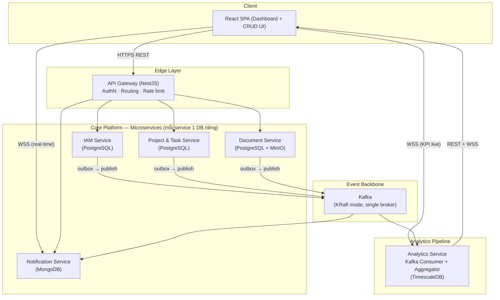
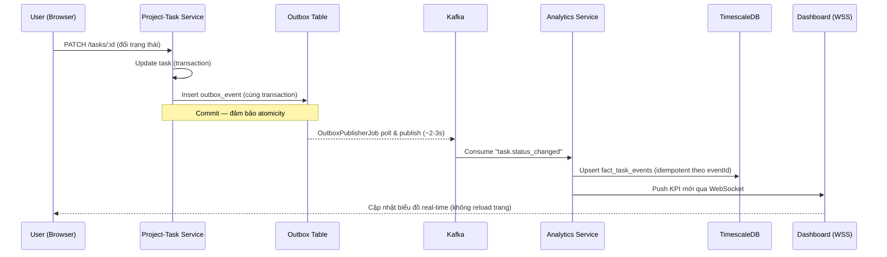

# Technical Specification — Enterprise Collaboration & Analytics Platform for SMEs

**Tài liệu liên quan:** [General_idea.md](General_idea.md) · [Wireframe.md](Wireframe.md)
**Ngày khởi tạo:** 18/07/2026
**Múi giờ chuẩn hệ thống:** GMT+7 (Asia/Ho_Chi_Minh) — mọi timestamp lưu ở DB dưới dạng UTC, quy đổi sang GMT+7 khi hiển thị ở tầng frontend/API response.

---

## 1. Kiến trúc tổng thể

Hệ thống gồm hai trụ cột liên kết qua một **event backbone** (Kafka): **Core Platform** (các microservice CRUD nghiệp vụ) và **Analytics Pipeline** (thu thập — xử lý — hiển thị dữ liệu).



**Nguyên tắc kiến trúc áp dụng:**
- **Database-per-service:** mỗi service sở hữu schema/DB riêng, không service nào truy vấn trực tiếp DB của service khác.
- **API Gateway là điểm vào duy nhất** cho client; các service không public trực tiếp ra ngoài internet.
- **Giao tiếp đồng bộ (REST)** dùng cho Gateway → Service (yêu cầu — phản hồi ngay).
- **Giao tiếp bất đồng bộ (Kafka event)** dùng cho lan truyền thay đổi trạng thái sang Analytics/Notification — tách rời (decoupling) giữa nơi sinh dữ liệu và nơi tiêu thụ dữ liệu.
- **Đa người thuê (multi-tenant), mô hình shared-schema:** mọi bảng nghiệp vụ có cột `organization_id`; mọi truy vấn được lọc theo tenant ở tầng middleware/service.

## 2. Công nghệ sử dụng (Tech Stack)

| Thành phần | Công nghệ lựa chọn | Lý do |
|---|---|---|
| Backend framework | **Node.js + NestJS (TypeScript)** | Kiến trúc module hóa sẵn có, hỗ trợ tốt cho microservices, cùng ngôn ngữ với frontend giúp giảm chi phí chuyển ngữ cảnh cho 1 sinh viên |
| Frontend | **React 18 + TypeScript + Vite** | Hệ sinh thái lớn, nhiều thư viện chart, tốc độ dev nhanh |
| UI styling | TailwindCSS + shadcn/ui | Xây UI nhanh, nhất quán, ít viết CSS thủ công |
| State/data fetching | TanStack Query (React Query) + Zustand | Quản lý cache API và state cục bộ tách biệt rõ ràng |
| Chart/Visualization | Recharts (hoặc ECharts cho biểu đồ phức tạp hơn) | Component React thuần, tài liệu phong phú |
| OLTP Database (IAM, Project-Task, Document) | **PostgreSQL 16** | Quan hệ mạnh, transaction ACID, phù hợp dữ liệu nghiệp vụ cốt lõi |
| Document store (Notification) | **MongoDB** | Schema linh hoạt, ghi nhanh, phù hợp dữ liệu thông báo bán cấu trúc — minh họa polyglot persistence |
| Analytics Database | **TimescaleDB** (extension của PostgreSQL) | Tối ưu cho dữ liệu time-series/hypertable, hỗ trợ continuous aggregate cho rollup theo ngày/tuần, vẫn dùng SQL quen thuộc |
| Object Storage | **MinIO** (S3-compatible) | Lưu file nhị phân (tài liệu upload), tương thích API S3, tự host được trong Docker |
| Message Broker | **Apache Kafka** (KRaft mode, không cần Zookeeper) | Event backbone có khả năng replay, phù hợp bài toán phân tích/xu hướng theo thời gian |
| Cache / Session / Rate-limit | **Redis** | Lưu refresh-token blacklist, cache truy vấn nóng, Socket.IO adapter |
| Real-time transport | **Socket.IO** (qua NestJS Gateway) | Đẩy notification và KPI real-time tới client |
| API Documentation | **Swagger/OpenAPI** (`@nestjs/swagger`) | Tự sinh tài liệu từ decorator, chi phí thấp |
| Containerization | **Docker + Docker Compose** | Đóng gói và chạy toàn hệ thống bằng một lệnh, đúng yêu cầu đề tài |
| CI | **GitHub Actions** (lint, test, build, docker build) | Miễn phí, tích hợp sẵn với GitHub |
| Testing | **Jest** (unit), **Supertest** (integration cơ bản) | Tích hợp sẵn trong NestJS |
| Quản lý mã nguồn | **Monorepo** (npm workspaces hoặc Turborepo) | 1 sinh viên quản lý nhiều service — monorepo giảm chi phí đồng bộ version, chia sẻ package `common` (DTO, event schema, guard dùng chung) |

## 3. Danh sách service chi tiết

### 3.1 API Gateway
- **Trách nhiệm:** điểm vào duy nhất; xác thực JWT (verify chữ ký, không gọi lại IAM cho mỗi request); định tuyến REST tới service tương ứng; forward WebSocket handshake tới Notification/Analytics Service; áp rate limiting cơ bản (theo `organization_id` + IP); tổng hợp Swagger từ các service con.
- **Không có DB riêng** (stateless), chỉ dùng Redis để cache blacklist token.

### 3.2 IAM Service
- **Trách nhiệm:** đăng ký tổ chức (organization) mới, đăng ký/đăng nhập user, quản lý Department, quản lý Role/Permission (RBAC), phát hành/refresh JWT.
- **Entity chính:** `Organization`, `User`, `Department`, `Role`, `Permission`, `RolePermission`, `RefreshToken`, `OutboxEvent`.
- **Event phát ra:** `iam.organization.registered`, `iam.user.registered`, `iam.user.deactivated`.

### 3.3 Project & Task Service
- **Trách nhiệm:** CRUD Project, CRUD Task, board Kanban (`TODO` → `DOING` → `DONE`), gán người thực hiện, comment trên task, lưu lịch sử đổi trạng thái (phục vụ modal chi tiết Task ở Wireframe §4.2).
- **Entity chính:** `Project`, `Task`, `TaskComment`, `TaskAssignee`, `TaskStatusHistory`, `OutboxEvent`.
- **Event phát ra:** `task.created`, `task.status_changed`, `task.assigned`, `task.deleted`, `project.created`, `project.completed`, `project.deleted`.
- **Lưu ý (điều chỉnh 21/07/2026):** bổ sung sự kiện `task.deleted`/`project.deleted` để Analytics không đếm nhầm entity đã bị xóa cứng; `TaskStatusHistory` ghi lại mỗi lần đổi trạng thái (cùng transaction với `Task.status` và Outbox), phục vụ trực tiếp yêu cầu "lịch sử thay đổi trạng thái" trong Wireframe §4.2.

### 3.4 Document Service
- **Trách nhiệm:** CRUD Folder/File (metadata trong PostgreSQL, nội dung nhị phân trong MinIO), chia sẻ nội bộ theo user/phòng ban, versioning đơn giản (giữ tối đa N bản gần nhất mỗi file).
- **Entity chính:** `Folder`, `FileMeta`, `FileVersion`, `FileShare`, `OutboxEvent`.
- **Event phát ra:** `document.uploaded`, `document.shared`, `document.deleted`.
- **Lưu trữ (điều chỉnh 21/07/2026):** bucket MinIO cấu hình **private** (không bật anonymous/public download); mọi truy cập tải file bắt buộc đi qua presigned URL có thời hạn ngắn (mặc định 15 phút) do Document Service cấp sau khi đã xác thực `organizationId` của người gọi.
- **Phạm vi `FileShare`/access-control (điều chỉnh 21/07/2026, nâng cấp thành access-control thực sự 28/07/2026):** mặc định (`Folder.visibility = 'organization'`) vẫn giữ nguyên hành vi MVP — mọi thành viên tổ chức xem/tải được mọi tài liệu, **không đổi hành vi của dữ liệu đã có** (opt-in). Người tạo thư mục (hoặc Org Admin) có thể chuyển 1 thư mục cụ thể sang `visibility = 'restricted'`: khi đó chỉ người tạo, Org Admin, hoặc người/phòng ban được cấp quyền tường minh qua `FolderShare` (bảng mới) mới thấy được thư mục đó và các tệp bên trong. `FileShare` (tệp lẻ, không đổi tên) giờ cũng là 1 đường cấp quyền TRUY CẬP THỰC SỰ (không chỉ gắn nhãn hiển thị) cho MỘT tệp cụ thể — dùng cho trường hợp "có link trực tiếp tới 1 tệp trong thư mục hạn chế mà không cần thấy được cả thư mục". Cả `FolderShare` lẫn `FileShare` đều chấp nhận đích là 1 người dùng (`sharedWithUserId`) HOẶC 1 phòng ban (`sharedWithDepartmentId`, mới) — chi tiết đầy đủ xem §6 và §14.

### 3.5 Notification Service
- **Trách nhiệm:** tiêu thụ sự kiện từ Kafka (từ IAM, Project-Task, Document), sinh notification tương ứng, lưu MongoDB, đẩy real-time qua WebSocket tới user liên quan, đánh dấu đã đọc/chưa đọc.
- **Entity chính (MongoDB collection):** `notifications` `{ _id, eventId, organizationId, userId, type, payload, isRead, createdAt }` — trường `eventId` có unique index, dùng để chống trùng khi Outbox publish lại cùng một sự kiện (điều chỉnh 21/07/2026, xem §4.1).
- **Không phát Outbox event** (là consumer cuối chuỗi, không kích hoạt nghiệp vụ khác).
- **(Bổ sung 28/07/2026) Module `failed-events`:** collection MongoDB riêng `failed_events`, populate qua 1 Kafka consumer độc lập đọc topic `domain-events.dlq` (xem §4.5) — service này đóng vai trò "nơi lưu trữ tập trung" cho Dead Letter Queue của toàn nền tảng, không chỉ riêng sự kiện của chính nó.

### 3.6 Analytics Service
- **Trách nhiệm:** tiêu thụ toàn bộ sự kiện từ Kafka, tổng hợp theo thời gian thực (increment counter) và theo lô (rollup ngày/tuần qua continuous aggregate của TimescaleDB), expose REST API cho truy vấn KPI lịch sử và WebSocket cho cập nhật KPI trực tiếp.
- **Entity chính:** hypertable `fact_task_events`, `fact_document_events`, `fact_user_activity`; continuous aggregate `daily_task_summary`, `weekly_project_progress`.
- **Không phát Outbox event.**

> **Ghi chú (mở rộng):** HRM-lite Service và CRM-lite Service (nếu triển khai ở Phase 2) sẽ theo đúng khuôn mẫu trên: sở hữu DB riêng, ghi Outbox, phát event vào cùng Kafka cluster để Analytics Service tiêu thụ mà không cần thay đổi kiến trúc.

## 4. Kiến trúc hướng sự kiện (Event-Driven Architecture)

### 4.1 Outbox Pattern
Mỗi service nghiệp vụ (IAM, Project-Task, Document) ghi bản ghi sự kiện vào bảng `outbox_events` **trong cùng transaction** với thay đổi dữ liệu nghiệp vụ, đảm bảo tính nguyên tử nội bộ service (tránh vấn đề dual-write). Một worker nội bộ (`OutboxPublisherJob`, chạy định kỳ mỗi 2–3 giây trong chính service) poll các bản ghi `published = false`, publish lên Kafka, sau đó đánh dấu `published = true`.

- **Ưu điểm:** đơn giản, không cần hạ tầng bổ sung, triển khai được trong thời gian 1 học kỳ.
- **Giới hạn đã biết:** độ trễ vài giây (không phải true CDC); nếu worker crash giữa lúc publish có thể phát trùng sự kiện (chấp nhận được vì **mọi consumer** — cả Analytics Service lẫn Notification Service — xử lý theo kiểu idempotent bằng `eventId`; xem yêu cầu cụ thể ở §3.5/§3.6).
- **Hướng nâng cấp (ngoài phạm vi MVP):** thay bằng Debezium đọc trực tiếp WAL của PostgreSQL (CDC thực thụ), loại bỏ độ trễ polling.

### 4.2 Chuẩn đặt tên Kafka topic
Dùng ít topic (theo bounded context sinh sự kiện) kèm trường `eventType` để phân loại bên trong message, giảm chi phí vận hành cho 1 broker:

| Topic | Producer | Consumer |
|---|---|---|
| `iam.events` | IAM Service | Analytics Service, Notification Service |
| `project-task.events` | Project & Task Service | Analytics Service, Notification Service |
| `document.events` | Document Service | Analytics Service, Notification Service |
| `domain-events.dlq` | Analytics Service, Notification Service *(bổ sung 28/07/2026)* | Notification Service (consumer riêng, xem mục 4.5) |

### 4.3 Schema sự kiện chuẩn (JSON)

```json
{
  "eventId": "b3f1c2d4-...-uuid",
  "eventType": "task.status_changed",
  "occurredAt": "2026-07-18T09:30:00.000Z",
  "organizationId": "org-uuid",
  "producer": "project-task-service",
  "payload": {
    "taskId": "task-uuid",
    "projectId": "project-uuid",
    "fromStatus": "DOING",
    "toStatus": "DONE",
    "actorId": "user-uuid"
  }
}
```

`occurredAt` luôn lưu dưới dạng ISO-8601 UTC; tầng hiển thị (Dashboard) quy đổi sang GMT+7.

### 4.5 Dead Letter Queue *(bổ sung 28/07/2026)*

Trước đây (xem mục 14, mục đã gỡ bỏ) một event xử lý thất bại chỉ có 2 kết cục: lỗi dữ liệu vĩnh viễn (payload sai định dạng) bị log rồi **mất hẳn**, hoặc lỗi hạ tầng tạm thời khiến Kafka **redeliver mãi mãi** cùng một message (có thể wedge cả partition nếu lỗi không tự khỏi). Cả hai đều là chỗ hổng vận hành thực sự cho một hệ thống hướng sự kiện.

- **Giới hạn số lần thử lại:** `KafkaConsumerService` của Analytics Service và Notification Service theo dõi số lần thất bại liên tiếp theo `eventId` (`Map` trong bộ nhớ, giới hạn 5 lần). Vượt quá 5 lần, thay vì tiếp tục rethrow, service tự phát ("republish") message + thông tin lỗi vào topic `domain-events.dlq`. **Giới hạn đã biết:** bộ đếm nằm trong bộ nhớ tiến trình — nếu service khởi động lại giữa chừng, một message đang bị kẹt sẽ được cấp lại đủ 5 lượt thử từ đầu; chấp nhận được ở quy mô đồ án, không dùng Redis/DB để giữ bền bộ đếm này.
- **Lỗi dữ liệu vĩnh viễn** (mã lỗi Postgres `22P02`/`23502`/`23503` ở Analytics Service; lỗi Mongoose permanent ở Notification Service) và **envelope không hợp lệ**/**JSON không parse được** giờ đều được đẩy vào `domain-events.dlq` ngay lập tức (không cần đợi hết lượt retry, vì retry lại chắc chắn thất bại y hệt) thay vì chỉ log-và-mất.
- **Schema DLQ** (`DeadLetterEnvelope`, `packages/common-dto`): `eventId`/`eventType`/`organizationId` (có thể `null` nếu lỗi xảy ra trước khi đọc được các trường này), `sourceService`, `sourceTopic`, `errorType` (`MALFORMED_JSON`/`INVALID_ENVELOPE`/`PERMANENT_DATA_ERROR`/`RETRY_EXHAUSTED`), `errorMessage`, `attempts`, `rawPayload`, `failedAt`.
- **Lưu trữ & hiển thị:** Notification Service có một Kafka consumer **riêng** (group `notification-service-dlq-group`, tách biệt hoàn toàn khỏi consumer đọc 3 topic domain event gốc — tránh 2 luồng xử lý khác nhau tranh nhau cùng 1 group/partition) chỉ đọc topic `domain-events.dlq`, lưu vào MongoDB collection `failed_events`. Endpoint `GET /api/v1/failed-events` (module `failed-events`, quyền `system:manage` — chỉ Org Admin) hiển thị danh sách này tại Quản trị > "Sự kiện lỗi hệ thống" — **chỉ đọc**, không có thao tác "thử lại" (replay) trong phạm vi bổ sung này.
- **(Sửa 28/07/2026, phát hiện qua đợt "ultimate check" toàn hệ thống) Phạm vi hiển thị `organizationId = null`:** endpoint trên lọc theo `organizationId` của người gọi **CỘNG THÊM** mọi bản ghi có `organizationId = null` (lỗi `MALFORMED_JSON` — xảy ra ngay từ khâu đọc JSON, trước khi hệ thống kịp đọc được `organizationId` từ message gốc, nên không thể gán cho tổ chức nào). Trước fix này, các bản ghi `organizationId = null` **vĩnh viễn vô hình** với mọi Org Admin (chỉ xem được qua truy vấn thẳng vào MongoDB) — nhóm lỗi hạ tầng nghiêm trọng nhất lại là nhóm duy nhất không ai xem được qua giao diện, đi ngược mục tiêu ban đầu của tính năng này. Vì hệ thống không có khái niệm "System Admin" toàn nền tảng (mỗi Org Admin chỉ thuộc 1 tổ chức), đánh đổi được chấp nhận: cho mọi Org Admin thấy các bản ghi không xác định được tổ chức (FE gắn nhãn "Không xác định tổ chức", cột "Phạm vi" mới trong bảng) — đây là dữ liệu chẩn đoán hạ tầng dùng chung, không phải dữ liệu nghiệp vụ riêng tổ chức nào, nên không vi phạm cách ly tenant theo nghĩa thực chất.
- **Đã kiểm thử trực tiếp trên hệ thống thật:** phát 1 message JSON hợp lệ nhưng payload sai kiểu UUID lên `project-task.events` → Analytics Service bắt đúng lỗi Postgres `22P02` → tự phát vào `domain-events.dlq` → Notification Service lưu vào `failed_events` → `GET /api/v1/failed-events` trả về đúng bản ghi, đúng phạm vi tổ chức. Kiểm thử lại sau fix `organizationId = null`: xác nhận qua `mongosh` có 5 bản ghi trong `failed_events` nhưng trước fix endpoint chỉ trả về 1 (đúng tổ chức) — 4 bản ghi `MALFORMED_JSON` còn lại (`organizationId = null`, tạo ra trong lúc kiểm thử DLQ bằng `kafka-console-producer`) vô hình hoàn toàn; sau fix endpoint trả đủ cả 5.

### 4.6 KPI theo phòng ban — mô hình "dimension table" *(bổ sung 28/07/2026)*

`Project`/`Task` cố tình KHÔNG lưu `departmentId` (một dự án/công việc có thể có người phụ trách từ nhiều phòng ban khác nhau — gắn cứng 1 `departmentId` lên `Project` sẽ sai về ngữ nghĩa). Thay vào đó, Analytics Service tự xây và duy trì một **bảng chiều (dimension table)** ánh xạ `user_id -> department_id`, cập nhật qua sự kiện — mô hình fact/dimension kinh điển trong data warehousing, áp dụng gọn vào kiến trúc hướng sự kiện sẵn có của đồ án:

- **Sự kiện mới:** `EVENT_TYPES.USER_DEPARTMENT_CHANGED` (`iam.user.department_changed`) — IAM Service phát mỗi khi `departmentId` của 1 user có sẵn thay đổi qua `PATCH /users/:id` (sự kiện `USER_REGISTERED` đã có sẵn `departmentId` cho user MỚI tạo, không cần sự kiện riêng cho trường hợp đó).
- **Đồng bộ lại toàn bộ mỗi lần khởi động (chủ đích, không phải một lần duy nhất):** IAM Service, mỗi lần khởi động, phát lại `USER_DEPARTMENT_CHANGED` cho **TOÀN BỘ** user của **TẤT CẢ** tổ chức với `departmentId` hiện tại. Vì Analytics Service chỉ làm phép "ghi đè giá trị mới nhất" (`ON CONFLICT (user_id) DO UPDATE`), việc phát lại này an toàn tuyệt đối để lặp lại — và tự "chữa lành" bảng `dim_user` nếu có lệch pha (vd retention của Kafka topic đã xóa message cũ, hoặc `dim_user` từng bị reset). **Đây là lựa chọn CHỈ PHÙ HỢP với quy mô đồ án** (vài chục tới vài trăm user) — ở quy mô production thật với hàng triệu user, cách làm đúng là event-driven thuần túy kèm cơ chế đối soát định kỳ theo lô, không phát lại toàn bộ mỗi lần khởi động.
- **`dim_user`** (bảng thường, KHÔNG phải hypertable — không có chiều thời gian): `user_id (PK), organization_id, department_id, updated_at`.
- **`fact_task_events.assignee_id`** (cột mới): trước đây bảng này chỉ lưu `actor_id` (người THỰC HIỆN hành động, vd người tạo/đổi trạng thái), không lưu người ĐƯỢC GIAO việc; cột mới lấy từ payload của sự kiện `task.assigned` (`TaskAssignedPayload.assigneeId`), NULL với các loại sự kiện khác.
- **Lọc theo phòng ban:** `GET /analytics/summary`, `/task-status-breakdown`, `/project-progress` nhận thêm query param tùy chọn `departmentId` — khi có, chỉ tính các task có ÍT NHẤT 1 lần giao việc (`task.assigned`) cho user thuộc phòng ban đó (`JOIN dim_user`). **`GET /analytics/task-trend` KHÔNG hỗ trợ** `departmentId` — cùng lý do đã ghi nhận trước đó (continuous aggregate không còn giữ `task_id` sau khi tổng hợp).
- **Ngữ nghĩa đa phòng ban (có chủ đích, không phải lỗi):** 1 công việc có nhiều người phụ trách thuộc nhiều phòng ban khác nhau sẽ được tính vào KPI của MỖI phòng ban liên quan khi lọc riêng — tổng các phòng ban cộng lại có thể VƯỢT tổng toàn tổ chức, đây là hành vi đúng thiết kế (công sức được ghi nhận cho đúng người thực hiện), không phải sai lệch dữ liệu.
- **Lưu ý vận hành khi triển khai lên hệ thống ĐÃ CHẠY (áp dụng đúng 1 lần cho đồ án này lúc bổ sung tính năng):** cột `fact_task_events.assignee_id` chỉ có giá trị cho các sự kiện `task.assigned` xử lý SAU KHI cột này tồn tại — dữ liệu lịch sử trước đó có `assignee_id = NULL` do ràng buộc `ON CONFLICT (time, event_id) DO NOTHING` khiến message Kafka cũ (dù còn trong topic) không ghi đè được dòng đã tồn tại. Đã khắc phục 1 lần bằng lệnh `UPDATE` thủ công lấy lại `assigneeId` từ `fact_user_activity.payload` (bảng này lưu nguyên payload JSONB của MỌI sự kiện nên vẫn còn dữ liệu gốc) — không cần thiết cho các bản triển khai MỚI hoàn toàn (schema đã có `assignee_id` từ đầu nên không có giai đoạn "trước khi cột tồn tại").

### 4.7 Nhận xét AI *(bổ sung 28/07/2026 — hạng mục đầu tiên của loạt nâng cấp tính năng AI)*

Sau khi hoàn tất 4 hạng mục Frontend/DLQ/access-control tài liệu/KPI theo phòng ban, đây là hạng mục đầu tiên trong loạt nâng cấp tính năng AI (đã thống nhất để sau cùng — xem mục 14). Do điều kiện tài nguyên hiện tại không phù hợp để tự lưu trữ (self-host) một mô hình cục bộ (cần GPU/RAM đáng kể), tính năng này gọi **Google Gemini API** (có gói miễn phí, không cần thẻ tín dụng) thay vì chạy mô hình tại chỗ.

- **Endpoint mới:** `GET /analytics/ai-insights?range=7d|30d|quarter&departmentId=&departmentName=` (Analytics Service, controller riêng `AiInsightsController` cùng prefix `analytics`, cùng quyền `analytics:view` như các endpoint KPI khác — đây chỉ là một lớp diễn giải bằng ngôn ngữ tự nhiên trên số liệu người dùng ĐÃ có quyền xem, không phải dữ liệu/quyền mới). `departmentName` là tham số RIÊNG chỉ để hiển thị trong đoạn văn AI sinh ra (Analytics Service không sở hữu tên phòng ban — database-per-service — nên frontend truyền kèm từ dữ liệu đã có sẵn cho dropdown lọc; KHÔNG dùng cho logic lọc/truy vấn, vẫn là `departmentId`).
- **Cơ chế:** `AiInsightsService` tái sử dụng NGUYÊN 3 phương thức đã có của `AnalyticsService` (`getSummary`/`getTaskStatusBreakdown`/`getProjectProgress` — mỗi phương thức đã tự có cache Redis riêng), ghép số liệu vào một prompt tiếng Việt có đầy đủ dấu, gọi thẳng REST API của Gemini qua `fetch` có sẵn của Node 20 (không thêm SDK `@google/genai` cho một lệnh gọi POST/JSON đơn giản — đúng định hướng "tối giản", ClaudeRule.md mục 8), rồi trả về đoạn văn bản Gemini sinh ra.
- **Cache riêng, TTL dài hơn cache KPI thường (30 phút thay vì 8 giây):** mục đích không phải giảm tải TimescaleDB (đã có cache cho từng truy vấn KPI) mà là giảm số lần gọi Gemini API thật để tiết kiệm hạn ngạch miễn phí — tính năng này chạy THEO YÊU CẦU (nút bấm), không polling tự động.
- **Chịu lỗi rõ ràng, không làm sập Analytics Service:** thiếu `GEMINI_API_KEY`, Gemini API lỗi/timeout (giới hạn 15 giây)/rate-limit, hoặc phản hồi không có nội dung (vd bị chặn bởi bộ lọc an toàn) đều trả về `503 ServiceUnavailableException` với thông báo tiếng Việt rõ ràng — các tính năng KPI khác trên cùng trang không bị ảnh hưởng.
- **Cấu hình:** `GEMINI_API_KEY` (lấy miễn phí tại `aistudio.google.com/apikey`) + `GEMINI_MODEL` (mặc định `gemini-flash-latest`) trong `infra/.env`/`docker-compose.yml`. Để trống `GEMINI_API_KEY` là trạng thái HỢP LỆ (không lỗi khởi động service) — chỉ riêng endpoint này trả lỗi rõ ràng cho tới khi được cấu hình.
- **Frontend:** trang Báo cáo & Phân tích có thêm thẻ "Nhận xét AI" với nút "Tạo nhận xét AI" (không tự động gọi khi vào trang/đổi bộ lọc — theo đúng lý do tiết kiệm hạn ngạch ở trên); đoạn nhận xét hiển thị kèm dòng chú thích phạm vi/khoảng thời gian ĐÃ DÙNG để tạo ra nó (tránh hiểu nhầm khi người dùng đổi bộ lọc sau khi đã tạo nhận xét).
- **Giới hạn token đầu ra (`maxOutputTokens = 2048`):** phát hiện qua xác minh sống — các model Gemini hiện tại (dòng `gemini-flash-latest`/`gemini-3.x`) tính cả "thinking token" (suy luận nội bộ, không hiển thị, quan sát được ~250-500 token/lần gọi) vào chung ngân sách `maxOutputTokens`. Mức khởi điểm 400 bị thinking chiếm gần hết, cắt cụt đoạn văn trả về giữa chừng (`finishReason=MAX_TOKENS`) mà vẫn trả `200 OK` — lỗi im lặng, không lộ ra qua status code. Đã nâng lên 2048 để đủ chỗ cho cả thinking lẫn đoạn văn 3-5 câu thực tế.

### 4.4 Luồng dữ liệu Analytics (end-to-end)



Song song với luồng real-time, các **continuous aggregate của TimescaleDB** (`daily_task_summary`, `weekly_project_progress`) tự động refresh mỗi giờ thông qua `add_continuous_aggregate_policy` — cơ chế rollup nội tại của TimescaleDB, không phải một cron job ở tầng ứng dụng (điều chỉnh 21/07/2026 so với bản đặc tả gốc: lựa chọn này bền hơn qua các lần restart service). Kết quả phục vụ các báo cáo xu hướng dài hạn, tách biệt khỏi luồng cập nhật tức thời.

## 5. Cơ sở dữ liệu — tổng quan entity theo service

| Service | Entity chính | Quan hệ đáng chú ý |
|---|---|---|
| IAM | Organization 1—N Department, Organization 1—N User, User N—N Role (qua UserRole), Role N—N Permission | `User.departmentId` → Department; mọi entity có `organizationId` |
| Project-Task | Project 1—N Task, Task 1—N TaskComment, Task 1—N TaskStatusHistory, Task N—N User (qua TaskAssignee) | `Task.projectId` bắt buộc; `Task.assigneeIds` tham chiếu `userId` của IAM (không FK vật lý xuyên service — chỉ lưu ID). Không có `departmentId` trên `Project`/`Task` (đúng theo thiết kế — 1 dự án/công việc có thể có người phụ trách từ nhiều phòng ban khác nhau); KPI theo phòng ban (từ 28/07/2026) tính qua `dim_user` bên Analytics Service, không gắn `departmentId` trực tiếp lên Project/Task — xem §4.6. |
| Document | Folder 1—N Folder (cây thư mục), Folder 1—N FileMeta, FileMeta 1—N FileVersion, FileMeta N—N User (qua FileShare) | Nội dung nhị phân lưu ở MinIO, DB chỉ lưu `objectKey` trỏ tới MinIO |
| Notification (MongoDB) | Document `notifications` phẳng, không quan hệ | Đánh index trên `(organizationId, userId, isRead)` |
| Analytics (TimescaleDB) | Hypertable theo `time`, `organizationId`, `eventType` | Continuous aggregate rollup theo ngày/tuần |

> Vì các service không chia sẻ DB, tham chiếu xuyên service (ví dụ `Task.assigneeIds` trỏ tới `User` của IAM) **chỉ lưu ID, không có foreign key vật lý** — đúng nguyên tắc microservices; tính toàn vẹn được đảm bảo ở tầng ứng dụng (validate qua API Gateway/IAM khi cần).

## 6. Xác thực & phân quyền (AuthN/AuthZ)

- **Đăng nhập:** IAM Service xác thực username/password (bcrypt hash), phát hành **JWT access token** (thời hạn 15 phút) + **refresh token** (thời hạn 7 ngày, lưu hash trong PostgreSQL, có thể thu hồi qua Redis blacklist). Refresh token trả về qua **httpOnly, SameSite=Lax cookie** do IAM Service set (không trả trong JSON body) — Gateway proxy nguyên vẹn cookie này tới client (điều chỉnh 21/07/2026, khớp với Wireframe.md §1).
- **Xác thực tại Gateway:** API Gateway verify chữ ký JWT (không gọi lại IAM mỗi request — giảm tải), trích `organizationId`, `userId`, `roles` từ payload, forward qua header nội bộ (`x-org-id`, `x-user-id`, `x-roles`, `x-permissions`) cho service phía sau. **(Bổ sung 28/07/2026)** Payload JWT/header nội bộ nay mang thêm `departmentId` (`x-department-id`, rỗng nếu người dùng chưa được gán phòng ban) — phục vụ Document Service tự kiểm tra "người gọi có thuộc phòng ban được chia sẻ thư mục hay không" mà không cần gọi ngang sang IAM Service (dịch vụ này vẫn chưa có cơ chế gọi nội bộ giữa các service — xem §14).
- **Xác thực nội bộ Gateway → Service (bổ sung 21/07/2026):** Gateway đính kèm thêm header `x-internal-secret` (giá trị bí mật chia sẻ qua biến môi trường `INTERNAL_SHARED_SECRET`, không lộ ra client). Mọi service phía sau bắt buộc kiểm tra header này khớp trước khi tin các header context `x-org-id/x-user-id/x-roles/x-permissions` — chống trường hợp một client gọi thẳng vào service (bỏ qua Gateway) và tự khai header để giả mạo danh tính/tổ chức.
- **Thu hồi access token (bổ sung 21/07/2026):** khi tài khoản bị `deactivate`, IAM Service ghi khóa `blacklist:user:{userId}` vào Redis với TTL bằng thời hạn access token (15 phút); Gateway kiểm tra khóa này song song với verify chữ ký JWT, giúp access token của tài khoản vừa khóa mất hiệu lực gần như ngay lập tức thay vì phải chờ hết hạn tự nhiên.
- **Phân quyền (RBAC):** mỗi Role gắn danh sách Permission dạng `resource:action` (ví dụ `task:create`, `document:delete`). Mỗi service tự kiểm tra permission liên quan qua NestJS Guard, không phụ thuộc Gateway kiểm tra thay. Guard phải được gắn trên **mọi** endpoint (kể cả các endpoint chỉ đọc/GET) tương ứng với permission đã định nghĩa trong RBAC matrix, không chỉ các endpoint ghi/mutate. **Ngoại lệ có chủ đích, ghi nhận sau đợt review toàn dự án 22/07/2026:** `GET /departments` (IAM) và `GET /users` dạng danh sách (IAM) để mở cho MỌI thành viên đã xác thực trong tổ chức thay vì chỉ Org Admin — cả hai là nguồn dữ liệu nền tảng cho nhiều màn hình không-phải-quản-trị (Dashboard, picker chọn người phụ trách task, chia sẻ tài liệu, tìm kiếm tổng hợp, trang Hồ sơ cá nhân); gắn permission quản trị (`user:manage`) sẽ chặn phần lớn ứng dụng đối với vai trò Manager/Employee — một regression nghiêm trọng hơn chính lỗ hổng đang sửa. `GET /users/:id` (xem hồ sơ một người dùng cụ thể) vẫn được chặn đúng theo quy tắc: chỉ cho phép tự xem chính mình HOẶC người gọi có `user:manage`. Xem chi tiết tại mục Lịch sử thay đổi tài liệu, mục review 22/07/2026.
- **(Bổ sung 25/07/2026) Gán vai trò (`roleIds`) khi mời/sửa người dùng yêu cầu riêng `user:manage`:** phát hiện qua đợt review vòng 2 — `POST /users/invite`/`PATCH /users/:id` trước đó chỉ yêu cầu `user:invite` (Manager cũng có quyền này) nhưng KHÔNG kiểm tra người gọi có được phép gán `roleIds` cụ thể trong request hay không, cho phép một Manager tự đọc UUID vai trò Org Admin qua `GET /users` (vốn cố ý mở cho mọi người, xem trên) rồi mời một tài khoản mới với vai trò đó — leo thang đặc quyền hoàn chỉnh mà không cần bất kỳ quyền quản trị nào ban đầu. Đây là lỗi mức **Nghiêm trọng (Critical)** duy nhất phát hiện ở IAM Service trong đợt review này. Sửa: `roleIds` non-empty trong 2 endpoint trên nay bị từ chối (`403 Forbidden`, thông báo tiếng Việt) trừ khi người gọi có `user:manage` — không âm thầm bỏ qua `roleIds` vì luồng UI hợp lệ (`InviteMemberModal.tsx`) chưa bao giờ cho vai trò thấp quyền gửi trường này, nên một request có `roleIds` từ Manager gần như chắc chắn là request thủ công/độc hại, cần lộ ra ngay bằng lỗi thay vì âm thầm thành công với vai trò rỗng.
- **Cách ly tenant:** mọi Guard/Middleware bắt buộc lọc theo `organizationId` lấy từ JWT — không cho phép truy vấn chéo tổ chức dù có ID hợp lệ của tổ chức khác. Quy tắc này áp dụng cả cho **tham chiếu chéo entity trong cùng service** (ví dụ tạo `Task` phải xác minh `projectId` thuộc đúng `organizationId`, không chỉ định dạng UUID hợp lệ).

## 7. Quy ước thiết kế API

- **Versioning:** tiền tố `/api/v1/...`.
- **Định dạng lỗi chuẩn:**
```json
{ "statusCode": 400, "error": "VALIDATION_ERROR", "message": "Trường 'title' là bắt buộc", "timestamp": "2026-07-18T09:30:00.000Z" }
```
- **Phân trang:** query `?page=1&limit=20`, response kèm `{ data, meta: { page, limit, total } }`.
- **Validation:** `class-validator` + `class-transformer` (DTO) ở tầng controller của từng service. **(Bổ sung 25/07/2026)** `ValidationPipe` của 5 service nghiệp vụ (không áp dụng cho Gateway — Gateway không parse/validate body, chỉ forward nguyên vẹn tới service phía sau) dùng chung `exceptionFactory` mới (`vietnameseValidationExceptionFactory`, `packages/common-guard`) dịch mọi constraint của `class-validator` sang tiếng Việt trước khi trả về client — trước đó dùng thông báo mặc định bằng tiếng Anh (vd `"page must not be greater than 100000"`), vi phạm ClaudeRule.md mục 1, phát hiện qua đợt review vòng 2 (áp dụng cho toàn bộ 400 response validate lỗi ở cả 5 service, không riêng 1 DTO nào).
- **Tài liệu API:** mỗi service expose `/api/docs` (Swagger) riêng, chỉ truy cập được từ bên trong `internal-net`. **(Sửa 06/08/2026)** Gateway KHÔNG có route `/api/docs` hay trang tổng hợp Swagger nào — mọi request tới đường dẫn không khớp `REST_PROXY_ROUTES` bị middleware xác thực JWT của Gateway trả `401` trước khi kịp 404, kể cả khi client chưa đăng nhập; câu "Gateway tổng hợp thành 1 trang docs chung" ghi trước đó mô tả một tính năng chưa từng được triển khai. Muốn xem Swagger của 1 service, dùng `docker compose exec gateway wget -qO- http://<service>:<port>/api/docs-json` từ bên trong `internal-net` (xem ví dụ ở README.md).

## 8. Triển khai & hạ tầng (Docker)

### 8.1 Danh sách container (Docker Compose)

| Container | Image/Base | Port (host) |
|---|---|---|
| `web` | Nginx serve static React build | 80 |
| `gateway` | NestJS (custom) | 3000 |
| `iam-service` | NestJS (custom) | 3001 |
| `project-task-service` | NestJS (custom) | 3002 |
| `document-service` | NestJS (custom) | 3003 |
| `notification-service` | NestJS (custom) | 3004 |
| `analytics-service` | NestJS (custom) | 3005 |
| `postgres-iam`, `postgres-pt`, `postgres-doc` | `postgres:16` | 5433–5435 |
| `timescaledb` | `timescale/timescaledb:latest-pg16` | 5436 |
| `mongodb` | `mongo:7` | 27017 |
| `kafka` | `apache/kafka:latest` (KRaft mode) | 9092 |
| `redis` | `redis:7-alpine` | 6380 (host) → 6379 (container) |
| `minio` | `minio/minio` | 9010 (host) → 9000, 9011 (host) → 9001 (console) |

- **(Sửa 25/07/2026)** Bảng port host của `redis`/`minio` ở trên trước đó ghi nhầm là cổng container mặc định (6379 / 9000, 9001) — phát hiện qua đợt review vòng 2, tự mâu thuẫn với chính changelog ngày 21/07/2026 bên dưới (đã nêu đúng `MINIO_PUBLIC_PORT` mặc định là `9010`). Cổng host thực tế lệch khỏi cổng mặc định của image để tránh xung đột với các dịch vụ khác cùng chạy trên máy phát triển (xem `infra/docker-compose.yml`) — bảng trên nay khớp đúng `docker-compose.yml`.
- **Mạng:** một Docker network nội bộ (`internal-net`) chứa toàn bộ service + DB. Chỉ `web` và `gateway` expose port nghiệp vụ ra host; 5 service nghiệp vụ còn lại (IAM, Project-Task, Document, Notification, Analytics) **không map port ra host** trong cấu hình mặc định — chỉ giao tiếp qua `internal-net`, kết hợp với xác thực `x-internal-secret` ở §6 để chống truy cập trực tiếp bỏ qua Gateway (điều chỉnh 21/07/2026, sửa sai lệch so với bản đặc tả gốc). Các container hạ tầng/CSDL (Postgres ×3, TimescaleDB, MongoDB, Redis, MinIO, Kafka) vẫn map port ra host **chỉ để phục vụ debug cục bộ trên máy phát triển** (rủi ro chấp nhận được vì đồ án chạy trên một máy đơn do sinh viên toàn quyền kiểm soát); khi trình bày/bảo vệ trên môi trường có thể truy cập từ bên ngoài, các port này nên được gỡ bỏ hoặc chặn qua firewall.
- **(Bổ sung 25/07/2026)** `gateway`, `analytics-service` dùng Redis (rate-limit/blacklist token, cache KPI) nhưng trước đó thiếu khai báo `depends_on: { redis: { condition: service_healthy } }` trong `docker-compose.yml` (chỉ `iam-service` được sửa tường minh trong đợt review này, rồi phát hiện thêm 2 service còn lại cũng thiếu — đã bổ sung cho cả 3); tương tự, `document-service` trước đó chỉ chờ `minio` khoẻ mà không chờ job một-lần `minio-init` (tạo bucket) hoàn tất, gây race hiếm gặp lúc `docker compose up` lần đầu — đã thêm `minio-init: { condition: service_completed_successfully }`.
- **Volume:** volume riêng cho mỗi DB + MinIO để dữ liệu tồn tại qua các lần `docker compose down/up`.
- **Cấu hình:** biến môi trường qua file `.env` theo từng service (không hardcode secret trong image), bao gồm `INTERNAL_SHARED_SECRET` dùng chung giữa Gateway và các service (xem §6).

## 9. Bảo mật

- Mật khẩu hash bằng **bcrypt** (cost factor ≥ 10), không bao giờ log plaintext password.
- Áp dụng **Helmet** (security headers) và **CORS** whitelist theo domain frontend.
- **Rate limiting** tại Gateway (theo IP + `organizationId`) chống brute-force đăng nhập. **(Sửa 25/07/2026)** Khoá rate-limit trước đó tin tưởng byte đầu tiên của header `X-Forwarded-For` (client tự khai báo được, có thể giả mạo IP tuỳ ý để tạo vô số khoá rate-limit mới) — nay ưu tiên `X-Real-IP` (Nginx phía trước GHI ĐÈ vô điều kiện bằng `$remote_addr`, không thể giả mạo qua header client, khác với `X-Forwarded-For` chỉ được Nginx `$proxy_add_x_forwarded_for` NỐI THÊM vào giá trị client đã gửi), chỉ rơi về `X-Forwarded-For`/`socket.remoteAddress` khi không có `X-Real-IP` (vd môi trường dev không qua Nginx).
- Validate toàn bộ input qua DTO (`class-validator`) — chống injection và dữ liệu không hợp lệ.
- Secret (JWT signing key, DB credential, MinIO key) quản lý qua `.env`, không commit vào Git (`.gitignore` áp dụng từ đầu).
- File upload giới hạn kích thước và loại MIME hợp lệ ở Document Service. **(Bổ sung 22/07/2026)** Ngoài kiểm tra `Content-Type` client tự khai báo, còn đối chiếu magic-byte thực tế của nội dung file (PDF/PNG/JPEG/GIF/nhóm định dạng ZIP gồm docx-xlsx-pptx-zip, và định dạng OLE Compound File cũ .doc/.xls/.ppt ở mức xác nhận "đúng cấu trúc OLE CFB", chưa phân biệt được 3 phân loại con) trước khi lưu lên MinIO — chống giả mạo phần mở rộng/MIME. `text/csv`/`text/plain` không có magic-byte đáng tin cậy nên vẫn chỉ dựa vào `Content-Type`. **(Sửa 25/07/2026)** Chính khoảng trống đó là một rủi ro sniff-XSS thật: file khai `text/plain` nhưng chứa HTML/JS, khi tải với `?disposition=inline` được MinIO (origin riêng, ngoài `helmet()` của app) phục vụ mà không có `X-Content-Type-Options: nosniff` — trình duyệt có thể tự đoán và render như HTML. Sửa bằng cách ép `disposition=attachment` (bỏ qua giá trị client yêu cầu) cho MỌI mime-type không kiểm chứng được bằng magic-byte (`text/plain`, `text/csv`) — các định dạng đã kiểm chứng được (PDF, ảnh, Office/zip) vẫn cho `inline` bình thường. Tên file gốc do client cung cấp cũng được làm sạch (loại bỏ ký tự phân tách đường dẫn, chuỗi `..`, ký tự điều khiển, giới hạn độ dài) trước khi dùng để tạo object key MinIO hoặc đưa vào header `Content-Disposition`.

## 10. Kiểm thử

| Cấp độ | Công cụ | Phạm vi bắt buộc |
|---|---|---|
| Unit test | Jest (6 service backend + 2 package dùng chung) · Vitest (`apps/web`, bổ sung 25/07/2026) | Logic nghiệp vụ cốt lõi mỗi service (state machine của Task, tính toán KPI của Analytics, RBAC guard của IAM); phía frontend: hàm định dạng ngày giờ theo múi giờ, hành vi `Dropdown`/tìm kiếm/`KpiCard`/tự thu gọn sidebar |
| Integration test | Jest + Supertest | Luồng API chính (đăng nhập, tạo task, upload file) chạy trên DB test (Docker) |
| E2E | Playwright (`e2e/`, bổ sung 28/07/2026) | Luồng vàng trên trình duyệt thật, nhắm vào stack Docker đang chạy: xác thực (đăng nhập/sai mật khẩu/đăng xuất), Dự án & Công việc (tạo dự án/công việc, đổi trạng thái qua đúng state machine, cập nhật Kanban), Tài liệu (tải lên, mở xem trực tiếp, chia sẻ), Quản trị > Thành viên (mời/vô hiệu hoá/kích hoạt lại), tìm kiếm tổng hợp. Không chạy trong CI (mục 11) vì chưa có môi trường staging với stack Docker đầy đủ — chạy thủ công từ máy phát triển, xem `e2e/README.md`. |
| Contract testing | — | **Ngoài phạm vi MVP** — ghi nhận là hướng phát triển |

## 11. CI/CD

Pipeline GitHub Actions (`.github/workflows/ci.yml`) chạy khi push/PR vào nhánh chính:
1. Cài dependency (cache theo `package-lock.json`).
2. Lint (ESLint) + kiểm tra kiểu (TypeScript `tsc --noEmit`).
3. Chạy unit test toàn bộ workspace.
4. Build Docker image cho từng service (không push registry — chỉ xác minh build thành công, do đồ án không có môi trường staging).

## 12. Yêu cầu phi chức năng (NFR)

| Hạng mục | Mục tiêu (mức demo đồ án) |
|---|---|
| Hiệu năng | Dashboard tải KPI ban đầu < 2 giây với tập dữ liệu demo (~vài nghìn bản ghi sự kiện) |
| Độ trễ real-time | Cập nhật KPI trên Dashboard trong vòng ≤ 5 giây sau khi sự kiện phát sinh |
| Khả dụng | Chạy ổn định trên 1 instance duy nhất (không yêu cầu HA/multi-region — đúng phạm vi Non-goal) |
| Khả năng mở rộng (thiết kế) | Kiến trúc cho phép scale-out theo service (thêm consumer group Kafka) về mặt lý thuyết, không kiểm chứng tải thực tế trong đồ án |
| Múi giờ | Toàn bộ timestamp lưu UTC, hiển thị GMT+7 |

## 13. Cấu trúc repository (Monorepo)

```
/
├── apps/
│   ├── gateway/
│   ├── iam-service/
│   ├── project-task-service/
│   ├── document-service/
│   ├── notification-service/
│   ├── analytics-service/
│   └── web/                     # React SPA
├── packages/
│   ├── common-dto/              # DTO/event schema dùng chung
│   └── common-guard/            # JWT guard, RBAC decorator dùng chung
├── infra/
│   └── docker-compose.yml
├── e2e/                          # Playwright - kiem thu E2E tren trinh duyet that (bo sung 28/07/2026)
├── Doc/
│   ├── ClaudeRule.md
│   ├── General_idea.md
│   ├── Technical_Spec.md
│   └── Wireframe.md
└── package.json                 # npm workspaces root
```

## 14. Giới hạn đã biết & Hướng phát triển

- **Outbox polling thay vì CDC thực thụ** — chấp nhận độ trễ vài giây trong MVP; nâng cấp Debezium là hướng phát triển rõ ràng.
- **Single Kafka broker** — không có replication/fault-tolerance thực sự; đủ cho mục đích minh họa kiến trúc trong đồ án.
- ~~**Không có observability hạ tầng** (Prometheus/Grafana) trong MVP~~ — **đã triển khai 04/08/2026**, xem §15.
- **Chưa có database-per-tenant** — mô hình shared-schema đơn giản hóa triển khai nhưng giới hạn khả năng cách ly dữ liệu ở mức doanh nghiệp lớn (chấp nhận được với quy mô SME).
- **Chưa có forecasting/ML** trong Analytics — hiện chỉ dừng ở tổng hợp mô tả (descriptive analytics), dự báo xu hướng (predictive) là hướng mở rộng.
- ~~**KPI theo phòng ban chưa triển khai**~~ — **đã triển khai 28/07/2026** đúng theo hướng khuyến nghị ban đầu (enrichment qua event, không gắn cứng `departmentId` lên `Project`) — xem §4.6.
- ~~**`FileShare` chỉ mang tính hiển thị, chưa phải access-control thực sự**~~ — **đã nâng cấp thành access-control thực sự 28/07/2026** (xem §3.4/§6): opt-in theo từng thư mục, mặc định KHÔNG đổi hành vi dữ liệu đã có.
- **(Bổ sung 28/07/2026) Việc tải lên tệp MỚI vào 1 thư mục hạn chế không tự kiểm tra quyền truy cập thư mục đó** — `POST /files/upload` chỉ kiểm tra `document:upload` (quyền chung), không kiểm tra `canAccessFolder()` như các thao tác khác (`findOne`, tải xuống, chia sẻ, xoá, tải phiên bản mới đều đã kiểm tra). Hệ quả: về lý thuyết, một thành viên biết trước UUID của 1 thư mục hạn chế (dù không thấy được thư mục đó trong danh sách) vẫn có thể tải file vào đó. Mức độ nghiêm trọng thấp (không đọc được dữ liệu người khác, chỉ "ghi mù" vào 1 thư mục không thấy được) — để trong phạm vi chấp nhận được của đợt bổ sung này, có thể siết chặt thêm ở đợt sau nếu cần.
- **(Bổ sung 28/07/2026) Chia sẻ tệp cho MỘT PHÒNG BAN (`FileShare.sharedWithDepartmentId`) không phát sinh thông báo (notification)** — `DocumentSharedPayload` (`packages/common-dto`) chỉ định nghĩa `sharedWithUserId: string` (bắt buộc, đơn lẻ), chưa hỗ trợ "chia sẻ cho nhiều người trong 1 phòng ban cùng lúc". Quyền truy cập vẫn được cấp đúng (người trong phòng ban đó xem/tải được tệp bình thường) — chỉ riêng việc CHỦ ĐỘNG báo cho họ biết qua thông báo/WebSocket là chưa có; mở rộng `DocumentSharedPayload` + Notification Service để "quạt" 1 event thành nhiều thông báo (1 cho mỗi thành viên phòng ban) là hướng phát triển, ngoài phạm vi đợt bổ sung này.
- **(Bổ sung 21/07/2026) Dọn dẹp object MinIO mồ côi** khi xóa thất bại (lỗi mạng giữa lúc xóa DB row và xóa object) hiện chỉ log cảnh báo, chưa có job đối soát (reconciliation) định kỳ — chấp nhận được ở quy mô demo.
- ~~**Kafka consumer chưa có Dead Letter Queue**~~ — **đã triển khai 28/07/2026, xem mục 4.5** (topic `domain-events.dlq`, giới hạn 5 lần retry, lưu trữ + hiển thị qua `GET /api/v1/failed-events`).
- **(Bổ sung 22/07/2026) `GET /analytics/task-trend` chưa loại trừ được task đã bị xóa cứng ở mức task** — 3 endpoint KPI khác (`/analytics/summary`, `/analytics/task-status-breakdown`, `/analytics/project-progress`) đã lọc `NOT EXISTS` với event `task.deleted`/`project.deleted` ở tầng câu truy vấn, nhưng `task-trend` đọc từ continuous aggregate (`daily_task_summary`/`weekly_project_progress`) vốn không còn giữ cột `task_id` sau khi đã tổng hợp — muốn loại trừ đúng cần định nghĩa lại continuous aggregate (một migration DB thực sự, ngoài phạm vi sửa lỗi ở tầng ứng dụng của đợt review này).
- **(Bổ sung 22/07/2026) KPI "số task hoàn thành" có thể chênh nhẹ giữa `/analytics/summary` (đếm `DISTINCT task_id`, loại trừ task mở-lại-rồi-hoàn-thành-lại tính trùng) và các endpoint đọc từ continuous aggregate (đếm theo dòng sự kiện, không dedupe theo task)** — chấp nhận được với quy mô demo, ghi nhận lại để không nhầm là 2 nguồn dữ liệu phải luôn khớp tuyệt đối.
- **(Bổ sung 22/07/2026) SPA (`apps/web`, phục vụ qua Nginx) chưa có `Content-Security-Policy`** — đã bổ sung `X-Frame-Options`/`X-Content-Type-Options`/`Referrer-Policy`/`server_tokens off`, nhưng CSP cần tinh chỉnh riêng cho bundle Vite (inline style/script, kết nối WebSocket `/ws/`) và xác minh qua trình duyệt thật trước khi bật — hoãn lại để tránh chỉnh mù (blind edit) làm hỏng ứng dụng.
- **(Bổ sung 22/07/2026) Reactivate tài khoản (`PATCH /users/:id/reactivate`) và Archive dự án (`POST /projects/:id/archive`) không phát Outbox event** — `EVENT_TYPES` (`packages/common-dto`) chưa có `USER_REACTIVATED`/`PROJECT_ARCHIVED` tương ứng; thêm event type mới kéo theo cập nhật Notification/Analytics Service nên để ngoài phạm vi 2 fix này (đều thuộc nhóm ưu tiên Major/Minor của đợt review, không phải Critical).
- **(Bổ sung 25/07/2026) `TasksService.assign()` (Project & Task) và `FilesService.share()` (Document) không xác minh `userId`/`sharedWithUserId` mục tiêu thuộc đúng `organizationId` của người gọi** — cả 2 service không có cơ chế gọi nội bộ sang IAM Service để tra cứu tổ chức của một user id (chưa tồn tại `HttpService`/API client nội bộ nào giữa các service trong toàn bộ codebase, xác minh qua rà soát mã nguồn). Mức độ nghiêm trọng thấp vì KHÔNG cấp quyền truy cập dữ liệu trái phép — mọi đường đọc dữ liệu vẫn tự kiểm tra lại `organizationId` độc lập; hệ quả thực tế chỉ là: (1) gán task cho một id không thuộc tổ chức sẽ không bao giờ hiện ở "task của tôi" cho bất kỳ ai; (2) chia sẻ tài liệu có thể kích hoạt notification tới một user id tuỳ ý ở tổ chức khác. Hướng khắc phục đúng đắn (thêm internal API tra cứu tổ chức của user) cần hạ tầng mới, ngoài phạm vi 1 đợt sửa lỗi.
- **(Bổ sung 25/07/2026) Traffic nâng cấp WebSocket (`/ws/notifications`, `/ws/analytics`) không đi qua rate-limit của Gateway** — do được xử lý ở tầng `http.Server.on('upgrade', ...)` thay vì middleware Express thông thường (xem `apps/gateway/src/proxy/setup-gateway.ts`), nơi `createRateLimitMiddleware()` không bao giờ chạy được. Xác thực JWT cho đường này vẫn có (thực hiện ở tầng downstream qua Socket.IO handshake, không phải qua Gateway), chỉ riêng rate-limit là còn thiếu — ghi nhận là giới hạn đã biết, không phải thiếu sót vô tình.

## 15. Observability hạ tầng *(bổ sung 04/08/2026)*

Giám sát HẠ TẦNG/VẬN HÀNH (latency, tỷ lệ lỗi HTTP, tài nguyên, Kafka consumer lag) — **tách biệt hoàn toàn** khỏi Analytics Dashboard nghiệp vụ (React, KPI công việc/dự án/tài liệu). Hai hệ thống không dùng chung dữ liệu, không dùng chung mục đích: Analytics Dashboard trả lời "doanh nghiệp đang hoạt động thế nào", Observability trả lời "hệ thống đang chạy khoẻ không".

- **Package dùng chung mới `packages/common-metrics` (`@app/common-metrics`)** — bọc `prom-client`:
  - `MetricsService`: `Registry` riêng cho từng service + `collectDefaultMetrics()` (CPU/RAM/event-loop process Node) + histogram `http_request_duration_seconds` (nhãn `method`/`route`/`status_code`).
  - `HttpMetricsInterceptor`: interceptor Nest toàn cục, dùng `req.route.path` (pattern, vd `/tasks/:id`) thay vì URL thật để tránh bùng nổ cardinality do UUID.
  - `MetricsController`: `GET /metrics`, đánh dấu `@Public()` (giống `health.controller.ts`) vì Prometheus không có JWT/internal-secret header.
  - `createHttpMetricsMiddleware()`: middleware Express thuần, riêng cho Gateway — các route nghiệp vụ ở Gateway đi qua `http-proxy-middleware` (xem §3.1), KHÔNG qua pipeline Nest nên `HttpMetricsInterceptor` không bắt được; middleware này đo trực tiếp ở tầng Express, rút gọn đường dẫn về tối đa 3 đoạn (vd `/api/v1/projects/<uuid>/tasks` → `/api/v1/projects`) để tránh cùng vấn đề cardinality, và loại trừ `/api/v1/health`/`/api/v1/metrics` (đã được `HttpMetricsInterceptor` ghi nhận riêng) để không đếm trùng.
  - Áp dụng cho toàn bộ 6 service nghiệp vụ + Gateway — mỗi service tự thêm `MetricsController`/`MetricsService`/`HttpMetricsInterceptor` vào `app.module.ts` (không dùng `@Global()` module bọc sẵn, theo đúng quy ước "export raw building block, mỗi service tự lắp" của `@app/common-guard`).
- **Hạ tầng mới trong `docker-compose.yml`:**
  - `prometheus` (`prom/prometheus`) — scrape 15s/lần, cấu hình tại `infra/prometheus/prometheus.yml`, map ra host `9090` để xem trực tiếp (chỉ phục vụ debug cục bộ, cùng quy ước với các container hạ tầng khác — xem README.md).
  - `kafka-exporter` (`danielqsj/kafka-exporter`) — expose lag từng consumer group/topic, tự động hoá phần "kiểm tra lag Kafka" từng phải làm thủ công ở đợt "ultimate check" (28/07/2026). Image build từ scratch (không có shell) nên không khai báo `healthcheck` — Prometheus tự retry scrape.
  - `grafana` (`grafana/grafana`) — tự động cấu hình sẵn datasource Prometheus + 1 dashboard khởi điểm ("ECAP - Tổng quan hạ tầng") qua provisioning (`infra/grafana/provisioning/`), map ra host `3010`, tài khoản `admin`/`GRAFANA_ADMIN_PASSWORD` (mặc định dev `admin`, đổi trước khi dùng thật — cùng quy ước `JWT_ACCESS_SECRET`).
  - Không service nghiệp vụ nào `depends_on` nhóm Observability — mất Prometheus/Grafana không làm gián đoạn Core Platform.
- **Quyết định có chủ đích: không thêm cAdvisor.** Cân nhắc ban đầu (theo dõi CPU/RAM từng container) nhưng cAdvisor cần mount trực tiếp các đường dẫn hệ thống file đặc thù của Linux (`/var/lib/docker`, `/dev/disk`...) — trên Docker Desktop for Windows (môi trường phát triển thực tế của đồ án), các đường dẫn này không ánh xạ đúng qua máy ảo quản lý của Docker Desktop, dẫn tới container chạy không ổn định hoặc báo dữ liệu sai. Giữ phạm vi Prometheus + Grafana + kafka-exporter (không phụ thuộc hệ thống file host) để đảm bảo mọi container đều thật sự "healthy" trên môi trường đang phát triển, đúng tinh thần tối giản (ClaudeRule.md mục 8) — có thể bổ sung cAdvisor sau nếu đồ án triển khai trên Linux thật.
- **Xác minh trực tiếp trên hệ thống thật (04/08/2026):** rebuild toàn bộ 7 service (6 nghiệp vụ + Gateway) + 3 container Observability mới; toàn bộ container ở trạng thái healthy. `GET http://localhost:9090/api/v1/targets` xác nhận cả 8 target (7 service + chính Prometheus) ở trạng thái `up`, không lỗi. Gọi thật 5 request `GET /api/v1/projects` + 1 `POST /api/v1/auth/login` qua Gateway → xác nhận Prometheus ghi nhận đúng số lượng ở cả 2 nơi: `project-task-service` (qua `HttpMetricsInterceptor`, route sạch `/api/v1/projects`) và `gateway` (qua middleware Express, cùng route, không đếm trùng với `/api/v1/health`/`/api/v1/metrics` của chính Gateway). Grafana API xác nhận datasource `Prometheus` và dashboard "ECAP - Tổng quan hạ tầng" được provisioning tự động thành công. Build+test toàn workspace sau khi gắn metrics vào 7 service: `typecheck`/`lint`/`build` sạch, toàn bộ test pass (bao gồm 5 test mới cho `packages/common-metrics`).

## 16. CRM-lite Service *(bổ sung 04/08/2026)*

Khách hàng và cơ hội bán hàng (deal pipeline) — hạng mục mở rộng thứ hai (sau Observability), mirror kiến trúc `apps/project-task-service` (Outbox Pattern, RBAC, database-per-service).

- **Service mới `apps/crm-service`** (cổng nội bộ 3007, Postgres riêng `postgres-crm`) — 2 entity chính:
  - `Customer` — khách hàng (tên, email, sđt, công ty, ghi chú, `ownerUserId`). `GET /customers`/`GET /customers/:id` trả kèm `openDealCount`/`openDealValue` tính gộp qua 1 query `GROUP BY customer_id` (loại trừ deal đã ở `WON`/`LOST`) — mirror `ProjectsService.computeProjectStats()`.
  - `Deal` — cơ hội bán hàng (tiêu đề, giá trị, `stage`, `expectedCloseDate`, `closedAt`, `ownerUserId`), thuộc 1 `Customer` (`onDelete: CASCADE`).
- **`DealStage` enum + `DEAL_STAGE_TRANSITIONS`** (`packages/common-dto`) — khác `TaskStatus` (3 trạng thái, tuyến tính): 6 giai đoạn `NEW/CONTACTED/PROPOSAL/NEGOTIATION/WON/LOST`, 4 giai đoạn đầu di chuyển tự do qua lại lẫn nhau (phản ánh đúng thực tế pipeline bán hàng — khách hàng có thể quay lại giai đoạn trước), `WON`/`LOST` là trạng thái **cuối** (terminal, không thể chuyển tiếp). `PATCH /deals/:id/stage` validate qua `DealsService.updateStage()` — mirror chính xác `TasksService.updateStatus()`: pre-check fail-fast, khoá `pessimistic_write` bên trong transaction, re-validate trước khi áp dụng (chống race condition khi 2 request đổi giai đoạn đồng thời).
- **RBAC:** permission mới `customer:view/create/update/delete`, `deal:view/create/update/delete` (`packages/common-dto`). Manager được cấp đủ CRUD (mirror nhóm quyền Project); Employee chỉ xem được danh mục khách hàng (`customer:view`) nhưng tự tạo/cập nhật được Deal của mình (`deal:create/update/view`, mirror nhóm quyền Task — không có delete).
- **Sự kiện Kafka mới** (topic `crm.events`): `customer.created`, `customer.deleted`, `deal.created`, `deal.stage_changed`, `deal.deleted`. Notification Service subscribe thêm topic này, chỉ sinh thông báo khi `deal.stage_changed` có `toStage = WON` (chúc mừng người thực hiện thao tác) — không tạo `DEAL_WON` như 1 event type riêng để tránh phình to danh sách event cho 1 trường hợp cụ thể của stage-change chung (xem `event-notification-builder.ts`).
- **Gateway:** route `/api/v1/customers`, `/api/v1/deals` (`services.crm` → `crm-service:3007`).
- **Frontend** (`apps/web/src/features/crm`): trang danh sách khách hàng (tìm kiếm, thẻ hiển thị số deal đang hoạt động + tổng giá trị), trang chi tiết khách hàng với bảng Kanban 6 cột (tái dùng `@hello-pangea/dnd`, cùng thư viện với Kanban Task), modal tạo/sửa deal. Nav item mới "Khách hàng" (`BriefcaseIcon` vẽ tay mới).
- **Quan sát hạ tầng:** `crm-service` tự động có `/metrics` (dùng chung `packages/common-metrics` — service được tạo sau khi quy ước này đã có, wiring từ đầu, không cần thêm bước riêng) — chỉ cần bổ sung 1 job scrape mới vào `infra/prometheus/prometheus.yml`.
- **Lỗi thật phát hiện qua xác minh sống (đã sửa):** `Customer.email`/`phone`/`company` khai báo `@Column({ nullable: true }) x?: string | null;` **không có `type` tường minh** — union `string | null` bị TypeScript `reflect-metadata` erase thành `Object`, khiến TypeORM ném `DataTypeNotSupportedError` ngay lúc khởi động service (không kết nối được DB, container "unhealthy" vĩnh viễn). Sửa bằng khai báo `type: 'varchar'` tường minh, mirror đúng cách `Project.description` (`apps/project-task-service`) đã làm với `type: 'text'`. Bài học: **mọi cột nullable kiểu chuỗi trong repo đều phải khai báo `type` tường minh**, không dựa vào suy luận tự động từ TypeScript type.
- **Xác minh trực tiếp trên hệ thống thật (04/08/2026):** build+test toàn workspace sạch (8 test mới cho `crm-service`: 4 cho `isValidDealStageTransition`, 4 cho `DealsService.updateStage`/`create`), `typecheck`/`lint` sạch. Rebuild toàn bộ stack (đã bao gồm fix lỗi entity ở trên) — tất cả container healthy, Prometheus xác nhận 9/9 target `up` (thêm `crm-service`). Luồng thật qua Gateway: tạo 1 khách hàng → tạo 1 deal (50.000.000đ) → chuyển giai đoạn `NEW → NEGOTIATION → WON` thành công, `closedAt` được gán tự động; xác nhận `openDealCount` của khách hàng về `0` sau khi deal đóng (query loại trừ đúng); thử chuyển tiếp từ `WON` → bị từ chối `400` đúng thông báo tiếng Việt; xác nhận Notification Service tạo đúng 1 thông báo "Deal đã chốt thành công" cho người thực hiện thao tác qua toàn bộ pipeline Outbox → Kafka (`crm.events`) → consumer. **Ghi nhận phụ:** tổ chức demo được tạo trước khi permission CRM tồn tại nên vai trò Org Admin của tổ chức đó KHÔNG tự có các quyền `customer:*`/`deal:*` mới (permission mới chỉ tự cấp cho tổ chức **đăng ký sau** khi tồn tại, qua `DEFAULT_ROLE_PERMISSIONS` — xem `PermissionsSeederService`) — đã cấp thủ công qua `PATCH /roles/:id/permissions` cho tổ chức demo; đúng hành vi đã biết trước, không phải lỗi.

## 17. HRM-lite Service *(bổ sung 05/08/2026)*

Chấm công (check-in/out kèm ảnh chụp làm bằng chứng) và nghỉ phép — hạng mục mở rộng cuối cùng trong danh sách đã thống nhất ban đầu. Mirror kiến trúc `apps/project-task-service`/`apps/crm-service` (Outbox Pattern, RBAC, database-per-service).

- **Quyết định thiết kế đã thống nhất với người dùng — "photo-proof check-in", KHÔNG nhận diện khuôn mặt:** thay vì mua thiết bị chấm công chuyên dụng, dùng thẳng camera laptop có sẵn để chụp 1 ảnh làm bằng chứng đính kèm mỗi lần check-in/out. Danh tính người chấm công xác định qua tài khoản đã đăng nhập (JWT, giống mọi endpoint khác), KHÔNG chạy mô hình nhận diện khuôn mặt — tránh rủi ro sai số nhận diện khi demo trực tiếp, tránh phát sinh dữ liệu sinh trắc học cần xử lý riêng, và đúng tinh thần "tối giản, ưu tiên chức năng" (ClaudeRule.md mục 8). Đây là quyết định rẽ nhánh quan trọng nhất của hạng mục này — xem thêm lựa chọn thay thế đã cân nhắc (nhận diện khuôn mặt bằng mô hình client-side) bị loại vì độ phức tạp và rủi ro không tương xứng với quy mô đồ án.
- **Service mới `apps/hrm-service`** (cổng nội bộ 3006, Postgres riêng `postgres-hrm`, bucket MinIO riêng `hrm-attendance`) — 2 entity chính:
  - `Attendance` — 1 bản ghi/người dùng/**ngày làm việc theo lịch GMT+7** (`workDate`, dạng `'YYYY-MM-DD'`, tính qua `toGmt7DateString()` — xem giải thích ranh giới nửa đêm trong `attendance-date.util.ts`), ràng buộc `@Unique(['organizationId','userId','workDate'])` ở tầng DB (phòng thủ 2 lớp cùng kiểm tra ở tầng service). Lưu `checkInAt`/`checkInPhotoObjectKey`, `checkOutAt`/`checkOutPhotoObjectKey` (2 cột sau nullable — chưa check-out).
  - `LeaveRequest` — yêu cầu nghỉ phép (`startDate`/`endDate`/`reason`, `status: PENDING|APPROVED|REJECTED`, `approverId`, `decisionNote`, `decidedAt`). Duyệt/từ chối dùng `LeaveRequestsService.decide()` — mirror pattern khoá `pessimistic_write` + re-check của `ProjectsService.complete()`/`archive()` (chống 2 Manager cùng quyết định 1 yêu cầu đồng thời).
- **Ảnh chấm công lưu trong bucket MinIO RIÊNG** (`hrm-attendance`, không gọi HTTP sang Document Service) — quyết định kiến trúc mirror đúng lý do đã ghi nhận cho CRM-lite (§16 không áp dụng ở đây, nhưng cùng nguyên tắc chung của dự án): giữ ghi nhận chấm công (ảnh + bản ghi + outbox event) là 1 transaction cục bộ duy nhất, và hiện KHÔNG có hạ tầng gọi HTTP nội bộ giữa các service trong repo. Object key `${organizationId}/${userId}/${workDate}/checkin|checkout.<ext>`. MIME allowlist thu gọn chỉ còn `image/jpeg`/`image/png` (ảnh xuất ra từ `<canvas>.toBlob()` trên trình duyệt) kèm kiểm tra magic-byte, sao chép-và-thu-gọn từ `apps/document-service/src/files/allowed-mime-types.ts`.
- **RBAC:** permission mới `attendance:checkin`, `attendance:view`, `leave_request:create`, `leave_request:view`, `leave_request:approve`. Employee tự chấm công/tự xin nghỉ (`attendance:checkin`, `leave_request:create`); Manager có thêm quyền xem toàn tổ chức và duyệt nghỉ phép. **Giới hạn đã biết (chấp nhận được ở quy mô đồ án):** `attendance:view`/`leave_request:view` cho phép xem TOÀN TỔ CHỨC, không giới hạn theo phòng ban của Manager — vì `Attendance`/`LeaveRequest` không lưu `departmentId` (muốn lọc đúng theo phòng ban của Manager cần hạ tầng tra cứu xuyên service tương tự bảng chiều `dim_user` của Analytics Service, ngoài phạm vi đợt này).
- **Endpoint `GET /attendance/:id/photo`, `GET /attendance/me`, `GET /leave-requests/me`:** không gắn `@RequirePermissions` cố định — tự kiểm tra "chính chủ HOẶC có quyền xem toàn tổ chức" bên trong service, mirror endpoint bình luận của `TasksController` (không nằm trong nhóm quyền cố định).
- **Sự kiện Kafka mới** (topic `hrm.events`): `attendance.checked_in`, `attendance.checked_out`, `leave_request.created`, `leave_request.approved`, `leave_request.rejected`. Notification Service subscribe thêm topic này nhưng CHỈ sinh thông báo cho 2 sự kiện có người nhận rõ ràng (`leave_request.approved`/`rejected` — nhắn cho chính người xin nghỉ), mirror đúng lý do bỏ qua `DEAL_CREATED` ở CRM-lite: `leave_request.created` không có "người duyệt" cụ thể ngay lúc tạo (bất kỳ Manager/Org Admin nào cũng duyệt được), Notification Service không có hạ tầng tra cứu "toàn bộ Manager của tổ chức này". Không sinh thông báo cho check-in/out (hành động tự thân).
- **Gateway:** route `/api/v1/attendance`, `/api/v1/leave-requests` (`services.hrm` → `hrm-service:3006`).
- **Frontend** (`apps/web/src/features/hrm`):
  - `CheckInCamera.tsx` — component camera MỚI (lần đầu tiên dùng `navigator.mediaDevices.getUserMedia()`/`<video>`/`<canvas>` trong repo, đã xác nhận qua grep toàn bộ `apps/web/src` trước khi viết: không có tiền lệ). Luồng: xin quyền camera → xem trước qua `<video>` → nút "Chụp ảnh" vẽ khung hình hiện tại vào `<canvas>` ẩn → `canvas.toBlob('image/jpeg', 0.9)` → xem lại ảnh vừa chụp (chọn "Chụp lại" hoặc "Xác nhận") → gửi kèm `FormData` trong request check-in/out. Dừng toàn bộ track của `MediaStream` ngay khi đóng modal (tránh đèn báo camera bật treo sau khi người dùng đã đóng). Bắt lỗi rõ ràng khi bị từ chối quyền/không có camera, kèm nút "Thử lại".
  - Trang "Chấm công": hiển thị trạng thái hôm nay (chưa check-in / đã vào lúc X / đã ra lúc X) + nút Check-in/Check-out mở `CheckInCamera`, bảng lịch sử chấm công cá nhân.
  - Trang "Nghỉ phép": form tạo yêu cầu + danh sách yêu cầu của bản thân kèm trạng thái; mục "Chờ duyệt" cho Manager/Org Admin chỉ hiển thị khi gọi API thành công (403 từ `PERMISSIONS.LEAVE_REQUEST_VIEW` được coi là "không áp dụng với mình" và ẩn đi thay vì hiện banner lỗi — component không có cách kiểm tra quyền phía client trước khi gọi, vì FE hiện chưa có hạ tầng gate theo permission-key ngoài phạm vi trang quản trị, xem giới hạn đã ghi nhận tại `Doc/Script.md`).
  - Nav item mới "Chấm công" (`ClockIcon`, đã có sẵn) và "Nghỉ phép" (`CalendarIcon`, đã có sẵn) — không cần vẽ icon mới cho 2 mục này, chỉ thêm 1 icon mới `CameraIcon` cho nút chụp ảnh.
- **Lỗi thật phát hiện SỚM nhờ bài học từ CRM-lite (§16):** áp dụng ngay quy ước "mọi cột nullable kiểu chuỗi phải khai báo `type` tường minh" khi viết `Attendance`/`LeaveRequest` — không lặp lại lỗi `DataTypeNotSupportedError` đã gặp ở `Customer` entity, cả 2 entity mới khởi động healthy ngay từ lần build đầu tiên.
- **Xác minh trực tiếp trên hệ thống thật (05/08/2026):** build+test toàn workspace sạch (8 test mới cho `hrm-service`: 3 cho `toGmt7DateString`, 5 cho `allowed-photo-mime-types`), `typecheck`/`lint` sạch. Rebuild toàn bộ stack — tất cả container healthy ngay từ lần build đầu (không có lỗi khởi động), Prometheus xác nhận 10/10 target `up` (thêm `hrm-service`). Luồng thật qua Gateway (ảnh JPEG thật, không phải file giả): check-in thành công → ảnh lưu đúng object key trong MinIO (xác nhận qua `mc ls` trực tiếp) → thử check-in lần 2 cùng ngày bị từ chối `400` đúng thông báo; lấy presigned URL xem ảnh → tải thành công (`200`, đúng `Content-Type: image/jpeg`); check-out thành công, thử check-out lần 2 bị từ chối; tạo 1 yêu cầu nghỉ phép → xuất hiện đúng trong danh sách "chờ duyệt" → duyệt thành công (`approverId`/`decidedAt` được gán) → thử quyết định lại bị từ chối `400`; xác nhận Notification Service tạo đúng 1 thông báo "Yêu cầu nghỉ phép đã được duyệt" qua toàn bộ pipeline Outbox → Kafka (`hrm.events`) → consumer. Thử tải lên 1 file giả mạo Content-Type `image/jpeg` (nội dung thật là văn bản thuần) → bị từ chối `400` đúng bởi kiểm tra magic-byte, xác nhận guardrail bảo mật hoạt động đúng. Tổ chức demo (được tạo trước khi permission HRM tồn tại) cần cấp thủ công `attendance:*`/`leave_request:*` cho Org Admin qua `PATCH /roles/:id/permissions` — cùng hành vi đã biết trước như CRM-lite (§16), không phải lỗi.

---

## Lịch sử thay đổi tài liệu

- **2026-07-18** — Khởi tạo tài liệu `Technical_Spec.md`: xác định kiến trúc tổng thể, tech stack, chi tiết 6 service MVP, event-driven design (Outbox + Kafka), schema DB tổng quan, AuthN/AuthZ, quy ước API, hạ tầng Docker, bảo mật, kiểm thử, CI/CD, NFR, cấu trúc repo và giới hạn/hướng phát triển.
- **2026-07-21** — Cập nhật sau đợt code review toàn diện (vai trò giảng viên phản biện) trên bản build MVP hoàn chỉnh:
  - §3.3: bổ sung entity `TaskStatusHistory`, event `task.deleted`/`project.deleted`.
  - §3.4: bucket MinIO chuyển sang **private** (bỏ anonymous download); làm rõ `FileShare` trong MVP chỉ mang tính hiển thị, không phải access-control.
  - §3.5: bổ sung trường `eventId` (unique) vào schema `notifications` để đảm bảo idempotency, khớp với yêu cầu ở §4.1.
  - §4.1: mở rộng yêu cầu idempotent-by-`eventId` cho mọi consumer (không chỉ Analytics).
  - §4.4: sửa mô tả rollup — dùng `add_continuous_aggregate_policy` nội tại của TimescaleDB thay vì cron job tầng ứng dụng (khớp với thiết kế thực tế, bền hơn qua restart).
  - §5: ghi chú `Project`/`Task` không có `departmentId` — KPI theo phòng ban ngoài phạm vi MVP.
  - §6: bổ sung xác thực nội bộ Gateway→Service bằng `x-internal-secret`, cơ chế thu hồi access token qua Redis khi deactivate, refresh token chuyển sang httpOnly cookie, và yêu cầu RBAC guard phải áp dụng cho cả endpoint GET.
  - §8: sửa quy tắc mạng — chỉ `web`/`gateway` expose port nghiệp vụ ra host; 5 service nghiệp vụ còn lại chỉ giao tiếp qua `internal-net`.
  - §14: bổ sung 4 giới hạn đã biết phát hiện qua review (KPI phòng ban, FileShare hiển thị-only, MinIO orphan cleanup, Kafka DLQ).
  - Chi tiết đầy đủ của đợt review (danh sách lỗi theo mức độ nghiêm trọng, file:line, kịch bản tái hiện) được lưu trong lịch sử làm việc giữa sinh viên và trợ lý AI ngày 21/07/2026; không tạo file riêng để tránh trùng lặp nội dung với tài liệu này.
  - **Bổ sung sau khi rebuild và kiểm thử toàn bộ stack (cùng ngày 21/07/2026):** phát hiện thêm 2 lỗi không nằm trong danh sách review ban đầu (do chỉ lộ ra khi chạy thật, không thấy được qua đọc code) — đã sửa luôn: (1) Document Service dùng chung một endpoint MinIO cho cả thao tác nội bộ (`minio:9000`) lẫn ký presigned download URL, khiến link tải file không thể phân giải được từ trình duyệt thật; tách riêng biến môi trường `MINIO_PUBLIC_ENDPOINT`/`MINIO_PUBLIC_PORT` (mặc định `localhost:9010`, khớp cổng host đã map) chỉ dùng để ký URL tải xuống. (2) Healthcheck của container `web` (`wget http://localhost:80/`) bị phân giải nhầm sang `::1` (IPv6) trong khi Nginx chỉ lắng nghe IPv4, gây báo "unhealthy" giả dù ứng dụng hoạt động bình thường; sửa bằng cách trỏ thẳng `127.0.0.1` thay vì `localhost`.
- **2026-07-22** — Sửa 4 lỗi phát hiện qua kiểm thử thật của người dùng trên bản build đã rebuild (không phải lỗi thiết kế, không đổi hành vi đã đặc tả — chỉ ghi nhận lại để có dấu vết sửa lỗi):
  - `packages/common-dto` `PaginationQueryDto.limit`: nâng trần `@Max(100)` → `@Max(500)` — nhiều màn hình frontend (danh sách dự án/nhân viên/công việc/thư mục/tệp, picker chọn người phụ trách) chủ động gọi `limit=200`/`500` để lấy toàn bộ dữ liệu 1 lần (quy mô SME ~10-200 nhân sự, xem General_idea.md §7); trần cũ khiến các request này bị từ chối ngay với `400 Bad Request` trước khi chạm tới tầng nghiệp vụ.
  - IAM `GET /roles`: bổ sung field `permissionKeys: string[]` (suy ra từ quan hệ `permissions`) vào response — trước đó chỉ trả về `permissions: Permission[]`, không khớp với field frontend đọc để vẽ ma trận Vai trò & Phân quyền (Wireframe.md §8), gây `TypeError` sập toàn bộ trang khi vào mục Quản trị > Vai trò.
  - Notification Service: bật `toJSON.virtuals` cho Mongoose schema để response có field `id` (không chỉ `_id`) — thiếu field này khiến "đánh dấu đã đọc" cho từng thông báo riêng lẻ luôn gọi API với `id=undefined` (trong khi "đánh dấu tất cả đã đọc" không cần id nên vẫn hoạt động bình thường).
  - Frontend `fetchFolders()`: sửa giả định sai về hình dạng response của `GET /folders` (endpoint này trả về mảng thô, không bọc trong `{data, meta}` như các endpoint có phân trang khác) — dùng lại tiện ích `unwrapList()` đã có sẵn trong codebase thay vì giả định cứng.
- **2026-07-22 (bổ sung)** — Sau khi rebuild với 4 bản sửa ở trên, người dùng báo trang Tài liệu vẫn không hiển thị thư mục/tệp. Kiểm thử trực tiếp qua API (curl qua Gateway, mô phỏng lại đúng logic frontend bằng script Node độc lập) xác nhận API trả dữ liệu đúng, nhưng lộ ra 2 lỗi *lệch hợp đồng field name* giữa Document Service và frontend — tồn tại từ trước, không liên quan tới 4 lỗi đã sửa cùng ngày, chỉ vô tình chưa bị phát hiện vì dữ liệu mẫu ban đầu toàn nằm ở cấp gốc (`parentFolderId: null`):
  - Thư mục: backend dùng field `parentFolderId`, frontend (kiểu `Folder`, `DocumentsPage.tsx`, `NewFolderModal.tsx`) đọc/ghi field `parentId` — khiến cây thư mục con và breadcrumb không bao giờ khớp (`f.parentId` luôn `undefined`), và tạo thư mục con bên trong một thư mục khác luôn bị đẩy nhầm ra cấp gốc do body `POST /folders` thiếu field `parentFolderId` mà DTO backend yêu cầu.
  - Tệp: backend dùng `fileName`/`sizeBytes`/`currentVersion`, frontend (kiểu `FileItem`) đọc `name`/`size`/`version` — khiến bảng tệp hiển thị tên rỗng, kích thước rỗng, luôn "v1".
  - Sửa bằng cách thêm lớp chuẩn hoá (`mapFolder`/`mapFile`/`mapFileVersion`) trong `apps/web/src/features/documents/api.ts` — quy ước response thô của backend về đúng model frontend đã dùng ở các component (`FolderGrid`, `FileTable`, `VersionHistoryModal`...), không đổi field name ở tầng backend (đã đúng theo entity `Folder.parentFolderId`/`FileMeta.fileName` từ đầu) để tránh phá vỡ các consumer nội bộ khác.
  - Phát hiện thêm (không phải nguyên nhân của lỗi trên, nhưng cùng đợt rà soát): 4/5 service nghiệp vụ nội bộ (Document, Notification, Project & Task, Analytics) gọi `app.enableCors()` không tham số → mặc định phát `Access-Control-Allow-Origin: *`; header này bị `http-proxy-middleware` của Gateway chuyển tiếp nguyên vẹn, kết hợp với `Access-Control-Allow-Credentials: true` của Gateway thành tổ hợp **vi phạm Fetch/CORS spec** (đã ghi chú ngay trong code `apps/web/src/lib/api-client.ts` rằng không được dùng wildcard cùng credentials) — vô hại với triển khai hiện tại (trình duyệt gọi qua Nginx cùng-origin nên trình duyệt không áp dụng kiểm tra CORS) nhưng sẽ phá vỡ CORS thật khi chạy chế độ dev (Vite, khác origin). Đã gỡ `enableCors()` khỏi 4 service này — chỉ Gateway (đã cấu hình đúng whitelist qua `CORS_ORIGIN`) mới xử lý CORS, đúng nguyên tắc "Gateway là origin duy nhất trình duyệt giao tiếp trực tiếp" đã nêu ở §9.
- **2026-07-22 (bổ sung lần 2)** — Người dùng kiểm thử tiếp trên bản build đã sửa và báo 4 vấn đề mới (3 lỗi + 1 yêu cầu bổ sung tính năng, xem Wireframe.md §2/§5/§11 để biết mô tả UI đầy đủ):
  - **Menu tuỳ chọn tệp không hiện gì khi bấm:** nguyên nhân gốc là component dùng chung `Dropdown` (`apps/web/src/components/ui/Dropdown.tsx`) định vị panel bằng `position: absolute` bên trong DOM cha; khi cha là `Table` (component dùng chung ở nhiều trang: `FileTable`, `MembersPage`, `DepartmentsPage`...) có `md:overflow-x-auto`, theo CSS spec việc đặt `overflow-x` khác `visible` ép `overflow-y` tính toán thành `auto` — panel dropdown (nằm ngoài luồng bình thường nên không được tính vào chiều cao phần tử cha) bị chính khung bảng chứa nó cắt mất, dù state vẫn "mở". Sửa bằng cách đưa panel ra ngoài qua React Portal tới `document.body` (cùng kỹ thuật `createPortal` đã dùng ở `Modal.tsx`) và tự tính vị trí bằng `getBoundingClientRect()` của nút kích hoạt — áp dụng chung cho MỌI nơi dùng `Dropdown`, không chỉ riêng bảng tệp.
  - **Mở và đọc tệp trực tiếp trên web:** trước đó chỉ có 1 hành động "Tải xuống", hành vi mở-hay-tải phụ thuộc "tình cờ" vào `Content-Type` vì presigned URL của MinIO chưa từng đặt `Content-Disposition`. Bổ sung tham số `respHeaders` cho `MinioService.presignedGetObject()` (dùng tham số override chuẩn `response-content-disposition` của S3 GetObject — được đưa vào chữ ký nên không thể giả mạo phía client) và query `?disposition=inline|attachment` trên `GET /files/:id/download` (`files.controller.ts`/`files.service.ts`, hàm dựng header mới `files/utils/content-disposition.util.ts`, có `filename*` theo RFC 5987 cho tên tệp tiếng Việt). Frontend (`FileTable.tsx`) tách 2 hành động rõ ràng: click tên tệp hoặc mục "Xem tệp" → `disposition=inline` (mở tab mới, trình duyệt tự render PDF/ảnh/text); mục "Tải xuống" → `disposition=attachment` (luôn ép hộp thoại Lưu tệp).
  - **Nút Back trình duyệt thoát hẳn khỏi trang Tài liệu thay vì lùi 1 cấp thư mục:** `DocumentsPage.tsx` trước đó giữ `currentFolderId` bằng `useState` nội bộ — mỗi lần vào 1 thư mục chỉ đổi state React, KHÔNG tạo history entry nào, nên nút Back của trình duyệt bỏ qua toàn bộ quá trình "đi sâu vào thư mục" và thoát thẳng ra trang trước đó người dùng đã vào Documents. Sửa bằng cách chuyển `currentFolderId` sang query param `?folderId=` qua `useSearchParams` (react-router-dom v6, `setSearchParams` mặc định PUSH 1 history entry mới) — Back/Forward giờ lùi/tới đúng từng cấp thư mục, đồng thời cho phép chia sẻ link trực tiếp tới 1 thư mục.
  - **Thanh tìm kiếm không hoạt động:** ô tìm kiếm trên Topbar trước đó là `<input>` tĩnh, không `onChange`, có sẵn `title="Tính năng tìm kiếm tổng hợp sẽ sớm ra mắt"` — chưa từng được nối với bất kỳ nguồn dữ liệu nào (khác với ô tìm kiếm trong trang Dự án, vốn đã hoạt động thật qua tham số `search` lọc server-side bằng `ILike`). Xây `useGlobalSearch()` (`apps/web/src/features/search/useGlobalSearch.ts`) tái sử dụng các query "lấy toàn bộ 1 lần" đã có sẵn và đang được cache bởi các trang khác (danh sách dự án/công việc/thành viên, thư mục cấp gốc) — lọc so khớp chuỗi con không phân biệt hoa/thường hoàn toàn ở client, debounce 300ms, không thêm endpoint tìm kiếm mới ở service nào. Giới hạn đã biết: chỉ tìm theo tên thư mục cấp gốc, chưa tìm theo tên tệp/nội dung bên trong thư mục con (Document Service chưa có endpoint liệt kê toàn bộ tệp xuyên thư mục để phục vụ việc này).
  - **Trang Hồ sơ cá nhân (tính năng mới):** trước đó mục "Hồ sơ cá nhân" trong menu user ở Topbar bị khoá cứng (`disabled`) và không có route `/profile` nào tồn tại. Bổ sung `apps/web/src/features/profile/` (route `/profile`), lấy dữ liệu qua `GET /users/:id` (IAM Service — endpoint đã tồn tại sẵn, không yêu cầu quyền quản trị, mọi thành viên tự xem được chính mình) join với `GET /departments` để hiện tên phòng ban. Cố ý **không** thêm field mới ngoài entity `User` hiện có (`fullName`, `email`, `departmentId`, `roles`, `isActive`, `createdAt`) — chưa có avatar ảnh thật/số điện thoại/tiểu sử trong phạm vi MVP; dữ liệu hiển thị là dữ liệu thật của tổ chức demo đã tạo qua `npm run seed`, không phải field bịa đặt. Trang chỉ-đọc — đổi phòng ban/vai trò vẫn thực hiện ở Quản trị > Thành viên (yêu cầu quyền `user:manage`) để tránh trùng lặp logic phân quyền.
- **2026-07-22 (review toàn dự án)** — Theo yêu cầu người dùng, thực hiện một đợt walkthrough toàn bộ dự án (vai trò giảng viên phản biện, đúng quy ước ClaudeRule.md mục 6), độc lập với các báo cáo lỗi cụ thể trước đó — 7 hướng rà soát song song (IAM, Project & Task, Document, Notification + Analytics, Gateway + gói dùng chung + hạ tầng, Frontend, và một hướng rà soát xuyên suốt kiến trúc/quy trình làm việc), đối chiếu trực tiếp với mã nguồn hiện tại và toàn bộ `Doc/`. Sau khi trình bày phát hiện, người dùng yêu cầu sửa theo đúng thứ tự mức độ nghiêm trọng rồi mới cập nhật tài liệu — mục này ghi lại toàn bộ các lỗi đã sửa (194/194 test qua trên toàn bộ workspace sau khi gộp, không có xung đột giữa các nhóm sửa lỗi chạy song song).

  **Lỗi mức Nghiêm trọng (Critical):**
  - **IAM — Đăng xuất không thực sự thu hồi phiên:** `AuthController.logout()` trước đó đọc refresh token từ `@Body()`, nhưng từ khi refresh token chuyển sang httpOnly cookie (21/07/2026) frontend không còn giữ token thật để gửi trong body — nó gửi 1 chuỗi placeholder không bí mật, khiến `verifyAsync()` luôn thất bại, bị bắt lỗi và coi như "đã đăng xuất" MÀ KHÔNG BAO GIỜ gọi tới `revokeRefreshToken()`. Kết quả: bấm "Đăng xuất" chỉ xoá cookie phía trình duyệt, phiên đăng nhập thật vẫn còn hiệu lực đủ 7 ngày. Sửa: đọc token từ cookie httpOnly giống hệt `refresh()`. Đồng thời sửa luôn 2 vấn đề liên quan lộ ra cùng lúc: cookie refresh token trước đó hardcode `secure: false` (nay suy ra từ `NODE_ENV`), và `/api/v1/auth/logout` chưa nằm trong `PUBLIC_GATEWAY_ROUTES` nên Gateway đòi access token còn hiệu lực trước khi cho qua — đúng lúc người dùng nhiều khả năng muốn đăng xuất nhất (access token 15 phút đã hết hạn) thì bị chặn ngay tại Gateway.
  - **Project & Task — `GET /tasks` không bao giờ trả về người phụ trách:** `TasksService.findAll()` không nạp quan hệ `assignees` (không `eager`), khiến bảng Kanban và modal chi tiết công việc luôn nhận `assignees === undefined`, hiển thị "Chưa có ai được phân công" dù dữ liệu thật đã có — một tính năng cốt lõi của Kanban coi như chưa từng hoạt động ở màn hình danh sách. Sửa bằng 1 truy vấn gộp `TaskAssignee WHERE taskId IN (...)` cho cả trang kết quả (kỹ thuật batch giống `ProjectsService.computeProjectStats()`), thống nhất shape `assignees: { userId }[]` giữa `findAll()` và `findById()` (trước đó 2 endpoint dùng 2 field khác nhau: `assignees`/`assigneeIds`).
  - **Project & Task — Tên người viết bình luận không bao giờ hiển thị:** entity trả về field `authorUserId`, frontend đọc `authorId` — cùng dạng lỗi lệch tên field đã gặp ở Document Service (`parentFolderId`/`fileName`) nhưng chưa được rà soát lại ở service khác sau lần sửa đầu tiên. Sửa bằng cách thêm field `authorId` (alias của `authorUserId`) vào response, giữ nguyên tên cột/entity nội bộ.

  **Lỗi mức Nghiêm trọng vừa (Major) — theo service:**
  - **IAM:** race condition khi rotate refresh token (2 request đồng thời cùng 1 token có thể cùng thành công) — sửa bằng `DELETE ... RETURNING`/kiểm tra `affected` nguyên tử; kênh timing side-channel ở đăng nhập (email không tồn tại phản hồi nhanh hơn sai mật khẩu) — sửa bằng `bcrypt.compare` giả định trên nhánh không tìm thấy user; thiếu guard `RequirePermissions` trên `GET /roles`/`GET /roles/permissions` — đã thêm `ROLE_MANAGE`; `departmentId` khi mời/sửa người dùng không được xác minh thuộc đúng `organizationId` (khác với `roleIds` đã kiểm) — đã thêm kiểm tra; không có rào chắn tự-vô-hiệu-hoá tài khoản của chính mình và không có đường quay lại (`reactivate`) cho tài khoản đã bị vô hiệu hoá — đã thêm cả hai, kèm nút "Kích hoạt lại" mới ở Quản trị > Thành viên (`MembersPage.tsx`) để tính năng backend thực sự dùng được từ giao diện; `RolesService.updateRolePermissions` trả 500 thay vì 404 khi `roleId` sai — sửa; đăng ký email trùng do race hiếm gặp trả 500 thay vì 409 — sửa bằng bắt mã lỗi Postgres `23505`. Riêng `GET /users` (danh sách) và `GET /departments` **cố ý** không gắn permission quản trị sau khi xác nhận qua rà soát frontend rằng cả hai đang phục vụ nhiều màn hình không-phải-quản-trị cho MỌI nhân viên (xem §6 để biết lý do đầy đủ) — đây là điểm lệch có ghi chú rõ so với đề xuất ban đầu của đợt review, không phải bỏ sót.
  - **Project & Task:** `ProjectsService.complete()`/`remove()` và `TasksService.remove()` có race condition đọc-rồi-ghi không khoá, có thể ghi trùng Outbox event khi 2 request đồng thời — sửa bằng khoá `pessimistic_write` + tái kiểm tra trạng thái sau khi khoá (đúng mẫu đã có sẵn ở `TasksService.updateStatus()`); xoá Project không phát `task.deleted` cho các Task bị xoá cascade theo (dù đây chính là lý do event này được thêm ngày 21/07/2026) — đã sửa, phát 1 event `task.deleted` cho mỗi Task bị cascade; `GET /projects/:id` thiếu `completionRate`/`memberCount` so với `GET /projects` — đã thống nhất. Bổ sung thêm (đánh giá là hoàn thiện tính năng dở dang, không phải lỗi độc lập): endpoint `POST /projects/:id/archive` (trạng thái `ARCHIVED` trước đó không route nào có thể đạt tới dù frontend đã có bộ lọc cho nó) và cột `dueDate` trên `Project` (trước đó bị `ValidationPipe({whitelist:true})` âm thầm loại bỏ dù frontend đã thu thập và hiển thị).
  - **Document Service:** tên file gốc từ client không được làm sạch trước khi ghép vào object key MinIO/header `Content-Disposition` — thêm `sanitize-filename.util.ts` (loại bỏ `/`, `\`, chuỗi `..`, ký tự điều khiển, giới hạn độ dài, áp dụng nhất quán cho cả object key lẫn `FileMeta.fileName` lưu DB); race condition ở `uploadNewVersion` (đọc `currentVersion` không khoá, 2 lần tải phiên bản mới đồng thời có thể ghi đè cùng 1 object MinIO và trùng `versionNumber`) — sửa bằng khoá `pessimistic_write` trong transaction + ràng buộc `UNIQUE(fileId, versionNumber)`; `GET /folders` thiếu guard `DOCUMENT_VIEW` — đã thêm; MIME-type chỉ tin `Content-Type` client khai báo — đã bổ sung đối chiếu magic-byte thật của nội dung (xem §9); `folderId`/`parentFolderId` query param chưa validate UUID (lỗi 500 thay vì 400 với giá trị rác) — đã bọc DTO; hoàn thiện RFC 5987 cho `filename*=UTF-8''...` (thiếu mã hoá `! * ' ( )`) và ASCII fallback (thiếu strip `\`).
  - **Analytics + Notification:** cả 2 event `task.deleted`/`project.deleted` (thêm 21/07/2026 với mục đích rõ ràng "để Analytics không đếm nhầm entity đã xoá cứng") **chưa từng được Analytics Service tiêu thụ** — task/project đã xoá vẫn bị đếm vĩnh viễn trong KPI; đã sửa ở tầng câu truy vấn (`NOT EXISTS` với event xoá) cho 3/4 endpoint KPI, còn 1 giới hạn đã biết ghi lại ở §14; cả 2 consumer (Kafka) trước đó không phân biệt được lỗi vĩnh viễn (payload sai định dạng) với lỗi tạm thời (DB down) — một message hỏng có thể làm kẹt cả partition mãi mãi, trái với hành vi §14 đã mô tả — đã thêm bước validate envelope + phân loại mã lỗi Mongo/Postgres cụ thể để log-và-bỏ-qua thay vì retry vô hạn; WebSocket real-time của Analytics phát trùng khi nhận event đã xử lý (Notification Service đã tránh được điều này, Analytics thì chưa) — sửa bằng `RETURNING` để biết chắc có dòng mới thật sự được ghi trước khi phát; cache Redis của `/analytics/summary` không có xử lý lỗi kết nối (biến 1 tối ưu cache thành phụ thuộc cứng) — đã bọc try/catch, lỗi thì tính lại từ TimescaleDB; `notification-service` thiếu đăng ký `PermissionsGuard` so với 4 service còn lại (vô hại hiện tại, chỉ là scaffolding lệch) — đã đồng bộ.
  - **Gateway + gói dùng chung + hạ tầng:** `INTERNAL_SHARED_SECRET` (bí mật nội bộ Gateway↔Service) trước đó fail-open về giá trị hardcode nếu biến môi trường bị thiếu — nay ném lỗi ngay lúc khởi động khi `NODE_ENV=production` mà thiếu biến (đã xác minh cả 6 service đặt `NODE_ENV: production` trong `docker-compose.yml` nên đường ném lỗi này thực sự có hiệu lực ở triển khai thật, không phải code chết); `PaginationQueryDto.page` không có trần trên — thêm `@Max(100000)` chặn `OFFSET` khổng lồ; proxy REST của Gateway thiếu `onError`, lỗi kết nối downstream trả về text thô thay vì đúng khuôn dạng lỗi chuẩn — đã thêm; Nginx phục vụ SPA (`apps/web/nginx.conf`) chưa có header bảo mật nào — thêm `X-Frame-Options`/`X-Content-Type-Options`/`Referrer-Policy`/`server_tokens off` (CSP hoãn lại, xem §14); `packages/common-dto` chưa có test nào dù được cả 6 service dùng chung — đã thêm bộ test cho `paginate()`/`PaginationQueryDto`; `.env.example` chưa cảnh báo "đổi trước khi dùng thật" cho mật khẩu Postgres/Mongo/Redis/MinIO như đã làm với JWT/internal secret — đã bổ sung.
  - **Frontend (tự rà soát lại chính các tính năng mới thêm cùng ngày 22/07/2026 — không phải lỗi tồn đọng lâu):** hành động "Xem tệp"/"Tải xuống" thêm buổi sáng cùng ngày gọi `window.open()` BÊN TRONG `onSuccess` của mutation (tức SAU 1 lệnh `await` mạng) — nằm ngoài phạm vi "user gesture" đồng bộ mà trình duyệt yêu cầu để cho phép mở tab mới, gần như chắc chắn bị popup blocker chặn âm thầm; sửa bằng cách mở sẵn 1 tab trống đồng bộ ngay trong `onClick`, gán lại `location` khi có URL thật (không gọi `window.open` lần 2 nên không còn bị chặn). `Dropdown` (vừa chuyển sang React Portal buổi sáng cùng ngày để sửa lỗi menu bị cắt) tự đóng khi cuộn ngay bên trong nội dung của chính nó (ví dụ danh sách thông báo dài trong `NotificationBell`) do listener `scroll` capture-phase không phân biệt được nguồn cuộn — đã thêm kiểm tra `panelRef.contains(target)`. `GlobalSearchBox` (tính năng tìm kiếm mới thêm buổi sáng cùng ngày) gọi 4 query "lấy toàn bộ tổ chức" ngay khi mount, mà `Topbar` (chứa nó) mount ở MỌI trang — mọi trang, kể cả không liên quan tìm kiếm, đều âm thầm trả thêm 4 request; đã gate 4 query này sau lần focus đầu tiên vào ô tìm kiếm. Ngoài ra: `ProfilePage` không xử lý lỗi riêng của `GET /departments`; sửa department/vai trò của chính mình qua Quản trị > Thành viên không làm mới cache trang Hồ sơ cá nhân; định dạng ngày/giờ (`lib/utils.ts`) chưa từng cố định múi giờ GMT+7 dù ClaudeRule.md mục 4 và Wireframe.md §0 đều yêu cầu rõ — đã thêm `timeZone: 'Asia/Ho_Chi_Minh'`; `ProjectDetailPage`/`DashboardPage` coi lỗi tải dữ liệu như "chưa có dữ liệu" thay vì hiện thông báo lỗi kèm nút thử lại — đã bổ sung nhất quán với các phần khác của 2 trang này.

  Chi tiết đầy đủ của đợt review (danh sách lỗi theo từng dòng file:line, kịch bản tái hiện cụ thể, và các đoạn code trước/sau khi sửa) được lưu trong lịch sử làm việc giữa sinh viên và trợ lý AI ngày 22/07/2026; không tạo file riêng để tránh trùng lặp nội dung với tài liệu này, theo đúng quy ước đã áp dụng cho đợt review 21/07/2026.
- **2026-07-25 (review vòng 2)** — Theo yêu cầu người dùng, thực hiện lại đúng quy trình của đợt 22/07/2026 (vai trò giảng viên phản biện, ClaudeRule.md mục 6): 7 hướng rà soát song song, MỖI hướng vừa xác minh lại toàn bộ các sửa lỗi của đợt trước (đọc trực tiếp mã nguồn hiện tại, không chỉ tin báo cáo cũ) vừa rà soát mới hoàn toàn độc lập. Kết quả xác nhận: không có sửa lỗi nào của đợt 22/07/2026 bị revert/làm dở dang, nhưng phát hiện thêm 2 lỗi mức Nghiêm trọng mới và một loạt lỗi Major/nợ kiểm thử. Người dùng yêu cầu sửa theo đúng thứ tự mức độ nghiêm trọng rồi mới cập nhật tài liệu — mục này ghi lại toàn bộ các lỗi đã sửa.

  **Lỗi mức Nghiêm trọng (Critical):**
  - **IAM — Leo thang đặc quyền qua `POST /users/invite`:** xem chi tiết đầy đủ ở §6 (mục "Gán vai trò khi mời/sửa người dùng"). Tóm tắt: một Manager (chỉ có `user:invite`) có thể tự đọc UUID vai trò Org Admin qua `GET /users` (cố ý mở cho mọi người) rồi mời tài khoản mới với vai trò đó, không hề bị chặn ở tầng nào — bypass RBAC hoàn chỉnh. Đã sửa bằng cách yêu cầu `user:manage` cho bất kỳ `roleIds` non-empty nào trong `invite()`/`update()`, trả `403 Forbidden` rõ ràng thay vì âm thầm bỏ qua.
  - **Gateway — Một request có thể làm sập toàn bộ tiến trình:** `jwt-auth.middleware.ts` (đoạn xử lý SAU khi verify JWT thành công — kiểm tra blacklist Redis rồi gọi `next()`) trước đó nằm trong một promise chain lồng nhau nhưng KHÔNG được `return` ra ngoài, nên bị "rời" khỏi `.catch()` bao ngoài; bất kỳ lỗi đồng bộ nào ném ra trong nhánh đó (vd `next()` lan lỗi từ middleware/proxy phía sau) trở thành "unhandled promise rejection" — mặc định Node.js (từ bản 15) là LÀM SẬP TOÀN BỘ TIẾN TRÌNH, ảnh hưởng MỌI người dùng đang kết nối chỉ vì một request lỗi. Đây là lỗi mức Nghiêm trọng dù xác suất kích hoạt tự nhiên thấp, vì hậu quả (sập toàn Gateway) không tương xứng với một request đơn lẻ. Sửa bằng cách chuyển toàn bộ middleware sang `async`/`await` + `try/catch` bao trọn (mẫu đã áp dụng đúng sẵn ở `rate-limit.middleware.ts`), kèm test riêng mô phỏng lỗi đồng bộ trong nhánh này và xác nhận không còn unhandled rejection nào lọt ra ngoài.

  **Lỗi mức Nghiêm trọng vừa (Major) — theo khu vực:**
  - **Gateway:** rate-limit bị bypass qua giả mạo `X-Forwarded-For` (xem §9) — sửa bằng ưu tiên `X-Real-IP`; traffic nâng cấp WebSocket không qua rate-limit — ghi nhận là giới hạn đã biết (§14), không sửa trong đợt này.
  - **Document Service:** rủi ro sniff-XSS qua file `text/plain`/`text/csv` không kiểm chứng được magic-byte (xem §9) — sửa bằng ép `disposition=attachment`; `folderId` trong `POST /files/upload` (trích trực tiếp từ `@Body('folderId')`, không qua DTO nên `ValidationPipe` không kiểm) — một giá trị UUID sai dạng gây `500` thô thay vì `400` sạch như các endpoint GET cùng chức năng đã sửa ở đợt trước — đã thêm kiểm tra UUID tường minh; `FilesService.share()` không xác minh user mục tiêu cùng tổ chức — ghi nhận là giới hạn đã biết (§14).
  - **Analytics:** KPI "tỷ lệ hoàn thành" (`/analytics/summary`) có thể vượt quá 100% — `total_tasks_created`/`total_tasks_completed` trước đó lọc độc lập từ 2 loại event khác nhau trên cùng cửa sổ thời gian, một task hoàn thành TRONG cửa sổ nhưng tạo TRƯỚC cửa sổ (tính năng "mở lại công việc rồi hoàn thành lại" cho phép điều này) sẽ tính vào "đã hoàn thành" mà chưa từng tính vào "đã tạo" — khiến số liệu lệch khỏi 2 endpoint KPI còn lại (vốn đã dùng đúng phương pháp cohort). Sửa bằng cách viết lại SQL của `computeSummary()` theo đúng phương pháp cohort đã dùng ở `getTaskStatusBreakdown()`/`getProjectProgress()`. Đồng thời: WebSocket real-time có thể mất vĩnh viễn 1 lần phát nếu một event thất bại giữa chừng (ghi `fact_user_activity` thành công nhưng `fact_task_events`/`fact_document_events` thất bại) rồi Kafka gửi lại — lần gửi lại đó bị coi nhầm là "đã xử lý" (do `fact_user_activity` đã tồn tại từ lần trước) nên bỏ qua phát WS dù dữ liệu giờ mới thực sự đầy đủ — sửa bằng cách gộp toàn bộ các lệnh ghi của một event vào 1 transaction, chỉ phát WS sau khi transaction commit thành công.
  - **Hạ tầng:** `document-service` không chờ job `minio-init` hoàn tất trước khi khởi động (§8.1); `iam-service`/`gateway`/`analytics-service` dùng Redis nhưng không khai báo `depends_on` (§8.1); `scripts/seed.js` không idempotent — mỗi lần chạy tạo 1 tổ chức demo mới với tên gắn timestamp, chạy lỗi giữa chừng để lại tổ chức mồ côi vĩnh viễn, không có cách khôi phục. Sửa bằng cố định tên tổ chức/email admin demo (`Demo SME (Seed Script)` / `admin@demo-sme.vn`) — chạy lại sẽ đăng nhập vào tổ chức đã tồn tại thay vì tạo mới; dữ liệu lịch sử KPI backfill (trước đó tích luỹ trùng lặp vô hạn qua các lần chạy do khoá `ON CONFLICT` dùng `event_id` ngẫu nhiên mỗi lần) nay tự xoá dữ liệu backfill cũ trước khi chèn lại. Đã xác minh bằng cách chạy `npm run seed` 2 lần liên tiếp trên stack thật — lần 2 tái sử dụng đúng 1 tổ chức, không nhân đôi dữ liệu.
  - **Xuyên suốt (Validation tiếng Việt):** `ValidationPipe` của cả 5 service nghiệp vụ trả thông báo lỗi mặc định bằng tiếng Anh, vi phạm ClaudeRule.md mục 1 trên MỌI response `400` validate lỗi của toàn nền tảng — xem chi tiết ở §7.
  - **Frontend:** Sidebar không tự thu gọn ở độ rộng tablet (768–1023px) như Wireframe.md §10 yêu cầu — `ui.store.ts` đã có sẵn hạ tầng (`setSidebarCollapsed(collapsed, byUser)`, cờ `hasUserSidebarPreference`) nhưng chưa từng được gọi; đã thêm listener `matchMedia` tôn trọng lựa chọn thủ công của người dùng. `apps/web` trước đó KHÔNG có bất kỳ test tự động nào (không test runner, không dependency `@testing-library`) — đã thiết lập Vitest + Testing Library và viết bộ test ban đầu cho các hành vi vừa sửa ở đợt trước (định dạng giờ theo múi giờ, `Dropdown` không tự đóng khi cuộn bên trong, tìm kiếm chỉ kích hoạt sau khi tương tác, `KpiCard` báo lỗi + thử lại) cùng tính năng tự thu gọn sidebar mới thêm. Ngoài ra: dọn dẹp một số điểm không thể thao tác bằng bàn phím (`TaskCard`, vùng kéo-thả tải tệp) và code chết còn sót từ lần chuyển sang cookie httpOnly (21/07/2026).
  - **Nợ kiểm thử đóng lại từ đợt trước:** IAM (`users.service.spec.ts`/`roles.service.spec.ts` mới, test riêng cho nhánh `DUMMY_PASSWORD_HASH` với email không tồn tại), Project & Task (sửa assertion cũ còn dùng field `assigneeIds` đã đổi tên, thêm test cho `remove()`/`archive()`/`findById()`), Document (`files.service.spec.ts` mới xác nhận `upload()`/`uploadNewVersion()` thực sự gọi `sanitizeFileName`/kiểm tra magic-byte), Analytics (`fact-writer.service.spec.ts` mới), Gateway (test cho `inject-auth-headers.ts` và `on.error` của `rest-proxy.factory.ts`).

  **Xác minh:** build + test toàn bộ workspace sau khi gộp 8 nhóm sửa lỗi chạy song song — **298/298 test qua** (tăng từ 194 của đợt trước, không tính trùng), không có xung đột file giữa các nhóm. Rebuild lại toàn bộ 14 container Docker — tất cả healthy theo đúng thứ tự phụ thuộc mới (`document-service` chờ `minio-init`, 3 service chờ `redis`). Xác minh trực tiếp qua API thật (không chỉ tin unit test) cho 2 lỗi Nghiêm trọng: dựng lại đúng kịch bản khai thác ở IAM (tài khoản Manager thật cố gắng tự gán vai trò Org Admin) — nhận `403` với thông báo tiếng Việt rõ ràng thay vì tạo được tài khoản Admin giả; đồng thời xác nhận luồng mời hợp lệ (không gửi `roleIds`) vẫn hoạt động bình thường, và thông báo lỗi validate (vd sai định dạng email) nay đúng là tiếng Việt.

  Chi tiết đầy đủ của đợt review (danh sách lỗi theo từng dòng file:line, kịch bản tái hiện cụ thể) được lưu trong lịch sử làm việc giữa sinh viên và trợ lý AI ngày 25/07/2026; không tạo file riêng để tránh trùng lặp nội dung với tài liệu này.
- **2026-07-28 (nâng cấp chất lượng Frontend)** — Theo yêu cầu người dùng, thực hiện đợt nâng cấp đầu tiên trong loạt nâng cấp đã thống nhất (Frontend trước, sau đó tới Dead Letter Queue/ACL tài liệu/KPI theo phòng ban, tính năng AI để sau cùng). Ba hạng mục theo đúng thứ tự đã thống nhất:
  - **Chia nhỏ bundle theo route (code splitting):** toàn bộ 13 trang cấp route (`App.tsx`) chuyển sang `React.lazy()` + `Suspense` (2 lớp: 1 ở gốc `App.tsx` cho lần chuyển route đầu tiên trước khi `AppShell` mount, 1 lồng bên trong `AppShell.tsx` quanh `<Outlet/>` để Sidebar/Topbar không bị gỡ khi chuyển trang). Bundle chính giảm từ 1 chunk duy nhất ~954KB (vượt cảnh báo mặc định của Vite) xuống ~347KB + các chunk riêng theo từng trang (1-110KB) — xác minh qua build thật và kiểm tra trực tiếp các chunk được container `web` phục vụ đúng (HTTP 200, đúng `Content-Type`).
  - **Bộ kiểm thử E2E (Playwright) mới — `e2e/` (workspace riêng, xem mục 10/13):** 7 kịch bản luồng vàng chạy trên trình duyệt Chromium thật, nhắm thẳng vào stack Docker đang chạy (không mock). **Phát hiện 1 lỗi thật đang tồn tại trong production ngay trong lần chạy đầu tiên** (không phải lỗi giả lập để test) — xem chi tiết ngay dưới. Không tích hợp vào CI (mục 11) do CI hiện không dựng stack Docker đầy đủ.
    - **Lỗi tìm thấy — "Xem tệp"/"Tải xuống" (fix 22/07/2026) thực chất chưa từng hoạt động đúng:** `useDownloadFile().openFile()` gọi `window.open('', '_blank', 'noopener,noreferrer')` để mở sẵn 1 tab trống TRƯỚC khi biết URL thật (đúng kỹ thuật để tránh popup blocker). Nhưng theo đúng đặc tả WHATWG HTML, khi có `noopener` (hoặc `noreferrer`, vốn kéo theo `noopener`), trình duyệt **LUÔN LUÔN trả về `null`** cho lệnh gọi đó — không có ngoại lệ, đây là hành vi đúng đặc tả của mọi trình duyệt hiện đại, không phải lỗi môi trường kiểm thử. Hệ quả: biến `tab` luôn là `null`, nhánh dự phòng (`window.open(url,...)` gọi LẦN 2 sau khi mutation bất đồng bộ hoàn tất) luôn được kích hoạt — đúng là tình huống "mở tab ngoài phạm vi user gesture" mà bản sửa 22/07/2026 định loại bỏ từ đầu, khiến bản sửa đó vô hiệu từ lúc viết ra cho tới khi bị E2E test thật phát hiện (unit test dùng jsdom không mô phỏng được hành vi popup blocker/`window.open` thật của trình duyệt nên không thể bắt được lỗi này). Sửa: mở tab KHÔNG kèm `noopener/noreferrer` để giữ được tham chiếu thật, rồi tự gán `tab.opener = null` ngay sau đó — đạt cùng mục tiêu chống "reverse tabnabbing" mà không mất khả năng điều hướng tab sau này (`apps/web/src/features/documents/hooks.ts`).
    - Trong lúc viết test cũng xác nhận lại (không phải lỗi) rằng backend **chặn đúng** việc chuyển trạng thái công việc thẳng từ `TODO` sang `DONE` (bắt buộc qua `DOING`) — ban đầu tưởng là lỗi ứng dụng khi Kanban không cập nhật, debug bằng cách log trực tiếp response mạng mới xác định được đây là state machine đã định nghĩa từ trước hoạt động đúng, chỉ có giả định sai trong chính kịch bản test.
  - **Đợt rà soát khả năng tiếp cận (a11y):** `Modal.tsx` (dùng chung cho toàn bộ modal/dialog trong ứng dụng) bổ sung quản lý focus đầy đủ — focus vào phần tử có thể nhận focus đầu tiên khi mở, "nhốt" Tab/Shift+Tab trong phạm vi dialog (focus trap), trả focus về phần tử đã mở dialog khi đóng. `FormField` (`components/ui/Input.tsx`, dùng chung cho mọi form) tự động gắn `aria-describedby`/`aria-invalid`/`role="alert"` giữa control và thông báo lỗi của nó — áp dụng ngay cho MỌI form hiện có mà không cần sửa từng nơi gọi. `AppShell.tsx` bổ sung liên kết "Bỏ qua tới nội dung chính" (skip-to-content) và tự chuyển focus vào vùng nội dung chính mỗi khi đổi route (SPA điều hướng phía client không tự làm điều này như điều hướng trang truyền thống). Ngoài ra còn 10 điểm nhỏ hơn: tên truy cập (`aria-label`) cho ma trận checkbox phân quyền (Quản trị > Vai trò), `MobileSidebar` (Escape + focus khi mở), Sidebar thu gọn, `AssigneePicker`, `EditMemberModal`, đổi tên thư mục, 2 ô tìm kiếm, ngữ nghĩa combobox/listbox cho kết quả tìm kiếm tổng hợp, `ProgressBar` (`role="progressbar"`), `Avatar`/`AvatarStack` (tên người được gán việc cho trình đọc màn hình).

  Kiểm thử: `npm run typecheck/lint/build/test -w apps/web` đều sạch (18/18 unit test qua) sau mỗi thay đổi; bộ E2E mới **7/7 kịch bản qua** trên bản build cuối cùng (đã rebuild lại container `web`). Chi tiết đầy đủ (toàn bộ log debug dẫn tới phát hiện lỗi `window.open`, danh sách file:line của từng điểm a11y) lưu trong lịch sử làm việc ngày 28/07/2026; không tạo file riêng.
- **2026-07-28 (Dead Letter Queue)** — Hạng mục đầu tiên trong loạt nâng cấp sau MVP đã thống nhất với người dùng (thứ tự: Frontend → **DLQ** → access-control tài liệu/KPI theo phòng ban → tính năng AI). Chi tiết kỹ thuật đầy đủ ở mục 4.5 (mới). Tóm tắt thay đổi hệ thống:
  - `packages/common-dto`: thêm `KAFKA_TOPICS.DLQ`, `KAFKA_CONSUMER_GROUPS.NOTIFICATION_SERVICE_DLQ`, kiểu `DeadLetterEnvelope`, và quyền mới `PERMISSIONS.SYSTEM_MANAGE` (tự động thuộc về Org Admin qua `DEFAULT_ROLE_PERMISSIONS.ORG_ADMIN = Object.values(PERMISSIONS)` — **lưu ý vận hành:** tổ chức đã đăng ký TRƯỚC thời điểm này cần được cấp quyền thủ công qua `PATCH /roles/:id/permissions` vì việc gán quyền cho vai trò chỉ diễn ra lúc tạo tổ chức, không tự động hồi tố cho tổ chức đã tồn tại — đã xác minh đúng như vậy trên tổ chức demo khi kiểm thử).
  - Analytics Service và Notification Service: thêm Kafka producer (trước đây chỉ là consumer thuần), giới hạn 5 lần retry cho lỗi tạm thời (thay vì retry vô hạn), tự động đẩy vào `domain-events.dlq` cho cả lỗi dữ liệu vĩnh viễn/envelope không hợp lệ/JSON hỏng (trước đây các lỗi này chỉ log rồi mất) lẫn lỗi hết lượt retry.
  - Notification Service: module `failed-events` mới (MongoDB collection `failed_events`, Kafka consumer riêng đọc `domain-events.dlq`, `GET /api/v1/failed-events` — quyền `system:manage`, lọc theo tổ chức).
  - Gateway: thêm route `/api/v1/failed-events` → Notification Service.
  - Frontend: tab mới "Sự kiện lỗi hệ thống" trong Quản trị (chỉ đọc, không có thao tác "thử lại" — nằm ngoài phạm vi đợt này theo lựa chọn của người dùng khi bàn bạc phương án).
  - **Phát hiện qua quá trình làm (không phải lỗi, một quyết định kỹ thuật đúng):** agent triển khai Notification Service phát hiện nếu subscribe theo `Object.values(KAFKA_TOPICS)` (cách cũ) thì consumer sự kiện domain gốc sẽ VÔ TÌNH tự đọc lại chính topic `domain-events.dlq` (coi `DeadLetterEnvelope` là "envelope không hợp lệ" vì thiếu các trường bắt buộc của `DomainEvent`), rồi lại tự đẩy nó vào DLQ — một vòng lặp tự nuôi chính nó. Đã sửa bằng khai báo tường minh 3 topic domain event gốc, tách biệt khỏi consumer DLQ riêng.
  - **Xác minh trực tiếp trên hệ thống thật** (không chỉ tin unit test): build+test toàn workspace (339 test backend/dùng chung + 18 test frontend, tất cả qua), rebuild 4 container liên quan (`analytics-service`, `notification-service`, `gateway`, `web` — kéo theo rebuild luôn `iam-service`/`project-task-service`/`document-service` do phụ thuộc `packages/common-dto` vừa đổi), tất cả 14 container healthy. Phát trực tiếp 1 message qua `kafka-console-producer.sh` vào topic `project-task.events` với `eventId`/`taskId`/`projectId` không phải UUID hợp lệ — Analytics Service bắt đúng lỗi Postgres `22P02`, tự đẩy vào `domain-events.dlq`, Notification Service lưu vào `failed_events`, và `GET /api/v1/failed-events` trả về đúng bản ghi sau khi cấp quyền `system:manage` cho tài khoản demo.
- **2026-07-28 (Access-control tài liệu theo thư mục)** — Hạng mục thứ 3 trong loạt nâng cấp (thứ tự: Frontend → DLQ → **access-control tài liệu** → KPI theo phòng ban → AI). Chi tiết đầy đủ ở §3.4/§6/§14. Tóm tắt:
  - **Nền tảng dùng chung trước tiên:** JWT/`AuthContext`/header nội bộ (`x-department-id`) nay mang thêm `departmentId` của người gọi — bổ sung tại `packages/common-dto`, `packages/common-guard` (`InternalAuthGuard`), Gateway (`inject-auth-headers.ts`), IAM (`AuthService.issueTokenPair()`). Đây là thay đổi CHUNG đầu tiên chạm tới toàn bộ chuỗi xác thực, làm trước khi đụng tới Document Service.
  - **Document Service:** `Folder` có thêm `visibility: 'organization' | 'restricted'` (mặc định `'organization'` — opt-in, không đổi hành vi dữ liệu đã có nhờ cơ chế DEFAULT của cột mới trong Postgres). Entity mới `FolderShare` (chia sẻ cả thư mục cho 1 người dùng HOẶC 1 phòng ban). `FileShare` (đã có) bổ sung `sharedWithDepartmentId` bên cạnh `sharedWithUserId` (nay đúng 1 trong 2, không còn bắt buộc phải là user). Enforcement: `findAll()` thư mục tự lọc bỏ thư mục hạn chế không có quyền xem; sửa/xoá/đổi visibility/quản lý chia sẻ 1 thư mục cụ thể trả `403` (không phải `404` — thư mục thực sự tồn tại trong tổ chức, chỉ là bị hạn chế) nếu không đủ quyền; chỉ người TẠO thư mục hoặc Org Admin được đổi `visibility`/quản lý danh sách chia sẻ. Tệp kế thừa hạn chế của thư mục cha, CỘNG THÊM 1 ngoại lệ "link trực tiếp": 1 tệp được chia sẻ riêng (`FileShare`) vẫn truy cập được dù thư mục cha đang hạn chế và người đó không có quyền duyệt cả thư mục.
  - **API mới:** `PATCH /folders/:id` nhận thêm `visibility?`; `POST/GET/DELETE /folders/:id/shares`. **Sửa lệch hợp đồng phát hiện khi đối chiếu 2 phía (backend/frontend triển khai song song):** `name` trong `PATCH /folders/:id` trước đó vẫn BẮT BUỘC trên mọi lần gọi (hành vi cũ từ khi endpoint này chỉ dùng để đổi tên) — 1 lần PATCH chỉ đổi `visibility` (không kèm `name`) sẽ bị `400` ngay tại tầng validate. Sửa: chuyển `name` sang optional đúng ngữ nghĩa PATCH (chỉ gửi trường muốn đổi), `FoldersService.update()` chỉ gán lại `name` khi trường này thực sự được truyền.
  - **Frontend:** biểu tượng khoá trên thư mục hạn chế (`FolderGrid.tsx`); menu thư mục có thêm "Hạn chế truy cập"/"Mở cho cả tổ chức" và "Quản lý chia sẻ" (chỉ hiện với người tạo thư mục/Org Admin); modal chia sẻ thư mục mới (`FolderShareModal.tsx`) và modal chia sẻ tệp đã có (`ShareModal.tsx`) đều có lựa chọn chia sẻ theo Người dùng hoặc Phòng ban.
  - **Xác minh trực tiếp trên hệ thống thật:** build+test toàn workspace (334 test backend/dùng chung + 18 test frontend, tất cả qua), rebuild `document-service`/`iam-service`/`gateway`/`web`, 14 container healthy. Kịch bản kiểm thử thật: tạo thư mục (mặc định `organization`) → chuyển `restricted` (xác nhận đúng lỗi hợp đồng ở trên rồi xác nhận bản sửa hoạt động) → nhân viên khác tổ chức xem `GET /folders` KHÔNG thấy thư mục → chia sẻ thư mục cho đúng phòng ban của nhân viên đó → nhân viên đó xem `GET /folders` THẤY được thư mục → nhân viên khác phòng ban (không được chia sẻ) vẫn KHÔNG thấy — cả 2 chiều đều đúng như thiết kế.
- **2026-07-28 (KPI theo phòng ban)** — Hạng mục thứ 4 và cũng là hạng mục cuối cùng đã thống nhất trước tính năng AI (thứ tự: Frontend → DLQ → access-control tài liệu → **KPI theo phòng ban**). Chi tiết kỹ thuật đầy đủ ở §4.6 (mới). Tóm tắt:
  - IAM Service: sự kiện mới `USER_DEPARTMENT_CHANGED`, phát khi `PATCH /users/:id` đổi `departmentId`, VÀ phát lại toàn bộ (mọi user, mọi tổ chức) mỗi lần khởi động (tự chữa lành, an toàn lặp lại — xem lý do đầy đủ ở §4.6).
  - Analytics Service: bảng chiều `dim_user` mới (không phải hypertable) + cột `fact_task_events.assignee_id` mới; DDL áp dụng cả ở `infra/timescale-init/001-init.sql` (cài mới) lẫn tự chạy lúc khởi động ứng dụng (tự vá cho database đang chạy sẵn — 2 nơi cùng nội dung, có chủ đích). 3 endpoint (`/analytics/summary`, `/task-status-breakdown`, `/project-progress`) nhận thêm query param tùy chọn `departmentId`; `/task-trend` không hỗ trợ (giới hạn continuous aggregate đã ghi nhận trước đó).
  - Frontend: bộ lọc "Phòng ban" xuất hiện lại trên Dashboard và trang Báo cáo & Phân tích (Wireframe.md mục 3/7) — đã từng bị gỡ ngày 21/07/2026 với lý do "chưa có departmentId trên Project/Task", nay quay lại đúng cách (qua `dim_user`, không gắn cứng lên Project/Task). KHÔNG áp dụng cho biểu đồ "Xu hướng hoàn thành công việc" (dùng `/task-trend`, không hỗ trợ lọc).
  - **Lưu ý vận hành 1 lần (đã thực hiện trên môi trường demo):** vì `assignee_id` là cột MỚI thêm vào bảng đã có ~340 dòng sự kiện `task.assigned` lịch sử, các dòng cũ có `assignee_id = NULL` cho tới khi được backfill thủ công (lệnh `UPDATE` lấy lại `assigneeId` từ `fact_user_activity.payload` — bảng này lưu nguyên payload JSONB của mọi sự kiện nên vẫn giữ được dữ liệu gốc dù `fact_task_events` thì không). Bản triển khai MỚI hoàn toàn không cần bước này.
  - **Xác minh trực tiếp trên hệ thống thật:** build+test toàn workspace (357 test backend/dùng chung + 18 test frontend, tất cả qua), rebuild `iam-service`/`analytics-service`/`gateway`/`web`. Xác nhận `dim_user` có 115 dòng ngay sau khi `iam-service` khởi động lại (không cần thao tác gì thêm — đúng cơ chế tự đồng bộ lúc boot). Sau khi backfill lịch sử: `GET /analytics/summary?departmentId=<id phòng Kinh doanh>` trả về 19 tạo/9 hoàn thành, so với 161 tạo/64 hoàn thành toàn tổ chức (đúng là tập con nhỏ hơn, không phải 0 hay trùng khớp toàn bộ — xác nhận bộ lọc thực sự có tác dụng); `GET /analytics/project-progress?departmentId=...` trả về đúng các dự án có thành viên phòng ban đó tham gia.
- **2026-07-28 (Kiểm tra tổng thể hệ thống — "ultimate check")** — Theo yêu cầu người dùng, thực hiện một đợt kiểm tra toàn diện trước khi bắt đầu tính năng AI (hạng mục cuối cùng còn lại). Phạm vi: `typecheck`/`lint`/`build`/`test` toàn workspace, E2E, log của cả 14 container, số dư Outbox chưa publish, độ trễ (lag) từng Kafka consumer group, và kiểm thử trực tiếp lại cả 3 tính năng vừa nâng cấp (DLQ/ACL/KPI phòng ban) trên hệ thống đang chạy thật. Phát hiện và xử lý:
  - **Lỗi thật (đã sửa):** `apps/gateway/src/proxy/jwt-auth.middleware.spec.ts` còn payload JWT giả thiếu trường `departmentId` (bổ sung từ đợt ACL) khiến `tsc --noEmit` thất bại — bỏ sót vì đợt ACL không chạy lại `typecheck` toàn workspace sau khi đổi `JwtAccessPayload`. Đã bổ sung trường, `typecheck` sạch trở lại.
  - **Lỗ hổng thiết kế thật (đã sửa) — phạm vi hiển thị DLQ:** `GET /api/v1/failed-events` trước đó lọc CHỈ ĐÚNG `organizationId` của người gọi, khiến các bản ghi `organizationId = null` (lỗi `MALFORMED_JSON` — xảy ra ngay từ khâu đọc JSON, trước khi xác định được tổ chức) **vĩnh viễn vô hình** với mọi Org Admin — nhóm lỗi hạ tầng nghiêm trọng nhất trong toàn bộ tính năng DLQ lại không ai xem được qua giao diện. Xem chi tiết kỹ thuật và lý do đánh đổi ở §4.5. Đã sửa `FailedEventsService.findForOrganization()` (`$or` cộng thêm `organizationId: null`) + cột "Phạm vi" mới trên `FailedEventsPage.tsx` (nhãn "Không xác định tổ chức"); cập nhật 2 test đã có phản ánh filter mới. Kiểm thử thật: phát 1 message không phải JSON hợp lệ → xác nhận trước fix endpoint trả về rỗng dù MongoDB có bản ghi, sau fix trả về đúng bản ghi với nhãn "Không xác định tổ chức".
  - **Dữ liệu demo lộn xộn (đã xử lý — không phải lỗi code):** do chạy `npm run seed` 3 lần (phòng ban/nhân viên/dự án bị nhân 3, xem giới hạn đã ghi nhận ở mục 14) cộng với nhiều artifact thử nghiệm thủ công còn sót lại (thư mục "ACL Test Folder E2E", phòng ban "Curl Debug Dept", tài khoản `mgr-exploit-*`/`e2e-member-*`, vài bản ghi DLQ thử nghiệm). Xử lý: `docker compose down -v` (chỉ xoá volume của project `ecap-sme`, không đụng tới stack khác trên cùng máy) → `docker compose up -d --build` (dựng lại toàn bộ image, đã bao gồm 2 fix ở trên) → `npm run seed` đúng 1 lần trên hệ thống hoàn toàn trống.
  - **Kết quả cuối cùng trên hệ thống sạch:** 14 container healthy, 0 restart; `typecheck`/`lint`/`build` sạch; **375/375** test backend/dùng chung/frontend qua; E2E **7/7** qua (xem ghi chú lịch sử về 1 kịch bản Kanban thỉnh thoảng cần retry — timing UI, không phải lỗi ứng dụng); 0 sự kiện Outbox chưa publish ở cả 3 Postgres; lag = 0 ở cả 3 Kafka consumer group; đúng 4 phòng ban/5 dự án/45 task/17 tài liệu sau đúng 1 lần seed (không còn trùng lặp); `dim_user` = 9 dòng; `GET /analytics/summary?departmentId=...` trả về tập con hợp lý (11 tạo/4 hoàn thành so với 45/19 toàn tổ chức).
- **2026-07-28 (Nhận xét AI)** — Hạng mục đầu tiên trong loạt nâng cấp tính năng AI, sau khi thống nhất với người dùng bắt đầu từ phương án ít tốn tài nguyên nhất (điều kiện hiện tại không phù hợp để tự host mô hình cục bộ). Chi tiết kỹ thuật đầy đủ ở §4.7 (mới). Tóm tắt:
  - Chọn gọi **Google Gemini API** (gói miễn phí, `aistudio.google.com/apikey`) thay vì OpenAI/Anthropic (đều chỉ trả phí) hoặc tự host (cần GPU/RAM đáng kể) — đúng ưu tiên "chức năng trước, chấm điểm sau" và điều kiện tài nguyên đã nêu.
  - Analytics Service: module mới `ai-insights` (`AiInsightsController`/`AiInsightsService`), endpoint `GET /analytics/ai-insights` — tái sử dụng nguyên `AnalyticsService.getSummary/getTaskStatusBreakdown/getProjectProgress` (không viết lại truy vấn), gọi thẳng REST API Gemini qua `fetch` (không thêm SDK cho 1 lệnh gọi đơn giản), cache Redis riêng 30 phút (khác TTL 8 giây của cache KPI thường — mục đích tiết kiệm hạn ngạch API, không phải giảm tải DB), chịu lỗi rõ ràng (503) khi thiếu key/timeout/rate-limit thay vì làm sập service.
  - Frontend: thẻ "Nhận xét AI" mới trên trang Báo cáo & Phân tích, nút bấm theo yêu cầu (không tự động) — icon `SparklesIcon` mới trong bộ icon SVG viết tay của dự án.
  - **Phát hiện phụ trong lúc kiểm thử (đã sửa):** 2 lỗi lint `react/no-unescaped-entities` (dấu ngoặc kép thẳng `"..."` trong JSX text) — 1 ở `AnalyticsPage.tsx` mới thêm, 1 ở `FailedEventsPage.tsx` sót lại từ đợt "ultimate check" trước (không chạy `lint` sau khi sửa). Cả 2 sửa bằng dấu ngoặc kép kiểu in ấn tiếng Việt (" ") thay vì escape HTML entity — vừa hết lỗi lint vừa đúng kiểu chữ hơn.
  - **Xác minh (bản build):** build+test toàn workspace (10 test mới cho `AiInsightsService`, tổng **385** test backend/dùng chung/frontend, tất cả qua), `typecheck`/`lint` sạch.
  - **Xác minh sống end-to-end (2026-08-04, sau khi có `GEMINI_API_KEY`):** rebuild `analytics-service` với key thật, gọi thật `GET /analytics/ai-insights?range=7d` qua Gateway. Phát hiện và xử lý 2 vấn đề trong lúc xác minh:
    - Model mặc định `gemini-2.5-flash` trả lỗi `404` ("no longer available to new users") — Google đã ngừng cấp model này cho project mới. Dò danh sách model khả dụng cho key thật (`GET /v1beta/models`) và thử trực tiếp, chọn `gemini-flash-latest` (bí danh do Google duy trì, tự trỏ tới bản Flash mới nhất — tránh lặp lại lỗi này khi model cụ thể tiếp tục bị khai tử). Cập nhật mặc định ở `configuration.ts`/`.env`/`.env.example`/`docker-compose.yml`.
    - Với model mới, phản hồi đầu tiên bị cắt cụt giữa câu dù trả `200 OK` (`finishReason=MAX_TOKENS`) — nguyên nhân là "thinking token" nội bộ của model chiếm gần hết ngân sách 400 token ban đầu. Xem chi tiết cơ chế và hướng xử lý (nâng `maxOutputTokens` lên 2048) ở §4.7.
    - Sau 2 fix trên: gọi lại (đã xoá cache Redis cũ để tránh phục vụ lại bản bị cắt cụt) → nhận đúng 1 đoạn văn tiếng Việt đầy đủ dấu, 3 câu, đúng số liệu thật của tổ chức demo (46 công việc tạo/20 hoàn thành/43%, 18 tài liệu mới, 1 thành viên hoạt động, so sánh 3 dự án theo tỷ lệ hoàn thành), không bịa số liệu. Gọi lần 2 cùng tham số trả về đúng kết quả đã cache (44ms, cùng `generatedAt`) — xác nhận cơ chế cache 30 phút hoạt động đúng, không tốn thêm lượt gọi Gemini. Chạy lại bộ test `analytics-service` (94/94 qua) sau khi đổi model/`maxOutputTokens` để xác nhận không phá test hiện có.
- **2026-08-04 (Observability hạ tầng)** — Dự án chuyển sang mô hình 3 người (xem `Doc/Script.md`); tiếp tục 2 hạng mục mở rộng còn lại theo thứ tự Observability → CRM-lite → HRM-lite. Chi tiết kỹ thuật đầy đủ ở §15 (mới). Tóm tắt: package dùng chung mới `packages/common-metrics` (bọc `prom-client`) áp dụng cho toàn bộ 6 service nghiệp vụ + Gateway; thêm `prometheus`/`grafana`/`kafka-exporter` vào `docker-compose.yml` (không thêm cAdvisor — lý do ở §15); Grafana tự động cấu hình datasource + 1 dashboard khởi điểm qua provisioning. Xác minh sống: toàn bộ container healthy, 8/8 target Prometheus ở trạng thái `up`, traffic thật qua Gateway được ghi nhận đúng số lượng ở cả tầng Gateway (middleware Express cho route proxy) và tầng service đích (`HttpMetricsInterceptor`), không đếm trùng; Grafana xác nhận datasource + dashboard provisioning thành công qua API. Build+test toàn workspace sạch sau khi gắn metrics (bao gồm 5 test mới cho `packages/common-metrics`).
- **2026-08-05 (CRM-lite)** — Hạng mục thứ hai trong 2 hạng mục mở rộng còn lại. Mục 6 (bảng module) và mục 3 (Phạm vi — Mở rộng) của `General_idea.md` chuyển CRM-lite sang đã triển khai. Chi tiết kỹ thuật đầy đủ ở §16 (mới): service mới `apps/crm-service` (Customer + Deal pipeline, 6 giai đoạn Kanban phi tuyến tính), RBAC/event Kafka mới, frontend `features/crm`. Phát hiện và sửa 1 lỗi thật lúc khởi động (thiếu `type` tường minh trên cột nullable string — xem §16). Xác minh sống đầy đủ qua Gateway: tạo khách hàng → tạo deal → chuyển giai đoạn tới `WON` → xác nhận thông báo real-time + số liệu tổng hợp cập nhật đúng.
- **2026-08-05 (HRM-lite, tiếp)** — Hạng mục cuối cùng trong danh sách mở rộng đã thống nhất ban đầu, hoàn tất và xác minh sống ngay trong cùng ngày với CRM-lite. Mục 3 và mục 6 của `General_idea.md` chuyển HRM-lite sang đã triển khai — **toàn bộ danh sách mở rộng ban đầu (trừ CDC và dự báo ML/thống kê, tạm giao Thành) nay đã hoàn tất.** Chi tiết kỹ thuật đầy đủ ở §17 (mới): service mới `apps/hrm-service` (chấm công photo-proof kèm ảnh chụp qua camera trình duyệt — quyết định KHÔNG nhận diện khuôn mặt đã thống nhất trước với người dùng; nghỉ phép có quy trình duyệt), bucket MinIO riêng, RBAC/event Kafka mới, frontend `features/hrm` (bao gồm component camera đầu tiên của repo). Áp dụng ngay bài học "khai báo `type` tường minh cho cột nullable string" từ CRM-lite nên không lặp lại lỗi khởi động tương tự. Xác minh sống đầy đủ qua Gateway với ảnh JPEG thật: check-in/check-out, xem lại ảnh qua presigned URL, chặn check-in/check-out trùng ngày, chặn nội dung file giả mạo Content-Type, tạo và duyệt yêu cầu nghỉ phép, xác nhận thông báo real-time.
- **2026-08-06 (rà soát toàn diện sau đợt HRM/CRM/Observability)** — Xác minh lại toàn bộ hệ thống theo yêu cầu người dùng, độc lập với các lần xác minh riêng lẻ theo từng hạng mục ở trên: `typecheck` (9 project TypeScript, gồm 3 package dùng chung), `lint`, `build`, và `test` (**388 test, toàn bộ qua**, 0 lỗi) trên toàn bộ workspace; toàn bộ 20 container của dự án (kể cả `kafka-exporter`, vốn không khai báo healthcheck do image scratch không có shell) ở trạng thái chạy khoẻ mạnh; cả 10 target Prometheus ở trạng thái `up`; Gateway, Grafana, và `web` phản hồi đúng qua HTTP trực tiếp trên stack đang chạy. Phát hiện 1 sai lệch tài liệu (không phải lỗi code): README.md và §7 mô tả Gateway có route `/api/docs` tổng hợp Swagger của các service — route này **chưa từng tồn tại** trong `apps/gateway/src` (không `SwaggerModule.setup()`, không có trong `REST_PROXY_ROUTES`); mọi request tới `/api/docs` bị middleware xác thực JWT của Gateway trả `401` do không nằm trong danh sách route công khai, xác nhận trực tiếp bằng `curl`. Đã sửa lại mô tả ở §7 và README.md cho khớp hành vi thực tế (xem cách xem Swagger từng service qua `internal-net`) — không xây dựng tính năng tổng hợp Swagger mới vì không nằm trong yêu cầu của đợt rà soát này.
- **2026-08-10 (dữ liệu RBAC lệch pha của tổ chức demo cố định)** — Phát hiện khi kiểm thử `ecap-mobile` (CNA) với tài khoản Employee thật: vai trò Manager/Employee của tổ chức demo cố định (đăng ký 28/07/2026 qua `scripts/seed.js`) thiếu toàn bộ permission CRM-lite/HRM-lite (`customer:*`, `deal:*`, `attendance:*`, `leave_request:*`) — Employee chỉ có 7/13 permission đúng ra phải có, Manager 13/26. Nguyên nhân không phải lỗi code: `RolesService.seedDefaultRoles()` (§6) chỉ gán permission cho vai trò một lần duy nhất tại thời điểm tổ chức đăng ký, không có cơ chế đồng bộ lại khi `DEFAULT_ROLE_PERMISSIONS` trong code thay đổi sau đó — tổ chức demo này đăng ký trước khi CRM-lite (04/08) và HRM-lite (05/08) tồn tại. Vai trò Org Admin của CHÍNH tổ chức này không gặp vấn đề vì đã được cập nhật thủ công qua `PATCH /roles/:id/permissions` trong đợt xác minh CRM-lite/HRM-lite trước đó (§16, §17) — Manager/Employee thì chưa. Đã sửa bằng đúng API đó (không thao tác trực tiếp lên DB), đưa cả hai vai trò khớp `DEFAULT_ROLE_PERMISSIONS` hiện hành. Đây là hành vi RBAC đúng thiết kế (permission theo tổ chức là dữ liệu riêng, không tự động ghi đè khi code đổi để tránh mất tuỳ chỉnh của Org Admin) chứ không phải lỗi cần vá ở tầng code — nhưng là điều cần rà soát cho bất kỳ tổ chức nào đăng ký trước 04-05/08/2026 nếu phát sinh. Chi tiết đầy đủ (danh sách permission thiếu, lệnh sửa) ở `Doc/ECAP_Mobile.md` §12.
- **2026-08-10 (dữ liệu thật cho trang Tài liệu + sửa sót sơ đồ §1)** — Theo yêu cầu người dùng, thay dữ liệu minh hoạ ở trang Tài liệu (Document Service) của tổ chức demo bằng tài liệu THẬT của chính dự án: 4 thư mục gốc mirror đúng cấu trúc repo thật (`Enterprise Collaboration and Analytics Platform for SMEs` kèm thư mục con `e2e`, `ecap-mobile`, `Doc`), chứa toàn bộ `README.md` của 3 repo/thư mục con và 5 tài liệu đặc tả (`General_idea.md`, `Technical_Spec.md`, `Wireframe.md`, `Script.md`, `ECAP_Mobile.md` — không gồm `ClaudeRule.md`, vì đây là chỉ dẫn nội bộ cho trợ lý AI, không phải tài liệu dự án). Mỗi file Markdown được chuyển sang PDF (`md-to-pdf`, dựng trên Puppeteer/Chromium để đảm bảo render đúng tiếng Việt có dấu và bảng biểu) trước khi tải lên qua đúng `POST /files/upload` hiện có — tận dụng NGUYÊN tính năng "Xem tệp trực tiếp" (`disposition=inline`, đã có từ 22/07/2026) vốn đã khiến trình duyệt/điện thoại tự mở PDF bằng trình xem PDF gốc, không cần thêm code mới ở Document Service hay frontend. Script chuyển đổi/tải lên là công cụ dùng một lần (không thêm `md-to-pdf`/Puppeteer làm dependency thường trực của dự án, tương tự cách `cloudflared` không trở thành một phần của repo) — không tạo thêm file trong `scripts/` vì không cần chạy lại định kỳ như `seed.js`. Xác minh: liệt kê đúng 4 thư mục gốc mới + 5 file trong `Doc/` qua API; tải file `Technical_Spec.pdf` qua URL inline trả về đúng `Content-Type: application/pdf`, `Content-Disposition: inline`, đúng kích thước byte. Tiện thể sửa 1 sai sót nhỏ sót lại từ lần sửa §7 ngày 06/08/2026: sơ đồ Mermaid ở §1 vẫn ghi chú Gateway có "Swagger aggregation" — đã bỏ cụm này cho khớp với phần văn xuôi ở §7 đã sửa trước đó.
- **2026-08-12 (CNA mở rộng phạm vi — Công việc & Tài liệu)** — Sau khi dùng thử `ecap-mobile` (CNA), người dùng đặt câu hỏi vì sao ứng dụng thiếu nhiều chức năng so với web dù không cần biểu đồ; trước khi sửa code, hai bên tranh luận về phạm vi, đối chiếu trực tiếp `DEFAULT_ROLE_PERMISSIONS` của vai trò `Employee` (`packages/common-dto/src/enums/permission.enum.ts`) thay vì suy đoán — xác nhận Employee có sẵn `PROJECT_VIEW`/`TASK_CREATE/UPDATE/VIEW`/`DOCUMENT_UPLOAD/VIEW/SHARE` trên web, tức phạm vi CNA ban đầu (chỉ Chấm công/Nghỉ phép/Thông báo) hẹp hơn mức Employee thực sự được phép làm. Không đụng tới bất kỳ service backend nào — hai endpoint nhóm này (`/tasks`, `/projects`, `/folders`, `/files`) đã tồn tại sẵn và `apps/web` đã dùng từ trước, chỉ thêm 2 màn hình mới trong `ecap-mobile`: `TasksPage` (xem công việc được giao cho mình + đổi trạng thái theo `TASK_STATUS_TRANSITIONS`, không Kanban/không tạo) và `DocumentsPage` (duyệt thư mục, xem file inline qua đúng cơ chế `disposition=inline` vừa xác minh ở mục trên, tải file lên — không quản trị thư mục). CRM (Deal) bị loại khỏi phạm vi có chủ đích dù Employee cũng có quyền `customer:view`/`deal:*` — quản lý pipeline bán hàng không phải thao tác tự nhiên trên điện thoại. Sự cố công cụ build gặp phải (không phải lỗi thiết kế): gói `file_picker` mới thêm kéo theo yêu cầu `compileSdk >= 36` (sửa bằng ép cứng `compileSdk = 36` ở `android/app/build.gradle.kts`, trước đó kế thừa mặc định 34 của Flutter SDK cài trên máy) và bản `file_picker` mới nhất (11.x) build lỗi trên máy phát triển hiện tại (thiếu class lúc biên dịch, liên quan Kotlin Gradle Plugin) — hạ về bản `10.3.10` (bản `10.3.11` đã bị rút khỏi pub.dev) thì build ổn định trở lại. Chi tiết kỹ thuật đầy đủ, gồm danh sách endpoint và giới hạn đã biết, ở `Doc/ECAP_Mobile.md` mục 12 (mới — cũng lấp khoảng trống đánh số mục 10 còn sót từ lần sửa 10/08/2026). Xác minh: `flutter analyze`/`flutter test` sạch (không đổi số ca test, cả hai đều là hàm thuần không phụ thuộc mạng), `flutter build apk --debug` build thành công (~164 MB).
- **2026-08-12 (đưa `ecap-mobile/` và `Doc/` vào repo Git; rà soát mã nguồn mobile)** — Theo yêu cầu người dùng: (1) rà soát lại toàn bộ mã nguồn `ecap-mobile` sau đợt mở rộng Công việc/Tài liệu ở trên, phát hiện và sửa 1 lỗi thật (`.files.single` không được bọc `try/catch`, có thể ném `StateError` không được bắt khi tải tài liệu lên — cùng dạng lỗi đã sửa ở `Doc/ECAP_Mobile.md` mục 8) và 1 nội dung lỗi thời (tagline màn hình đăng nhập chưa liệt kê Công việc/Tài liệu); (2) commit `ecap-mobile/` và `Doc/` (trừ `ClaudeRule.md`, thêm vào `.gitignore` của repo — tài liệu nội bộ cho trợ lý AI, không phải tài liệu dự án) vào repo Git của chính dự án này. Máy phát triển không có `git` cài đặt độc lập (xem hạn chế đã ghi nhận trước đó) — dùng bản `git` đi kèm GitHub Desktop đã có sẵn trên máy thay vì cài mới. Vì `Doc/` và `ecap-mobile/` trước đó nằm CÙNG CẤP với thư mục gốc repo (không phải bên trong — repo chỉ có 1 thư mục `.git` duy nhất, tại `Enterprise Collaboration and Analytics Platform for SMEs/`), cả hai được di chuyển vật lý vào làm thư mục con ở gốc repo trước khi `git add`/`commit`. Cập nhật lại `Doc/ECAP_Mobile.md` mục 1 và đoạn mở đầu cho khớp thực tế mới: ranh giới "tách biệt" của `ecap-mobile` là ở TẦNG MÃ NGUỒN/BUILD (không import, không chung dependency, không chung Docker image), độc lập với việc nó có nằm trong cùng lịch sử Git hay không — quyết định vị trí vật lý (06/08/2026: cùng cấp; 12/08/2026: thư mục con) không ảnh hưởng ranh giới đó. `ecap-mobile/.gitignore` (Flutter tự sinh) tiếp tục loại trừ đúng `build/`/`.dart_tool/`/... nhờ Git áp dụng `.gitignore` lồng nhau theo thư mục chứa nó, không cần sửa `.gitignore` gốc của repo ngoài việc thêm dòng loại trừ `ClaudeRule.md`. Xác minh: `git status` trước khi commit khớp đúng tập file dự kiến.
